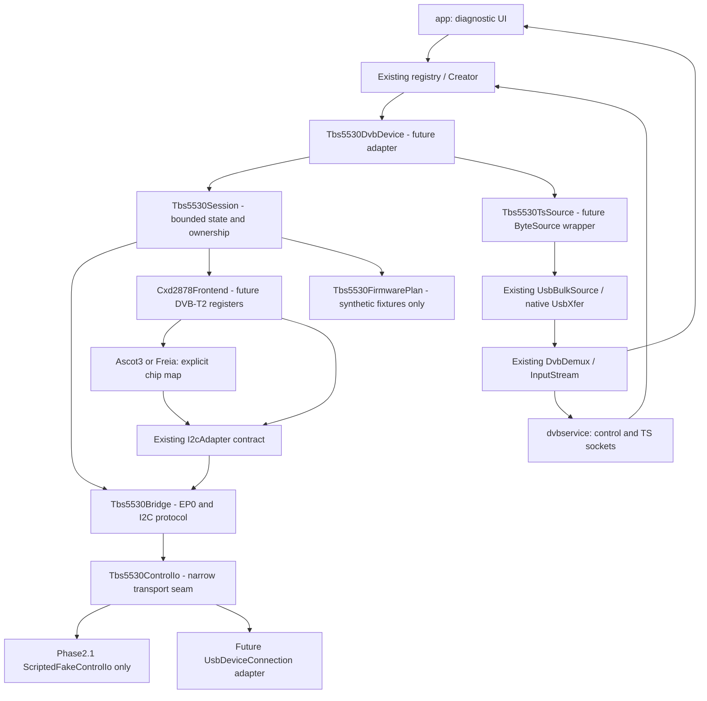

# Research log (append-only)

## 2026-11-03 10:39 +07 — Phase 2.1: hiện thực hóa protocol core, chỉ kiểm thử offline

### Mốc nguồn và loại bằng chứng

Nhánh mới `feat/tbs5530-offline-protocol` từ checkpoint sạch `8588ee7661003052b7d1a0353e23bb3a3dcef8b5`; không đổi baseline modernization hoặc ba references. TBS `2ce787de9f6e81b4294692a45de15596ae2e1322`, C `c5fa27eecbe80633cbb365cc44656daea1c0e2e3`, Go `11228b05fb1626bf41c4e1879ace10cd0a8d575c`, working tree của cả ba sạch khi kiểm lại. Không fetch/sync hoặc ghi index/config reference.

Nguồn official vẫn là [tbs5530.c](https://github.com/tbsdtv/linux_media/blob/2ce787de9f6e81b4294692a45de15596ae2e1322/drivers/media/usb/dvb-usb/tbs5530.c): `tbs5530_op_rw`, `tbs5530_i2c_transfer`, `tbs5530_load_firmware`, `tbs5530_properties`; đối chiếu [C community](https://github.com/koreapyj/cxd28xx/blob/c5fa27eecbe80633cbb365cc44656daea1c0e2e3/tbs5530.c) và [Go tbs bridge](https://github.com/Till0196/coax/blob/11228b05fb1626bf41c4e1879ace10cd0a8d575c/internal/coaxd/usb/bridge/tbs/tbs.go). Chip/PLP đối chiếu official [cxd2878.c](https://github.com/tbsdtv/linux_media/blob/2ce787de9f6e81b4294692a45de15596ae2e1322/drivers/media/dvb-frontends/cxd2878.c) `cxd2878_init`, `cxd2878_set_dvbt2`, `cxd2878_set_frontend`, cùng khác biệt C/Go đã ghi Phase2.0.

| Loại | Đã xác nhận trong phase | Không được suy ra |
|---|---|---|
| Source-grounded | EP0 types0x40/0xc0, timeout2000ms, 0x80/90/91/8a encoding, TS0x82; A0 reset/chunks64/delay100ms; official chip/PLP policy | Chip thực, giới hạn vật lý48/50, Android giữ connection sau firmware |
| Implemented |4core classes thuần Java8, không Android/JNI imports, không concrete hardware transport; mọi state/ownership qua dependency injection | Có driver hoạt động hoặc Android permission handler |
| Unit-tested |52 methods mới, exact bytes/order/error/state; tổng83 methods không failure/error; debug/lint thành công | Silicon timing, firmware thật, lock/TS hoặc native cancellation |
| Chưa có bằng chứng |Firmware provenance/license/hash/address map, warm/cold identity, reconnect, USB Host, tuner/PLP registers |Không đánh dấu PASS chỉ vì fake hoặc build thành công |

### Các component đã tạo

Cùng nằm ở `drivers/src/main/java/info/martinmarinov/drivers/usb/tbs5530/`:

- [Tbs5530ControlIo.java](../../drivers/src/main/java/info/martinmarinov/drivers/usb/tbs5530/Tbs5530ControlIo.java): interface nhận đủ control-transfer parameters; lỗi có loại SHORT_TRANSFER/TIMEOUT/IO_FAILURE/CANCELLED/SESSION_UNAVAILABLE và cause. Không implementation USB thật.
- [Tbs5530Bridge.java](../../drivers/src/main/java/info/martinmarinov/drivers/usb/tbs5530/Tbs5530Bridge.java): validate trước I/O; write48/read50 là guard phần mềm; 0x90/0x91 dùng chung session lock. Sau transfer kiểm lại generation/state để callback detach không dẫn đến request tiếp. Read chỉ copy output sau đủ length, không retry. Descriptor giả phải khớp interface0, alternate đã chọn, Bulk IN0x82; reject ambiguity. Chip map0x197→Ascot3,0x19c/0x39a→Freia, ID khác reject; manualPLP0/range0..255, không ghi frontend register.
- [Tbs5530FirmwarePlan.java](../../drivers/src/main/java/info/martinmarinov/drivers/usb/tbs5530/Tbs5530FirmwarePlan.java): SHA-256/size/ranges/overflow checks trước lập plan; start address0; không cho DATA chồng0x7f92/0xe600 dù caller thiếu reserved ranges. Mô hình stop1 ở cả hai CPU registers → chunks≤64/exact tail → restart0 → DELAY100ms, tất cả defensive copies. Không nhận file/path/firmware thật, không execute plan production.
- [Tbs5530Session.java](../../drivers/src/main/java/info/martinmarinov/drivers/usb/tbs5530/Tbs5530Session.java): phân biệt permission/connected/firmware transition/ready/faulted/uncertain/disconnected/closed. Streaming và frontend lock độc lập. Generation cũ bị bỏ qua; permission deny không I/O; failure latch chặn các lần gọi sau. Resource cleanup một lần, đúng thứ tự theo phần đã sở hữu, vẫn release/close khi cancel lỗi; không corrective writes.

Test package tương ứng có `ScriptedFakeControlIo`, `Tbs5530BridgeTest`, `Tbs5530FirmwarePlanTest`, `Tbs5530SessionTest`. Fake sao chép buffers, kiểm toàn bộ tham số và thứ tự; unexpected/missing call làm fail. Executor firmware chỉ ở test, kiểm failure tại từng bước kể cả delay, không thay uploader production. Cặp đọc concurrent được kiểm bằng thread/latches, không dùng USB.

### Làm rõ ADR-010 và giới hạn

Không đổi hướng ADR-010. ADR-011 ghi chi tiết: caller chịu tài nguyên của `connected` callback bị từ chối; permission timeout là event inject; READY cần explicit event từ phép kiểm độc lập tương lai; synchronous transfer không có cơ chế cưỡng bức hủy từ thread khác. Close thông thường cleanup ngoài monitor, nhưng phải đợi transfer đang giữ monitor kết thúc. Test worker join không chứng minh native USB cancel; adapter sau phải tuân timeout và không tự cleanup/join từ transport callback còn đang chạy.

Không thêm TS reader nên các fixture packet188bytes/partial read/drain của kế hoạch Phase2.0 **NOT RUN/hoãn**; cũng chưa test ghi lại PLP registers khi retune. Trong Phase2.1 chỉ kiểm lựa chọn endpoint, policy values và streaming khác lock. Không thay driver cũ, Retry, DeliverySystem/TCP, registry hoặc USB XML filter. Không thêm dependency hoặc nâng toolchain.

### Phase 2.2 đề xuất — chưa bắt đầu

1. Review core offline và thống nhất contract callback/cancellation/ownership của ADR-011; giữ gate83methods cùng debug/lint.
2. Chỉ khi được duyệt, thiết kế lifecycle adapter Android với fake connection/permission events; kiểm timeout, detach khi in-flight, callback cũ và exactly-once cleanup. Chưa đăng ký thiết bị hoặc có uploader mặc định.
3. Dùng instrumentation không tuner nếu cần xác minh Android callback/threading; tiêu chí hoàn thành là không gọi transport thật khi deny/stale/fault, không resource leak, không làm sai registry/XML/native smoke hiện có.
4. Tách approval firmware thật/USB writes/frontend thành bước sau: phải có license/provenance/hash/address map và kế hoạch phần cứng cụ thể. Fake PASS không mở các gate đó.

Kết quả chạy và lệnh chính xác ở [WORKLOG.md](WORKLOG.md), bảng kiểm ở [TEST-MATRIX.md](TEST-MATRIX.md). Dừng sau Phase2.1, chưa commit/push.

## 2026-11-03 00:54 +07 — Xác nhận checkout TBS phục hồi bởi người dùng

Windows PowerShell tại main repo, nhánh tài liệu `docs/tbs5530-source-architecture`, nền4cf1b64. Người dùng gửi screenshot script Apply PASS và yêu cầu kiểm lại. Đã kiểm source thực, không chỉ dựa screenshot.

- TBS `latest` / `2ce787de9f6e81b4294692a45de15596ae2e1322` không đổi. `status --porcelain=v1 -uall` không có dòng, index tồn tại (8.822.766 bytes tại kiểm tra), index.lock không có; sáu sparse paths giữ nguyên.
- Tạo expected manifest từ `ls-tree` sáu thư mục cộng cone ancestor files; so filesystem: **1.357 expected /1.357 actual,0missing/extra**. `hash-object --stdin-paths` kiểm nội dung theo Git filters/EOL: **0 hash mismatch**. Không dùng checkout sạch thay cho kiểm file thực.
- File counts sáu trees: dvb-usb100, dvb-frontends438, dvb-core11, tuners114, include/media114, include/uapi/linux/dvb8. Phần còn lại là cone ancestor files, không tải toàn kernel. Board tbs5530.c/.h, Sony cxd2878.c/.h/_priv.h, Montage m88rs6060.c và framework init/firmware source đều hiện diện.
- `config --show-origin --get core.protectNTFS` exit1/không override lưu. Backup `../logs/tbs-sparse-before-20261103-004911-951/git` tồn tại, after.json ghi PASS/1357file/đúngSHA. Không xóa backup, không khẳng định có thể build full kernel từ sáu sparse paths.
- C/Go status sạch. Không fetch, index repair hoặc config write do agent; người dùng đã phục hồi trước lượt kiểm. Theo yêu cầu dọn tạm trước đó, script session `Restore-TbsSparseCheckout-Reviewed.ps1` chỉ được xóa sau gate trên đạt; source/backup không bị dọn.

**Kết luận hiện tại:** checkout-readiness PASS trong phạm vi sparse dùng nghiên cứu; các BLOCKED index/disk trong Phase2.0 dưới đây là lịch sử đã được giải quyết. Firmware provenance/rights, silicon identity và mọi test USB thật vẫn chưa xác minh.

## 2026-11-03 — Phase 2.0: source readiness, thiết kế và kế hoạch offline

### Phạm vi, phiên bản và loại bằng chứng

Windows PowerShell, cwd `D:\API\TBS5530-DVB-Android\AndroidDvbDriver`, baseline đã push `4cf1b64e03a563f66cfb2b2051fb6f4ed05eacbe`. Main sạch trước tác vụ; tạo nhánh **`docs/tbs5530-source-architecture`** từ đúng baseline để không chỉnh nhánh modernization. Chỉ thay năm hồ sơ, không viết driver/test implementation, không build hoặc chạy phần cứng.

- **Đo trực tiếp trong phase:** Git metadata/tree/object/file existence; đọc source local tại SHA khóa, dry-run không ghi index; kiểm diff tài liệu.
- **Được source xác nhận:** những requests, thứ tự register, API/state bên dưới. Đây không phải bằng chứng silicon/timing hoặc Android USB hoạt động.
- **Đề xuất:** class boundaries, giới hạn payload, policy retry/firmware/PLP và test cases. Chưa triển khai/chạy, có thể điều chỉnh trước Phase2.1 sau review.
- **Chưa có bằng chứng:** firmware provenance/hash/quyền phân phối, chip ID của thiết bị thật, warm/cold/reconnect thực, lock và TS continuity.

| Nguồn | SHA khóa, nhánh | Trạng thái mới đo |
|---|---|---|
| Android fork trankien84/AndroidDvbDriver | `4cf1b64e03a563f66cfb2b2051fb6f4ed05eacbe`, baseline modernization | Sạch trước tạo nhánh tài liệu; toolchain không thay |
| tbsdtv/linux_media | `2ce787de9f6e81b4294692a45de15596ae2e1322`, latest | Index thiếu, 81.399 staged D, sáu thư mục tồn tại nhưng đều 0 file |
| koreapyj/cxd28xx | `c5fa27eecbe80633cbb365cc44656daea1c0e2e3`, main | Sạch, source thực có trên đĩa |
| Till0196/coax | `11228b05fb1626bf41c4e1879ace10cd0a8d575c`, main | Sạch, source thực có trên đĩa |

Mỗi câu dẫn file/hàm trong các mục TBS/C/Go dùng đúng SHA ở bảng này; links khóa commit, không dùng tên nhánh động làm chứng cứ. Không fetch/sync/index/analyze. GitNexus không có project index; AgentMemory narrow lookup không có match, source/hồ sơ local là chính.

### Source readiness mới: object nghiên cứu đủ, checkout vẫn BLOCKED

Lệnh TBS dùng `git --no-lazy-fetch`, `GIT_NO_LAZY_FETCH=1`, `GIT_OPTIONAL_LOCKS=0`; không sửa config, không dùng recovery script.

| Kiểm tra | Quan sát 2026-11-03 | Kết luận |
|---|---|---|
| HEAD/remote/branch | Đúng SHA và origin official, latest | Mốc nghiên cứu xác định |
| `.git/index`, `index.lock`, `GIT_INDEX_FILE` | Index không có, lock không có, không override index | `ls-files=0`; không phải sparse sạch |
| Status | 81.399 `D` ở index | Giữ nguyên, không stage/commit reference |
| Sparse flags/list | core.sparseCheckout=true, cone=true; đủ sáu patterns | Configuration đúng không chứng minh file được materialize |
| Sáu thư mục thực | Tất cả hiện hữu, 0 file mỗi thư mục | Checkout FAIL/BLOCKED |
| Sáu selected trees | 785 paths/785 unique blobs, **0 missing**, 15.372.887 bytes uncompressed | Đọc protocol/frontend offline được |
| Cone ancestor files | 572 paths/572 blobs, **0 missing hiện tại** | Khác lịch sử 572 missing; không biết tác nhân đã bổ sung, phase này không tải |
| Toàn cone materialize dự kiến | 1.357 paths, kiểm tên Windows cơ bản 0 unsafe | Chưa là bảo đảm checkout thực hoặc toàn filesystem semantics |
| Default read-tree dry-run | exit128 `invalid path drivers/gpu/drm/nouveau/nvkm/subdev/i2c/aux.c` | Lỗi Windows vẫn tái hiện; index/lock vẫn không được tạo |
| core.protectNTFS config query | Không có override lưu, exit1 | Không đổi bảo vệ hệ thống/repository |

**Phân biệt rõ:** `tbs5530.c/.h`, `cxd2878.c/.h/_priv.h`, `m88rs6060.c/.h/_priv.h` và framework helpers đều có trong Git tree và **blob local**, nhưng không có trên đĩa/index. Chúng không nằm ngoài sáu patterns nên không được giải thích là “sparse cố ý bỏ qua”. `aux.c` có trong full HEAD tree ngoài sparse, không materialize nhưng Git Windows vẫn validate tên khi dựng full index. Không kết luận đây chắc chắn là nguyên nhân index mất lúc clone đầu vì thiếu log gốc.

**Dependency inventory đã đối chiếu tree + cat-file:**
- Board: `drivers/media/usb/dvb-usb/tbs5530.c/.h`; blob C `a1afafb96e952f07c399d1325a774e6f37974017` (10.257 bytes), header `7197e6013437a021255c335f1e1b64c1a44c2108`.
- Sony: `drivers/media/dvb-frontends/cxd2878.c/.h/cxd2878_priv.h`; C blob `c432fe5e6b8d35b8e21a532b1d36bd4a2471ba5a` (132.388 bytes), header915db9a02612bfff40632c8bd123c868e600b03a, privde0326ee8743a294ba728b4ed003839472baf1b4. Ascot3/Freia code nằm trong C này, không giả định cần một ascot3.c riêng.
- Satellite để tra phụ thuộc tương lai: `m88rs6060.c/.h/_priv.h` local blobs có; không đưa vào scope triển khai T2 đầu.
- Framework: `dvb-usb.h`, `dvb-usb-common.h`, `dvb-usb-init.c`, `dvb-usb-firmware.c`, `usb-urb.c`; `dvb_frontend.c`, `include/media/dvb_frontend.h`, `dvb_math.h`, `include/uapi/linux/dvb/frontend.h`: tree/blob có, disk thiếu. Makefile map CONFIG_DVB_USB_TBS5530→tbs5530.o, CONFIG_DVB_CXD2878→cxd2878.o, CONFIG_DVB_M88RS6060→m88rs6060.o.
- Headers Linux trực tiếp cần diễn giải `include/linux/delay.h`, `i2c.h`, `usb.h`, `firmware.h`, `regmap.h`, `math64.h`: tree/blob local đều có, disk thiếu. Đây là inventory dependency phục vụ nghiên cứu userspace, **không** chứng nhận có toàn bộ transitive headers/build config để build kernel Linux.

### Kế hoạch phục hồi cần phê duyệt riêng — không thực thi

1. Dừng/điều phối mọi tác vụ Git khác trên reference. Khóa SHA, remote, refs, sparse rules và kiểm lại counts/blob availability; không giả định 572 ancestor vẫn thiếu hoặc sẽ luôn đủ.
2. Backup metadata `.git` và inventory working-tree hiện tại ở thư mục ngoài Git, giữ timestamp/hash/permissions và ghi index vốn không có. Backup phải private/local, không commit credentials/config. Kiểm metadata yên trước và trong backup; nếu đổi thì dừng.
3. **Phương án A — giữ NTFS, ít thay đổi:** sau phê duyệt riêng, xem xét command-scoped `-c core.protectNTFS=false` chỉ cho dựng index/working tree tại SHA khóa, cùng no-lazy-fetch và sáu cone rules không đổi. Có thể không cần tải object nữa vì 1.357 blob hiện đều local. Không lưu config, không reset/clean/reclone, không disable sparse hoặc materialize AUX ngoài patterns. Đây là phương án đề xuất, không cấp quyền gửi lệnh ngay.
4. **Phương án B — source trong filesystem ext4 của WSL2:** tạo bản tham khảo riêng tại đường dẫn ext4 được người dùng xác nhận, giữ repository NTFS nguyên trạng. ext4 xử lý AUX/case/symlink như Linux, nhưng Git Windows vẫn không phù hợp để thao tác index có tên reserved trên share WSL; phải dùng Linux Git. Cần phê duyệt riêng việc tạo bản sao, dung lượng metadata/objects và sửa workspace nếu muốn; không cài SDK trong WSL, không chuyển USB. Có thể tận dụng local objects sau khi kiểm tra closure, không hứa bundle/clone offline sẽ thành công nếu full tree còn promisor objects thiếu. Không clone toàn kernel để giải quyết một file board.
5. **Gate phục hồi:** HEAD/branch/remote không đổi; sáu rules giữ nguyên; index có; status sạch; 1.357 expected cone files (hoặc manifest phạm vi mới được duyệt) khớp tree/hash sau EOL normalization; đủ board/Sony/helper deps; không download ngoài kế hoạch/không file AUX ngoài scope.
6. **Rollback:** nếu thất bại, giữ cả trạng thái lỗi và backup, ngừng dùng checkout đó; chỉ hoàn nguyên các đường dẫn/metadata đã thay theo manifest sau review. Không đưa lệnh xóa hàng loạt, không hứa có index cũ để copy lại. Bản WSL mới nếu có sẽ được cô lập, không xóa tự động.

**Lựa chọn hiện tại:** giữ NTFS reference chỉ đọc, nghiên cứu blobs local; **research-readiness PASS có phạm vi, checkout-readiness BLOCKED**. Phê duyệt phục hồi phải là yêu cầu mới, không suy từ Phase2.0. Full kernel build/driver installation không nằm trong kế hoạch.

### Mở rộng đối chiếu protocol và firmware

Nguồn official [tbs5530.c](https://github.com/tbsdtv/linux_media/blob/2ce787de9f6e81b4294692a45de15596ae2e1322/drivers/media/usb/dvb-usb/tbs5530.c), funcs `tbs5530_op_rw`, `tbs5530_i2c_transfer`, `tbs5530_load_firmware`, `tbs5530_properties`; C cộng đồng [tbs5530.c](https://github.com/koreapyj/cxd28xx/blob/c5fa27eecbe80633cbb365cc44656daea1c0e2e3/tbs5530.c); Go [bridge/tbs5530](https://github.com/Till0196/coax/blob/11228b05fb1626bf41c4e1879ace10cd0a8d575c/internal/coaxd/usb/bridge/tbs5530/tbs5530.go) và [bridge/tbs](https://github.com/Till0196/coax/blob/11228b05fb1626bf41c4e1879ace10cd0a8d575c/internal/coaxd/usb/bridge/tbs/tbs.go).

| Chức năng | Byte/request được source xác nhận | Thiết kế an toàn đề xuất |
|---|---|---|
| EP0 control | Request type0x40 OUT/0xc0 IN, value/index tùy request, timeout2000ms | Giữ request/value/index/buffer offset/length rõ ràng, kiểm return==length; negative/short/zero là lỗi, không loop nối phần thiếu của vendor transaction |
| I2C write |0x80, value/index0, payload `[n+1,addr7<<1,data...]` |addr0..127, chỉ write flags cho phép, chưa dùng helper send/recv gắn TEN; reject bare read |
| I2C register read |0x90 OUT `[readLen,addr7<<1,register]`, sau đó0x91 IN |Một byte pointer, cùng address write/read, khóa cả cặp; nếu0x90fail không0x91 |
| Giới hạn |Official/C buffer50; Go write max62 |Khởi đầu conservative write data1..48bytes/read1..50bytes để không vượt C buffers; là policy phần mềm, không claim hardwarelimit; reject trướcIO. Liftinglimit cần source/test riêng |
| TS route |0x8a OUT `[0x0a,0]` T/C hoặc `[0x0a,1]` satellite |T2 chỉ terrestrial; không coi selector là stop/gate |
| Endpoints |EP0 cho vendor;0x82 bulk TS;0x81 generic_bulk_ctrl_endpoint config |Chọn interface ID0/alternate mô tả phù hợp, endpointaddress0x82+IN+BULK; không endpoint(0)/first-IN hoặc yêu cầu OUT0x01 |
| Firmware |0xa0, resetregs0x7f92/0xe600, stop1 → data offsets từng64 → restart0 →100ms |Chỉ planner/fake ở2.1. Binary cuối không overread; không retry upload/CPUwrite tự động sau lỗi hoặc interrupt |

Official `dvb-usb-firmware.c::usb_cypress_load_firmware` là loader generic parse hexline khác **device-specific raw contiguous image** trong `tbs5530_load_firmware`; không reuse IntelHEX parser chỉ vì đều gọiA0. TBS no_reconnect=1 và [dvb-usb-init.c](https://github.com/tbsdtv/linux_media/blob/2ce787de9f6e81b4294692a45de15596ae2e1322/drivers/media/usb/dvb-usb/dvb-usb-init.c)::dvb_usb_device_init cold branch tiếp tục khi upload trả0, không chờ enumerate; đó là assumption framework, **không đảm bảo** Android connection/permission/fd vẫn dùng được. Go board.open reload mỗiopen cũng là policy Go, không là hardware warm/cold detector.

Firmware candidate phải được caller cung cấp có source/license/hash/board-image-format/allowed-address-map đã duyệt trước khi có production upload. Go cap0xe200 là một implementation limit, không xác nhận layout mọi blob. Đặc biệt reset address0x7f92 nằm dưới cap0xe200; vì vậy cap đơn lẻ không chứng minh image không chồng control register. Phase2.1 synthetic fixtures phải có explicit allowed range/reserved addresses và reject overlap; chưa chọn real-image cap/hash khi chưa có blob được duyệt. Không bundle/download firmware, không coi tên file hoặc VID/PID là bằng chứng firmware đúng.

Lỗi giữa upload: vào **FAULTED/UNCERTAIN**, không chuyểnREADY, không tự restartCPU/reset hoặc tìm đường phục hồi hardware ngoài kế hoạch. Cleanup chỉ hủy nguồn TS/cancel workers/release interface/close host connection hợp lệ; nó không phải permission để gửi corrective vendor writes. Upload thành công vẫn cần settle/probe/identity mới, chưa tự động reload khi fd cũ chết.

### Frontend, chip dispatch, tuning và PLP: điểm mới cần giữ

Official [cxd2878.c](https://github.com/tbsdtv/linux_media/blob/2ce787de9f6e81b4294692a45de15596ae2e1322/drivers/media/dvb-frontends/cxd2878.c): `cxd2878_attach` L3997 lấy SLVT0x64/SLVX0x66, tuner0x60 theo board; `cxd2878_init` L3171 clear SLVX0x02, đợi4ms, crystal/clock, đợi2/2/21ms, tuner bridge/repeater, tuner init, TS pins; `ascot3_init` L807 đọc tuner0x7f và chọn crystal24MHz code0x18; `ascot3_tune` L560 nhận kHz; `set_frontend` L3699 chuyểnHz→kHz, gate-on/tune/gate-off/tuneEnd. Không rút ngắn sleep/tự đổi register table vì userspace nhanh hơn.

**Khác biệt chip-ID thực trong code, chưa phải kết quả phần cứng:**
- Official `cxd2878_init/set_frontend`: Ascot3 cho **0x197/CXD6802**; Freia cho **0x19c/CXD6822** và **0x39a/CXD2878A**. Các enums0x396/0x297 có trong header nhưng không tự đồng nghĩa đường tunerinit đã được board này hỗ trợ.
- C [cxd2878.h](https://github.com/koreapyj/cxd28xx/blob/c5fa27eecbe80633cbb365cc44656daea1c0e2e3/cxd2878.h) macro SONY_TUNER_IS_ASCOT3 mở thêm0x396/0x297, Freia0x19c/0x39a và Helene họ khác. Đây là mở rộng implementation, không tự chọn cho Android trước khi có fixture/hardware.
- Go `cxd2878.go::usesASCOT3` chỉ0x197, còn lại chọnFreia, trong khi `sony/chip.go::ReadChipID` nhận nhiềuID hơn. Do đó không port rule “mọi ID khác làFreia”; **unknown/out-of-scope ID phải fail closed**, chỉ bảng explicitly reviewed cho0x197/0x19c/0x39a lúc mở rộng production. Phase2.1 chỉ test classifier giả, chưa quảng cáo supportchip.

**PLP (luồng con trong một kênh DVB-T2):** official `cxd2878_set_dvbt2` L2457 và Ccommunity L3300 đều ghi bank0x23/register0xaf=`stream_id&0xff`,0xad=1 **trước** rẽ nhánh active/sleep; manual selection, không specialcase NO_STREAM_ID_FILTER. Vì vậy không gọi default0xff hay zero là auto theo chứng cứ này. Go `sony/terrestrial.go::PLPOrZero` map negative→0; `WakeupDVBT2` manual0xaf/0xad. Comment “chip has no automatic path” chỉ là claim Go, chưa chứng minh khả năng silicon.

**Khác biệt retune quan trọng:** Go `cxd2878.go::Wakeup` active cùngsystem chạy `retuneBand`; nhánhT2 chỉSetBandwidth, không cập nhậtPLP. Official ghiPLP lại mỗiset_dvbt2 kể cả cùngsystem. Thiết kế Android phải test đổiPLP cùngfrequency/bandwidth thật sự phát lệnhPLP+reacquire, không copy shortcutGo. Đây là phát hiện logic source; không gọi đã tái hiện lỗi tunerGo trênhardware.

Public Android `DvbFrontend.setParams`, `DvbDevice.tune` và `dvbservice/Request.REQ_TUNE` hiện chỉfreq/bandwidth/system; DeliverySystem ordinalDVBT,DVBT2,DVBC là wire API. **Chốt đề xuất2.1:** có giá trịPLP int0..255 ở core/internal tune config, reject -1/256; default compatibility **manualPLP0**, ghi rõ không auto/không scanmọiPLP. Chưa thêm TCP request hoặc UI PLP trong2.1; một extension API tương thích phải là nhiệm vụ sau được duyệt. Giữ bandwidth ở Hz đủ1_700_000, không `/1_000_000` truncate thành1MHz rồi suy băngtần khác. Phaseđầuưu tiên6/7/8MHz;5/1.7chỉsau bảng/fixture đượcreview.

### Tích hợp Android: lựa chọn ít thay đổi và trạng thái

Các path Android bên dưới dùng baseline4cf1b64. Kết quả Phase0 vẫn hữu ích; Phase2.0 chỉ chốt phần retry/lifecycle chưa đủ rõ.

- `drivers/.../usb/DvbUsbDeviceRegistry.java::Creator` trả **DvbDevice**, không bắt buộc subclassDvbUsbDevice. Registry construction chỉ match descriptors, không được upload/probe I2C trongconstructor/listDevices.
- `DvbUsbDevice.open/close` làfinal, tựretry power/readConfig/attach/init; tune/status cũngretry. **Hiệu chỉnh nghiên cứu cũ:** `Retry.retry(4)` thực chạy **tối đa5attempts** (mộtlầnđầu+4retry), không4attempts; I2cAdapter có10iterations. Do đó outerretry có thể lặp sideeffects và cleanupfailedopen không cófinally đầyđủ. Không sửa chung Retry/framework trongphase này.
- **Đề xuất productionadapter sau2.1:** `Tbs5530DvbDevice extends DvbDevice` để owns open/failure/close với exactly-once sideeffects; tái dùng Creator, UsbPermissionObtainer, DvbDemux, DvbFrontend/DvbTuner, ByteSource/UsbBulkSource. Đây là điều chỉnh có lý do so với đề xuấtPhase0 extendsDvbUsbDevice; không thiết kế lạiframework hoặc ép cácdriver cũ đổi lifecycle.
- `Tbs5530I2cAdapter extends I2cAdapter` dùng bridgecore khóa/singleattempt. Do baseI2cAdapter tự10iterations không phânloạilỗi, core phải latch **FAULTED sau bất kỳIO thấtbại**: lần gọi lại chỉ throw, **khôngIO tiếp**. Sau này có thể xem protectedretrypolicyhook trongtask riêng nếu cần;2.1khôngsửa baseI2cAdapter hoặc dùng retry10làm recoveryhardware.
- TS productionwrapper `Tbs5530TsSource implements ByteSource` composeUsbBulkSource, chọnrouteT2 trước queue, cancel/release theo thứtự,khôngcoialternate0làTBSgate. `DvbDevice.DataPump` startstreamtrướctune trongluồngapphiệncó, nên choqueue chờdữliệukhi bridge/frontendready màchưaLOCKED; stateSTREAMING không khẳngđịnhFE_HAS_LOCK. Retune phải ngăn oldchanneldata qua demuxreset/drain strategy đượctest.
- Close tránh giữcontrol/sessionlock khi joinDataPump đểkhôngdeadlock; cancelread trước đóngfd; cleanup từng resource trongfinally,khôngcloseconnđangđượcJNI dùng. `DvbDevice.close` hiện join khôngtimeout và nativecancel/free phụthuộclifecycle; đây là gateproduction cầntest,khôngđược fakePASS bằngloadlibrarysmoke.
- `dvbservice` giữ loopbackcontrol/TSsockets vàmediaPlaybacklifecycle; `app` giữchẩnđoán vàkhôngtunerflow, không điềukhiểnfakeUSB đểmởservice. Khôngthêm satellite enums/lệnhwire trong2.1.



State model gồm session identity/generation, frontendstate và streamflag riêng (không gộp thành enum “streaming=locked”):

| Event | State/result đề xuất | IO/retry/ownership |
|---|---|---|
| Discover/create | DETECTED | Chỉdescriptors,0USBwrites |
| open→permission | WAIT_PERMISSION | Khônglock/chờFuture trênUIthread;deny/timeout/cancel→CLOSED,0firmwareIO |
| permission→connection | HOST_OPEN | Xácnhậndescriptors/interface/EP0x82,claimkiểmreturn;khôngwarm=enumerated |
| Approved firmware process | FW_TRANSITION | Syntheticplanở2.1;productionexecutioncầnapproval/license/hash/addressmap |
| writefail/detach/unknownpostupload | FAULTED hoặc DISCONNECTED | Invalidategeneration/fd,cancelreads;0autoretry/reset/reupload |
| settle/probe success | BRIDGE_READY | Probechínhthứcchưađượctest;permission/deviceidentitymớiđượccheck |
| Sony init→tunerinit/TS pins | FRONTEND_READY | ExplicitIDmap,failclosedonunknown;gatefinally;0satelliteGPIO |
| tune(validT2) | ACQUIRING→LOCKED hoặc NO_LOCK | TimeoutkhônglàIOreplay;tune/statusbound,PLP/manual0rõràng |
| streamopen | streamActive=true độc lậpLOCKED | RouteT20x8a,queue0x82;khôngcho2frontendstreamsong song |
| close/failure | CLOSED/FAULTED | Exactly-oncecancel/release/close;khôngvendorcleanupwrites |

**Reconnect:** detachevent làm mọi callback cũ mang generationN vô hiệu; thiếtbịre-enumerate generationN+1 phảiđượcmatchVID/PID+descriptor/identityvàxinpermissionmới nếu cần. Khôngtựopen/upload từbroadcast hoặc coi samePID/path là samefirmwaresession. Bounded wait/probe dùng fakeclock; actualI2Cprobe cũnglàvendorOUTwrite nên khôngđượcthực hiệnởPhase2.0/2.1offline.

### Class/component và danh sách Phase2.1

**Phase2.1 được đề xuất là offline protocol foundation, KHÔNG hoàn tất productiondriver.** Toàn bộ core dùng plainJava8, không UsbDeviceConnection/Androidcontext/JNI để puretests; khôngCreatorregistration, khôngUSBpermissionrequest, khôngrealfirmwareexecutor. Chỉthêmabstraction cócầncho dependency injection,khôngframeworktransporttoàncục.

Basepath main: `drivers/src/main/java/info/martinmarinov/drivers/usb/tbs5530/` (chưa tạo):

| File dự kiến | Trách nhiệm và scope2.1 |
|---|---|
| `Tbs5530ControlIo.java` | Mộtmethod control(type,request,value,index,buffer,offset,length,timeout), trả count hoặc typedfailure; fake-only implementation trongtest |
| `Tbs5530Bridge.java` | Encode/validateEP0/I2C, atomicpair,returncount/errorpolicy;innerSessionState/endpointchoicevalueobject nếu đủgọn |
| `Tbs5530FirmwarePlan.java` | Purevalidatebytes+approvedpolicy/allowedranges,immutablechunkplan;khôngđọcresourceblobthật hoặc uploadAPIproduction |
| `Tbs5530Session.java` | State/generation/ownership và guardfailedsession; nested injectedclock/sleeper/lifecycleports tối thiểu chỉkhinécesstest;khôngfakephysicaldevice |

Basepath test: `drivers/src/test/java/info/martinmarinov/drivers/usb/tbs5530/` (chưa tạo):
- `ScriptedFakeControlIo.java`: scriptedreturns,copybuffertrước/sau,exactorderedcalls;unexpectedcall làmtestfailngay.
- `Tbs5530BridgeTest.java`, `Tbs5530FirmwarePlanTest.java`, `Tbs5530SessionTest.java`: cases và assertions bên dưới; fakebyte-source/lifecycle/clock nested trongtestkhi chưa cầnreuse.

Chỉnhsửa2.1: chỉcác hồ sơSTATUS/RESEARCH/DECISIONS/WORKLOG/TEST-MATRIX theo kết quả; **không cần sửa build.gradle/dependency** vìJUnit/Mockitođãsẵn. Nếu cósource khác phải sửađểtest,reviewscopetrước. Deferredproductionfiles (không2.1): `Tbs5530DvbDevice`, `Tbs5530DvbDeviceCreator`, `AndroidTbs5530ControlIo`, `Tbs5530I2cAdapter`, `Cxd2878Frontend`, `Ascot3Tuner`/`FreiaTuner`, `Tbs5530TsSource`. Registry/javaIDs/XMLfilter chỉthêm cùngđợt productionadapterđượcduyệt; devservice/app khôngđổiprotocol,usbxfer/JNI khôngsửa trongofflinefoundation.

### Offline test strategy: assertions và tiêu chí

Tất cả hàng dưới **NOT RUN / PLANNED** ởPhase2.0. Firmware fixtures được sinh từbytesgiả,khôngcopyblob/licensechưađượcduyệt. Fake khôngcallUSB/ADB/WSL/native.

| Nhóm test | Assertions bắt buộc / PASS | FAIL nếu |
|---|---|---|
| EP0 encoding |types0x40/c0,requests80/90/91/8a,expectedvalue/index/offset/length/timeouts,mảngreadcopyđúng | Sai byte/order/length,returnshort bịcoilàsuccess |
| I2Cwrite |1byte→`[2,addr<<1,data]`;bound48đúng;7bitaddr/flags;0/49/invalidaddrreject0IO | Shift2lần,bare-read/TEN bịgửi,overflowbuffer |
| I2Cread |0x90baobytesrồi0x91,lockpairkhônginterleave,read1/50bound,51/multipointer/mismatchaddrreject0IO |0x91sau0x90fail,concurrentbankreadmix,responsezero-fillcheerror |
| Controlshort/timeout/error |Count-1/0/short đưaFAULTED;giữnguyêncause/requestcontext;subsequentcall0extraIO | Autoloopresendvendorwrite,ignoredexception |
| Firmwarevalidation |Empty/wrongdigest/boardpolicy/address-overlap/overflowrejecttrướcmọiIO;fixtures1/63/64/65/128planexactchunks,tail1không64 | Assumevalidtừfilename,copyleft=firmwareright,tailoverread |
| Firmwaresequence fake |Stop1bothregs,orderedA0offsetchunks,restart0bothregs,wait100mschỉsaukếtquảđủ;errorởmỗistep→UNCERTAINkhôngauto-replay | Restart/READYsaulỗi,reuploadkhôngapproval,newcallbackdùngfdcũ |
| Endpointselection |FakeimmutabledescriptorlistpermutationsluônchọnID0/IN+BULK0x82;rejectmissing/ambiguous/wrongtype | Chọn0x81/endpointindex0/đòiOUT0x01 |
| State/generation |Permissiondeny/detach/reconnect/cancel/latecallbackkhôngwrites;readyonlysauprereqs;no-lockkhácIOerror | Callbackgenerationcũmở lại/disconnectedstreamtiếptục |
| Retries |Exactly1physicalfakecallchosideeffect;max2attemptschỉlogicalread-onlyoperationđãreviewtrướckhôngfaillatch,default0retry | CPU/I2Cwrite/TuneEndbịretry,nestedbasewrappersgửilại |
| Resourcecleanup |Injectfailởtừngacquire,assertcancel→release→closeexactlyonce;close2lầnnoextraIO;fakeworkersjoinkhôngdeadlock | fdclosedtrướccancel,leak,double-release,cleanupvendorwrites |
| Frontend policy fixtures | Bảng ID explicit0x197/0x19c/0x39a; PLP0/255 hợp lệ, -1/256 bị từ chối; đổi PLP cùng mode phải tạo yêu cầu retune mới; giữ đúng Hz/kHz và1.7MHz | Mặc định ID khác là Freia, gọi manual0 là auto, bỏ qua thay đổi PLP |
| TS/demuxfake |Synthetic188packetbịsplitởreadboundarieskhôiphụcthứtự/PIDs,stopreopenkhôngleakoldpackets;streamflagkháclock | Count-basedtestkhôngassertpayload,streamingđồngnghĩalock |

Retry read-only có nghĩa **logicaloperation không hardware mutation**; registerreadTBSthực hiện0x90OUT nêndefault **không tự retry** khi busstateuncertain. Nhómfrontend/TSfixture ở2.1 chỉvalidatepolicy/valuecontracts/fakesession,khôngdựngregistertablesCXDhoặcthưviệnMPEGparsermới. Nếu cầntestDvbDemuxthậtAndroidNativePipe, đểinstrumentation/offlinerecordedfixturephase riêng, không dùngplainJVMpasslàmchứngminh.

### Risk ranking và kế hoạch2.1 có thứ tự

| Mức ảnh hưởng | Rủi ro | Khả năng kiểm thử / xử lý |
|---|---|---|
| Critical | Firmware/reset lặp khiretry hoặcdeviceidentitysai | Exactorderedfake/failedlatchkiểmoffline;realreconnectcầnapprovalhardware |
| High | TBScheckoutindexlỗi/AUX,sourceprovenance | Tree/blobmanifestđãđo;recoveryBLOCKEDchờphêduyệt,khôngchặnplaincorevớilocalblobs |
| High | PLPmanualkhácauto,GoactiveretunebỏPLP | Goldenfixtureofficial0xaf/0xad;publicwireextensiondeferred |
| High | ChipIDdispatchconflict/unknownsilicon | Failclosedexplicitmap;hardwarechipID/tunergatechưarun |
| High | Nativecancel/fdlifetime/demuxthreaddeadlock | Fakescancheckorder;JNIstress/AndroidUSBthậtlàgateproductionchưađạt |
| High | Androidpermission/detach/re-enumeration | Generation+futuretimeoutfake;dialog/receiver/AndroidHosttestriêng |
| Medium–High | EP0/0x81/0x82confusion,bytecounts/timeouts | Permuteddescriptors/exactrequests/shortreadfaultoffline |
| Medium | Service/appstreamtrướctune,publicAPIordinal | PreserveRequest/DeliverySystem,nativewrapperstateorthogonal,existingregressiongates |
| High | Firmware provenance/giấy phép và khả năng phân phối APK | Giữ notices và kiểm giấy phép từng file; firmware hash/nguồn gốc/quyền phân phối vẫn BLOCKED |

**Thứ tự Phase2.1 đề xuất:** (1) review ADR-010 và scopeoffline; (2) khóafixture-sourceSHA/boundarycontracts; (3) viết ScriptedFakeControlIo cùngfailingtestsexactbytes; (4) implement bridge/payload+endpointselectorfakeonly; (5) firmwarevalidation/chunkplan/addresspolicy vàerrorsequencefake; (6) sessionstates/generation/cleanup/retrypolicyfake; (7) chạyfocusedJUnitnhómTBS,rồiallunitdrivers/usbxfer/dvbservicevàdebug/lintnếutouchedmain; (8) cậpnhậtmatrix/cmd/fixtures/provenancevàdừng,khôngregisterboard hoặcopenrealUSB. Khôngcầnnângtoolchain/càidependency/images,khôngcầnphục hồifullkernelđểbắtđầuofflinecore.

**Tiêu chí raPhase2.1:** mọicaseđãcamkếtcóassertionthậtvàđượcchạy;0IOngoàifake,0regressiondrivercũ,registry/XML/Requestordinalsunchanged;firmwarekhôngđượcbundlehaygửi;state/failuretestđủtrướcconsiderproductionadapter. Gatehardwarechỉmởởkếhoạchđượcthôngquariêng,khônghứaDVB-T2locktừunitPASS.

## 2026-11-02 — Migration stable mới trên JDK25 và ngoại lệ API21

**Scope approval:** người dùng13:06+07 cho nâng build/dependencies và sửa code tương thích; ask_user xác nhận giữ Android minSdk21 và references local read-only. Nhánh mới `chore/modernize-android-build`, nền SHA `e4c13a5b86ad5ef9be887df58226046dcb42dcd5`; không commit/push. Không triển khai TBS driver/hardware.

**Nguồn version truy xuất lại:**
- [Gradle releases](https://gradle.org/releases/) xác nhận9.8.2; [checksum binary-only](https://services.gradle.org/distributions/gradle-9.8.2-bin.zip.sha256) redirect downloads.gradle.org, SHA25621bd5da2de49b642904077f38c0efdc7778e92b3ed0889392dca61b97e389607. Wrapper tải và --version chạy JDK25.0.5.0.3 exit0, sau đó regenerate wrapper scripts/JAR bằng Gradle wrapper task.
- [AGP API table](https://developer.android.com/reference/tools/gradle-api) stable9.4.1; POM9.4.1 Google Maven tồn tại. [AGP9.4 compatibility](https://developer.android.com/build/releases/agp-9-4-0-release-notes): Gradle min9.6/JDK min17/API37;9.8.2+JDK25 chạy configuration/debug build thực. Không gọi AGP9.5rc là latest stable.
- Android CLI `sdk list --all` và source.properties xác nhận versions stable chọn: BuildTools37.0.0, platform37.2, CMake4.1.2, NDK30.0.16248370. [NDK downloads](https://developer.android.com/ndk/downloads), [r30 changelog](https://github.com/android/ndk/wiki/Changelog-r30) xác nhận r30/latest LTS; metadata local min21/max37. Chỉ4package mới đã khai báo được cài, không images.
- [CompileSdkSpec DSL](https://developer.android.com/reference/tools/gradle-api/9.4/com/android/build/api/dsl/CompileSdkSpec): `compileSdk { version = release(37) { minorApiLevel = 2 } }`; target37 riêng, min21 giữ. Java8 bytecode độc lập JVM25, không tăng lên25.
- [AppCompat notes](https://developer.android.com/jetpack/androidx/releases/appcompat):1.8.0 min23 → chọn1.7.1. [Material1.14](https://github.com/material-components/material-components-android/releases/tag/1.14.0) min23 → chọn [1.13.0](https://github.com/material-components/material-components-android/releases/tag/1.13.0) min21. Không dùng tools:overrideLibrary để ép runtime Android cũ.
- [AndroidX test notes](https://developer.android.com/jetpack/androidx/releases/test) stable ext-junit1.3.0/Espresso3.7.0 và core1.7.0 nâng min lên21, không phải23; chọn stable này. Metadata Maven latest có thể là alpha, đã lọc stable theo release notes.
- [Mockito metadata](https://repo.maven.apache.org/maven2/org/mockito/mockito-core/maven-metadata.xml) và javadoc latest xác nhận5.24.0. Bỏ Mockito1/mockito-all/PowerMock; giữ JUnit4.13.2 theo test framework hiện hữu, không áp JUnit Jupiter major chỉ vì latest.

**Compatibility changes đã làm:**
- AGP9 library DSL bỏ targetSdk ở defaultConfig; gỡ consumer keep-file khai báo nhưng không tồn tại, không tạo file rỗng để che lỗi. Groovy assignment đổi sang `=`; gỡ global BuildConfig/nonFinalResIds cũ (source không dùng BuildConfig/case R.id), giữ AndroidX/non-transitiveR.
- Native pin NDK30/CMake4; tăng minimum CMake3.22.1 vì CMake4 bỏ compatibility3.3.1. Không đổi logic JNI/USB hoặc bỏ ABI; Release `-O1` hiện hữu vẫn giữ (AGP release native variant thực là RelWithDebInfo, không suy ra cờ Release này có tác dụng với mọi config).
- Debug javac FAIL thật vì localbroadcastmanager không còn transitive từ dependency UI mới; thêm **direct** dependency1.1.0 (latest/retired, không event-bus refactor), build lại PASS.
- RequestTest chuyển static Log mock từ PowerMockRunner sang Mockito MockedStatic với cleanup After; openMocks/close có lifecycle; Matcher cũ đổi ArgumentMatchers.isNull cho getExternalFilesDir(null), vì Mockito mới anyString không match null.
- StackTraceSerializerTest thay newline hardcode bằng System.lineSeparator để kiểm đúng PrintWriter output trên Windows, không đổi serializer runtime. Unit run đầu13service tests có2fail; sau sửa assertion/mock **31methods tổng cả3module đều0fail**.
- `android.builder.sdkDownload=false` kiểm soát dung lượng; missing packages báo lỗi thay vì silent install. Task editor truyền env process đúng; không sửa global JAVA_HOME/SDK.

**Scope graph:** GitNexus:list_repos kiểm lại không có project index; không rebuild. Impact được kiểm source trực tiếp ở Gradle modules, native config, test mocks, registry/protocol tests. Không chạm public DeliverySystem enum/Request ordinal/USB driver logic. Không dùng tool index rỗng làm bằng chứng an toàn.

**Kiểm chứng cuối:** debug assemble PASS4nativeABIs; unit XML31methods0fail (gồm1utility); instrumentation APK compilePASS (chưa chạy trên Android). ZIP align16KiB PASS debug+release, ELF64bit LOAD0x4000 debug+release;32bitLOAD0x1000 riêng. Release/lint ban đầu lỗi filesystem Windows ở output native; ABI x86_64 riêng max-workers1 PASS, sau đó980`:app:lintDebug :app:assembleRelease :app:bundleRelease --max-workers=1` **exit0/3m54s**,286tasks. Lint XML0errors/11warnings, releaseAPK unsigned/AABđã sinh.983chốt debug/tests/instrumentationcompileexit0/36s. Không chứng minh cần max-workers1 cho mọi môi trường; đây là command đã vượt lỗi Windows quan sát, root cause lock chưa xác định. Không sửa source JNI/OS để né lock. RuntimeAndroid/16KiB/USB vẫnNOTRUN; xem TEST-MATRIX/WORKLOG.

**Lint exceptions minh bạch:**2GradleDependencywarnings cho AppCompat/Material version pin giữAPI21;9warningUI/resources ở các file không chỉnh trong migration. Không dùng baseline/abortOnError=false/suppress để bỏ errors. Original baseline chưa chạy nên không khẳng định warning đã được tái hiện trên toolchain cũ hoặc đã có lịch sử PASS.

## 2026-11-02 12:52 +07 — Kế hoạch khôi phục TBS: dry-run và giới hạn Windows

**Môi trường/mốc:** Windows PowerShell, Git2.56.0.windows.3, TBS `latest` / `2ce787de9f6e81b4294692a45de15596ae2e1322`; main `master` / `e4c13a5b86ad5ef9be887df58226046dcb42dcd5`. Chỉ dò và dry-run, **chưa khôi phục reference**. Mọi lệnh Git đọc TBS dùng `--no-lazy-fetch`, cùng `GIT_NO_LAZY_FETCH=1`, `GIT_OPTIONAL_LOCKS=0`.

**Kết quả mới:**
- Index và index.lock không có; GIT_INDEX_FILE không bị override. Status vẫn81.399 staged D; đủ6 cone paths nhưng cả6 có0 file. Không chỉ frontend bị thiếu.
- `git ls-tree -r HEAD -- <six-paths>`:785 paths/blob; `cat-file --batch-check`: **785/785 blob có sẵn**.
- Cone sparse rules còn giữ file tại root và các ancestor (`drivers`, `drivers/media`, `drivers/media/usb`, `include`, `include/uapi`, `include/uapi/linux`). Kiểm thêm572 ancestor files: **572/572 blob thiếu**. Tổng cone dự kiến1357 paths; kiểm tên thiết bị Windows/reserved names và ký tự không hợp lệ trong tập này:0 lỗi. Đây là kiểm tên cơ bản, chưa là checkout thực hay bảo đảm toàn bộ filesystem semantics.
- `git --no-lazy-fetch -C <TBS> read-tree --dry-run -m -u HEAD`: **exit128**, `invalid path 'drivers/gpu/drm/nouveau/nvkm/subdev/i2c/aux.c'`. Git kiểm đường dẫn toàn cây index dù file nằm ngoài sparse selection; AUX là tên đặc biệt trên Windows.
- `git --no-lazy-fetch -c core.protectNTFS=false -C <TBS> read-tree --dry-run -m -u HEAD`: **exit0**. `-c` chỉ áp dụng cho lệnh này; `config --show-origin --get core.protectNTFS` không có cấu hình được lưu, exit1. Index vẫn không tồn tại sau dry-run.
- **Không suy ra dry-run thành công là restore offline thành công:**572 blob ancestor thiếu sẽ cần lấy từ upstream nếu giữ nguyên cone checkout. Không tự fetch hoặc bỏ no-lazy-fetch để vượt chặn.
- FETCH_HEAD mtime khi bắt đầu lượt này là12:50:47+07 (trước các phép dò12:52); không dùng nó làm kết quả thao tác trong lượt này.

**Phân biệt:** invalid AUX path là lỗi tái hiện được của thao tác phục hồi trên Windows; việc nó đã gây mất index ở lần clone ban đầu chỉ là giả thuyết, chưa có log nguồn gốc.

### Kế hoạch đề xuất cho người dùng xem xét — chưa được thực thi

1. Người dùng xác nhận không có Git sync/checkout khác đang chạy; giữ nguyên HEAD TBS. Bảo toàn metadata hiện có vào backup ngoài repository, kèm inventory source/untracked, sparse rules, refs, config và ghi nhận index hiện không tồn tại. Không sửa hay xóa metadata gốc; backup có thể chứa URL/config riêng nên giữ local, không commit/upload.
2. **Giữ nguyên sáu cone paths và SHA.** Chuẩn bị hướng dẫn để người dùng tự khôi phục reference bằng Git command-scoped workaround, không đổi core.protectNTFS global/local. Cần đồng ý việc lấy572 blob còn thiếu từ origin tại SHA khóa; tải objects không đồng nghĩa pull/merge/update branch. Không dùng full sync script.
3. Chỉ sau backup/approval và kiểm lại tên của tập file thực materialize mới dựng index+working tree ở HEAD đã khóa. Không reset --hard/clean/reclone, không disable sparse checkout, không chạm hardware. Nếu Git đòi tải ngoài phạm vi hoặc lỗi khác thì dừng, không tự đổi chiến lược.
4. Gate sau phục hồi: HEAD/branch/remotes không đổi;6 patterns giữ nguyên; index tồn tại; status sạch; đủ1357 cone paths dự kiến và các source/dependencies bắt buộc;0 file ngoài sparse không mong muốn; hash source khớp HEAD. Không chạy build TBS kernel hoặc driver.
5. Rollback phải theo backup và từng thay đổi thực ghi nhận; không đưa lệnh xóa hàng loạt. Chưa có index cũ để đơn giản copy lại nên không hứa rollback một lệnh. Nếu cần rút lui, dừng và bảo toàn cả trạng thái sau lỗi trước khi người dùng quyết định.

**Phương án offline:** giữ reference nguyên trạng và tiếp tục nghiên cứu785 blobs có sẵn bằng git show; chưa đạt readiness checkout. Thay cone patterns để bỏ ancestor hoặc dùng export riêng là thay đổi phạm vi/workflow khác, không tự áp dụng chỉ để tránh tải.

**Quyết định người dùng:** đã chọn `prepare-user-recovery` qua ask_user: soạn bộ lệnh để **người dùng tự chạy**, có backup và lấy objects thiếu tại SHA khóa. Không phải cho phép agent thực thi phục hồi reference.

**Bộ lệnh bàn giao:** `Restore-TbsSparseCheckout-Reviewed.ps1`, lưu ngoài Git trong session artifacts; không copy script hay backup vào reference/app source. Mặc định preview chỉ đọc; `-Apply -AllowObjectDownload` yêu cầu xác nhận `KHOI-PHUC-TBS` trước backup/fetch/read-tree. Script kiểm HEAD/branch/origin/sparse rules/tree rỗng, Windows-safe materialized paths, locks và metadata yên trong3giây; sao lưu toàn bộ .git ngoài repo, fetch exact missing blob OIDs bằng `--stdin --no-write-fetch-head --no-tags --no-recurse-submodules`, không ref đích; chỉ một read-tree dùng `-c core.protectNTFS=false`. Không bypass bảo vệ cho toàn bộ config. Nếu origin không phục vụ blob OIDs, dừng, không fallback tự động.

**Validation thực:** PowerShell Parser0errors; chạy script **không tham số** trả HEAD khóa,1357 cone files,572 missing blobs; index vẫn thiếu. SHA256 script `EFC40DE33FB4C202C49FB720DD569CB65A6B234B1F0055BD8CEC270D61AD97F5` (13:01:40+07). Apply/backup/fetch/restore/post-restore checks **NOT RUN**, script chưa được kiểm end-to-end. Sau apply script chỉ PASS khi HEAD/branch/origin không đổi, status sạch, đủ file bắt buộc và tập cone, hash nội dung sau chuẩn hóa EOL/filter khớp blobs. Không tự rollback xóa dữ liệu nếu fail.

**Cảnh báo môi trường dùng chung:** FETCH_HEAD mtime tiếp tục thay đổi giữa các kiểm tra chỉ đọc (12:50:47 →12:56:56). Không xác định được tác nhân; **phải dừng Git sync/auto-fetch khác trước người dùng chạy Apply**, script sẽ từ chối nếu phát hiện metadata thay đổi khi kiểm/backup. Cửa sổ yên3giây không bảo đảm không có tác nhân khởi động sau đó. Người dùng phải phối hợp quyền truy cập, không xóa lock cưỡng bức. Không bắt đầu migration/build/hardware.

## 2026-11-02 — Khóa phiên bản nguồn trước audit Phase 0

- Windows PowerShell, cwd `D:\API\TBS5530-DVB-Android\AndroidDvbDriver`; lệnh `git -C <repo> rev-parse HEAD`, `branch --show-current`, `status --porcelain=v1 -uall`, `remote -v` (chỉ đọc; không fetch).
- Android `signalwareltd/AndroidDvbDriver`, `master`: `e4c13a5b86ad5ef9be887df58226046dcb42dcd5`; 18 file untracked ban đầu.
- TBS `tbsdtv/linux_media`, `latest`: `2ce787de9f6e81b4294692a45de15596ae2e1322`; 81.399 thay đổi hiển thị, cần chẩn đoán index trước khi coi checkout sẵn sàng. Sparse list có đủ sáu thư mục yêu cầu.
- C `koreapyj/cxd28xx`, `main`: `c5fa27eecbe80633cbb365cc44656daea1c0e2e3`; working tree sạch.
- Go `Till0196/coax`, `main`: `11228b05fb1626bf41c4e1879ace10cd0a8d575c`; working tree sạch.
- Các SHA này là mốc nghiên cứu local, không chứng minh đã đồng bộ upstream mới nhất. Không sửa repository tham khảo hoặc index.

## 2026-11-01 — TBS5530 baseline source comparison

**Question:** Which source implementations are suitable for the Android userspace port?

**Sources:**
- Official hardware reference: https://github.com/tbsdtv/linux_media/blob/latest/drivers/media/usb/dvb-usb/tbs5530.c (record exact checkout commit SHA when cloned)
- Community C Linux driver: https://github.com/koreapyj/cxd28xx/blob/main/tbs5530.c
- Community Go userspace driver: https://github.com/Till0196/coax/blob/main/internal/coaxd/usb/bridge/tbs5530/tbs5530.go
- Android destination: https://github.com/signalwareltd/AndroidDvbDriver

**Source-grounded observations:** TBS Linux version includes Cypress FX2 firmware handling, vendor control requests and tuner configuration. The C community driver derives from the official implementation and uses its own URB streaming. Go `coax` contains a userspace TBS5530 USB bridge implementation for comparison.

**Hardware evidence provided by user:** WSL2/PyUSB descriptor enumeration and claim/release succeeded; bulk IN endpoints 0x82 and 0x81 present.

**Still hypotheses / requires verification:** Whether the Go and community C initialization sequence exactly matches the user's device; whether firmware upload resets USB/IP; whether DVB-T2 lock/streaming works under Android. Do not conflate the mere presence of code with verified hardware operation.

**Next experiment:** Verify Android toolchain and baseline build. Firmware upload only under explicit, reviewed hardware test plan.

---

## Template for future research

### YYYY-MM-DD — Title
**Question:**
**Source links, commit SHA, file/function:**
**Source-grounded findings:**
**Actual hardware test evidence:**
**Assumptions/uncertainties:**
**Decision or next verification:**

## 2026-11-02 — Readiness repository và đối chiếu TBS5530 (Phase 0)

**Phạm vi:** chỉ đọc source; không biên dịch/chạy driver. Windows PowerShell tại root AndroidDvbDriver. Mọi tham chiếu trong mục này dùng SHA đã khóa ở đầu tài liệu, không dùng nhánh chuyển động làm bằng chứng.

### Git, sparse checkout và workspace

| Repository | Nhánh / SHA | Kết quả trực tiếp |
|---|---|---|
| AndroidDvbDriver | `master` / `e4c13a5b86ad5ef9be887df58226046dcb42dcd5` | 18 file untracked có sẵn trước audit; không có tracked modification ban đầu; origin đúng fork `signalwareltd/AndroidDvbDriver` |
| TBS | `latest` / `2ce787de9f6e81b4294692a45de15596ae2e1322` | **BLOCKED checkout:** `.git\index` không tồn tại, `git ls-files` = 0; `status -uall` và `diff --cached --name-status --no-renames` báo 81.399 `D` (staged deletions) |
| cxd28xx | `main` / `c5fa27eecbe80633cbb365cc44656daea1c0e2e3` | Clean, origin `koreapyj/cxd28xx` |
| coax | `main` / `11228b05fb1626bf41c4e1879ace10cd0a8d575c` | Clean, origin `Till0196/coax` |

- Lệnh `sparse-checkout list`, `config --get core.sparseCheckout`, `config --get core.sparseCheckoutCone`: đủ **6 patterns**, cả hai flag true. Sáu thư mục hiện hữu nhưng không có source cần thiết; riêng `drivers\media\dvb-frontends` có **0 file**. Có thư mục/pattern không đồng nghĩa checkout hoàn chỉnh.
- `Test-Path`, `git ls-tree HEAD -- <path>`, `git ls-files --stage -- <path>`: `tbs5530.c/.h`, `cxd2878.c/.h/_priv.h`, `m88rs6060.c/.h/_priv.h`, `dvb-usb.h`, `dvb_frontend.c`, `dvb_demux.c` **thiếu trên đĩa và index**, nhưng tồn tại trong cây HEAD.
- `git cat-file --batch-check` xác nhận các blob cần nghiên cứu có sẵn local. Ví dụ `tbs5530.c` = `a1afafb96e952f07c399d1325a774e6f37974017`, 10.257 bytes; `cxd2878.c` = `c432fe5e6b8d35b8e21a532b1d36bd4a2471ba5a`, 132.388 bytes. Đọc bằng `git show HEAD:<path>`, **không restore** file tham khảo.
- Cảnh báo `too many active changes` nếu xuất hiện phù hợp với 81.399 staged deletions, không phải bằng chứng đã sửa hàng chục nghìn source. Nguyên nhân trực tiếp có bằng chứng là index thiếu; nguyên nhân khiến index mất chưa rõ. Không tăng giới hạn VS Code để che cảnh báo, không reset/checkout/sparse-reapply khi chưa duyệt phương án bảo toàn trạng thái.
- Workspace JSON parse được; cả 4 đường dẫn tương đối resolve đúng repo. Nhãn READ-ONLY không khóa hệ điều hành. `TBS5530.code-workspace` **bị ignore bởi `.gitignore:73` (`*.code-workspace`)**, chưa được version-control. Không sửa ignore trong Phase 0.
- Sync script parse bằng `System.Management.Automation.Language.Parser.ParseFile`: **0 lỗi cú pháp**. Root suy ra đúng từ `AndroidDvbDriver\tools`; log ở parent `logs`; 6 sparse paths và required file checks đúng. Tuy nhiên `-CheckOnly` vẫn **fetch**, tạo thư mục/log; full mode còn có clone/merge/sparse set/restore. Main chỉ fetch; references kiểm tra remote/clean/upstream trước fast-forward. Nhánh dirty reference bị skip trước kiểm tra sparse. **Không chạy script, kể cả CheckOnly**, trong Phase 0.

**Giới hạn no-fetch cần bàn giao minh bạch:** không gọi `git fetch/pull/clone` tường minh. Lệnh chẩn đoán ban đầu `git diff --cached --shortstat` trên partial clone chạy quá 30 giây, đã dừng process tree; lúc đó chưa đặt `GIT_NO_LAZY_FETCH`. Sau đó quan sát `.git\FETCH_HEAD` có mtime `2026-11-02 12:23:15 +07`, nội dung vẫn SHA TBS đã khóa. Không có baseline mtime trước lệnh nên **không chứng minh được** do lazy fetch của Git hay tác nhân khác trên môi trường dùng chung; không tuyên bố tuyệt đối không có fetch ngầm. Mọi lần đọc object sau đó đặt `GIT_NO_LAZY_FETCH=1`, `GIT_OPTIONAL_LOCKS=0`; kiểm tra object trước khi dùng. Không sửa index/working tree/HEAD references. Pack mới nhất quan sát có mtime 00:04:14, trước audit; điều này không chứng minh không có trao đổi mạng.

### Nguồn chính hãng — protocol ban đầu

Repository **TBS**, SHA `2ce787de9f6e81b4294692a45de15596ae2e1322`:

- [tbs5530.c](https://github.com/tbsdtv/linux_media/blob/2ce787de9f6e81b4294692a45de15596ae2e1322/drivers/media/usb/dvb-usb/tbs5530.c): `tbs5530_op_rw` dùng control endpoint 0, request type vendor IN/OUT (`0xc0`/`0x40`), timeout 2000 ms; không phải gửi I2C qua bulk `0x81`.
- Cùng file, `tbs5530_i2c_transfer`: 2 messages (ghi một byte register rồi đọc) → request `0x90` payload `[readLength, address<<1, register]`, sau đó `0x91` đọc; 1 message → `0x80` payload `[writeLength+1, address<<1, data...]`. Lock bao trọn giao dịch. Đây là **address I2C 7-bit**, byte trên đường truyền đã shift; tránh shift hai lần.
- Hàm trên dùng buffer 50 bytes, không kiểm tra đầy đủ length/return của control calls, trả `num` cả khi truyền lỗi. Port Android phải kiểm tra số byte thực, giới hạn payload và giữ nguyên lỗi; không sao chép việc che lỗi. Không coi tên capability `I2C_FUNC_I2C` là hỗ trợ mọi kiểu giao dịch.
- `tbs5530_load_firmware`, `tbs5530_properties`: firmware `dvb-usb-id5530.fw`, `no_reconnect=1`; request `0xa0`, stop CPU tại `0x7f92`/`0xe600`, chunks `0x40`, restart, đợi 100 ms. Loop gốc luôn gửi 64 bytes kể cả cuối image; cần fixture thử image không chia hết 64, lỗi giữa chừng và short transfer. `no_reconnect` là giả định source, không phải quan sát USB/IP/Android thật.
- `tbs5530_cfg`, `tbs5530_frontend_cxd2878_attach`: demod `0x64`, tuner `0x60`, cả hai crystal 24 MHz; TS mode 1, serial-data 0, clock 1/mask 1. [cxd2878.c](https://github.com/tbsdtv/linux_media/blob/2ce787de9f6e81b4294692a45de15596ae2e1322/drivers/media/dvb-frontends/cxd2878.c): `cxd2878_attach`, `cxd2878_init`, `cxd2878_set_frontend`, `cxd2878_set_dvbt2`, `ascot3_init/tune`, `freia_init/tune`, `cxd2878_read_status`; local dependencies `cxd2878.h`, `cxd2878_priv.h`, media DVB/I2C APIs. Ascot3/Freia chọn theo chip ID; **không xác nhận tuner silicon chỉ từ tên board**.
- `tbs5530_frontend_m88rs6060_attach`: Montage demod `0x69`, tuner `0x2c`, clock 27 MHz, `i2c_wr_max=33`, common TS; board GPIO `0xb7 [0,0]`, `0x8a [8,1]`. [m88rs6060.c](https://github.com/tbsdtv/linux_media/blob/2ce787de9f6e81b4294692a45de15596ae2e1322/drivers/media/dvb-frontends/m88rs6060.c) phụ thuộc `_priv.h`, `.h` và có `request_firmware`. Chỉ khảo sát để chừa extension; không khởi tạo phần satellite trong thiết kế DVB-T2-first trước khi có bằng chứng cần thiết.
- `tbs5530_ter_cable_streaming_ctrl` → `0x8a [0x0a,0]`, satellite → `[0x0a,1]`; không dùng `onoff` để gate stream. `tbs5530_properties`: một adapter, hai frontends dùng **chung TS bulk `0x82`**, 8 URB × 4096 bytes; `generic_bulk_ctrl_endpoint=0x81` là trường cấu hình khác, không phải TS. Không thiết kế stream T2 và satellite đồng thời.

### Đối chiếu cộng đồng C

Repository **cxd28xx**, SHA `c5fa27eecbe80633cbb365cc44656daea1c0e2e3`:

- [tbs5530.c](https://github.com/koreapyj/cxd28xx/blob/c5fa27eecbe80633cbb365cc44656daea1c0e2e3/tbs5530.c): `tbs5530_op_rw`, `tbs5530_i2c_transfer`, `tbs5530_load_firmware` giữ hình dạng requests/firmware gốc; vẫn có các giới hạn xử lý length/error tương tự, không mặc định là bản đã sửa mọi lỗi.
- `tbs5530_probe`, `tbs5530_dvb_init` tự đăng ký I2C/DVB; `tbs5530_start_feed/stop_feed`, `tbs5530_start_streaming`, `tbs5530_urb_complete` thay framework dvb-usb bằng URB riêng, feed counter, `active_fe`, resubmit/error counters và `dvb_dmx_swfilter`. [tbs5530.h](https://github.com/koreapyj/cxd28xx/blob/c5fa27eecbe80633cbb365cc44656daea1c0e2e3/tbs5530.h): 8 URB × **65536 bytes**, khác official 4096. Đây là thay đổi buffering/ownership, **chưa chứng minh** nhanh hoặc đúng hơn trên Android.
- `tbs5530_fe_ter_init/sat_init` chọn `active_fe=0/1`; start streaming vẫn route chung `0x82` bằng `0x8a`. ALP/ATSC3 có riêng callback, sysfs stats và parser; ngoài phạm vi DVB-T2/MPEG-TS phase đầu.
- [cxd2878.c](https://github.com/koreapyj/cxd28xx/blob/c5fa27eecbe80633cbb365cc44656daea1c0e2e3/cxd2878.c): `cxd2878_set_frontend` gọi init khi chưa warm, chọn DVB-T2, mở I2C repeater để tune Ascot3/Freia theo chip ID, đổi Hz→kHz, tắt repeater rồi tuneEnd. `cxd2878_set_dvbt2`/`read_status` là vị trí đối chiếu PLP, bandwidth và lock. Không import ALP/network kernel vào Android chỉ để hỗ trợ DVB-T2.

### Đối chiếu Go userspace

Repository **coax**, SHA `11228b05fb1626bf41c4e1879ace10cd0a8d575c`:

- [bridge/tbs/tbs.go](https://github.com/Till0196/coax/blob/11228b05fb1626bf41c4e1879ace10cd0a8d575c/internal/coaxd/usb/bridge/tbs/tbs.go): `ControlWrite/Read` kiểm tra đủ byte; `LoadFirmware` kiểm tra size `1..0xe200`, chunk cuối `min(offset+64,len)`, kiểm tra lỗi; `Write` có max payload 62. Các giới hạn này là quyết định implementation Go, chưa phải giới hạn phần cứng được đo.
- [bridge/tbs5530/tbs5530.go](https://github.com/Till0196/coax/blob/11228b05fb1626bf41c4e1879ace10cd0a8d575c/internal/coaxd/usb/bridge/tbs5530/tbs5530.go): `Read` từ chối bare read (không suy diễn request `0x93` của board khác); `WriteRead` yêu cầu đúng một byte register; `SelectStreamSource` giữ selector official; `InitializeSatellite` tách GPIO riêng. Chưa thấy kiểm tra readLength tương đương giới hạn 50 của C trong hàm `WriteRead`, nên không copy mù.
- [board/tbs5530/tbs5530.go](https://github.com/Till0196/coax/blob/11228b05fb1626bf41c4e1879ace10cd0a8d575c/internal/coaxd/usb/board/tbs5530/tbs5530.go): `Layout` báo một tuner logic; `open` tải firmware mỗi lần mở và khởi tạo cả Sony/Montage; `Tune`, `StartStream/StopStream`, `Read` tách frontend và transport; `boardkit` tuần tự Tune/Status, bulk read chạy song song. Đây là mẫu userspace, **không** là yêu cầu Android phải luôn init Montage.
- [demod/cxd2878/cxd2878.go](https://github.com/Till0196/coax/blob/11228b05fb1626bf41c4e1879ace10cd0a8d575c/internal/coaxd/demod/cxd2878/cxd2878.go): `Initialize` đọc chip ID, `usesASCOT3` chọn CXD6802, còn lại Freia; `Wakeup` tách system/PLP/bandwidth khỏi `Tune(frequencyKHz)`. Không dùng comment “embedded tuner” để kết luận chip thực của thiết bị người dùng.
- [pkg/usbio/usbio.go](https://github.com/Till0196/coax/blob/11228b05fb1626bf41c4e1879ace10cd0a8d575c/pkg/usbio/usbio.go): `Transport.Control`, `BulkReader.Start/Read/Stop`, `ReaderOf`; ring 16 × 64 KiB, giữ carry/pending khi caller buffer nhỏ, fallback bulk đồng bộ. Backend userspace riêng theo OS, **không phải libusb-only**. Android nên dùng UsbDeviceConnection fd/native có sẵn thay vì import whole Go runtime hoặc đòi `/dev/dvb`.

### Đề xuất kiến trúc và cổng kiểm chứng

**Đề xuất, chưa triển khai:** một TBS5530 device trong registry Android → bridge transport vendor EP0 + khóa I2C bao cả write/read → Sony CXD2878 frontend và tuner theo chip ID → chọn TS terrestrial → bulk `0x82` → demux/service hiện hữu. Tách firmware provider khỏi protocol để kiểm tra giấy phép và inject test double; không đóng gói firmware lúc này.

Thứ tự: baseline build riêng → mocked control/I2C/short transfers/firmware chunks → frontend state/PLP/bandwidth/unit Hz-kHz → TS route/cancel/reopen/continuity bằng fixtures → kế hoạch phần cứng được duyệt → Android USB Host vật lý → firmware → I2C/chip ID → DVB-T2 lock → TS continuity. Chỉ báo DVB-T2 hỗ trợ sau thực nghiệm; DVB-C và S/S2/S2X/ATSC3 chưa có cam kết.

**Giấy phép:** official bridge có thông báo GPLv2; community `.c/.h` ghi GPL-2.0-only; Go bridge/board cũng GPL-2.0-only, các file khác có thể khác theo `NOTICE`/SPDX. Phải giữ thông báo từng file và kiểm tra kết hợp toàn ứng dụng; không coi mọi code trong coax là Apache chỉ vì có LICENSE-APACHE. Firmware source, hash, quyền phân phối/APK chưa kiểm chứng; không tải/đóng gói blob.

**Hardware:** phiên này chỉ đọc `usbipd list`; TBS đang Shared, không Attached. Không dùng `lsusb`/PyUSB claim lại. Endpoint 0x81/0x82, 512 bytes/interface claim là lịch sử người dùng; mọi hành vi firmware, I2C, chip ID, lock, TS thật **NOT RUN**.

## 2026-11-02 — Build audit và kế hoạch hiện đại hóa (chưa thực hiện)

**Bằng chứng:** source Android HEAD `e4c13a5b86ad5ef9be887df58226046dcb42dcd5`; đọc local bằng file tools, nghiên cứu nguồn web chính thức qua web_fetch/web_search. Không chạy Gradle task, wrapper --version, migration hoặc dependency resolution. Các phiên bản cài thực tế và lỗi environment nằm ở [ENVIRONMENT.md](ENVIRONMENT.md).

### Baseline thực tế (khác ghi chép lịch sử)

| Thành phần / vị trí | Kết quả |
|---|---|
| `build.gradle`, plugin application/library | AGP **8.5.2** |
| `gradle/wrapper/gradle-wrapper.properties` | Gradle **8.7**; chưa có distributionSha256Sum |
| `app`, `drivers`, `dvbservice`, `usbxfer` build.gradle | **compileSdk 34, targetSdk 36, minSdk 21**, source/target Java **1.8** |
| `settings.gradle` | 4 modules; Google/Maven Central/Plugin Portal; không JCenter trong cấu hình này |
| `gradle.properties` | Xmx 2048m; AndroidX/non-transitive R; BuildConfig global và resource IDs final |
| `.idea/gradle.xml` | `#GRADLE_LOCAL_JAVA_HOME`: IDE có thể chọn JVM khác PowerShell |
| `usbxfer/build.gradle`, CMakeLists.txt | Có native build; không pin NDK/CMake/ABI; minimum CMake 3.3.1, shared `UsbXfer`, log/OpenSLES; Release cố ý `-O1` do ghi chú deadlock Samsung |
| Ba library consumerProguardFiles | Khai báo `consumer-rules.pro` nhưng file thiếu: vấn đề cần đánh giá trước AGP 9, chưa sửa trong Phase 0 |
| Dependency chung | AppCompat 1.5.1, Material 1.7.0, JUnit 4.13.2, AndroidX test-ext 1.1.3, Espresso 3.4.0 |
| Test mocks | Mockito/mockito-all 1.10.19, PowerMock 1.6.5; reflection trên JDK mới là rủi ro, chưa tái hiện lỗi |
| Test inventory | 31 phương thức @Test local/10 lớp, gồm một tiện ích chuyển chuỗi; 1 instrumentation test `DeviceFilterXmlEquivalenceTester` so registry với XML; không thấy test source app |

**Hai blocker riêng biệt:** `JAVA_HOME` không tồn tại dù PATH java chạy được; và Gradle 8.7 không hỗ trợ JDK 25. SDK 36/platform và NDK mặc định AGP 8.5 chưa được cài theo inventory hiện tại; không giả định NDK 28 sẽ tự được chọn vì đã có trên đĩa. compile 34/target 36 cần đánh giá ở baseline, không tuyên bố chắc chắn build FAIL chỉ từ cấu hình và không hạ target để né kiểm chứng.

### Nguồn chính thức truy xuất ngày 2026-11-02

- [Gradle releases](https://gradle.org/releases/): bản đầu danh sách **9.8.2**, ngày **2026-10-19**; nhánh 8.x có 8.14.6. Kết quả tìm kiếm tóm tắt nói 9.6.0 không khớp trang trực tiếp; ưu tiên trang trực tiếp.
- [AGP API reference](https://developer.android.com/reference/tools/gradle-api), trang ghi cập nhật 2026-10-28: bản không hậu tố cao nhất **9.4.1**. [Landing AGP](https://developer.android.com/build/releases/gradle-plugin) redirect 9.5 nhưng [nội dung 9.5](https://developer.android.com/build/releases/agp-9-5-0-release-notes) chỉ xác nhận tới **9.5.0-rc02**. Không gọi 9.5 stable; nguồn chưa hoàn toàn đồng bộ, cần kiểm lại trước migration.
- [Gradle current compatibility](https://docs.gradle.org/current/userguide/compatibility.html): JDK 25 chạy Gradle từ **9.1.0**. [Gradle 8.7 compatibility](https://docs.gradle.org/8.7/userguide/compatibility.html): JVM chạy 8–21; cộng yêu cầu AGP 8.5 thì chọn JDK **17** để lấy baseline. Java source/target 1.8 độc lập với JVM chạy build: không tạo bytecode Java 25 cho Android.

| AGP (release notes chính thức) | Gradle minimum/default | JDK minimum/default | API tối đa | NDK default |
|---|---|---|---|---|
| [8.5.x](https://developer.android.com/build/releases/agp-8-5-0-release-notes) | 8.7 | 17 | 34 | 26.1.10909125 |
| [8.10.x](https://developer.android.com/build/releases/agp-8-10-0-release-notes) | 8.11.1 | 17 | 36 | 27.0.12077973 |
| [8.13.x](https://developer.android.com/build/releases/agp-8-13-0-release-notes) | 8.13 | 17 | 36.1 | 27.0.12077973 |
| [9.0.x](https://developer.android.com/build/releases/agp-9-0-0-release-notes) | 9.1.0 | 17 | 36.1 | 28.2.13676358 |
| [9.4.x](https://developer.android.com/build/releases/agp-9-4-0-release-notes) | 9.6.0 | 17 | 37 | 28.2.13676358 |

JDK minimum 17 **không** có nghĩa mọi JDK lớn hơn đều tương thích. Cặp AGP/Gradle mới nhất được ghi để tham khảo, không phải quyết định tự nâng. Nguồn thay đổi theo thời gian; API 37.0 package local không tự chứng minh AGP cũ hỗ trợ API 37.

### Lộ trình đề xuất, mỗi mốc cần phê duyệt và kiểm chứng

1. Chốt baseline nguyên trạng trước: nhánh mới chỉ khi được duyệt; chọn JDK 17 có thật, SDK `D:\Android\Sdk` trong **process riêng**, không sửa global. Kiểm tra cache wrapper/SDK trước mọi lệnh: `--offline` không chặn wrapper tự tải distribution hay AGP tự cài SDK. Thiếu JDK/package thì báo BLOCKED và xin phạm vi cài, không tự cài.
2. Sau baseline: cặp AGP 8.10.1/Gradle 8.11.1 + compileSdk 36, giữ target 36/min 21/Java 8. Platform 36 hiện thiếu: xin duyệt package tối thiểu, không chọn API 37 chỉ vì có sẵn.
3. Native riêng: pin NDK r28c `28.2.13676358` và CMake `3.22.1` đã xác minh; giữ `-O1`, protocol và ABI hiện hữu. Kiểm tra arm64-v8a, armeabi-v7a, x86/x86_64 theo output thực; không tự bỏ ABI.
4. Chuẩn bị AGP 9 trên 8.x: keep-files thiếu, BuildConfig module DSL thay flag global khi cần, resource-ID flags, library targetSdk DSL. Chỉ thay mock dependencies khi có failure tái hiện; không gộp nâng UI dependencies với toolchain.
5. Mốc 8.13.2/Gradle 8.13 → 9.0.1/9.1.0, giữ JDK 17 để tách biến. Sau khi xanh mới thử JDK 25 trong bước riêng; tiếp đó cân nhắc 9.4.1/9.6.0 và Gradle 9.8.2 riêng. Không bắt buộc nâng mọi mốc nếu không giải quyết nhu cầu đã xác định.

**Breaking changes/rủi ro:** [AGP 9 notes](https://developer.android.com/build/releases/agp-9-0-0-release-notes) đổi DSL/variant API, built-in Kotlin, missing keep-files, tested build types, R và compileSdk library; [Gradle 9 migration](https://docs.gradle.org/current/userguide/upgrading_major_version_9.html) đổi Groovy/test discovery. Project hiện Java nhưng vẫn phải kiểm tra plugins. Target 36 đã có: [Android 16 behavior changes](https://developer.android.com/about/versions/16/behavior-changes-16) đòi UI/back/edge-to-edge regression; service mediaPlayback manifest chưa chứng minh lifecycle đúng.

**Native 16 KiB:** [Android page sizes](https://developer.android.com/guide/practices/page-sizes): AGP ≥8.5.1 xử lý ZIP alignment `.so` không nén; NDK r28+ mặc định ELF alignment 16 KiB. Baseline 8.5.2 vượt ngưỡng AGP nhưng **chưa có APK kiểm chứng**. Source không có giả định PAGE_SIZE rõ ràng không đủ chứng minh runtime PASS. Trang nhận được ghi hạn Play 2027-02-01 cho target ≥35/64-bit; vì chính sách có thể đổi, không dùng mốc lịch này thay tiêu chí kiểm thử. [ABI guide](https://developer.android.com/ndk/guides/abis), [JDK guide](https://developer.android.com/build/jdks), [NDK/CMake selection](https://developer.android.com/studio/projects/install-ndk).

### Tiêu chí baseline và lệnh tương lai — tất cả NOT RUN

- Chạy wrapper ở JDK hợp lệ đã duyệt; build original checkout không sửa driver; lưu warning/error, versions và dependencies đã resolve. Không chạy `clean` để xóa output ngoài nhu cầu.
- Thứ tự kiểm chứng nhỏ nhất: wrapper/configuration → unit tests ba library → debug assemble/lint → native ABI/load → instrumentation registry/XML → release/bundle và kiểm tra alignment. Bộ unit tests xanh, APK tồn tại/kiểm được nội dung, native `.so` load được trên target được chọn, không regressing driver cũ mới đủ baseline; UI/emulator không chứng minh tuner thật.

```powershell
.\gradlew.bat --version
.\gradlew.bat help --warning-mode all --console plain --no-daemon
.\gradlew.bat :usbxfer:testDebugUnitTest :drivers:testDebugUnitTest :dvbservice:testDebugUnitTest --stacktrace --console plain
.\gradlew.bat :app:assembleDebug :app:lintDebug --stacktrace --console plain
.\gradlew.bat :app:assembleRelease :app:bundleRelease --stacktrace --console plain
.\gradlew.bat :app:dependencies --configuration debugRuntimeClasspath --console plain
.\gradlew.bat :dvbservice:connectedDebugAndroidTest "-Pandroid.testInstrumentationRunnerArguments.class=info.martinmarinov.dvbservice.DeviceFilterXmlEquivalenceTester"
```

Instrumentation chỉ khi có serial Android được chọn rõ ràng và được phép chạy. Kiểm ZIP bằng SDK `build-tools\36.0.0\zipalign.exe -v -c -P 16 4 <apk>`; giải nén APK trong thư mục kiểm chứng riêng, dùng NDK `llvm-objdump.exe -p` từng `.so`, yêu cầu LOAD alignment ≥2**14; runtime 16 KiB kiểm `adb -s <serial> shell getconf PAGE_SIZE` và native-load smoke. Đường dẫn đúng ADB là `D:\Android\Sdk\platform-tools\adb.exe`. Không chạy các lệnh tương lai ở Phase 0.

**Rollback:** lưu baseline và mỗi mốc thành commit riêng chỉ sau khi được cho phép; khi lỗi, dừng ở mốc trước, dùng `git revert <migration-commit>` theo phạm vi được duyệt, hoàn nguyên JVM process, chạy lại cùng tests. Không reset --hard/clean, không xóa SDK hoặc untracked tài liệu có sẵn. Build-system modernization phải xong trước mã TBS5530.

## 2026-11-02 — Kiến trúc AndroidDvbDriver và extension points đã đọc trực tiếp

**Nguồn:** toàn bộ vị trí dưới đây thuộc `signalwareltd/AndroidDvbDriver`, SHA **`e4c13a5b86ad5ef9be887df58226046dcb42dcd5`**, Windows PowerShell/editor tools. [Cây source khóa SHA](https://github.com/signalwareltd/AndroidDvbDriver/tree/e4c13a5b86ad5ef9be887df58226046dcb42dcd5). GitNexus không có index; semantic_search không có kết quả, chuyển glob/grep/view đọc source. Agent explore được giao khảo sát thất bại `400 The requested model is not supported`, không có report; parent tự hoàn tất trace, không tái giao cùng mục tiêu. Không sửa/chạy code.

### Bốn module và luồng thực thi

| Module | File/hàm và vai trò |
|---|---|
| `app` | `src/main/java/info/martinmarinov/dvbdriver/DeviceController.java`, `run/tuneTo`: giao diện chẩn đoán chọn device đầu tiên, open → lấy stream → tune/status, `DataHandler` xử lý dữ liệu/đo; không phải tầng protocol USB riêng |
| `drivers` | `.../drivers/usb/DvbUsbDeviceRegistry.java`, `AVAILABLE_DRIVERS/getUsbDvbDevices/getDvbUsbDeviceFor`: enumerate `UsbManager.getDeviceList`, so DeviceFilter, gọi Creator. Hiện chỉ RTL28xx/CxUsb/AF9035, chưa có TBS5530 |
| `drivers` | `.../drivers/DvbDevice.java`, `tune/getTransportStream/DataPump.run`: tune reset demux; một data pump đọc ByteSource, đưa vào DvbDemux, trả InputStream; interrupt/close dừng worker |
| `usbxfer` | `.../usbxfer/UsbBulkSource.java`, `open/readNext/close`: claim interface, set alternate, queue native bulk, consume vào ByteSink, backoff khi chưa có dữ liệu, stop/release khi đóng |
| `dvbservice` | `.../dvbservice/UsbDelegate.java`, `onCreate`: chuyển USB attach intent; `DeviceChooserActivity` chọn device. `DvbService.onStartCommand`: worker mở device, bind loopback, foreground mediaPlayback, serve và close |
| `dvbservice` | `DvbServer.bind/open/serve`: **hai TCP socket riêng** control/TS, cổng cấp động. `Request.parseAndExecute` điều khiển tune/status/PIDs/capabilities; `TransferThread.run` đọc InputStream, gửi TS qua socket, buffer 5×188 bytes |

Không cần driver kernel DVB hoặc root chỉ để tái sử dụng API này: `UsbPermissionObtainer.obtainFdFor` dùng `UsbManager.hasPermission/requestPermission/openDevice`, trả Future<UsbDeviceConnection>. File `.../drivers/tools/UsbPermissionObtainer.java` có nhánh PendingIntent/receiver theo Android API; phải regression permission denied/detach/reopen trên target mới, không suy ra đúng từ manifest. Android USB Host chính thức đã đọc qua `android docs search/fetch`, nguồn [USB Host](https://developer.android.com/develop/connectivity/usb/host): chọn interface/endpoint và xin quyền trước truyền. Firmware write chưa được phép chỉ vì mở permission thành công.

### Hợp đồng driver có thể tái sử dụng

- `.../drivers/usb/DvbUsbDevice.java:60`, interface **Creator**: `create`, `getSupportedDevices`. Thêm Creator TBS trong **AVAILABLE_DRIVERS** (`DvbUsbDeviceRegistry.java:41`), DeviceFilter VID:PID734c:5530 và đồng bộ `dvbservice/src/main/res/xml/device_filter.xml`; instrumentation `DeviceFilterXmlEquivalenceTester` bảo vệ tương đương registry/XML. Tìm trong Java/XML hiện không có TBS/VID/PID này.
- `DvbUsbDevice.open` (`:102`, final): obtain connection → `getUsbInterface()` → retry tối đa 4 vòng `powerControl(true)`, `readConfig`, `frontendAttatch/attach`, `getCapabilities`, `tunerAttatch/attatch`, `frontend.init(tuner)`, `init`. Tên `Attatch/attatch` là API hiện có, không đổi spelling ngoài phạm vi.
- Hooks (`DvbUsbDevice.java:249` trở đi): powerControl, readConfig, frontendAttatch, tunerAttatch, init, getUsbInterface, getUsbEndpoint. **Đề xuất TBS extends DvbUsbDevice trực tiếp**: firmware/bridge readiness ở readConfig có state/error rõ; frontend/tuner Sony tách theo contracts. Không nhét vendor A0 vào generic bulk wrapper.
- `DvbUsbDevice.createTsSource` (`:243`) trả UsbBulkSource, có thể override/wrap để route TBS trước stream và quản lý stop; base không có hook `streaming_ctrl` riêng kiểu Linux. `getNumRequests=40`, `getNumPacketsPerRequest=10` là mặc định có thể override. `Af9035DvbDevice.java:967/972` đã override 87 packets ×10 requests. Không copy buffer size từ Linux mà không đo throughput/loss/cancel trên Android.
- `.../drivers/tools/I2cAdapter.java:60`, `transfer` khóa **toàn bộ message array**, retry tối đa10; implement `masterXfer` map đúng một write hoặc write-pointer/read TBS. `I2GateControl.runInOpenGate` có finally đóng gate, dùng cho tuner repeater. `send/recv` hiện gắn I2C_M_TEN; không dùng mù cho TBS7-bit, validate flags/address/length và throw lỗi thật. Lock USB riêng phải tránh interleave cặp90/91 với bank/selector/firmware writes.
- `DvbFrontend.java:32`: `attach/init/release/setParams/readSnr/readRfStrengthPercentage/readBer/getStatus/setPids/disablePidFilter`; `DvbTuner.java:26`: `attatch/init/setParams/getIfFrequency/...`. Có thể cài frontend CXD2878 và tuner Ascot3/Freia theo chip-ID; không mở rộng mọi frontend cũ chỉ để thêm board.

### USB control và native bulk: phân biệt quan trọng

- `.../usb/rtl28xx/Rtl28xxDvbDevice.java:80`, `controlTransfer/ctrlMsg` là **mẫu cách gọi Android controlTransfer/locking**, không phải protocol TBS: RTL request=0, value/index semantics riêng, TS endpoint0x81. Helper có nhánh dùng buffer.length thay length; **không tái sử dụng nguyên xi** cho firmware chunk/offset TBS; tạo transport TBS kiểm request/value/index/length/short transfer cụ thể trong phase được duyệt, không sửa RTL ở audit.
- `.../usb/generic/AbstractGenericDvbUsbDevice.java:22`, `dvb_usb_generic_rw` là **bulk control IN/OUT**, không phải EP0 controlTransfer dù tên có “control”. `CxUsbDvbDevice` (`:97` constructor) đòi endpoints0x81 IN,0x01 OUT,0x82 TS theo vị trí cố định. TBS lịch sử chỉ thấy IN0x81/0x82, official dùng EP0: **không kế thừa CxUsb transport** hoặc giả định có OUT0x01.
- TBS `getUsbEndpoint` phải tìm theo **address0x82 + BULK + IN** ở interface0/alternate đã xác nhận, không lấy endpoint(0) hay “IN đầu tiên”. Không đổi TS sang0x81 chỉ vì có descriptor.
- `UsbHiSpeedBulk.java:44` load `libUsbXfer`; constructor lấy **UsbDeviceConnection.getFileDescriptor**, packetSize từ endpoint. Platform support false nếu load native thất bại; DvbUsbDevice constructor từ chối unsupported platform, nên native ABI cần test trước board.
- `UsbBulkSource.open`: setInterface → claimInterface(force=true) → start; `UsbHiSpeedBulk.start/read/stop` một thread, queue/resubmit/cancel. Dữ liệu Buffer tái sử dụng, phải consume/copy trước read kế tiếp. Base queue mặc định 40×(10×maxPacketSize); nếu maxPacket512 như lịch sử thì mỗi request5120 bytes, không phải Linux4096.
- `usbxfer/src/main/cpp/isorequest.c:20`, JNI allocate/reset/submit/cancel/read/reap dùng `USBDEVFS_URB_TYPE_BULK`, SUBMITURB/DISCARDURB/REAPURB(NDELAY), dù Java class tên IsoRequest. `usbhispdbulk.c:10` dùng USBDEVFS_SETINTERFACE. Không cần port URB kernel driver vào app, nhưng phải test ioctl trên fd Android được cấp quyền, ABI pointer/lifecycle, cancel/reap/disconnect và return/error propagation.
- `UsbHiSpeedBulk.unsetInterface` đặt alternate0 với comment “stops streaming”; **không được coi alternate0 gate được TBS**. Official selector không gate; phải ngừng queue/cancel đúng lifecycle và quyết định routing trước đọc. `IsoRequest` hiện free native từ finalize; cần theo dõi lifetime/reopen/stress, không refactor/fix trong audit.

### Firmware, Sony frontend và MPEG-TS

- Firmware pattern `Af9035DvbDevice.readFirmware/readConfig/download_firmware` (`:368/:389`), `Si2168.readFirmware/init`, `Mn8847X.loadFirmware`: đọc raw resources, warm/cold và kiểm lỗi. Đây là mẫu orchestration/Resources/exception, **không** là FX2 loader. Chưa có abstraction firmware provider chung hoặc TBS FX2 trong phạm vi source đã khảo sát.
- Driver **mẫu frontend gần nhất là Cxd2841er** (`drivers/.../usb/rtl28xx/Cxd2841er.java:56`): Sony bank/register, SHUTDOWN/SLEEP/ACTIVE, DVB-T2 bandwidth/status/TS clock. Nhưng constructor/field phụ thuộc **Rtl28xxI2cAdapter**, chip list chỉ CXD2837/2841/2843/2854; **không phải CXD2878 và không thể chỉ thêm chip ID**. Dùng làm mẫu style/state/contracts, đối chiếu register với official CXD2878; không refactor toàn họ Sony trong Phase0.
- `CxUsb/MygicaT230C` là mẫu ghép DVB-T2 frontend+tuner (`frontendAttatch`: Si2168, `tunerAttatch`: Si2157; 0x64/0x60), **không** tương đương silicon/protocol TBS. `Af9035` là mẫu firmware và queue tuning, `Rtl28xx` mẫu EP0; không có một driver duy nhất khớp toàn board.
- `DvbDemux.java:50`, `DvbDmxSwfilter/consume/swfilterPacket`: resync0x47, gom partial packet qua nhiều reads, software PID filtering, NativePipe, đầu ra188 bytes. `getDroppedUsbFps`/continuity/TEI counters hỗ trợ đo nhưng không thay capture thật; lựa chọn filter/full stream phải được cấu hình để tránh hiểu nhầm zero bytes là firmware hỏng.
- Luồng TS: native0x82 → UsbBulkSource.readNext → DvbDevice.DataPump → DvbDemux/NativePipe/InputStream → app DataHandler **hoặc** service TransferThread/TCP. Không phải MPEG decoder và không cần ATSC3 ALP parser cho DVB-T2.

### Giới hạn API và rủi ro cần kiểm chứng ở phase sau

1. `DeliverySystem.java:23`: chỉ **DVBT,DVBT2,DVBC**, ordinal là giao thức TCP; Request.REQ_TUNE giải ordinal, REQ_GET_CAPABILITIES mã hóa bitset. DVB-S/S2/S2X cần mở rộng protocol tương thích về sau, không thể chỉ cài Montage driver rồi quảng cáo hỗ trợ.
2. `DvbFrontend.setParams`, `DvbDevice.tune`, `Request.REQ_TUNE` hiện chỉ frequency/bandwidth/system, **không có tham số PLP/stream_id** (PLP là luồng con trong một kênh DVB-T2). Phải quyết định auto/default PLP hay API mở rộng sau, không tự hứa chọn mọi PLP. SNR/BER/RF trả integer theo app hiện hữu, cần quy đổi/định nghĩa rõ, không gán trực tiếp dBm/CNR từ Go vào phần trăm.
3. Base open retry4, I2C retry10, tune retry4 có thể lặp firmware/reset/giao dịch không idempotent. Thiết kế TBS state/recovery trước khi ghép hooks, test lỗi giữa upload và disconnect/re-enumeration; không dùng retry để che lỗi.
4. Firmware provenance/hash/rights vẫn NOT RUN; mọi tác vụ ghi phần cứng phải có kế hoạch được duyệt. Chip/timing/selector và Android ioctl/USB permission chưa xác minh trên thiết bị thật.
5. Tests hiện hữu chủ yếu parser/protocol/helper, không có TBS fixture hoặc test native USB phần cứng. Local test files gồm DeviceFilterMatcher, DvbMath, BitReverse, FastIntFilter, RegMap, Request, TsDumpFileUtils, StackTraceSerializer, AlternateUsbInterface; `ConvertCStringToJavaArrayTool` là utility có @Test. Instrumentation registry/XML phải cập nhật đồng bộ khi thêm Creator.

**Kết luận:** AndroidDvbDriver có sẵn đường permission→fd→bulk→TS/service để tái sử dụng, nhưng phần cần port thật là TBS EP0/FX2/I2C/CXD2878+tuner cùng state/error/TS selector, không phải chỉ thêm VID:PID. Mọi thiết kế trên là đề xuất nguồn-backed, chưa thay mã hoặc test hardware.
