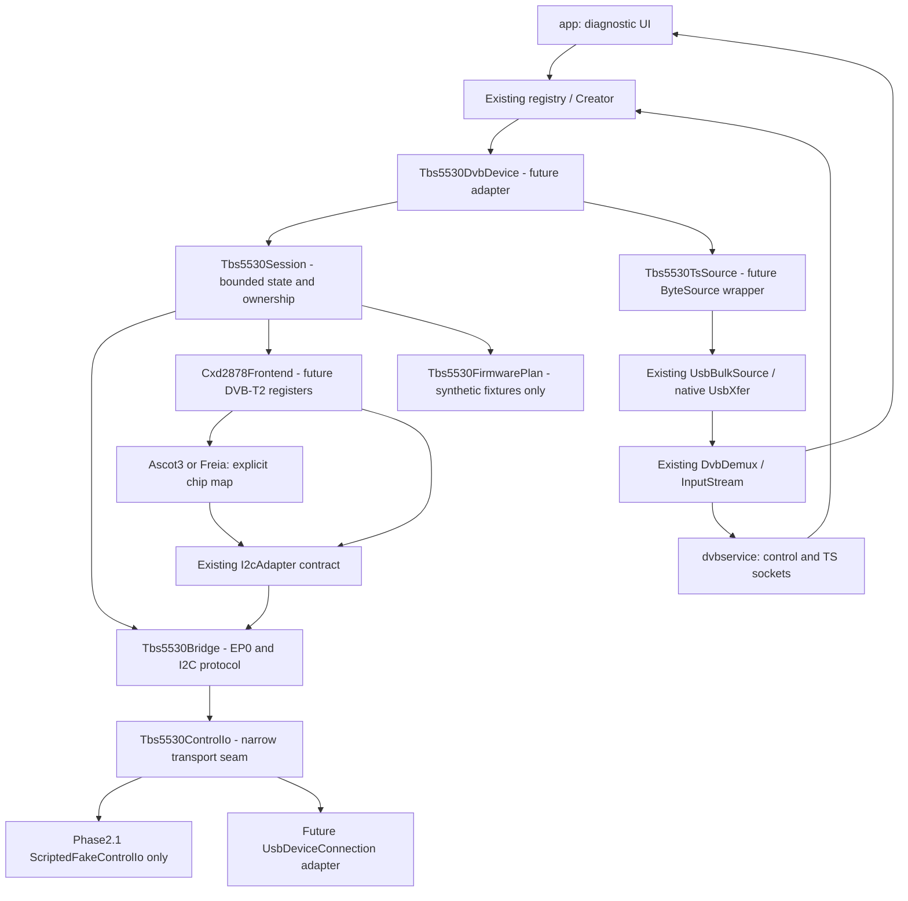

# Research log (append-only)

## 2026-11-07 — Phase 3.1: AUTO đã được kiểm thật; errno chỉ ra lỗi nhận USB EOVERFLOW

### Kết luận và giới hạn bằng chứng

`RUNTIME-OBSERVED`: Năm fresh-owner workflows đều probe ID `0x197`, init ASCOT3I E-family và AUTO tune K36 / 594 MHz / 8 MHz thành công; status đầu mỗi lượt có syncState=6, tsLock=true, unlockDetected=false. Vì vậy không còn blocker phải biết PLP ID trước tune. AUTO bank 0x23/AD=0, không ghi AF, đã đạt `DVBT2_LOCK_CONFIRMED` trên đường CXD6802 đang thử. Bằng chứng này không đo active PLP ID, không xác nhận mọi silicon revision, Common PLP hoặc mọi dịch vụ Multi PLP; L1/PLP monitor đúng chip vẫn `UNVERIFIED`, không có register probe suy đoán.

`REGULATORY_RECEIVER_REQUIREMENT` và `LAB_TEST_FIXTURE` từ QCVN vẫn tách khỏi `ACTUAL_RF_BROADCAST`: ID 42/0/1/2 trong tests không trở thành thông số SDTV. Bandwidth tuner giữ 8000000 Hz, không thay bằng băng thông tín hiệu chiếm dụng. Kết quả lock hiện tại chỉ chứng minh có đường đồng bộ trên ứng viên K36 lúc test; chưa có nội dung dịch vụ vì TS chưa đến.

### Bốn phép thử TS có approval riêng

| Lượt trên fresh owner | Backend / chunk / chuẩn bị endpoint | Kết quả đo | Diễn giải được phép |
| --- | --- | --- | --- |
| Workflow thứ hai | Android synchronous Bulk / 16384 byte / không clear | Một 0x8A full-length, một read=-1, 0 byte; smoke 46530260 ns | `NO_DATA_OR_USB_FAILURE`; chưa có errno |
| Workflow thứ ba | Android synchronous Bulk / 4096 byte / không clear | Một 0x8A full-length, một read=-1; timeout thực 500 ms, managed read 5218021 ns, smoke 31229531 ns | Chunk theo official không chữa được lỗi; không phải benchmark tăng tốc |
| Workflow thứ tư | Android synchronous Bulk / 4096 byte / một CLEAR_HALT được duyệt | Clear hoàn tất, một 0x8A, một read=-1, 0 byte; smoke 50912135 ns | Không xác nhận endpoint từng bị HALT hoặc clear đã sửa transport |
| Workflow thứ năm | Native USBDEVFS_BULK / 4096 byte / một CLEAR_HALT được duyệt mới | Clear hoàn tất, một 0x8A, một read=-1, `errno=75`; timeout 500 ms, managed read 13419167 ns, smoke 62119843 ns | `EOVERFLOW` được đo trực tiếp; vẫn 0 byte/packet, không TS PASS |

Workflow thứ nhất đã lock nhưng ADB mất trước TS, không consume TS/0x8A/Bulk từ lượt đó. Mỗi smoke dừng ngay read lỗi, không retry hoặc fallback PLP. Các số thời gian smoke gồm guards/audit/control/read, không phải native-only latency; managed read cũng gồm wrapper/JNI. Không có paired benchmark, không tính throughput hoặc speedup từ các lượt lỗi.

### Nguồn giải thích errno và thứ tự streaming

`SOURCE-CONFIRMED`: Header `asm-generic/errno.h` của NDK 30.0.16248370 định nghĩa `EOVERFLOW=75`. [Linux USB error codes](https://docs.kernel.org/driver-api/usb/error-codes.html), truy cập 2026-11-07, mô tả EOVERFLOW là dữ liệu endpoint trả vượt max packet hoặc buffer còn lại, còn EPIPE là stall và ETIMEDOUT là hết thời gian chờ. Vì thế phép thử mới đã phân biệt lỗi USB hiện tại với các giả thuyết timeout/stall chưa kiểm trước đó; chưa xác định chính xác bên nào gây sai kích thước gói.

`SOURCE-CONFIRMED`: Official TBS tại SHA `2ce787de9f6e81b4294692a45de15596ae2e1322`, `drivers/media/usb/dvb-usb/dvb-usb-dvb.c:dvb_usb_ctrl_feed`, bật `streaming_ctrl` trước `usb_urb_submit`. `usb-urb.c:usb_urb_init:220` clear endpoint trước khi tạo URBs; `tbs5530.c` dùng 0x82, tám URBs, 4096 byte/buffer. Port vẫn khác official ở synchronous read thay vì hàng đợi tám URBs, nhưng chưa có bằng chứng đó là nguyên nhân EOVERFLOW; không tự đổi thứ tự stream-select hoặc tạo concurrent native I/O để thử đại.

`OFFLINE-TESTED` và `RUNTIME-OBSERVED`: JNI v4 hardcode endpoint 0x82, dùng fd của chính connection đang claim, giới hạn length 1..16384 và timeout 1..2000 ms; lưu errno ngay sau ioctl, trước JNI release. Với fd âm, test native trả -1/errno22 và không sửa buffer, không ioctl USB. Fake tests kiểm -1/errno32 không retry, stale owner bị từ chối, và errno truyền qua đủ facade/binding/handoff/coordinator đến TS result. Bản chạy thật dùng 4096/500 ms, không tự nâng giới hạn. Transcript TS v4 bind `readApi=USBDEVFS_BULK_ERRNO`; hash của scope có clear là `9687b7a1e306c899bce71e76d89b6bdd766937ebadfcb60c5ed3bfddd94f94b0`.

### Phân loại nguyên nhân và bước phân biệt độc lập

| Giả thuyết | Bằng chứng hiện có | Trạng thái |
| --- | --- | --- |
| Không biết PLP nên không thể lock | Năm AUTO workflows đạt demod/TS lock mới, không AF/id giả | Không còn là blocker lock; selected PLP số vẫn chưa đo |
| Timeout 500 ms hoặc endpoint stall | Lượt v4 trả errno75 sau managed read khoảng 13,42 ms; clear đã hoàn tất | Không được gọi timeout/EPIPE từ phép đo này |
| Chunk 16384 không hợp | Chunk 4096 cũng lỗi; native v4 errno75 với length chia hết 512 | Không đủ giải thích nguyên nhân chỉ bằng chunk |
| Thiết bị/firmware, host controller hoặc liên kết USB trả gói không hợp lệ | Errno75 được đo trên OnePlus/API30, chưa có trace packet/đo đối chứng | `UNVERIFIED` nguyên nhân vật lý cụ thể; không đổ lỗi anten hoặc cáp khi chưa đo |
| Tốc độ USB, trạng thái host hoặc queue policy khác Linux | Read-only sysfs không xác lập được tốc độ; chưa có phép thử Windows cùng tuner tại thời điểm này | `NOT MEASURED`; không dùng descriptor wMaxPacketSize thay số đo tốc độ bus |

`PHASE_3_1_BLOCKED_WITH_EVIDENCE` tại transport, không phải vì thiếu PLP công khai. Bước thực tế duy nhất được đề nghị là kiểm nhận TS độc lập chính TBS5530 bằng Windows driver/ứng dụng hãng trên cùng anten K36 594 MHz/8 MHz; chưa chạy và chưa có consent chuyển ownership. Nếu đối chứng nhận TS thì thu hẹp về host/port Android; nếu cũng lỗi thì cần điều tra đường thiết bị/firmware/link, không tự suy RF tốt hoặc hỏng. Mọi phép thử tiếp vẫn nằm trong Phase 3.1 và cần proposal/approval mới; không tái dùng các scope đã consumed.

Tổng control checked theo delta năm workflows là 776 OUT/160 IN; cộng một upload firmware 132 OUT thành 908 OUT/160 IN, không bao gồm descriptor reads hoặc host-only failures. Có bốn stream-select, hai clear và bốn Bulk attempts; tổng byte/packet nhận được là 0. Raw evidence chỉ giữ ngoài Git trong session files, không lưu hoặc gửi broadcast, permit, boot ID hay ledger thật lên dịch vụ ngoài.

## 2026-11-06 — Phase 3.1: hai chunk đều lỗi; phát hiện thiếu bước chuẩn bị USB pipe của Linux

Lượt user-approved TS v2 với chunk 4096 vẫn đạt lock mới rồi Bulk đầu trả -1, yêu cầu 4096 byte/timeout 500 ms, managed read wall time 5218021 ns, toàn smoke 31229531 ns; 0 byte/packet. Giảm chunk không chứng minh sửa được transport. Giữ riêng cả hai kết quả v1/v2, không retry hoặc nạp lại firmware. Owner/UI/helper của lượt này đã đóng. Sau ba workflow, control checked tổng 464 OUT/96 IN, cộng một firmware upload là 596 OUT/96 IN; có hai stream-select và hai Bulk đều -1. Số này không bao gồm raw descriptor hoặc host-only failures.

SOURCE-CONFIRMED mới: official TBS cùng SHA `2ce787de9f6e81b4294692a45de15596ae2e1322`, `drivers/media/usb/dvb-usb/usb-urb.c:usb_urb_init:213–220`, gọi **usb_clear_halt cho stream endpoint trước khi tạo URBs**. TBS5530 cấu hình endpoint 0x82 trong `tbs5530.c:342`. Port Android mới chỉ có claim/stream-select/read, chưa có bước chuẩn bị pipe này. Đây là khác biệt source rõ ràng và giả thuyết hợp lý cho lỗi Bulk tức thì, **chưa chứng minh endpoint thật đang HALT hoặc errno là EPIPE**.

[Linux USB core v6.12](https://github.com/torvalds/linux/blob/adc218676eef25575469234709c2d87185ca223a/drivers/usb/core/message.c), hàm `usb_clear_halt:1207`, gửi CLEAR_FEATURE(ENDPOINT_HALT) rồi reset endpoint phía host khi thành công. `include/linux/usb.h:1891` định nghĩa USB_CTRL_SET_TIMEOUT=5000 ms. `devio.c:proc_clearhalt` cung cấp USBDEVFS_CLEAR_HALT trên fd đã có quyền. Vì thế không thay bằng vendor/I²C tùy ý hoặc chỉ gửi raw CLEAR_FEATURE mà bỏ host toggle reset. Không dùng SET_INTERFACE, reset device, power-cycle, B7 hoặc satellite GPIO làm phép chữa thay thế.

Đang bổ sung đường opt-in cố định 0x82 trên cùng claimed connection/worker/generation, thông qua ioctl USBDEVFS_CLEAR_HALT có kiểm âm errno; không mở fd USB mới. Mặc định tắt. TS plan v3 sẽ ghi rõ prepare operation/source, hai OUT tối đa (một standard clear-halt và một vendor stream-select), giới hạn program 12000 ms gồm dự trù ioctl 5000 ms + control 2000 ms + data window 5000 ms. Giữ Bulk timeout 500 ms, chunk 4096, trần byte/read và TTL/heartbeat cũ; không tự tăng timeout để giải quyết PLP. Native syscall đồng bộ không thể được hủy vật lý an toàn, nên cleanup vẫn đợi trả về. Bất kỳ thử nghiệm thật nào cần consent riêng mới cho endpoint preparation; **chưa có CLEAR_HALT thật tại checkpoint nguồn này**.

## 2026-11-06 — Phase 3.1 live: AUTO đạt lock, lượt TS đầu trả -1

### Firmware và owner mới

Sau approval riêng và user tự cấp permission, raw mới xác nhận FX2_DEFAULT 189 byte. Đúng một upload dùng helper Phase 2.9 không đổi đã đạt 132/132 A0 full-length, image 8192/payload 8196 byte, duration runner 111344 ms gồm điều phối/approval/audit, không phải USB-only. Terminal vẫn UNCERTAIN/JAVA_IO_EXCEPTION, after NOT_OBSERVED; không retry hoặc sửa thành PASS. Observation độc lập sau permission mới đạt READ_AND_CLOSED, operational 50 byte/hash `22e2f1df9f66c58dbb6c554e400b6b8abcb78ee4f277e03679bc0fac7a25add5`, 14 ms, open/read/close 1/1/1, claim/vendor 0. Prefix firmware ledger 545 records/182748 byte giữ nguyên; sau lượt này 812 records/271744 byte.

### AUTO và status mới

Host approval PROBE đầu đã consumed nhưng dừng trước native: tệp tạm `phase31-permit.json.new` bị AtomicFile reader coi là tệp phục hồi và xóa trước rename. Giữ cả hai host records consumed/stop, không có app execute hoặc I²C trong lần lỗi này. Đổi helper sang `phase31-permit.tmp`, tái hiện bằng Android instrumentation cách ly và kiểm channel UID/clock. User duyệt PROBE mới, mở owner mới, probe đạt ID 0x197 với 3 OUT/2 IN; init ASCOT3I E-family đạt 65/14; AUTO K36/594 MHz/8 MHz đạt 84/15 theo hash `93208a78c0f677dd62a81fdfad51da2dc2ccca25b0ae522f3599300168940df2`. Không ghi AF, AD=0; không Common PLP monitor hoặc scan.

POLL_STATUS tối đa ba mẫu dừng ngay mẫu đầu: epoch 1, monotonic clock 362269254 ms, syncState 6, tsLock true, unlockDetected false. Đây là DVBT2_LOCK_CONFIRMED thật, không còn chỉ là analog hay giả lập. Selected PLP ID vẫn NOT_MEASURED, không suy PLP 0 hoặc chứng minh Multi/Common PLP đầy đủ. Tổng control checked full-length tại checkpoint đầu là 154 OUT/32 IN; không có native-boundary latency counter riêng.

TCP ADB mất trước TS, không còn target online. Không phát 0x8A/Bulk hoặc consume TS từ lượt đó. User đóng operational và khôi phục TCP, duyệt workflow mới; chỉ pin TCP sau kiểm đúng OnePlus GM1900/API 30/USB Host/boot, không tự adb connect hoặc failover alias. Owner mới probe/init/AUTO/status lại đạt, mẫu đầu syncState 6/tsLock true/unlock false tại clock 363014342 ms. Không nạp firmware lần hai.

### TS smoke đầu: NO_DATA_OR_USB_FAILURE, không phải INVALID_TS

Trên owner thứ hai, approval TS v1 riêng đúng một 0x8A [0x0A,0x00] full-length rồi một Bulk IN 0x82 yêu cầu 16384 byte, timeout theo limits 500 ms. Audit STREAM_SELECT_INTENT/COMPLETE tại 363027807/363027820 ms; BULK_READ_INTENT/COMPLETE tại 363027825/363027845 ms, result **-1**; FINISHED tại 363027853 ms, bytes 0. Runner elapsed 46530260 ns, khoảng 46,530260 ms, gồm storage/guards/stream-select/read chứ không phải USB-only. Không tự gán lỗi timeout hoặc NO_SIGNAL từ -1 và không có errno riêng. Logcat giới hạn các tag USB không cho thêm errno hữu ích.

Kết quả: một read, 0 byte/packet/sync loss/TEI/continuity error; số 0 lỗi parser là vì chưa có dữ liệu, không phải TS PASS. Trạng thái NO_DATA_OR_USB_FAILURE; chưa TS_SMOKE_PASS. Tổng checked control của hai workflow là 309 OUT/64 IN, gồm một stream-select; cộng firmware là 441 OUT/64 IN trong phiên, không tính raw descriptor hoặc các host-only failures. UI counters giữ tích lũy trong Activity dù owner đã đổi; các delta từng plan mới là counts của owner đó. Đã Back để đóng operational sau khi smoke tự cancel/drain, không giữ owner/màn hình hoặc helper chờ.

### Điều tra an toàn và ứng viên sửa tiếp trong cùng phase

SOURCE-CONFIRMED: official `tbs5530.c:337–345` dùng stream Bulk 0x82, 8 URBs và **4096 byte/buffer**. Port Android cũ dùng synchronous Bulk, tối đa 16384 byte/call; khác kích thước không tự chứng minh root cause của -1. Endpoint/metadata/worker/owner/claim path đã đối chiếu lại, không thấy bằng chứng đang đọc 0x81 hoặc sai hướng. Request 0xB7 và 0x8A [0x08,0x01] xuất hiện trong attach/init M88RS6060 ở official/C/Go; không nhập vào terrestrial như một lệnh sửa FIFO vì nguồn chưa chứng minh an toàn/ý nghĩa đó và phạm vi cấm satellite.

Đang bổ sung TS limits v2 có chunkBytes tường minh, mặc định 4096 theo official, vẫn tối đa 64 KiB/16 reads/5 giây/timeout 500 ms và dừng ngay read <=0, không retry trong smoke. Bổ sung telemetry last result/requested length/timeout/managed read wall time, không giả errno hoặc native-only latency. Đây là ứng viên giúp phân biệt transport, **chưa được chứng minh sửa lỗi phần cứng** và mọi lượt hardware tiếp cần approval mới với hash mới.

Phát hiện thêm report TS dùng lastPlanHash của status trước đó: native approval vẫn scope đúng limits/hash, nhưng trường summary bị stale. Lượt live được đối chiếu bằng app CONSUMED audit đúng TS hash và OUT delta 1, không nhận nhầm stale report hash là TS hash. Test fake tái hiện ComparisonFailure trước sửa; đang sửa cập nhật hash TS ngay khi prepare. Không sửa audit/terminal live cũ hoặc đổi số đo để khớp code mới.

## 2026-11-06 — Phase 3.1: quyết định PLP trước triển khai, chưa cấp quyền phần cứng

Baseline thực `9621a8028d2cd3e5d98652cde69ba80d27cd7ee2`, nhánh `chore/modernize-android-build`, origin đúng fork; worktree và stage sạch, không có commit mới sau baseline. Ba reference chỉ đọc vẫn là official `2ce787de9f6e81b4294692a45de15596ae2e1322`, community C `c5fa27eecbe80633cbb365cc44656daea1c0e2e3`, Go `11228b05fb1626bf41c4e1879ace10cd0a8d575c`. Không fetch/sync hoặc phục hồi phiên USB cũ.

### Bảng quyết định trước coding và hardware

| Nhánh | Nguồn silicon / mức bằng chứng | Chương trình dự kiến | Đảo ngược / thành công / rủi ro | Quyền và trạng thái |
| --- | --- | --- | --- | --- |
| Manual PLP đã biết | SOURCE-CONFIRMED cho CXD6802 trong official `cxd2878_set_dvbt2:2468–2475`; C `3311–3318`; Go `terrestrial.go:144–162` chỉ manual | SLV-T 0x64, bank23, AF=id, AD=1; giữ toàn bộ init/tune/status hiện có | RAM, có thể khôi phục bằng power-cycle được duyệt; thành công cần status mới và TS thật, không phải OUT đủ byte; ID K36 chưa biết | IMPLEMENTABLE; approval TUNE riêng và ID đo đúng multiplex, không mặc định 0/255 |
| AUTO ứng viên AD=0 | CROSS-CHIP-ANALOGY, không SOURCE-CONFIRMED CXD6802; Linux v6.12 SHA `adc218676eef25575469234709c2d87185ca223a`, `cxd2841er.c:cxd2841er_dvbt2_set_plp_config:2148–2167` và `cxd2820r_t2.c:cxd2820r_set_frontend_t2` | Khác manual đúng hai điểm: không ghi AF, AD=0 ở bank23; giữ profile Base, tuner ASCOT3I/24MHz và phần tune còn lại | Register RAM, không flash; nguồn chip khác chưa chứng minh side effect/selected data PLP trên 0x197. Chỉ lock và TS mới kiểm được đường auto; power-cycle không được tự thực hiện | EXPERIMENTAL_WITH_APPROVAL; mặc định runtime từ chối, debug opt-in và consent thử nghiệm riêng theo hash; chỉ đề nghị K36/594MHz/8MHz |
| PLP từ monitor L1 | UNVERIFIED cho 0x197; official/C/Go không có monitor danh sách/active PLP được xác minh | Không tạo allowlist monitor hardware. CXD2880 cùng SHA có `mon_data_plps` dùng bank0B/0C, L1-post-valid86, numC1/listC2; đây là chip khác, không chép sang bank22/23 | Monitor chức năng vẫn có bank/pointer OUT và có thể freeze/unfreeze; đọc sai bank không chứng minh PLP. Không gửi probe suy đoán | BLOCKED; biểu diễn MONITOR_RESOLVED nhưng không cho tune cho tới nguồn đúng chip và test hợp lệ |
| PLP đo bằng thiết bị độc lập | ACTUAL_RF_BROADCAST chỉ khi có INFO/thiết bị đo đúng K36 và thời điểm; chưa có dữ liệu đó | Dùng manual theo ID đo, không quét PLP 0..255 | Không đụng tuner khi đọc INFO TV; không dùng ID của multiplex khác, bảng quy chuẩn hoặc tên dịch vụ | BLOCKED do chưa có measurement; chỉ yêu cầu một ảnh INFO nếu auto không được phép hoặc không đủ chẩn đoán |

Chọn triển khai AUTO dưới dạng ứng viên thử nghiệm tách quyền, không dùng mặc định PLP 0 và không coi analog là bằng chứng silicon. [Linux DVB property API](https://docs.kernel.org/userspace-api/media/dvb/fe_property_parameters.html), mục DTV_STREAM_ID, quy định ID 0..255 và NO_STREAM_ID_FILTER để bỏ lọc; đó là semantic API, không chứng minh chip đưa mọi PLP đồng thời hoặc chuyển sentinel thành byte. Go `PLPOrZero` ánh xạ số âm thành 0 là fallback phần mềm, không phải chứng minh chip không có auto.

### Quy chuẩn và cấu hình sóng phải tách riêng

REGULATORY_RECEIVER_REQUIREMENT: [Thông báo chính thức Thông tư 17/2020](https://cspl.mic.gov.vn/Pages/TinTuc/tinchitiet.aspx?tintucid=138179), truy cập 2026-11-06, xác nhận QCVN 63:2020 thay QCVN 63:2012 và hiệu lực 01/07/2021. Trang có một câu lỗi biên tập về chống sét; không dùng câu đó làm nội dung quy chuẩn. [VSQI](https://tieuchuanxaydung.vsqi.gov.vn/quychuan/view?sohieu=QCVN+63%3A2020%2FBTTTT) hiện trả Website Disabled, nên chưa kiểm được trạng thái hiệu lực qua cơ sở dữ liệu này. [Bản HTML 2020 đối chiếu](https://dulieuphapluat.vn/van-ban/xay-dung-do-thi-van-ban/quy-chuan-ky-thuat-quoc-gia-qcvn-632020btttt-ve-thiet-bi-thu-truyen-hinh-so-mat-dat-dvb-t2-27864.html) xác nhận 2.4.4 hỗ trợ Multi không Common, 2.4.5 có Common và 2.4.7 thích ứng thay đổi tham số. Không tuyên bố chứng nhận hợp quy từ kiểm thử driver.

LAB_TEST_FIXTURE: ví dụ Single PLP ID42, Multi 0/1/2 với Common0, Multi không Common và thay đổi cấu hình chỉ dùng SYNTHETIC_TEST_FIXTURE/USB fake-only; không đưa vào preset/approval live. PDF 2012 được đính kèm nhưng model không nhận được nội dung native, không báo đã đọc 102 trang hoặc kiểm số trang; bản 2012 là lịch sử theo văn bản thay thế, việc kiểm appendix công khai được ghi tiếp khi có kết quả.

ACTUAL_RF_BROADCAST: tìm công khai SDTV K36/Vũng Chua và trang kênh phát sóng không tìm thấy PLP đáng tin cậy trong kết quả đã kiểm; không phải bằng chứng PLP không tồn tại. K36 giữ `594000000 Hz`/`8000000 Hz`; băng thông chiếm dụng 7,61/7,71/7,77 MHz không thay bandwidth tuner. PLP live, RF hiện tại, tune/lock/TS vẫn UNVERIFIED/NOT RUN; owner/init/consent Phase 3.0 đã hết, không có hardware operation trong checkpoint này.

### Kết quả đối chiếu và kiểm offline Phase 3.1

Bản HTML 2020 đã kiểm thêm 3.2.4.2/3.2.5.2: thực hiện tìm kênh tự động rồi kiểm giải mã dịch vụ. Trong 3.2.5.1, Common PLP0 mang PSI/SI, data PLP1/2 mang hai TS là cấu hình phép đo, không phải quy tắc SDTV. Chính xác hơn về cách đánh số: **mục A.2 chứa Bảng A.2 Single PLP, Bảng A.3 Multi PLP và Bảng A.4 tham số biến đổi**; không gọi mục A.3/A.4 là bảng PLP. Bảng A.2 đánh dấu ID của PLP bằng (*) và chú thích cho phép giá trị bất kỳ; Bảng A.3 dùng 0/1/2. Fixtures ID42 và cấu hình có/không Common đều chỉ là kiểm phần mềm, không giải mã bài đo quy chuẩn thật. Bản DOC 2012 công khai tìm được tại [vanbanphapluat.co](https://vanbanphapluat.co/data/2012/12/285356_qcvn63-2012-btttt.doc) nhưng fetch lỗi transport; không báo đã đọc bản 2012 hoặc xác minh trang ảnh. Nguồn ban hành lịch sử đối chiếu tại [Thông tư 20/2012](https://vanban.chinhphu.vn/default.aspx?pageid=27160&docid=165849).

CROSS-CHIP-ANALOGY bổ sung: Linux cùng SHA cố định, `cxd2880/cxd2880_tnrdmd_dvbt2.c:cxd2880_tnrdmd_dvbt2_set_plp_cfg:1112–1145` cũng dùng bank23, bỏ AF khi auto và AD=0; chỉ cho sleep/active và không cho diversity-sub. Monitor của chip này lại dùng bank0B/0C, vì vậy không suy monitor bank22/23 của CXD6802. `cxd2820r_t2.c:cxd2820r_set_frontend_t2` phân biệt stream_id>255 thành AD=0, manual AF/id rồi AD=1. Các nguồn này đủ để trình bày một thử nghiệm có kiểm soát, **chưa chứng minh register AUTO của ID0x197 hoặc Common PLP output**.

OFFLINE-TESTED: full JVM cuối 355 methods PASS; instrumentation cách ly 61 app +43 library PASS, gồm cùng fake manager/owner/coordinator/control gate qua probe/init/manual hoặc AUTO/status/TS. Approval protocol2 dùng namespace Phase31, boot-count/lease identity dạng hash, generation/challenge/plan hash, maximum được host duyệt và quỹ khởi động tối thiểu maximum+5000 ms; không nới TTL/heartbeat/USB timeout. UI pause drain owner rồi xóa frontend/RF/plan cũ; kiểm nhập qua InputConnection giữ chữ/cursor khi tick. L1 monitor thật vẫn bị chặn; không thêm scan API hoặc whitelist register suy đoán. Kết quả và lỗi trung gian ghi tại [TEST-MATRIX.md](TEST-MATRIX.md).

Hai lỗi TS được tái hiện FAIL rồi sửa: audit tiêu hết ngân sách nhưng Bulk vẫn bắt đầu với timeout cũ; native trả ngoài hạn nhưng vẫn báo TS PASS. `Tbs5530TsSmoke` nay tính lại thời gian ngay trước native và giữ LIMIT_REACHED nếu packet hợp lệ nhưng quá hạn. SyncState7 cũng không được dùng làm bằng chứng cấp quyền stream: đây là lựa chọn bảo thủ dựa trên trạng thái chưa hợp lệ ở chip Sony đối chiếu, không sửa diễn giải Linux official thành bằng chứng silicon mới. Không có paired benchmark hoặc hardware mới, nên không báo tăng tốc/giảm latency.

### Đề nghị phạm vi phần cứng tại checkpoint, chưa thực thi

| Chương trình | USB OUT / IN hoặc Bulk tối đa | Thay đổi / trần được đưa vào approval |
| --- | --- | --- |
| Descriptor/owner mới | Raw observation và claim(false), 0 vendor | Đúng một 734c:5530, cây operational mới + metadata; nếu FX2_DEFAULT phải dừng để xin approval firmware riêng |
| PROBE | 3 OUT / 2 IN | 0x66 bank00, FB/FD; ID phải là 0x197 trước init; bound10000 ms |
| INITIALIZE | 65 OUT / 14 IN | Board24MHz, terrestrial 0x66/0x64/0x60, ASCOT3I E-family; source delay84 ms, bound158084 ms |
| AUTO TUNE ứng viên | 84 OUT / 15 IN | Đúng K36/594000000/8000000; bank23/AF không ghi, AD=0 thay AD=1; source delay120 ms, bound198120 ms; cần duyệt thử nghiệm riêng |
| POLL_STATUS, 3 samples | Tối đa 6 OUT / 3 IN | Bank20/reg10, khoảng cách1000 ms; bound20000 ms, dừng sớm lock/unlock; không tự retune hoặc gán NO_SIGNAL |
| TS_SMOKE, chỉ sau lock mới | Một OUT 0x8A [0x0A,0x00], tối đa16 Bulk IN0x82 | 65536 byte,5000 ms, tối đa16384 byte/call, timeout500 ms giảm theo thời gian còn lại; approval TS riêng, RAM-only và không raw broadcast vào Git/cloud |
| Firmware nếu default | NOT APPROVED / NOT RUN | Approval Phase 2.9 độc lập cho đúng 132 A0, không gộp với control/tune; không upload khi operational |

Mỗi chương trình vẫn phải có permit mới theo exact transcript/hash và owner hiện hành; bảng này **không phải quyền chạy**. Script firmware Phase2.9 không được dùng để cấp control Phase31. Provisioning/heartbeat host thật cho protocol2 chưa chạy; phải kiểm tương thích helper và dừng nếu không giữ được identity/budget/consume, không dùng permit viết tay thiếu field hoặc nới thời hạn để vượt gate. Không có helper vô hạn, không giữ Activity operational hoặc màn hình sáng trong khi chờ người dùng. Trạng thái hiện tại là phần mềm đã kiểm, chờ phê duyệt rõ ràng; lock/TS thật chưa được thử.

## 2026-11-06 17:57 +07 — Ảnh Công báo xác nhận trực tiếp K36 = 594 MHz, kênh rộng 8 MHz

Người dùng cung cấp bốn ảnh chụp các trang Thông tư 27/2026/TT-BKHCN, Công báo số 333 ngày 16/06/2026. Đây là nội dung ảnh do người dùng gửi, không phải tải DOCX đã thành công; lần tải browser bị timeout bên dưới vẫn giữ nguyên lịch sử. Không sửa hoặc chép ảnh vào Git.

| Nội dung đã đọc trên ảnh | Kết luận cho ứng viên K36 |
| --- | --- |
| Điều 3 khoản 1, dòng kênh 36: giới hạn 590–598 MHz, trung tâm 594 MHz | Tần số trung tâm `594000000 Hz` được xác nhận từ bảng; độ rộng kênh là `598 − 590 = 8 MHz`, tương ứng cấu hình bandwidth `8000000 Hz` |
| Điều 2 khoản 7: Gia Lai thuộc khu vực Nam Trung Bộ và Tây Nguyên | Phù hợp nhóm khu vực của ứng viên trạm Vũng Chua; không xác nhận giấy phép hoặc trạng thái phát của một trạm cụ thể |
| Điều 3 khoản 2 điểm d: kênh 36 và 37 quy hoạch cho khu vực Nam Trung Bộ và Tây Nguyên | K36 phù hợp quy hoạch khu vực; không dùng quy hoạch để tự mở rộng sang K37 hoặc scan tần số khác |
| Điều 4 khoản 1: hiệu lực 16/07/2026 | Khớp metadata Công báo đã đọc trên trang chính thức |

Các ảnh không nêu PLP ID của multiplex SDTV hoặc chế độ auto/no-filter của CXD2878. Tần số và độ rộng kênh đã đủ bằng chứng tài liệu; blocker còn lại vẫn là PLP/cơ chế chọn PLP đã kiểm, không phải thiếu tần số hoặc chưa gắn anten. Không đổi manual PLP thành 0/255, không gửi tune/status/stream/Bulk mới từ việc nhận ảnh. K36 vẫn là ứng viên ưu tiên, không phải xác nhận on-air tại thời điểm thử.

## 2026-11-06 — Bằng chứng live Phase 3.0: ID 0x197, init đạt; K36 chưa tune vì PLP chưa xác minh

### Firmware và observation riêng

Sau terminal 0 native đã ghi dưới đây, người dùng duyệt độc lập một transaction khác, cập nhật APK giữ data và helper tiến trình riêng. APK SHA `5965aced4de6c56efad951586f892dc07b4cc5d17915e64b9526d2ed711a7a36` được cài đè; so hash toàn bộ consumed stores cũ trước/sau giống hệt. Host chờ challenge mới trước khi cấp GUID, thay vì để thời gian thao tác chọn file làm hết reserve; không đổi loader, hash, plan, ACK, heartbeat, USB timeout, TTL hoặc reserve.

Transaction thứ hai trong Phase 3.0 có planned/guard requested/accepted/native started/completed/full-length đều 132; image 8192 byte, payload 8196 byte, release 131/132 đều trả 1/1. Duration runner 108499 ms gồm toàn bộ điều phối/audit, không phải USB-only. Attachment event 1 khiến auto-observation dừng trước permission/lease mới: terminal `UNCERTAIN/JAVA_IO_EXCEPTION/UPLOAD_COMPLETE_OPERATIONAL_UNVERIFIED`, after NOT_OBSERVED, cleanup NONE/pending false. Giữ nguyên terminal và ledger, không reupload/corrective release.

Người dùng duyệt riêng A và C. A: tự bấm OK permission sau re-enumeration rồi đọc raw đúng một lần; complete 50 byte/hash `22e2f1df9f66c58dbb6c554e400b6b8abcb78ee4f277e03679bc0fac7a25add5`, config 1/interface 0/alt 0, IN/BULK 0x82 và 0x81/512 byte, bInterval tương ứng 1 và 0; 26 ms, open/read/close 1/1/1, claim/release/vendor 0/0/0, cleanup/pending false. Đây là observation mới riêng, không sửa upload terminal trước đó thành PASS.

### Bridge và frontend thực

C: owner mới dùng strict raw profile, đối chiếu metadata và claim(false), không A0. Plan `fc687ddce2d46f557f6c77b8ac065a56bbe5aaa565e97596c90f0eeccc3ea0d9`, slave 0x66/bank 0/high FB/low FD, đúng 3 OUT/2 IN full-length. ID đã giải mã `0x197`, không phải dữ liệu 00/FF/echo; state DEMOD_IDENTIFIED, frontend chưa initialized tại checkpoint probe. Audit có 10 INTENT/RETURN events; INTENT đầu đến RETURN cuối 76 ms, gồm storage/checks/transport, không phải native USB latency. Không lưu hoặc suy toàn bộ byte FB ngoài bit mask từ ID đã giải mã.

D được duyệt riêng CHỈ INIT, plan `6179e394a8f650e5fec33be334f1c05f226d6067675f4bcc2d38aa6f8f6682da`, targets 0x66/0x64/0x60. Đúng 51 register writes và 14 write/read, tức 65 OUT/14 IN full-length, 158 audit events. Tuner E-family, boot/parallel TS checks và re-identification sau reset đều qua các guard của plan. State FRONTEND_INITIALIZED rồi READY_FOR_TUNE; UI dừng AWAITING_RF_IN_CONNECTION. INTENT đầu 342395683 ms → RETURN cuối 342397101 ms, tổng 1418 ms gồm audit, delay nguồn và điều phối. Không lấy trần 158084 ms làm thời gian đo.

Tổng C+D là 68 OUT/16 IN, không scope tune/lock/TS. Audit được kiểm theo từng GUID riêng; consumed của C và D không dùng Phase 2.9 stores. Màn hình đã đóng sau khi thiếu PLP được xác nhận; launcher là Activity resumed, không giữ owner chờ thông số hoặc helper còn chạy. Số release/close operational thực chưa có native-boundary counter riêng, không gán fake count thành đo hardware; descriptor-only cleanup có telemetry riêng đã nêu.

### Nguồn RF K36 và cách xử lý PLP

Người dùng đã xác nhận coax thụ động, không DC ngoài, đúng RF IN, đường anten từng thu tốt. Không giữ kết luận ANTENNA_NOT_CONNECTED sau xác nhận này. Ứng viên được cung cấp: SDTV trạm Vũng Chua, UHF K36, trung tâm 594000000 Hz, bandwidth 8000000 Hz; **PLP chưa xác minh**.

- [SDTV công bố trạm Bình Định](https://sdtv.vn/cong-ty-sdtv-chinh-thuc-phat-song-truyen-hinh-ky-thuat-so-mat-dat-tai-binh-dinh/): nội dung ngày 11/04/2019 nói trạm núi Vũng Chua, công suất 1,1 kW và phát trên K36. Đã đọc text bằng browser để tránh ảnh inline base64 che phần văn bản trong web fetch. Không suy bài năm 2019 là trạng thái on-air ngày thử.
- [Bản đồ phủ sóng SDTV](https://sdtv.vn/ban-do-phu-song/) liệt kê Bình Định trong cột K36. Trang không cung cấp PLP hoặc số đo RF hiện hành. Tần số 594 MHz/băng thông 8 MHz giữ là bộ ứng viên được người dùng đưa ra, phù hợp phép ánh xạ kênh UHF 8 MHz; không coi đó là measurement từ TBS5530.
- [Công báo Thông tư 27/2026/TT-BKHCN](https://congbao.chinhphu.vn/van-ban/thong-tu-so-27-2026-tt-bkhcn-469693/65635.htm) xác nhận phạm vi quy hoạch 470–694 MHz, ban hành 31/05/2026, hiệu lực 16/07/2026. Trang metadata không chứng minh PLP hoặc trạm đang phát. Tải bản DOCX bằng browser bị timeout; chưa đọc được bảng phụ lục, không khẳng định đã xác nhận toàn bộ phụ lục.

Đối chiếu trực tiếp official SHA `2ce787de9f6e81b4294692a45de15596ae2e1322`, `cxd2878.c:cxd2878_set_dvbt2:2468–2475`: chọn bank 0x23, ghi 0xAF bằng `stream_id & 0xFF`, ghi 0xAD = 1, chú thích manual PLP. Community C cùng SHA đã khóa, `cxd2878.c:3311–3318` giữ đúng cơ chế đó. Go SHA đã khóa, `internal/coaxd/demod/sony/terrestrial.go:144–162` cũng nhận một `plpID byte`, ghi AF/AD tương ứng và không có automatic-PLP path được hiện thực.

**Không có bằng chứng auto/no-filter cho path CXD2878 đang port.** Không đổi AD thành 0 dựa trên chip Sony khác, không diễn giải bit DB/PLP_ALWAYS_MATCH là auto selection khi chưa có semantics đủ, không nhập cơ chế ATSC3 bank 0x93 của cộng đồng vào DVB-T2 bank 0x23. Nếu truyền sentinel `NO_STREAM_ID_FILTER` vào code official hiện tại, phép `& 0xFF` sẽ thành chọn thủ công PLP 255, không phải bỏ lọc. Android giữ từ chối AUTO_PLP; không tự mặc định PLP 0.

Kết luận: **TUNE_NOT_RUN_ENVIRONMENT_BLOCKER do PLP/chế độ chọn PLP chưa xác minh**. RF IN đã xác nhận; tune, lock polling, stream select và Bulk đều 0. Không ghi NO_SIGNAL, NO_LOCK hoặc driver failure cho phần chưa chạy. Cần PLP K36 từ nhà phát sóng hoặc thiết bị đo, hoặc source/tài liệu Sony đúng chip chứng minh auto-PLP trước khi thay plan và xin approval tune riêng. Không quét tần số hoặc PLP hàng loạt.

### Số đo mới và bảo toàn

| Phân đoạn | N | p50/p95/p99/max | Phạm vi |
| --- | --- | --- | --- |
| ACK Android mới | 132 | 783/1012/1064/1098 ms | Chỉ event android_observed của đúng upload mới, không gộp terminal summary hoặc attempt trước |
| Native API firmware | 132 | 0,293229/0,446302/1,076823/1,524583 ms | Tổng 42,521095 ms; boundary native start/end, không I²C init |
| Probe C | 5 control calls | Tổng audit interval 76 ms | Gồm audit/checks; không native-only |
| Init D | 79 control calls | Tổng audit interval 1418 ms | Gồm 84 ms delay nguồn, audit và điều phối |

Ledger firmware cuối có 545 records/182748 byte, SHA `3e82a0c1c181abeee809bf0fce13a77b4dfaed520808764e38ad4660fb2daf36`. Prefix 92018 byte giữ SHA a2ec…6d0f và prefix 93760 byte giữ SHA f5fa…28a, khớp trước khi append, không sửa lịch sử. C/D không ghi vào ledger firmware. Native writes mới trong Phase 3.0 chỉ một upload đầy đủ 132 A0; reservation trước đó native 0. C+D có 52 request 0x80 OUT, 16 request 0x90 OUT và 16 request 0x91 IN; tổng mọi vendor OUT/IN là 200/16. 0x8A, tune, LNB, EEPROM và Bulk đều 0.

**NO OPTIMIZATION WARRANTED:** không so chênh lệch latency giữa hai phiên thành speedup; không có thay đổi tối ưu protocol, delay hoặc audit. Giữ ACK 1500/heartbeat 2000/USB 2000/TTL 300000/start reserve 240000 ms. Các bản ghi phần mềm/chờ approval bên dưới là lịch sử trước những kết quả live mới này.

## 2026-11-06 — Phase 3.0: operational handoff, probe whitelist và port chọn lọc DVB-T2

### Nguồn và ranh giới bằng chứng

Baseline fork `722c4916a83074e8cc5b5c6aeeaee9d2f1190785`; ba checkout tham khảo chỉ đọc vẫn official `2ce787de9f6e81b4294692a45de15596ae2e1322`, C `c5fa27eecbe80633cbb365cc44656daea1c0e2e3`, Go `11228b05fb1626bf41c4e1879ace10cd0a8d575c`. Không fetch/sync/reset hoặc sửa references. Tài liệu Android được tra lại bằng Android CLI `docs search`/`docs fetch` với `kb://android/develop/connectivity/usb/host`, cùng [UsbDeviceConnection](https://developer.android.com/reference/android/hardware/usb/UsbDeviceConnection); claim(false), worker ngoài UI, bulk/control timeout hữu hạn và cleanup đúng owner được giữ. Bulk trước Android P có giới hạn 16384 byte mỗi call nên prototype không vượt giới hạn này; API control/bulk có offset đã có trước minSdk 21. Giá trị trả âm không đủ xác định errno hoặc khẳng định timeout.

[Trang sản phẩm chính hãng](https://www.tbsdtv.com/products/tbs5530-multi-standard-universal-tv-tuner-usb-card.html) xác nhận tuner USB2 đa chuẩn, không chứng minh driver Android hỗ trợ các chuẩn đó. DVB-T2 phải vào RF IN, không LNB IN; nhãn/cáp thật và ảnh hãng vẫn phải đối chiếu ở checkpoint RF trước tune. Chưa yêu cầu người dùng cắm coax, chưa đo RF hoặc cấp nguồn qua coax/LNB.

### So sánh protocol và frontend

| Câu hỏi | Source-confirmed | Quyết định port / giới hạn |
| --- | --- | --- |
| Bridge EP0 | Official `drivers/media/usb/dvb-usb/tbs5530.c:tbs5530_i2c_transfer` dùng write 0x80, read-pointer 0x90 rồi IN 0x91, mutex bao cặp; C `tbs5530.c:71,74,85` cùng dạng | Tái sử dụng Bridge/ControlTransport. Full-length không chứng minh slave ACK hoặc identity; không copy cách source bỏ qua lỗi trả về |
| Stream | Official properties TS 0x82, generic bulk 0x81; terrestrial streaming_ctrl 0x8A [0x0A,0]; C `tbs5530.c:149,162` và Go `internal/coaxd/usb/bridge/tbs/tbs.go`, `tbs5530/tbs5530.go` đối chiếu cùng shape | 0x81 không mặc định là TS; 0x8A là write riêng, chỉ sau lock và approval TS |
| Demod ID | Official `cxd2878.c:cxd2878_attach:4010–4014,4066–4070`: SLV-X = 0x64+2 = 0x66, bank 00, high FB và low FD; `((FB&3)<<8)|FD`. C `cxd2878.c:5830–5831`, Go `internal/coaxd/demod/sony/chip.go:ReadChipID` cùng semantics | Probe đúng 1 bank write + 2 register reads; 3 USB OUT/2 IN. Không scan toàn I²C, không EEPROM/MAC hoặc nhánh vệ tinh |
| Tuner variant | Official `cxd2878.c:ascot3_init:812–958`, target 0x60/reg7F, E-family khi `(value&F0)==E0`, có nhánh VCO/calibration 2871A | Chỉ init/tune 0x197 + ASCOT3I E-family. ID 0x19c/0x39a được nhận diện nhưng Freia init/tune chưa port; không đoán variant |
| Init và tune | Official `cxd2878_init:3171–3254`, repeater `436–444`, DVB-T2 `2185–2514`, tuner tune `656–804`, `tuneEnd:1957–1963`, status `3312–3323` | Port các bảng/thao tác cần thiết cho board xtal 24 MHz; có delay, read-derived RMW/VCO formula trong transcript, không giả mọi byte đã biết trước |
| Khác biệt C | `cxd2878.c:4765–4900` thay stabilization delay và bỏ 9C/10 cho ATSC3; `cxd2878_set_dvbt2:3300–3368` vẫn manual PLP | Không nhập thay đổi ATSC3 vào DVB-T2 chỉ vì source cộng đồng mới hơn |
| Khác biệt Go | `cxd2878/cxd2878.go:Initialize,retuneBand`; `tuner_ascot3.go:ascot3Init,ascot3Tune` bỏ E-family calibration, retune cùng chuẩn chỉ đổi bandwidth | Giữ nhánh official và ghi PLP explicit mỗi tune. Auto PLP chưa có cơ chế được kiểm; không ngầm PLP=0 |

| Plan fixture đã kiểm | USB OUT / IN | Delay nguồn | Trần timeout phần mềm |
| --- | --- | --- | --- |
| Chip-ID probe | 3 / 2 | 0 ms | 10000 ms |
| Init 0x197/ASCOT3I | 65 / 14 | 84 ms | 158084 ms |
| Tune đầu 666 MHz, bandwidth 8 MHz, PLP explicit | 85 / 15 | 120 ms | 200120 ms |
| Tune đầu bandwidth 1,7 MHz | 84 / 15 | 120 ms | 198120 ms |

Các số này là đếm và bound của chương trình bất biến/fake fixture, **không phải phép đo hoặc tần số được chọn cho địa phương**. Frequency/BW/PLP thật chưa được cung cấp. SNR/CNR/BER/strength trả NOT_AVAILABLE; không dựng số đo.

### Lifecycle, approval và parser đã triển khai

Strict raw profile nằm ở đường operational debug, chặt hơn classifier candidate cũ: đủ device/config/interface/endpoints, đúng identity 734c:5530, không duplicate/malformed, đối chiếu Android metadata trước claim. Profile cũ không sống qua generation mới; A0 bị cấm trên owner operational. Detach event không còn chờ enumeration mất path mới invalidate; path/id có thể đã được dùng lại. Tests kiểm owner cũ bị từ chối và close/release chờ native/fake call trả, không force-close.

ControlProbe dùng cùng session/bridge, không API ghi thanh ghi tùy ý. Mọi USB payload được so với plan đã consume; read-dependent bytes chỉ tính từ read thuộc plan đó. App debug có màn hình operational riêng trong cùng reservation loại trừ firmware/raw owner, chỉ mở khi bấm, không auto-probe từ intent/attach. Namespace approval Phase 3.0 tách Phase 2.9; challenge không phải consent, hash/operation/generation/heartbeat/expiry/foreground phải khớp. Init/tune/TS có scope riêng; RF IN checkbox không thay thế approval I²C.

BulkTransport chỉ nhận owner đã claim, frontend initialized/locked và stream active, buffer tối đa 16 KiB/call, timeout hữu hạn. TS smoke trần byte/read/time, 0x8A đúng một lần, RAM-only; negative/no-data dừng không blind retry hoặc gán lỗi frontend. Parser kiểm ít nhất 3 packet 188 byte và carry qua chunk, continuity theo PID, adaptation-only/discontinuity/TEI/null/duplicate; 38 parser tests đã PASS riêng và được đưa vào full JVM sau đó. Không ghi raw TS vào Git/cloud.

### Hardware observation mới và lỗi trước native

Người dùng duyệt descriptor-only, xác nhận đã cắm OnePlus/OTG và tự chọn OK permission. APK đang cài hash `12a97e1745c031ec5c80565c6816d00f2e53b50d92aef3a47957b4011f57526e` đúng bản Phase 2.9 đã kiểm, không update trước lượt raw. Kết quả mới: raw COMPLETE 189 byte/hash `e2887bad8b5a0e8dcaaa69bd636a01a2d11e53fe4b532b5b14828a2d3df952de`, default MATCH, config 1/interface 0/alt 0 có 0 endpoint; open/read/close 1/1/1, claim/release/transfer 0/0/0, 24 ms, pending/cleanup false. Không suy operational từ quan sát 50 byte đêm trước.

Upload được duyệt riêng sau đó dùng GUID mới, firmware local hash khóa, helper/ledger cũ. Terminal mới FAULTED/PERMIT_EXPIRED trước native: attempted/guard/native/completed/full-length/image/payload đều 0; raw preflight cùng default 189 byte, after NOT_OBSERVED, duration runner 49 ms, cleanup NONE/pending false. Challenge created_elapsed_ms 338832194; STOP khoảng 338905933 ms, tức khoảng 73,7 giây chuẩn bị/UI, còn dưới reserve 240000 ms. Ledger từ 275 lên 278 records, có reservation/consumed/terminal mới; không sửa hoặc reuse GUID vì native=0. Đây là quỹ bắt đầu, không phải USB chậm, firmware STALL hoặc lỗi anten.

Sửa UI kiểm reserve trước khi cho bấm; deterministic test kiểm đúng biên 60000/60001 ms, không consume app hoặc thay expiry. Giữ TTL/ACK/heartbeat/USB/reserve; user đã duyệt độc lập một transaction khác sau giải thích, chưa tự suy transaction đó thành thành công. Các kết quả tiếp theo phải ghi bằng evidence mới, không thay terminal dừng trước native.

### Tối ưu và giới hạn

**NO OPTIMIZATION WARRANTED:** chưa có số đo I²C/TS thật để kết luận nút thắt. Không cache bank qua plan/epoch, không bỏ audit/guard, không tăng timeout hoặc rút delay phần cứng. Ngưỡng quỹ UI là sửa eligibility/fail-stop, không phải speedup. Phân biệt thời gian thao tác UI/ADB với latency USB.

## 2026-11-06 — Phase 2.9 đạt firmware bring-up: 132 full-length và raw OPERATIONAL_CANDIDATE

**RUNTIME-OBSERVED:** Sau hai reservations chỉ ở host đã tiêu thụ và các sửa UID/private/no-clamp, người dùng duyệt riêng transaction thứ ba, physical current=true/UI-ready=true. Fresh target/boot/model/API/firmware/guard đạt; raw trước upload mới 189 byte/FX2_DEFAULT/MATCH, open/read/close 1/1/1, transfer 0, duration 18 ms. APK đã cài khớp build 40fc…411e, pin 91% lúc preflight. Người dùng tự bấm UI; parent không bấm upload thay. Helper chạy đúng một lần với GUID mới sau approval, không reuse/fallback/retry/recovery.

**Upload thực hoàn tất:** Report lúc 00:03:48 +07 có planned/guard_requested/guard_accepted/native_started/native_completed/full_length đều 132, image 8192/payload 8196, 132 API results đều đúng requested length; hai release ở bước 131/132 trả 1/1 byte. Plan TBS_SOURCE_DUAL_RESET và hash ảnh khóa giữ nguyên, tổng 132 A0 OUT. Sau NATIVE_CALL_END full-length cuối có FINAL_RELEASE_FULL_LENGTH_DETACH_OBSERVATION_REQUIRED rồi STOP JAVA_IO_EXCEPTION; snapshot epoch 1/attachment events 1/cleanup NONE/pending false. Source đi qua delay 100 ms và releaseUpload trước acquireObservation; duration 106486 ms không phải USB-only. Không tự reupload/corrective release khi observation chưa có quyền hoặc attachment mới.

**Observation riêng được duyệt:** Người dùng approve_read_once cho đóng/mở owner mới, fresh USB permission và một raw read/0 transfer. Report 00:10:59 +07 hoàn chỉnh 50 byte/no issues/hash 22e2…add5, có alt 0/interface 0/config 1/bulk IN 0x82+0x81/512 byte; classifier cũ UNKNOWN vì 0x82 có bInterval=1. Không mặc định lỗi firmware hoặc nạp lại. Microsoft USB endpoint descriptor xác nhận polling interval không dùng cho bulk; chỉ sửa nhánh candidate debug, giữ parser/default fingerprint và main transport guard. Unit repro FAIL trước sửa, focused PASS sau sửa rồi full gates mới.

**Binary và classifier cuối:** Người dùng duyệt riêng update APK giữ data và một raw read mới, không upload/vendor/claim/reset. Trong lúc install test riêng ADB TCP offline, không reconnect tự động; người dùng khôi phục TCP mới, giữ nguyên OTG/nguồn, pin lại cùng boot/model/API. APK observation 12a9…526e cập nhật tại chỗ, so cả legacy và current-attempt consumed không đổi true. Raw cuối 00:32:55.837 +07 là COMPLETE_RETURNED_TREE/50 byte/no issues, hash `22e2f1df9f66c58dbb6c554e400b6b8abcb78ee4f277e03679bc0fac7a25add5`, OPERATIONAL_CANDIDATE, open/read/close 1/1/1, claim/release/transfer 0/0/0, 29 ms, pending/cleanup false. Binary thực được port checked-sync lưu private rồi export 50 byte, hash/length khớp, không phải reconstruction. Fixture offline từ numeric fields không khớp hash được giữ đúng là fixture, không dùng làm raw evidence. Probe sysfs cached descriptor không tìm được path đọc được; không chmod hoặc đọc bus thêm.

| Raw cuối, numeric fields | Giá trị thực |
| --- | --- |
| Device | VID:PID 734c:5530, USB 2.00, EP0 packet 64, class/subclass/protocol 0/0/0, bcdDevice 1, 1 config |
| Configuration | value 1, wTotalLength 32, 1 interface, attributes 128, max power 50 units ×2 mA |
| Interface | interface 0/alt 0, 2 endpoints, class 255/subclass 0/protocol 0 |
| Endpoint 0x82 | IN/bulk, attributes 2, wMaxPacketSize 512, bInterval 1 |
| Endpoint 0x81 | IN/bulk, attributes 2, wMaxPacketSize 512, bInterval 0 |

Default fingerprint vẫn PARTIAL_MATCH là đúng vì cây 50 byte operational không phải cây 189 byte default; OPERATIONAL_CANDIDATE được xét riêng theo endpoints, không READY. Không đưa strings/unknown payload vào docs/Git. Nguồn USB công khai và ba reference SHAs/file ở ADR-023; TBS/C/Go chỉ đối chiếu địa chỉ/type, không chứng minh DVB tuning/TS hoặc trạng thái chip.

### Timeline/latency của đúng 132 native calls mới

N=132, nearest-rank ceil(p×N), cùng Android monotonic ở boundary/ACK; không trộn 24 steps ngày 04-11 hoặc 2 host failures trước native. `helper_usb_calls=0` chỉ nói host helper không gọi USB, không phủ nhận 132 Android calls.

| Phân đoạn thực | p50 | p95 | p99 | max | Tổng / ghi chú |
| --- | --- | --- | --- | --- | --- |
| Request→Android ACK observed, ms | 738 | 1001 | 1046 | 1067 | 101432 ms qua 132 steps |
| Request→native call start, ms | 759,066 | 1022,626 | 1066,429 | 1089,356 | Bao request storage/handshake/audit/checks, không USB-only |
| Guard accepted→native, ms | 12,136 | 17,406 | 26,315 | 36,624 | Bao audit +device/permission/native/dispatch guard |
| Durable intent event→native, ms | 12,127 | 17,391 | 26,304 | 36,619 | Không tách riêng sync syscall hoặc CPU serialize |
| Native API start→return, ms | 0,304 | 0,466 | 0,947 | 6,155 | Tổng 48,664 ms, 132 full-length, 0 short/negative/exception |
| Transaction duration | — | — | — | 106486 ms | Upload/transition/cleanup và observation stop; không dùng làm USB latency |

| Ordinal band | ACK p50/p95/p99/max (ms) | Native p50/p95/p99/max (ms) |
| --- | --- | --- |
| 1–33 | 616/713/948/948 | 0,290/0,466/0,612/0,612 |
| 34–66 | 690/794/796/796 | 0,310/0,756/0,947/0,947 |
| 67–99 | 798/890/923/923 | 0,301/0,497/0,626/0,626 |
| 100–119 | 917/985/1008/1008 | 0,315/0,417/0,424/0,424 |
| 120–132 | 992/1067/1067/1067 | 0,306/6,155/6,155/6,155 |

ACK có xu hướng tăng ở ordinal cuối trong transaction thật, trong khi native gần phẳng; không quy thành FX2/USB chậm. Production UI export/full report/scheduler chưa được tách chi phí đủ để gọi là root bottleneck. Max ACK 1067 ms và request→native 1089,356 ms vẫn dưới 1200 ms và deadline 1500 ms, 0 timeout; giữ timeout, không tối ưu suy đoán hoặc upload nữa để đo. Audit cuối 50659 byte/794 events, gồm 132 intent+132 result+1 transition+1 stop. Suy từ source là 266 critical checkpoints, không phải trace syscall/fsync count; byte serialize tích lũy và thời gian audit riêng của lượt thật NOT MEASURED. Số đo fake được giữ riêng.

### Trước–sau cuối phần cứng và giới hạn

| Hạng mục | Trước / cấu hình cũ | Sau / cấu hình mới | Giả thuyết | Thay đổi mã cụ thể | Số đo trước | Số đo sau | Tác động | Rủi ro còn lại |
| --- | --- | --- | --- | --- | --- | --- | --- | --- |
| Native bring-up | Attempt 04-11 consumed/uncertain | Một transaction thực mới sau approval thứ ba | Authorization trước native có thể chặn, không mặc định do USB | Watch/ApprovalSession/DurableFile/Port, không đổi plan/hash | 23 native full/1344 image bytes, không release | 132 native full/8192 image/8196 payload, 2 release full | Đủ plan một lần, không retry | Không bảo đảm frontend hoặc toàn bộ firmware functions |
| ACK/native latency | Hardware cũ thiếu native-only timestamps | Boundaries monotonic/host ledger mới | Cần phân biệt orchestration và native USB | Telemetry và typed stop, tách ACK/USB/audit | Durations 24 steps cũ không cùng ý nghĩa | ACK 738/1001/1046/1067 ms; native 0,304/0,466/0,947/6,155 ms | Không tăng USB timeout vì ACK | Mẫu chưa bảo đảm zero-failure |
| Descriptor | Default 189 byte, thiếu 0x82 | Operational 50 byte, 0x82/0x81 bulk 512 | Upload đủ byte chưa tự chứng minh operational profile | Raw inspection với permission/owner mới, không vendor | Hash e288…52de | Hash 22e2…add5/OPERATIONAL_CANDIDATE | Gate firmware bring-up đạt | Không READY/DVB lock/TS |
| Classifier | Đòi bulk IN interval 0 | Không dùng interval làm bulk IN polling gate | Điều kiện polling có thể áp dụng nhầm cho bulk IN | Debug fingerprint bỏ interval gate, USB reference và negative tests | Raw thực interval 1 bị UNKNOWN | Một raw read riêng bằng classifier mới, cùng hash 50 byte | Không sửa hardware descriptor để làm PASS | Main operational guard chưa được kiểm streaming |
| Raw evidence | Standalone report chỉ fields/hash | Binary thực riêng private | Fields/hash chưa đủ lưu raw bytes đã quan sát | AndroidRawDescriptorPort checked sync/save bounded và test | Chưa lưu post binary từ lần đọc đầu | Saved 50 byte/hash khớp, 29 ms/1 read/0 transfer | Có bằng chứng mở lại ngoài Git | Raw có thể chứa định danh, không publish |
| Audit/ledger | 2 host failures trước native, legacy true | 3 new host consumed/1 upload terminal, 275 records | Reservation không đồng nghĩa native đã gọi | Ledger append/fsync và snapshot terminal, không viết lại lịch sử | 8 records sau 2 host failures | 92018 bytes/275 records, giữ terminal cũ UNVERIFIED | Phân biệt approval/native/observation riêng | Không chống chủ máy cố ý rollback ledger |

**Regression mã cuối:** Full JVM 259 =245 drivers +1 usbxfer +13 service, 0 failures/errors/skipped; build debug/release/lint PASS 2 phút 45 giây/357 tasks/70 executed/287 up-to-date, 0 errors/10 warnings. App 47 methods/9,315 giây và library 37/1,398 giây rerun PASS; service 2 PASS trước đó không đổi nguồn, tổng 86 methods riêng biệt có phạm vi. Static 127 TBS classes major 52/minSdk 21/targetSdk 37, uploader/raw port chỉ debug, firmware entries 0/harness vắng/zipalign cả hai exit 0. APK cuối SHA `12a97e1745c031ec5c80565c6816d00f2e53b50d92aef3a47957b4011f57526e`. Nguồn/records vẫn working tree, không stage/commit/push; FTS index failed không được repair hoặc dùng làm bằng chứng cuối.

**Kết luận final:** OPERATIONAL_CANDIDATE; Phase 2.9 đạt mục tiêu firmware bring-up theo gate 132 full-length +operational raw. Không READY/I²C/frontend/tune/PLP/MPEG-TS/EEPROM/flash PASS, không tự chuyển phase hoặc ngầm vendor init. Owner đã đóng/cleanup xong; legacy và upload-attempt consumed true, không helper/permit/GUID thứ tư hoặc reset/power-cycle/recovery. Host terminal trước observation vẫn UPLOAD_COMPLETE_OPERATIONAL_UNVERIFIED/firmware_pass=false/ready=false theo đúng thời điểm kết thúc; observation được duyệt riêng sau đó là evidence mới, không sửa ledger cũ thành PASS.

## Chốt Phase 2.9 sau UID split/private channel/no-clamp — 2026-11-05

**RUNTIME-OBSERVED/OFFLINE-TESTED:** Controller đọc clock/boot ở shell UID, chỉ file I/O qua run-as; instrumentation dùng đúng app-private của `.phase29offline`, seed legacy request/permit rồi chờ fresh grant và UI 3500 ms trước owner. No-clamp: POLL sample sau app-file read; host_seen giữ NOW raw; PUT chỉ chờ tối đa 2 ×10 ms lấy tick thật hoặc fail alignment, chạm deadline dừng trước ghi permit. Không gán created/request/minimum vào timestamp, không grace/host wall clock hoặc nâng ACK/heartbeat. Marker sau write/rename vẫn không chứng minh fsync host permit.

| Lượt cùng private UID/no-clamp | ACK p50/p95/p99/max (ms) | Tổng Android (ms) | Request-start→dispatch max (ms) | Native audit tổng (ms) | Run-as/file-child dispatch attempts | Fake full-length / raw files / reads / USB thật |
| --- | --- | --- | --- | --- | --- | --- |
| Verified 1 | 505/588/625/626 | 71.721 | 646,489 | 2.247,719 | 281 | 132 /2 /2 /0 |
| Verified 2 | 524/603/854/911 | 78.765 | 933,022 | 2.353,683 | 284 | 132 /2 /2 /0 |
| Verified 3 | 543/625/662/670 | 80.427 | 689,997 | 2.407,101 | 282 | 132 /2 /2 /0 |
| Baseline callback audit cũ, đo sau ba lượt | 536/632/646/760 | 80.026 | 781,834 | 2.184,238 | 281 | 132 /2 /2 /0 |

Mỗi lượt 132/132 PASS, 8192 image bytes/8196 payload bytes giả đúng plan, 264 audit checkpoints/6.711.056 byte serialize và 3 helper ADB subprocess, không actual USB. Ba verified riêng 396 samples, nearest-rank ceil(p×N): p50/p95/p99/max 526/606/669/911 ms; không gộp baseline hoặc FAIL. Ordinal 120–132 max 570/669/581 ms, p50 533/534/519 ms; baseline tail max 592 ms. Tổng chậm nhất 80,427 giây gồm UI wait so reserve 240 giây còn 159,573 giây dự phòng quan sát, không phải bảo đảm worst-case native USB. ACK max 911 ms và dispatch max 933,022 ms dưới 1200 ms; giữ ACK 1500/heartbeat 2000/USB 2000/TTL 300000/benchmark 240000 ms.

### Bảng trước–sau cuối, không đánh đồng sửa đúng với speedup

| Hạng mục | Cấu hình cũ | Cấu hình mới | Giả thuyết/nguồn bằng chứng | Thay đổi mã | Số đo cũ | Số đo mới | Tác động | Rủi ro còn lại |
| --- | --- | --- | --- | --- | --- | --- | --- | --- |
| Clock permission | Cả controller dưới app run-as | Clock/boot shell, I/O run-as | Runtime uptime shell PASS/app Permission denied; clock lỗi -990 bị clamp | Watch UID split +clock read/format/range checks | 2 host reservations dừng trước native, heartbeat không tiến | Legacy/UIwait3500 →3 ×132 PASS | Giữ heartbeat thật, không timestamp giả | OEM khác cần probe; không thay quyền |
| Channel storage parity | Benchmark shell/external | Test app-private đúng UID/file path | Runtime run-as external denied dù shell đọc được | Run/Watch exact private offline prefix, Context canonical private test | Clean shell max 490 ms trước đó không cùng permission | Private no-clamp max 626/911/670 ms | Test gần production hơn | Không gọi tăng latency là USB chậm; UI export thật chưa đo |
| Timestamp | POLL trước read/host_seen Max, PUT clamp nhỏ | Sample sau read, tick thực bounded | Source và no-clamp/stalled/cross-deadline mocks | Watch/Test raw NOW/no Max/no minimum assignment | Checkpoint private có clamp max 1116 ms | 3 no-clamp PASS, dispatch max 933,022 ms | Không grace hoặc sửa timestamp | Counter 10 ms, thời điểm lấy mẫu vẫn có giới hạn |
| Audit | AtomicFile full snapshots | Full snapshots +checked sync/verify | Lỗi sync/rename có thể chỉ log | DurableFile/NativeAudit giữ intent/result | Same-UID baseline audit 2184,238 ms | 2247,719/2353,683/2407,101 ms | Tăng kiểm lỗi với chi phí nhỏ, không journal suy đoán | Filesystem/USB không nguyên tử; intent không chứng minh call |
| 132-step latency | Clean namespace bắt đầu ngay | Legacy seed +UI wait 3500 ms +same UID | Mock cũ thiếu trạng thái production | FullPathBenchmark fixture và host cold-start | Historical 611/705/783/1476 và 359/506/714/759 ms | 505/588/625/626; 524/603/854/911; 543/625/662/670 ms | Dữ liệu đúng điều kiện mới, không hứa speedup | Không so sánh hai môi trường như A/B kiểm soát |
| Tổng phiên | Chưa có idle-UI parity | Total 80,427 giây max, reserve 240 giây | Không bắt đầu khi TTL còn quá ngắn | Start budget vẫn giữ | Trước private UID khoảng 54 giây | 71,721/78,765/80,427 giây | Có dự phòng thực đo | 132 USB timeout 2 giây worst-case vẫn có thể vượt TTL |
| Processes/logs | Helper 3 ADB, không đếm app children | Helper 3 ADB +run-as 281/284/282 attempts | Counter dispatch mới | Watch metric không gọi là total OS forks | Device fork count NOT MEASURED | Dispatch attempts có thật; audit 264 writes/6.711.056 bytes mỗi lượt | Thấy chi phí privilege boundary | Chi phí CPU/OS forks/flush syscall NOT MEASURED |
| Fail-stop/ledger | Legacy/malformed có thể property error; pulse clock giả | Prior/current classify, permission/read errors typed | Host fixture/mocks +runtime failures lưu | Watch/Test fail-closed, no repair | 2 consumed host/0 firmware writes | Ledger 8 records/hash không đổi qua fakes | Không rearm approvals đã tiêu thụ | Hardware khác cần approval/GUID mới |
| Raw/native | Chỉ fields/hash trong report | Raw before/after private sink +native boundaries | Fake byte/fault tests và source | Runner RawAudit, giữ metadata khi lỗi | Thiếu raw binary evidence cho attempt | 2 raw files/2 reads, 132 fake full-length mỗi run | Không thêm USB read hoặc leak raw vào report/Git | Chưa có operational descriptor thật mới |

**Gate cuối và phạm vi:** Production Java không đổi sau full JVM 257 methods/debug/release/lint/major 52/minSdk 21/release isolation, library 37 +service 2 instrumentation PASS có phạm vi trước đó; app 46 rerun sau private UID/no-clamp PASS 9,12 giây. Host mock 61 checks gồm 10 production/2 benchmark, clock/file/UID/no-clamp faults đã PASS; lần xác nhận cuối được ghi WORKLOG. Export 34 synthetic evidence files và failed namespaces trước gỡ 2 test packages; production/legacy guard và canonical ledger 8 records/hash giữ nguyên. Không GUID/permit/hardware helper thứ ba hoặc vendor write mới.

**Kết luận:** SOFTWARE_READY_AWAITING_HARDWARE_APPROVAL cho transaction độc lập khác. Hai host approvals đã tiêu thụ không được reuse; cả hai chưa có native firmware A0 OUT. Phase 2.9 chưa hoàn tất firmware bring-up; không READY/frontend/TS/phase mới. Cần approval/nguồn/UI mới rồi fresh preflight, không tự retry/recovery từ software PASS.

## 2026-11-05 — Approval độc lập thứ hai: initial grant đã có nhưng heartbeat không tiến khi chờ UI

### Checkpoint private UID parity đã chạy, còn phải bỏ mọi clamp timestamp

**RUNTIME-OBSERVED:** Sau chuyển instrumentation channel sang app-private và I/O qua run-as offline, ba lượt verified liên tiếp có seed legacy files/UI-wait 3500 ms đều 132/132 PASS, USB thật 0. ACK p50/p95/p99/max lần lượt 512/575/606/668, 524/603/986/1116, 516/587/815/952 ms; tổng Android 77.066/79.626/78.549 ms, final dispatch max 688,233/1137,309/971,735 ms. Mỗi lượt fake/full-length 132, audit 264/6.711.056 byte, raw files/reads 2/2; 3 helper ADB subprocess, run-as/file-child dispatch attempts 281/282/283, không phải số OS forks thực. Baseline audit cũ cùng path/UID/legacy wait được đo sau đó: ACK 520/597/632/654 ms, tổng 78.394 ms, audit 2.191,032 ms, 281 dispatch attempts. Ba verified audit tổng 2.313,524/2.367,759/2.289,114 ms; không gắn nhãn speedup khi đổi permission model.

**Chưa chốt software-ready từ checkpoint này:** Source review timestamp cho thấy POLL.NOW lấy trước app-file read rồi host_seen dùng max với request; PUT còn clamp minimum dưới 10 ms. Dù app vẫn reject late deadline và các lượt đều PASS, user yêu cầu không tự sửa timestamp. Đang chuyển clock sample sau read và chờ sample thực ở tick tiếp hoặc fail alignment, không clamp/minimum giả hoặc gia hạn deadline. Cần 3 lượt mã sau sửa lại; giữ các số đo trên đúng checkpoint, không tự gọi là số cuối.

### Root cause mới đã probe: clock permission khác giữa shell và run-as

**RUNTIME-OBSERVED:** Trên cùng target/boot GM1900/API30, `adb shell cat /proc/uptime` exit 0 và parse được hai số thập phân; `adb shell run-as info.martinmarinov.dvbdriver cat /proc/uptime` exit 1, Permission denied. Probe tiếp theo xác nhận `boot_id` đọc được và khớp pin ở cả shell/run-as, nên lỗi quyền quan sát là cụ thể với uptime, không gán chung mọi `/proc` đều bị cấm. Không thay quyền, su/root hoặc đọc/ghi USB. Benchmark cũ ở shell UID không đại diện cho production loop chạy dưới app UID; cùng protocol/worker/audit vẫn chưa đủ parity về quyền.

**SOURCE/OFFLINE-CONFIRMED có phạm vi:** Agent tái hiện clock read lỗi tạo -990 rồi bị clamp lặp về challenge-created. Đã bỏ clock fallback giả, thêm read/format/range/alignment checks, lỗi phải DEVICE_CLOCK_UNAVAILABLE. `continue` cũ nằm trong foreach selector, chưa chứng minh nó bỏ vòng heartbeat ngoài; không gọi giả thuyết ban đầu là root cause đã xác nhận. Cần split UID: controller clock/boot giữ shell có quyền, chỉ app-private GET/PUT qua run-as, không host wall clock hoặc cache timestamp.

**Parity file I/O mới đã probe:** Sau UID split, live fake lần kế tiếp dừng Initial host approval missing sau 30,07 giây. Probe cùng file challenge test cho thấy shell đọc `/sdcard/Android/data/...phase29offline/...` exit 0, nhưng run-as offline exit 1/Permission denied; không diễn giải thành host mất liveness hoặc grant chậm. Run-as offline `pwd` xác nhận root `/data/user/0/info.martinmarinov.dvbdriver.phase29offline` hợp lệ. Chuyển channel instrumentation sang app-private dưới đúng root này và canonical validation; không sửa quyền hoặc tùy tiện mở access external storage. Benchmark shell app_process cũ vẫn giữ namespace cũ, không dùng thay parity test mới.

**Gate bổ sung:** Mock sau clock validation PASS 50 negatives/10 production fixtures/6 clock faults, chờ 3500 ms với legacy request rồi 132 ACK; nhưng live test mới seed legacy request trong BenchmarkOnly đã FAIL INVALID_REQUEST_BINDING trước clock vì classifier chưa dùng chung ở mode này. Giữ FAIL/evidence trong test namespace; không native thật/canonical ledger change. Đang đồng bộ classifier và privilege split, cần live fake đúng UID app-file I/O +UI wait trước bất kỳ approval khác.

**RUNTIME-OBSERVED:** Sau fix stale-frame và software gates mới, user duyệt riêng transaction khác/physical current=true, rồi UI-ready riêng. Dùng GUID mới sau approval, không reuse. Fresh target/boot/API/legacy guard đạt; debug APK mới cập nhật tại chỗ, SAF file 8192/hash khóa, permission mới, raw 189/FX2_DEFAULT/MATCH/14 ms với open/read/close 1/1/1 và transfer 0. User vẫn dùng cùng OnePlus/OTG theo xác nhận, không thay nguồn hoặc recovery.

Helper lần này publish initial permit đúng protocol 2/run epoch/authorized ordinal 0, không còn StrictMode lỗi. Tuy nhiên không có request mới/UI upload, helper kết thúc TOTAL_SESSION_DEADLINE 300 giây với ACK 0/observation 0. Một lần đọc trạng thái sau hơn 120 giây thấy permit current-run nhưng heartbeat vẫn bằng initial challenge time, expires=heartbeat+300000; app foreground qua UI hierarchy. Current app attempt-store/native-audit files đều 0, report vẫn RAW READ_AND_CLOSED. Không native A0 hoặc CPU release/reset mới; không diễn giải đây là USB timeout hay tuner không nhận firmware.

**Giả thuyết cần source/repro:** Nhánh bỏ qua stale request có thể `continue` trước periodic heartbeat, khiến grant stale sau 2000 ms trong khi chờ user bấm. Chưa quy lỗi cho user; cần fixture giữ old request tồn dư ít nhất 3500 ms trước khi Android ghi v2 request, đồng thời core approval vẫn requireCurrent thành công. Parent bổ sung seed legacy request/permit và UI-wait 3500 ms vào instrumentation test namespace; agent chỉ fix/mock host, không ADB/ledger mutation.

**Safety/ledger:** GUID lần hai đã consumed, không reuse dù không native; cả hai failed reservations giữ nguyên. Ledger nay 8 records: enrollment 1/prior consumed 1/production start 2/new consumed 2/fail 2, parent pin hash sau lượt hai. UI đóng/revoke, không rerun helper hoặc recovery. Firmware bring-up vẫn chưa hoàn tất; chỉ hỏi transaction mới sau khi lỗi chờ UI được sửa và gates mới có evidence.

## 2026-11-05 — Transaction mới được duyệt dừng ở host stale-frame, trước native USB

### Chốt sửa và kiểm lại sau lỗi production, không retry phần cứng

**SOURCE-CONFIRMED/OFFLINE-TESTED:** Chỉ helper `Watch-TBS5530-BootstrapApproval.ps1` và fixtures host được sửa để nhận diện prior challenge/run trước khi đọc protocol/fields current, bỏ RAW report khỏi bootstrap assertion, giữ current malformed fail-closed trước reservation/grant. Không xóa legacy request/permit, không sửa canonical ledger hoặc authorization timeout. Mock PASS 45 negative checks, 7 production first-start/terminal/replay cases, 132 loops/133 exports, ADB/USB 0. Runner thêm kiểm AUDIT_FAILED ở suppressed chain tại full-length final release+detach; lượt repro FAIL đã giữ, targeted và full JVM sau sửa PASS.

| Gate sau sửa | Kết quả mới | Phạm vi |
| --- | --- | --- |
| Full JVM/debug/release/lint | PASS 257 methods | 243 drivers +1 usbxfer +13 service; wrapper 3 phút22 giây/357 tasks, 0 failures; lint không thêm errors/warnings |
| App/library instrumentation | PASS 46/37 methods | App 9,129 giây, library 1,426 giây, namespaces cách ly; service 2 PASS trước đó không đổi source |
| Baseline cùng harness | PASS 132/132 | ACK 364/452/472/474 ms, tổng Android 55.762 ms, audit 2.116,481 ms, dispatch max 496,952 ms |
| Mã cuối 1 | PASS 132/132 | ACK 363/436/451/457 ms, tổng Android 54.124 ms, audit 2.355,839 ms, dispatch max 483,531 ms |
| Mã cuối 2 | PASS 132/132 | ACK 367/453/461/468 ms, tổng Android 54.714 ms, audit 2.264,148 ms, dispatch max 491,587 ms |
| Mã cuối 3 | PASS 132/132 | ACK 364/447/464/466 ms, tổng Android 51.845 ms, audit 2.261,369 ms, dispatch max 494,749 ms |
| Ordinal 120–132, baseline/mã 1/mã 2/mã 3 | ACK max 443/432/432/455 ms | p50 lần lượt 359/359/352/362 ms, p95/p99 bằng max vì N=13 |

Mỗi lượt xác nhận 132 fake full-length, 264 native audit checkpoints/6.711.056 byte serialize, hai raw fixture files và đúng hai descriptor reads, USB thật 0; chỉ một test method chạy nhiều lần, không tăng số method. Ba verified mã cuối riêng có 396 samples, nearest-rank 365/447/463/468 ms; request-start→dispatch max 494,749 ms, giữ ACK 1500/heartbeat 2000/USB 2000/TTL 300000/benchmark 240000 ms và reserve 240000 ms. Không gộp FAIL host thật hoặc các benchmark trước để làm đẹp số. Tổng Android 54,714 giây là max mới, vẫn chỉ mô hình fake chứ không bảo đảm USB thật.

**Trước–sau bổ sung:** Lỗi host thật trước fix dừng 0 ACK/0 native vì legacy frame; sau fix production-first-start fixture đạt và current malformed vẫn deny, không đo speedup hardware. Final-release audit bị suppressed trước sửa có test FAIL; sau sửa observation không được tiếp khi audit lỗi, vẫn giữ đủ 132 native giả/counters/typed provenance và UNCERTAIN. Chi phí audit/fsync/subprocess không thay cơ chế; snapshot vẫn full, ACK vẫn per-step, không cache permit. Canonical ledger thật 5 records đã pin hash không đổi trong tất cả phép fake; GUID vừa consumed không được dùng lại. Mã Android mới nhất sau fix chưa cài vào production, cần update giữ data nếu có approval khác.

**RUNTIME-OBSERVED:** Sau checkpoint software, người dùng duyệt riêng đúng một transaction và physical conditions=true, rồi xác nhận sẵn sàng tự bấm UI. Parent không suy approval từ prompt. Fresh preflight đã cập nhật debug APK tại chỗ với SHA-256 `ae337e4aea703a3d1aadb024fb49ce5a00d2e786f6a3c313a61842724deb80a6`, guard legacy so nguyên; OnePlus GM1900/API30/boot pin, pin 100%, quyền USB mới. Raw READ_AND_CLOSED mới 189 byte/hash `e2887bad8b5a0e8dcaaa69bd636a01a2d11e53fe4b532b5b14828a2d3df952de`, FX2_DEFAULT/MATCH/BOOTSTRAP_CANDIDATE, open/read/close 1/1/1 và claim/release/transfer 0/0/0. Đây là descriptor pre-upload mới, không phải recovery lịch sử hoặc operational profile.

**Firmware/SAF:** File local trên OnePlus đã có, 8.192 byte/hash khóa, không copy ảnh mới hoặc nhúng APK/Git. Lần đầu gõ URL bằng key events bị IME tiếng Việt đổi `tar` thành `tả`; phát hiện bằng đọc UI rồi dùng Android CLI setText để đặt source/entry đúng nguyên chuỗi, không đổi IME/device settings. SAF hiển thị đúng file đã kiểm; chỉ chọn sau user UI-ready để không ăn TTL sớm. Challenge mới có protocol 2/run epoch/new-attempt-required/legacy true/hash/plan đúng.

**Blocker — SOURCE-CONFIRMED và runtime:** Helper reserve GUID sau approval và append/fsync `NEW_APPROVAL_CONSUMED`, sau đó `AssertBinding` truy cập StrictMode `Value.approval_protocol` trên request legacy chỉ có `challenge,ordinal`, phát sinh property-not-found trước initial permit mới. Old permit cũng thiếu protocol/run epoch, không được thay grant mới; helper có ACK 0/observation 0, ledger ghi HOST_HELPER_ERROR. Production report vẫn RAW_DESCRIPTOR_INSPECTION/READ_AND_CLOSED, pending/cleanup=false, app per-attempt prefs mới 0, native audit/raw files cho run mới 0; không có firmware/vendor A0 write mới hoặc CPU release. Không diễn giải lỗi này thành ACK deadline/USB timeout hoặc firmware failure sau partial upload.

**Hiệu năng không phải nguyên nhân lỗi mới:** Lỗi phát sinh trước initial permit, ACK/observation 0/0, không có sample runtime nào để quy cho deadline 1.500 ms, sync chậm, native timeout hoặc chip FX2. Không tăng ACK/heartbeat/USB/TTL để che lỗi binding. Các lượt fake trước đó vẫn giữ số đo đúng nhưng clean namespace chưa đại diện cho production leftovers; sửa bằng thêm fixture thay vì xóa file thật.

**Safety outcome:** Host GUID mới đã tiêu thụ dù chưa tới UI upload/native; không được dùng lại, reset/rearm hoặc xóa entry. UI đã đóng để thu hồi challenge, không rerun helper hoặc gửi corrective/recovery. Legacy attempt 04-11 vẫn 23 native full-length/1344 image bytes/CONSUMED_UNCERTAIN độc lập. Không cần rút/cắm OTG vì lần này chưa reset CPU; mọi recovery khác vẫn cần hỏi riêng.

**Đối chiếu thời hạn:** API SystemClock chính thức được đọc lại: `elapsedRealtime` bao gồm deep sleep, trong khi `uptimeMillis` không bao gồm; `/proc/uptime` của Linux là counter từ boot, không được nhầm với API `SystemClock.uptimeMillis`. ACK/heartbeat là Windows↔ADB↔Android authorization; `UsbDeviceConnection.controlTransfer` có timeout riêng. Property-not-found trước grant không phải căn cứ nới bất kỳ timeout nào.

**Fix sau lỗi — OFFLINE-TESTED:** Helper đã phân loại frame trước truy cập fields bắt buộc: challenge hợp lệ khác current là prior/stale, same-current malformed thành INVALID_REQUEST_BINDING, thiếu challenge không phân biệt được vẫn deny. Observation old-run được lọc trước fields của current; RAW report không bị kiểm như bootstrap binding. Current malformed bị chặn trước reservation/initial grant. Fixture production dùng đúng legacy request `{challenge,ordinal}`, old permit và RAW report rồi đổi sang request v2 sau grant, thêm terminal ACK 0/replay; mock PASS 45 negative checks, 7 production cases, 132 loops/133 exports, không ADB/USB hoặc ledger thật. Không xóa file historical hoặc nới current binding.

**Fault tightly coupled sau final release:** JVM mới chứng minh AUDIT_FAILED bị suppressed dưới USB_DETACHED ở full-length 132 có thể bị nhánh expected-final-detach cũ bỏ qua. Lượt tái hiện FAIL; sửa runner kiểm cả sanitized cause/suppressed chain, giữ original stop/native result nhưng không tiếp observation khi audit lỗi. Targeted runner PASS; full gates và benchmark mã cuối ghi ở checkpoint tiếp theo, không gọi đây là lỗi đã xảy ra trên tuner.

**Coverage gap cần sửa trong cùng Phase 2.9:** Benchmark sạch luôn tạo namespace mới nên không tái hiện file legacy tồn dư ở app production. Cần production-first-start fixture có đúng request `{challenge,ordinal}` và permit v1, không xóa dữ liệu; frame chứng minh thuộc challenge/run cũ có thể được bỏ qua nhưng frame current malformed phải fail-closed. Không nới validator/binding hoặc tự sửa ledger thật để chạy lại. Test/live no-USB sau sửa phải ghi riêng; hardware attempt kế tiếp cần approval/GUID/UI/preflight mới.

## 2026-11-05 — Phase 2.9: đo full-path không USB, kiểm audit và giữ ACK 1.500 ms

### Checkpoint cuối có raw evidence riêng — mới hơn tất cả số đo phía dưới

**Đã đóng một thiếu sót bằng chứng:** `Tbs5530RawDescriptors` cố ý không giữ bytes/unknown payload để bảo vệ báo cáo; chỉ fields/hash chưa đáp ứng yêu cầu lưu raw descriptors của firmware attempt. Thêm sink riêng cho runner debug: đọc đúng một lần trước upload và một lần ở observation lease mới, lưu checked-durable vào hai file app-private theo run epoch, không thêm USB read hoặc nhúng bytes vào JSON/report/APK/Git. Source parser và operational guard không đổi. JVM fault tests chứng minh raw-save lỗi trước upload không consume/native; lỗi sau đủ 132 giữ full-length và metadata, UNCERTAIN, không retry.

**Kết quả mã cuối — OFFLINE-TESTED/RUNTIME-OBSERVED:** JVM 256 methods = 242 drivers +1 usbxfer +13 service, 0 failure; debug/release/lint PASS 2 phút 42 giây, lint 0 errors/10 warnings. App isolated 46 methods/8,181 giây và library 37/1,421 giây chạy lại PASS sau thay đổi; service native-load/registry 2 PASS trước đó không đổi nguồn. Benchmark cuối kiểm bytes của cả hai raw fixture files và xác nhận `descriptor_reads=2`, `raw_descriptor_files=2` ở mỗi lượt; không đọc tuner thật.

| Lượt mã cuối có raw sink | ACK p50/p95/p99/max (ms) | Tổng Android / wrapper host UTC (ms) | Audit tổng (ms) | Request-start → dispatch max (ms) | Hoàn tất / fake full-length / raw files / descriptor reads / USB thật |
| --- | --- | --- | --- | --- | --- |
| Baseline callback audit cũ | 363/465/471/472 | 55.221 / 69.305,293 | 2.104,114 | 500,913 | PASS 132/132 /132 /2 /2 /0 |
| Mã cuối 1 | 362/452/463/474 | 54.036 / 67.986,521 | 2.293,906 | 494,732 | PASS 132/132 /132 /2 /2 /0 |
| Mã cuối 2 | 361/449/466/472 | 52.618 / 66.389,942 | 2.356,181 | 491,537 | PASS 132/132 /132 /2 /2 /0 |
| Mã cuối 3 | 365/447/463/490 | 54.340 / 67.081,527 | 2.347,036 | 513,080 | PASS 132/132 /132 /2 /2 /0 |

| Audit tail cuối | Baseline | Mã cuối 1 | Mã cuối 2 | Mã cuối 3 |
| --- | --- | --- | --- | --- |
| Audit p50/p95/p99/max, ms | 7,678/12,341/14,186/19,907 | 8,059/12,696/29,063/29,565 | 8,185/14,446/23,320/28,652 | 8,213/13,417/18,547/40,674 |
| Ordinal 120–132 ACK p50/p95/p99/max, ms | 360/409/409/409 | 364/444/444/444 | 363/462/462/462 | 350/438/438/438 |
| Request storage p95, ms | 10,255 | 9,417 | 12,168 | 9,925 |
| ACK accepted → dispatch p95/max, ms | 15,680/18,028 | 16,386/32,117 | 17,469/31,208 | 17,214/42,514 |

Ba lượt mã cuối liên tiếp riêng: 396/396 ACK hợp lệ, 0 timeout, nearest-rank p50/p95/p99/max 363/450/466/490 ms. Giữ ACK 1.500 ms; max ACK 490 ms và dispatch 513,080 ms đều dưới mục tiêu 1.200 ms. Tổng Android chậm nhất 54,340 giây so reserve 240 giây còn 185,660 giây dự phòng quan sát, không chứng minh worst-case USB. Native audit vẫn 264 checkpoints và 6.711.056 byte/lượt, cộng đúng hai checked raw writes ngoài cửa sổ ACK; helper vẫn 3 ADB subprocess/lượt. Không quy chênh lệch vài giây giữa các lượt cho code. GC delta baseline 63/862 ms, ba mới 67/860, 67/880 và 65/878, blocking GC 0 ở cả bốn lượt cuối; không thay số 1 blocking GC ở lượt marker trước thành 0.

Marker completion file/clock không đổi semantics: temp-write + rename ACK không có explicit fsync và không dùng timestamp marker để cấp quyền; native audit và canonical host ledger vẫn sync riêng. Summary JSON cuối đã lọc IDs lưu ngoài Git, có toàn bộ percentile và ordinal bands; các bảng bên dưới giữ checkpoint trước raw sink, không phải số đo mới nhất.

### Bổ sung sau marker ghi file — checkpoint trước raw sink

**SOURCE-CONFIRMED:** `request_elapsed_ms` được lấy trước serialize/write request, không phải timestamp hoàn tất durable publication. `host_ack_elapsed_ms` được gán trước temp-write/rename permit, không phải ACK đã fsync. Để không đặt nhãn sai, harness mới đo riêng start/end của request storage và observation storage; helper đọc thêm uptime ngay sau temp-write + rename trong cùng PUT frame, không ghi permit lần hai hoặc đổi timestamp dùng để kiểm authorization. Marker `benchmark_host_ack_persisted` có scope `TEMP_WRITE_RENAME_COMPLETE_NO_EXPLICIT_FSYNC`; durable status là `NOT_MEASURED`. Host ACK file là metadata authorization ngắn hạn, không được coi thay thế audit Android và ledger canonical append/fsync. Không tuyên bố đã đo fsync của permit hoặc khả năng khôi phục ACK sau crash.

**RUNTIME-OBSERVED:** Sau marker đã chạy lại baseline và ba lượt mã cuối liên tiếp trên cùng OnePlus/boot/kênh, mỗi lượt 132/132 PASS, 264 audit checkpoints/6.711.056 byte, fake calls/full-length 132/132, USB thật 0. JSONL riêng giữ các lượt mới, không trộn vào bốn lượt ban đầu hoặc lỗi. Ghép marker theo `(run, ordinal, host_ack_elapsed_ms)` được đúng một marker cho mỗi sample; 528 marker cho ordinal 1–132, các marker ordinal 0 là initial/heartbeat, không tính thành writes.

| Lượt marker cuối | ACK p50/p95/p99/max (ms) | Runner / tổng Android (ms) | Tổng wrapper host UTC (ms) | Audit tổng / p50/p95/p99/max (ms) | Ordinal 120–132 p50/p95/p99/max (ms) |
| --- | --- | --- | --- | --- | --- |
| Baseline callback cũ | 339/437/453/467 | 43.797 / 44.888 | 54.279,901 | 2.025,589 / 6,892/12,569/22,930/40,934 | 166/315/315/315 |
| Mã cuối 1 | 352/440/456/525 | 51.805 / 51.952 | 66.218,737 | 2.443,531 / 8,558/14,404/26,407/50,923 | 349/440/440/440 |
| Mã cuối 2 | 357/440/459/468 | 53.068 / 53.353 | 67.430,042 | 2.221,107 / 8,027/12,718/14,965/15,138 | 359/448/448/448 |
| Mã cuối 3 | 362/441/464/468 | 53.483 / 53.820 | 66.791,771 | 2.292,820 / 8,226/12,561/16,446/37,160 | 367/451/451/451 |

Ba lượt mã cuối riêng có 396 ACK, nearest-rank 358/440/464/525 ms. Request-start → final dispatch max lần lượt 548,464/484,658/492,292 ms, đều dưới 1.200 ms; không chỉ kiểm margin tại ACK observation. Không gắn nhãn tối ưu nhanh hơn: baseline lượt marker nhanh hơn ba lượt mới, GC/scheduler/mạng không được kiểm soát và checked audit chủ đích tăng kiểm lỗi. ACK/heartbeat/USB/TTL không đổi.

| Phân đoạn được đo thật | Baseline p50/p95/p99/max (ms) | Mã cuối 1 | Mã cuối 2 | Mã cuối 3 |
| --- | --- | --- | --- | --- |
| Request storage start → sync/commit/readback hoàn tất | 6,167/10,396/12,619/14,327 | 6,834/10,629/13,286/18,047 | 6,903/9,971/11,875/13,266 | 6,893/10,293/16,504/16,990 |
| Host observed → marker sau rename ACK | 290/340/390/390 | 300/380/400/430 | 310/370/400/420 | 300/380/410/420 |
| ACK timestamp gốc → marker sau rename | 120/130/130/140 | 120/130/140/140 | 120/130/130/130 | 120/130/130/130 |
| Marker sau rename → Android ACK observed | 8/16/17/21 | 8/15/18/19 | 9/16/18/18 | 8/16/19/19 |
| Observation storage start → sync/commit/readback hoàn tất | 9,352/15,744/20,242/20,361 | 9,744/17,363/33,114/43,992 | 9,542/15,160/19,216/19,882 | 9,398/15,809/17,108/20,039 |
| Guard ACK accepted → final dispatch | 9,845/15,573/16,245/24,917 | 12,305/19,460/49,439/52,617 | 11,685/16,318/17,959/18,766 | 11,801/17,297/29,911/39,137 |

Marker uptime chỉ có độ phân giải 10 ms và được lấy sau rename; Android có thể quan sát ACK trước marker được đọc. Do đó delta marker → observed có min -2/-4/-3/-2 ms; request-verified → host observed cũng có mẫu âm vì đọc song song sau rename và trước app readback xong. Giữ nguyên số đo, không clamp, không cộng grace hoặc dùng các marker này để cấp quyền. Không coi thứ tự sampling hai process là quan hệ nguyên tử; thời gian native guard dùng `elapsedRealtime` riêng và vẫn từ chối đúng deadline.

**Tác động trước–sau cuối:** Native audit vẫn 264 writes, snapshot 539–50.489 byte, 6.711.056 byte serialize/lượt; helper vẫn 3 ADB subprocess/lượt. Thêm bốn timestamp vào observation test làm log chuẩn hóa minified tăng từ 65.231 lên 88.463 byte/lượt (không tính newline cuối); ledger marker riêng 1.612.172 byte tại checkpoint, không thêm native call/permit write. GC delta của baseline là 61 lần/686 ms, ba lượt mới là 66/855, 66/906 và 65/895; lượt mới thứ hai có 1 blocking GC/8 ms, không che bằng tuyên bố mọi lượt blocking GC đều 0. Thread CPU vẫn NOT MEASURED, chưa có căn cứ quy GC toàn process cho riêng native audit. Stop kinds của ba lượt mới là NONE; lỗi cũ vẫn giữ. Tổng Android chậm nhất 53,820 giây so reserve 240 giây còn 186,180 giây dự phòng quan sát; không bảo đảm worst-case USB thật. Tất cả nhận định khác ở bảng trước–sau ban đầu vẫn có phạm vi checkpoint, không thay thành số liệu marker mới.

**Baseline/Git — SOURCE-CONFIRMED:** Nhánh `chore/modernize-android-build`, HEAD và live origin `92a25b4962ff487c169e67649f454e277bcc60e6`, working tree sạch đầu phiên; các sửa trong mục này chưa stage/commit/push. Không thay protocol FX2, firmware, toolchain, references hoặc phase. ADR-021 ghi chính sách mới; ADR-018/019/020 và attempt 04-11 được giữ nguyên.

**Phạm vi — RUNTIME-OBSERVED:** OnePlus GM1900/API30, cùng boot đã pin; app/test `.phase29offline` với path canonical riêng, manager/connection giả và Context chặn mọi yêu cầu USB service. Test dựng ảnh tổng hợp 8.192 byte, không đọc payload firmware thật. Đường được chạy gồm approval core, production `Port`, audit, binding/coordinator/session, worker `Tbs5530AndroidRuntime`, 132 fake calls, delay 100 ms, đóng upload lease rồi mở observation lease mới; raw operational là fixture, không phải descriptor tuner. Không khởi tạo `AndroidManager`, không gọi `UsbManager.openDevice`, `UsbDeviceConnection.controlTransfer`, claim/setInterface, reset hoặc frontend thật. Activity/SAF và physical foreground thực không nằm trong phép đo latency này; regression Activity riêng dùng facades giả. Không gọi đây là hardware PASS.

### Đối chiếu evidence cũ và các lượt lỗi mới

- **OFFLINE-TESTED:** Đọc lại JSONL ngoài Git của phiên trước, 687 records: hai terminal PASS có đúng 132 observations/lượt; nearest-rank lần lượt 611/705/783/1.476 ms và 359/506/714/759 ms. Lượt FAIL riêng có 76 observations/77 ACK, 720/785/809/809 ms. Không gộp FAIL vào PASS hoặc dựng timestamp attempt 04-11.
- **FAIL được giữ:** Full-path đầu không tạo được thư mục scoped storage, instrumentation assertion ở bước tạo namespace; helper bản trung gian chờ hết 240 giây, 0 ACK/0 USB. Sửa bằng `getExternalFilesDir()` và kiểm canonical path, không đổi quyền lưu trữ hệ thống. Host wrapper nay phát hiện child exit sớm, kể cả ADB exit 0 nhưng instrumentation FAIL, và xuất evidence lỗi có giới hạn.
- **FAIL được giữ:** Một lượt fail-closed vì test đặt install identity `isolated-full-path` thay vì `benchmark-only`; sửa fixture đúng binding, không nới validator. Fault không host sau sửa storage dừng sau 30,067 giây, `Initial host approval missing`, 0 USB và chưa tạo runner.
- **RUNTIME-OBSERVED:** Kênh ADB thực từng OFFLINE giữa các lượt, được xác nhận bằng cả hai công cụ; không reconnect tự động. Người dùng tự khôi phục, sau đó target TCP mới được kiểm cùng model/API/boot và guard production không đổi. Tất cả lượt dưới đây dùng namespace/challenge mới, không resume lượt lỗi.

### Benchmark có thể so sánh trong phiên

Mỗi lượt có 132 request/ACK/final authorization, 264 native audit checkpoints, 132 fake full-length, 8.192 image bytes giả/8.196 payload bytes giả, USB thật 0. Percentile dùng nearest-rank `ceil(p × N)`, không nội suy; thời gian request/host observation/ACK/Android observation lấy cùng timebase boottime của thiết bị, không trộn host wall clock. Timestamp host đọc từ `/proc/uptime` có độ phân giải thô hơn `elapsedRealtimeNanos`, không coi là đo nano giây chính xác.

| Lượt | Audit | ACK p50/p95/p99/max (ms) | Hoàn tất | Runner / tổng Android (ms) | Tổng wrapper host (ms) | Tổng audit (ms) | GC count / GC time runtime (ms) |
| --- | --- | --- | --- | --- | --- | --- | --- |
| Baseline trong phiên | AtomicFile cũ, cùng harness | 357 / 450 / 488 / 500 | PASS 132/132 | 53.150 / 54.386 | 68.847,644 | 2.185,105 | 67 / 870 |
| Mã mới 1 | Checked sync + commit readback | 351 / 430 / 449 / 452 | PASS 132/132 | 48.167 / 49.929 | 63.590,253 | 2.355,012 | 52 / 702 |
| Mã mới 2 | Checked sync + commit readback | 359 / 442 / 451 / 459 | PASS 132/132 | 53.005 / 53.521 | 67.339,874 | 2.310,075 | 67 / 922 |
| Mã mới 3 | Checked sync + commit readback | 360 / 436 / 457 / 458 | PASS 132/132 | 53.122 / 53.481 | 67.303,971 | 2.244,889 | 67 / 918 |

Tổng wrapper được tính riêng từ hai UTC timestamps host đã ghi trong JSONL, bao cả preflight/export/cleanup, không phải đồng hồ monotonic hoặc thành phần đem cộng vào ACK trên Android. Không quy 13–15 giây ngoài runtime Android thành chậm USB; số subprocess của wrapper/deploy ngoài 3 subprocess helper chưa được đếm (`NOT MEASURED`).

Ba lượt mã mới liên tiếp có 396/396 ACK hợp lệ, 0 timeout; nearest-rank gộp riêng ba lượt này là 358/437/452/459 ms. Max 459 ms nhỏ hơn mục tiêu tham khảo 1.200 ms; không suy 396 mẫu bảo đảm zero-failure. Chênh lệch latency giữa các lượt không được quy hết cho code: scheduler/mạng/GC không được kiểm soát. GC là số liệu toàn process test, blocking GC count 0 ở cả bốn lượt; CPU theo thread chưa đo (`NOT MEASURED`). Baseline trong phiên chỉ thay callback audit về bản cũ, không khôi phục toàn bộ mã 04-11 hoặc môi trường của hai benchmark lịch sử.

| Khoảng ordinal | Baseline ACK p50/p95/p99/max (ms) | Mã mới 1 | Mã mới 2 | Mã mới 3 |
| --- | --- | --- | --- | --- |
| 1–33 | 357/444/449/449 | 300/384/421/421 | 354/442/446/446 | 360/452/458/458 |
| 34–66 | 348/437/459/459 | 330/403/442/442 | 361/417/451/451 | 371/428/428/428 |
| 67–99 | 361/473/482/482 | 361/437/448/448 | 359/448/459/459 | 359/443/457/457 |
| 100–119 | 364/471/488/488 | 365/449/452/452 | 349/437/443/443 | 362/406/407/407 |
| 120–132 | 350/500/500/500 | 363/430/430/430 | 359/442/442/442 | 360/451/451/451 |

### Ranh giới thời gian và chi phí audit

**SOURCE-CONFIRMED:** Thứ tự `Port` là guard request → ACK accepted → durable native intent → kiểm device/quyền → final authorization → kiểm device/quyền/epoch/gate → dispatch deadline không I/O → fake/native API → durable result. Pre-native intent audit nằm sau ACK accepted nhưng vẫn trong hạn ACK tại dispatch; post-native audit nằm sau call, ảnh hưởng ngân sách toàn phiên và bước tiếp, không phải USB timeout. Observation metadata được lưu đồng bộ trong `requireWrite`, nên thời điểm `ack_observed` chưa bao hết chi phí final checks.

| Phân đoạn, đơn vị ms | Baseline p95 / max nếu phù hợp | Mã mới 1 | Mã mới 2 | Mã mới 3 |
| --- | --- | --- | --- | --- |
| Request published → host observed, p95 | 106 | 83 | 93 | 105 |
| Host observed → host ACK, p95 | 270 | 220 | 260 | 240 |
| Host ACK → Android observed, p95 | 139 | 138 | 139 | 140 |
| ACK guard accepted → dispatch, p95 / max | 16,465 / 35,041 | 18,066 / 43,376 | 17,010 / 20,471 | 16,497 / 23,478 |
| Fake API, max | 0,712 | 3,005 | 0,507 | 0,603 |
| Audit checkpoint, p50/p95/p99/max | 7,486/12,765/29,044/36,640 | 8,220/14,291/35,074/40,720 | 8,287/13,375/14,280/18,834 | 8,126/12,806/16,991/22,853 |

**Audit-cost riêng — RUNTIME-OBSERVED:** Hai mode storage-only cùng 264 checkpoints và 6.711.056 byte serialize: cũ tổng 1.604,809 ms, p50/p95/p99/max 5,904/7,666/9,178/14,865 ms; checked commit tổng 2.077,883 ms, 7,094/11,035/26,426/34,744 ms. Trong full-path, snapshot đầu/cuối 539/50.489 byte, mỗi lượt vẫn serialize 6.711.056 byte. Cũ có 264 `finishWrite` gọi sync nội bộ, mới thêm 264 checked `FD.sync`; không có buffered writer/flush riêng hoặc ghi bất đồng bộ. Tổng serialization full-path cũ 575,332 ms; mới 514,158/573,628/558,193 ms. Checked sync mới tổng 1.294,726/1.168,892/1.114,550 ms; `finishWrite` mới 184,922/183,899/186,430 ms. Tổng audit trước API cũ/mới là 1.222,803/1.291,550/1.285,044/1.239,977 ms và sau API là 962,302/1.063,462/1.025,031/1.004,911 ms theo thứ tự baseline rồi ba lượt mới. Đây là số lần gọi API sync; số syscall/storage flush vật lý chưa trace (`NOT MEASURED`). Chưa có bằng chứng full snapshot là nút thắt chính, nên loại phương án journal/fixed-size làm mất hoặc phức tạp hóa lịch sử intent.

### Bảng trước–sau và lý do thay đổi

| Hạng mục | Cấu hình cũ | Cấu hình mới | Giả thuyết | Thay đổi mã cụ thể | Số đo cũ | Số đo mới | Tác động | Rủi ro còn lại |
| --- | --- | --- | --- | --- | --- | --- | --- | --- |
| ACK p50/p95/p99/max | ACK 1.500 ms, persistent channel | Giữ ACK 1.500 ms | Audit có thể gây outlier | Đo cùng core/Port/audit/worker, thêm dispatch guard | Baseline phiên 357/450/488/500 ms; lịch sử khác harness max 1.476 ms | 3 lượt 351/430/449/452; 359/442/451/459; 360/436/457/458 ms | Đủ margin quan sát, không nới deadline | Không chứng minh speedup do code hoặc zero-failure |
| Hoàn tất và tổng phiên | Standalone chỉ approval; không native audit | Full-path fake | Chưa đủ bằng chứng end-to-end | FullPathRig và instrumentation cách ly | 2 lượt lịch sử 132 PASS; full-path baseline 54.386 ms | 3 × 132 PASS; tổng 49.929/53.521/53.481 ms | Kiểm được owner/cleanup/observation fixture | Không thay hardware bring-up |
| Audit serialize/write | Full snapshot mỗi boundary | Giữ full snapshot | O(N²) có thể là bottleneck | Tách `Tbs5530NativeAudit` để đo đúng callback | 264 writes/6.711.056 byte | Không giảm write/bytes; audit full-path 2.244,889–2.355,012 ms | Không tối ưu suy đoán | GC process và UI export chưa được quy nguyên nhân |
| Audit sync/commit | `finishWrite` log lỗi | Checked sync + readback | Callback có thể không biết commit lỗi | `Tbs5530DurableFile`, dùng cho audit/approval/report | Storage-only 1.604,809 ms; sync lỗi có thể bị log | 2.077,883 ms, fault sync/commit bị từ chối | Tăng độ kiểm được lỗi, chấp nhận chi phí tăng | Không nguyên tử hóa filesystem với USB; power-loss vẫn UNCERTAIN |
| Final deadline/device | Check trước final storage/native guard | Kiểm lại device sau guard và dispatch one-use không I/O | Metadata/final checks có thể vượt hạn | `requireDispatch`, Port và controller delegate | Chưa có dispatch guard riêng | Exact 1.499/1.500/1.501 ms và dispatch delay tests PASS | ACK muộn không được grace | Vẫn có race rất ngắn trước API |
| Start budget | Chỉ TTL 300 giây | Cần còn ≥240 giây trước consume | Chuẩn bị lâu có thể hết TTL sau reset | `requireStartBudget` và runner gate | NOT MEASURED | Mã mới tổng tối đa 53,521 giây, reserve 240 giây | Không bắt đầu với phần TTL quá ngắn | USB thật chưa đo; không bảo đảm worst-case 132 timeout |
| ADB subprocess | Helper persistent 3 | Giữ 3/helper/run | Startup từng command gây trễ | Không bỏ fresh nonce/ordinal, pin boot/identity | 3 ở hai lượt lịch sử và baseline | 3 ở mỗi lượt mới | Không tăng process theo 132 bước | Không bao wrapper/deploy; Wi-Fi vẫn có thể mất |
| Log/evidence | Failure có thể mất child output; terminal phụ thuộc pending | Export lỗi bounded, terminal theo epoch/boundaries | Poll có thể bỏ lỡ pending ngắn | Host helper/ledger/wrapper | Baseline observation export chuẩn hóa 65.231 byte | Mỗi lượt mới cũng 65.231 byte sau chuẩn hóa minified, không tính newline cuối; ledger gồm các FAIL/PASS ~1,26 MB tại checkpoint | Bảo toàn kết quả trước khi cleanup | Stream stdout/stderr bị giới hạn 256 Ki ký tự, ghi rõ truncated |
| Stop kinds | Preflight/child exit có thể chờ tổng timeout | Phân biệt child/total/guard/terminal | Preflight bị gán nhầm firmware success/timeout | Early exit + terminal validation + ledger tests | FAIL tổng 240 giây, 0 ACK | Mock negative PASS; các FAIL giữ riêng | Không biến lỗi trước native thành firmware PASS | Failure export chỉ khi kênh cũ còn đồng bộ |
| Native fake/full length | Chưa đo native audit ở standalone | Production Port với fake manager/Raw | Counter adapter có thể bị nhầm native | Giữ counters theo boundary + fault tests | Baseline 132/132 fake | Mỗi lượt mới 132/132 fake, 0 USB thật | Short/negative/post-audit giữ result và fail-stop | Không gọi fake là native hardware |
| Host ledger thật | Prior consumed đã enroll | Không đổi nội dung ledger thật | Duplicate/corrupt/restart có thể reuse | Strict ledger framing/key/enrollment checks | 1 enrollment +1 prior consumed | Không cấp approval/GUID/permit thật | Bảo toàn attempt cũ | Không chống chủ máy cố ý rollback file |
| Hardware | Attempt 04-11: 23 native full-length/1.344 image bytes, không release | Chưa có attempt mới | Không suy từ benchmark sang board | Không gửi USB trong phiên software | CONSUMED/UNCERTAIN; recovery default lịch sử | NOT RUN; descriptor thật mới NOT OBSERVED | Giữ điểm dừng đúng approval | Chưa đạt mục tiêu firmware bring-up |

### File thay đổi và nguyên nhân

| File / nhóm file | Thay đổi trong Phase 2.9 | Cách kiểm |
| --- | --- | --- |
| `Tbs5530DurableFile.java` mới | Checked sync và kiểm nội dung commit, phát hiện lỗi mà AtomicFile chỉ log | Instrumentation fsync/commit fault và số đo audit-cost |
| `Tbs5530NativeAudit.java` mới | Tách đúng serializer/writer production để dùng chung với phép đo, không giảm events | Full-path 264 checkpoints/lượt và native boundary fault tests |
| `Tbs5530AndroidBootstrap.java` | Dùng audit mới, thêm seam telemetry package-private cho fake Port, kiểm lại device sau authorization và dispatch deadline cuối | Port/facade regression, dispatch fault và full-path fake |
| `Tbs5530Fx2Fingerprint.java`, `Tbs5530OperationalDescriptorTest.java` | Bỏ đúng interval=0 gate của bulk IN trong nhánh debug candidate; không sửa parser/default fingerprint hoặc main operational transport | Repro FAIL, quét interval 0..255/negative fields PASS, runtime raw 50 byte OPERATIONAL_CANDIDATE |
| `Tbs5530AndroidRawDescriptorPort.java` | Lưu actual raw riêng app-private bằng checked sync, không đưa binary vào report/Git hoặc thêm USB read trong cùng inspection | Injected storage test và user-approved read cuối, binary 50 byte/hash khớp report |
| `Tbs5530OneShotBootstrap.java` | Guard có budget/dispatch hooks; kiểm budget trước consume và native đầu tiên; lưu raw descriptor qua sink riêng trước/sau mà không thêm USB read | JVM runner budget/raw-evidence failure và regression 132-step |
| `Tbs5530ApprovalSession.java`, `Tbs5530ApprovalProtocol.java` | Start reserve 240 giây; dispatch kiểm clock/foreground/nonce không I/O, không đổi ACK/heartbeat/TTL | Deterministic deadline/budget/replay tests |
| `Tbs5530BootstrapApproval.java` | Storage output dùng checked durable writer, không sửa legacy/per-attempt preferences policy | Isolated storage/approval tests và so production guard |
| `Tbs5530DiagnosticController.java`, `Tbs5530UsbDiagnosticActivity.java` | Delegate budget/dispatch; report export cũng phát hiện commit lỗi | Diagnostic/report instrumentation và APK debug-only isolation |
| `Tbs5530ApprovalDeterministicTest.java`, `Tbs5530OneShotBootstrapTest.java` | Thêm exact deadline edges, chậm sau final guard và insufficient start budget | Clock/store giả, JVM và isolated instrumentation |
| `FullPathRig.java`, `Tbs5530FullPathBenchmarkTest.java` mới | Cùng worker/owner/approval/audit qua fake Manager/Raw, synthetic image/descriptors, namespace test canonical và timeline runtime | Baseline và các lượt 132-step không USB; hard stop khi xin USB service thật |
| `Tbs5530DurabilityFaultTest.java`, `Tbs5530AuditCostTest.java` mới | Fault trước/sau native/commit/dispatch và so chi phí writer cũ/mới | Test package cách ly, không production preferences hoặc hardware |
| `Watch-TBS5530-BootstrapApproval.ps1` | Nhận terminal theo run epoch/boundaries dù pending quá nhanh; fail-stop và export lỗi có giới hạn | Host negative mocks và live no-USB |
| `Get-TBS5530-ApprovalTarget.ps1` | Deadline kiểm trước/sau preflight thay vì để preflight ăn quá budget im lặng | Mock preflight/identity/deadline |
| `Tbs5530-ApprovalLedger.ps1` | Strict JSON/framing/duplicate/enrollment checks; API namespace/evidence failure, không repair ledger | Mock ledger và đọc canonical counts không đổi |
| `Tbs5530-ApprovalTiming.ps1` | Giới hạn stream capture và phát hiện instrumentation FAIL dù child exit 0 | Failure-evidence/early-exit mocks |
| `Run-TBS5530-ApprovalBenchmark.ps1` | Chọn instrumentation isolated, bảo toàn original exception/child evidence/namespace | Wrapper mocks, các lỗi runtime đã giữ và full-path PASS |
| `Test-TBS5530-ApprovalChannel.ps1` | Tái hiện các nhánh terminal/ledger/deadline/child/evidence mới | PowerShell 7, 26 negative checks/132 shell loops ở checkpoint đã ghi |
| Sáu hồ sơ `docs/project/` | Thêm bằng chứng mới, ADR-021, bảng trước–sau và handoff; không sửa lịch sử FAIL/consumed | `git diff --check`, kiểm source lines mới và đối chiếu JSONL/XML |

### Quyết định timeout/ngân sách và giới hạn kết luận

Giữ ACK=1.500, heartbeat=2.000, USB=2.000 ms/call, TTL=300.000 và benchmark=240.000 ms. Ba lượt cùng kênh mới đều có max dưới 1.200 ms, nên không có căn cứ đổi ACK lên 2.000 ms hoặc đổi heartbeat/USB timeout. Ngân sách bắt đầu tối thiểu 240 giây lớn hơn tổng full-path giả chậm nhất 53,521 giây khoảng 186,479 giây; đây là khoảng dự phòng quan sát, không phải giới hạn đã chứng minh cho USB thật. Tổng theoretical 132 × (1.500 + 2.000) = 462 giây vượt TTL 300 giây; không che rủi ro này bằng tăng timeout. Phần cứng chỉ được xét sau phê duyệt riêng, fresh preflight/nguồn và chấp nhận khả năng fail-stop để lại CPU halt/UNCERTAIN.

**Nguồn công khai:** [UsbDeviceConnection](https://developer.android.com/reference/android/hardware/usb/UsbDeviceConnection), [SystemClock](https://developer.android.com/reference/android/os/SystemClock), [AtomicFile](https://developer.android.com/reference/android/util/AtomicFile), [AOSP Android 11 AtomicFile.java](https://android.googlesource.com/platform/frameworks/base/+/refs/heads/android11-release/core/java/android/util/AtomicFile.java). Android CLI docs search đã chạy; không dùng kết quả tìm kiếm thay source/test. Firmware plan/hash và lịch sử board vẫn theo ADR-018/019/020, không dùng email hãng làm Git artifact.

## 2026-11-05 — Phase 2.9: phân biệt handshake trước native và kết quả USB

**Baseline đã kiểm:** `d76bbfb63dd21d55af6ce27fdff0543eb500db72`, nhánh
`chore/modernize-android-build`; working tree sạch đầu phiên, một worktree.
Đã đọc trực tiếp JSON attempt đã lọc lưu ngoài Git của phiên trước, không yêu cầu xuất lại.
Report recovery đang có trên app là dữ liệu ngày 04-11, không phải phép đọc descriptor mới.
Lần kiểm chỉ đọc ngày 05-11 xác nhận đúng một TCP OnePlus GM1900/API 30, USB Host
và tuner `734c:5530`; alias mDNS không được tính thành thiết bị thứ hai.
Preferences production vẫn có `consumed=true`; không sửa hoặc cài lại ứng dụng đó.

### Timeline có thể chứng minh từ report lịch sử

`UNVERIFIED` nghĩa là report cũ không lưu trường đó. Thời gian ở cột cuối bao gồm
handshake, adapter và kiểm owner; **không phải** thời gian riêng của native USB.
Không cộng dồn các duration để dựng timestamp giả.

| Ordinal | Request published / monotonic | Helper observed / target verified / heartbeat / ACK published | Android ACK observed | Native start / end monotonic | API result có trong report | Stop / duration đã ghi |
|---|---|---|---|---|---|---|
| 20 | UNVERIFIED | UNVERIFIED cho từng bước | UNVERIFIED | UNVERIFIED | 64/64; DATA 0x0440 | FULL_LENGTH; 1.134.606 µs |
| 21 | UNVERIFIED | UNVERIFIED cho từng bước | UNVERIFIED | UNVERIFIED | 64/64; DATA 0x0480 | FULL_LENGTH; 1.158.729 µs |
| 22 | UNVERIFIED | UNVERIFIED cho từng bước | UNVERIFIED | UNVERIFIED | 64/64; DATA 0x04C0 | FULL_LENGTH; 1.145.002 µs |
| 23 | UNVERIFIED | UNVERIFIED cho từng bước | UNVERIFIED | UNVERIFIED | 64/64; DATA 0x0500 | FULL_LENGTH; 1.208.014 µs |
| 24 | UNVERIFIED | ACK cuối phiên là 24 theo worklog; thời điểm UNVERIFIED | UNVERIFIED | Không có call 24 trong API results | Không gọi native; DATA dự kiến 0x0540/64 | FAILED_OR_UNKNOWN cũ; 1.510.321 µs |

**OBSERVED:** JSON có 24 adapter requests, 23 API results full length, 1346 payload bytes;
1344/8192 bytes thuộc ảnh. Không có release CPU. `attempted` cũ tăng trước guard,
`completed` chỉ tăng sau khi transport trả về và owner vẫn hợp lệ.
Không được đổi tên hai số này thành native calls.

**SOURCE-CONFIRMED:** helper cũ thực hiện mỗi vòng: một `devices -l`, ba `getprop`,
một uptime, một request read, một permit write và một report read: khoảng tám ADB
subprocess, chưa kể sleep 50 ms. Android đọc permit mỗi 10 ms, thường đọc hai lần
mỗi vòng. Hai nhịp poll không đồng nghĩa ACK đến trong 10 hoặc 50 ms; launch process,
Wi-Fi, ADB shell, filesystem và scheduler đều nằm trong đường đi.
App còn đọc permit riêng cho kiểm foreground/heartbeat trước và sau guard.

Phân bố nearest-rank của **24 duration cũ**, gồm bước fail: min 947,543 ms;
p50 1049,436 ms; p95 1293,526 ms; p99/max 1510,321 ms.
Đây không phải benchmark USB, cũng không đủ mẫu để ước lượng độ tin cậy đuôi dài.

**PROVEN bug từ source:** telemetry gộp lỗi trước native thành FAILED_OR_UNKNOWN/IO_FAILURE;
nhánh Port đóng write gate khi RuntimeException nhưng thiếu IOException.
Test approval dùng target context và xóa preferences production trong `clean()`.
Các lỗi phần mềm này có phép thử tái hiện độc lập, không cần tuner.

**HYPOTHESIS, chưa chứng minh:** ACK 24 đến hoặc được đọc quá deadline 1500 ms.
Chưa biết thời điểm helper thấy request, ghi permit hay app đọc ACK; report không loại trừ
một nhánh `requireCurrent()` thất bại. Không có bằng chứng packet loss, CPU hang,
USB timeout/STALL hoặc lỗi 7F92 gây ra bước 24. Không đổi timeout USB 2000 ms
hoặc chọn E600-only dựa trên giả thuyết đó.

### Telemetry mới và ranh giới tính bền vững

`run_epoch` là mã ngẫu nhiên cho một runner; `epoch` của USB lease vẫn độc lập.
Đếm riêng planned ordinal, guard requested/accepted, native started/completed,
full-length completed, image bytes và payload bytes. Native completion gồm cả return
âm/ngắn và exception đã xác nhận; full-length chỉ đếm return đúng requested length.
Giữ legacy counters có nhãn rõ nghĩa để đọc report cũ, không dùng chúng làm số native.

Lưu audit AtomicFile trước native intent và sau kết quả, gồm timestamp monotonic
ở native start/end và stop provenance. Không xuất message/cause có thể chứa định danh;
exception chain vẫn giữ trong bộ nhớ để phân tích lỗi và cleanup không ghi đè lỗi đầu.
`NATIVE_INTENT_NOT_CALL_START` ghi bền trước call; crash tại khe giữa ghi intent và call
không thể xác nhận đã gọi USB. Không có giao dịch nguyên tử giữa filesystem và USB.
Chỉ gọi `UNKNOWN_IN_FLIGHT` khi bộ đếm cho biết call đã bắt đầu nhưng chưa xác nhận kết thúc.
Guard timeout trước native là `PRE_NATIVE_ACK_TIMEOUT`, không giả thành USB failure.

Sau audit intent, kiểm lại device/permission, authorization và attachment trước call;
IOException/RuntimeException, kết quả âm/ngắn, mismatch hoặc revoke đều đóng write gate.
Không retry, fallback, corrective release, claim interface hay mở streaming.
Đủ 132 writes chỉ cho phép quan sát read-only bằng lease/permission/epoch hiện tại;
không bắt buộc detach/re-enumeration nếu VID/PID giữ nguyên. Có endpoint 0x82 chỉ là
`OPERATIONAL_CANDIDATE`, không phải READY hoặc chứng minh I²C/frontend/TS.


### Checkpoint cuối kênh không USB — giữ cả hai lượt 132 PASS

Sửa parser helper đọc toàn bộ JSON nhiều dòng qua **một file descriptor**, ghép thành một
frame, giới hạn 256 KiB và từ chối lỗi/quá cỡ thay vì cắt. Điều này cần cho report thật
Activity đang `toString(2)`, trong khi fixture minified cũ chưa phát hiện lỗi.
Đọc file descriptor duy nhất giữ snapshot cũ hoặc mới khi AtomicFile rename,
không trộn các thế hệ file. Mock gồm report terminal trên 64 KiB và reject trên 256 KiB.
Ledger phân biệt mode production/benchmark, helper USB calls luôn 0;
terminal ghi native started/completed/full-length/image bytes/stop/cleanup,
không dùng legacy attempted làm native count.

**Live-no-USB cuối:** 132/132 observations PASS, timeout 0, 20 deterministic cases PASS.
Request→Android observe p50 **359 ms**, p95 **506 ms**, p99 **714 ms**, max **759 ms**.
Hai lượt đủ 132 đều giữ trong ledger: 264 mẫu thành công, p95 694 ms, p99 781 ms,
max 1476 ms. Không gộp 76 mẫu của lượt FAIL vào một kết quả “264 PASS”.
Không thể quy toàn bộ chênh lệch giữa các lượt cho code, vì scheduler/mạng không được
kiểm soát như thí nghiệm phòng lab. Các số mới không chứng minh nguyên nhân ACK 24 cũ.

Timeline **lượt cuối**, device elapsed milliseconds; native **NOT RUN**,
không phải timestamp attempt ngày 04-11:

| Ordinal | Request published | Host observed | Host ACK | Android observed | Deadline | Native |
|---|---|---|---|---|---|---|
| 20 | 237377025 | 237377030 | 237377110 | 237377177 | 237378525 | NOT RUN |
| 21 | 237377194 | 237377210 | 237377470 | 237377530 | 237378694 | NOT RUN |
| 22 | 237377550 | 237377560 | 237377650 | 237377738 | 237379050 | NOT RUN |
| 23 | 237377765 | 237377780 | 237377870 | 237377991 | 237379265 | NOT RUN |
| 24 | 237378012 | 237378030 | 237378130 | 237378198 | 237379512 | NOT RUN |

Helper production giữ overall tối đa 300 giây, tương ứng session TTL cũ; giới hạn tổng
60 giây ở bản sửa trung gian không đủ cho 132 vòng. Benchmark tổng 240 giây;
ACK 1500 ms/heartbeat 2000 ms/native timeout 2000 ms không đổi.
Hardware mode được kiểm bằng mock, chưa chạy helper production hoặc cấp permit mới.
Mất target phải fail-stop; chỉ một channel response timeout không được tự ghi thành mất
ADB khi discovery/identity vẫn online. Host ledger ghi riêng loại lỗi và thời gian tổng.

### Đo mới không USB: 132 lượt request → ACK → Android observe

**RUNTIME-OBSERVED, ngày 05-11:** Android Java `app_process` độc lập, không Context,
không app-private data và không dependency `UsbDeviceConnection`, chạy cùng
`Tbs5530ApprovalSession.requireWrite/requireNative` với storage test riêng.
Harness ở `tools/approval-benchmark`, không phải nguồn app production.
Host dùng một persistent ADB shell, giữ binding serial/boot identity và ACK mới cho từng nonce/ordinal.
Kênh benchmark báo 3 ADB subprocess cho phần helper, không phải tổng subprocess của
wrapper push/harness/fake/preflight hoặc monitor độc lập.

Kết quả đủ **132/132**, **0 timeout**, USB calls=0; 20 fake-clock cases cũng PASS trên Android.
Nearest-rank request→observe: p50 **611 ms**, p95 **705 ms**, p99 **783 ms**, max **1476 ms**.
Mẫu max chỉ còn 24 ms so với ACK deadline 1500 ms. Một lượt PASS không bảo đảm Wi-Fi,
Windows sleep hoặc scheduler sau này; không tự tăng deadline hoặc xin upload ngay chỉ vì PASS này.
Các duration cũ gồm adapter/native nên chỉ so đường đi và mức overhead, không công bố tỷ lệ
USB speedup hoặc coi phân bố cũ/mới là thí nghiệm cùng điều kiện.

| Đường đi | Cũ từ source / JSON | Mới đã đo không USB |
|---|---|---|
| Host process mỗi poll | Khoảng 8 ADB subprocess + 50 ms sleep | Một persistent channel, shell builtins; fresh ACK vẫn từng ordinal |
| Android chờ | Poll permit 10 ms, file có thể đọc lại nhiều lần | Clock/storage core dùng cùng deadline 1500 ms; nonce, epoch và final native recheck |
| Tách latency | Chỉ tổng request/adapter/native, không native-only | Request, host seen, host ACK, Android observed và deadline cùng device elapsed clock |
| Tail / giới hạn | max 1510,321 ms tại bước fail 24, nguyên nhân sâu thiếu timestamps | max 1476 ms ở 132 mẫu no-USB; không có native transfer/audit production overhead |

Timeline **benchmark mới**, đơn vị milliseconds từ device elapsedRealtime, không phải timeline
attempt ngày 04-11. Host uptime có độ phân giải 10 ms và clamp cận dưới tới request;
không coi là timestamp nanosecond chính xác. Native start/end là **NOT RUN** trong benchmark.

| Ordinal | Request published | Host request observed | Host ACK published | Android ACK observed | ACK deadline | Native / stop |
|---|---|---|---|---|---|---|
| 20 | 235629986 | 235630020 | 235630450 | 235630621 | 235631486 | NOT RUN; no stop |
| 21 | 235630652 | 235630710 | 235631080 | 235631241 | 235632152 | NOT RUN; no stop |
| 22 | 235631269 | 235631320 | 235631680 | 235631855 | 235632769 | NOT RUN; no stop |
| 23 | 235631882 | 235631910 | 235632300 | 235632473 | 235633382 | NOT RUN; no stop |
| 24 | 235632512 | 235632550 | 235632900 | 235633079 | 235634012 | NOT RUN; no stop |

Một lượt trước đó đủ 76 observations rồi dừng ở bound tổng 60 giây, không phải bằng chứng mất ADB;
discovery/identity vẫn online sau lỗi. Giới hạn tổng benchmark đổi thành 240 giây vì
132 × 1500 ms có thể cần 198 giây, tách khỏi ACK 1500 ms, heartbeat 2000 ms, TTL 300000 ms
và native timeout 2000 ms. Lượt lỗi giữ lịch sử trong ledger; lượt 132 PASS không xóa nó.
Sau PASS đã xuất mẫu vào ledger local ngoài Git và xóa đúng namespace test của lượt thành công.

**Giới hạn cuối:** benchmark không chạy fsync native audit, UsbManager check, synchronous USB
hoặc UI render production; do đó chưa chứng minh latency đủ cho bring-up thật.
Cơ chế guard vẫn fail-closed nếu tail vượt deadline; khi đã có native write thì attempt UNCERTAIN,
không corrective release/retry. Chuỗi log/identity heartbeat chỉ thu hẹp race, không loại bỏ race
mạng mất ngay sau kiểm cuối.

### Readiness bridge/I²C/frontend — chỉ đối chiếu source, không thực thi

Ba checkout sạch, không fetch/sync/sửa: official TBS
`2ce787de9f6e81b4294692a45de15596ae2e1322`, community C
`c5fa27eecbe80633cbb365cc44656daea1c0e2e3`, Go
`11228b05fb1626bf41c4e1879ace10cd0a8d575c`.

Nguồn truy vết:
[TBS tbs5530.c](https://github.com/tbsdtv/linux_media/blob/2ce787de9f6e81b4294692a45de15596ae2e1322/drivers/media/usb/dvb-usb/tbs5530.c),
[C tbs5530.c](https://github.com/koreapyj/cxd28xx/blob/c5fa27eecbe80633cbb365cc44656daea1c0e2e3/tbs5530.c),
[Go bridge tbs](https://github.com/Till0196/coax/blob/11228b05fb1626bf41c4e1879ace10cd0a8d575c/internal/coaxd/usb/bridge/tbs/tbs.go),
[Go board](https://github.com/Till0196/coax/blob/11228b05fb1626bf41c4e1879ace10cd0a8d575c/internal/coaxd/usb/board/tbs5530/tbs5530.go)
và bridge/tbs5530 cùng SHA. Đây là thứ tự source, không phải bằng chứng board đã ready.

| Request / hướng | Side effect và điều kiện trước | Response source kỳ vọng | Chắc chắn / phép thử còn cần |
|---|---|---|---|
| Standard raw descriptors, không vendor | Chỉ đọc qua connection đang có permission/epoch hợp lệ; đóng lease nạp trước khi mở observer | Cây hoàn chỉnh; kiểm VID/PID, interface 0/alt 0, Bulk IN 82/81 | Android recovery lịch sử chỉ default. Sau upload mới cần quan sát lại; endpoint không chứng minh frontend |
| A0 OUT 40, dual-reset | Dừng/chạy CPU và ghi RAM; đúng ảnh/hash, một approval đã duyệt | Full length mọi lần; 132 writes, delay 100 ms | Windows có chứng cứ; Android cũ chỉ 23 calls, không đủ ảnh. Không retry |
| 90 OUT 40 → 91 IN C0, value/index 0 | 90 đặt con trỏ I²C với `[readLength, addr<<1, register]`; 91 lấy kết quả. Cả cặp có side effect trên bus, không phải health-check vô hại | OUT 3 byte, IN đúng readLength; source C không kiểm đầy đủ kết quả hai lệnh | Source rõ ở TBS `tbs5530_i2c_transfer` 60–104, C 51–94, Go `WriteRead` 46–54. Cần fixture pointer một byte, mutex và short/error; hardware cần approval riêng |
| 80 OUT 40, value/index 0 | Ghi I²C `[payloadLength+1, addr<<1, payload...]`; có thể đổi thanh ghi frontend | Full length payload+2; Go `Bridge.Write` kiểm giới hạn 62 | TBS 87–96/C 78–87 dùng buffer 50 byte và không kiểm transfer đủ; không sao chép thiếu bounds vào Android |
| 90/91 đọc EEPROM MAC | `tbs5530_read_mac_address` 116–142 lặp 256 địa chỉ với I²C address byte A0; thay con trỏ EEPROM dù không ghi nội dung | IN 1 byte/lần; MAC lấy từ offset 16 | Không cần MAC để chứng minh FX2 đã nạp. Không chạy chuỗi này trong Phase 2.9 |
| 8A OUT 40 `[0A,00]` hoặc `[0A,01]` | Chọn nguồn TS terrestrial/satellite; thay routing dù callback có tham số onoff | OUT 2 byte; source callback không kiểm đầy đủ | TBS streaming_ctrl 167–186/C 149/Go `SelectStreamSource` 74–80. Không coi onoff=false là tắt nguồn đã được chứng minh |
| B7 OUT 40 `[00,00]`, rồi 8A OUT `[08,01]` | GPIO satellite sau attach M88RS6060; delay 10 ms; có thể ảnh hưởng nguồn phần satellite | Source mong OUT 2 byte mỗi lệnh; Go kiểm full length | TBS `tbs5530_frontend_m88rs6060_attach` 202–248/C 495–503/Go `InitializeSatellite` 59–67. Không dùng B7 IN errors của Windows làm readiness protocol Android |

Official `tbs5530_properties` dùng `no_reconnect=1`, generic control endpoint 81,
stream endpoint 82; frontend CXD2878 attach qua I²C tại 64, tuner 60/24 MHz.
C `tbs5530_probe` 690–735 nạp firmware, tạo I²C adapter, URB buffers rồi DVB/frontends.
Go board `open` 109–158 nạp firmware, initialize CXD2878, satellite GPIO và M88RS6060.
Go chủ động initialize cả hai frontend và có bình luận reload mỗi open; **không sao chép**
chính sách đó thành reupload Android hoặc kết luận không có EEPROM trên mọi board.

Không có một bridge-readiness vendor request vô hại được ba nguồn xác lập chung.
Vì vậy không thêm probe 80/90/91/8A/B7 hoặc parser I²C production để làm xanh phase.
Contract hữu ích hiện tại là giữ exact A0 plan và từ chối mọi request ngoài plan;
fixtures về negative/short/exception/ordinal đã kiểm đúng tại bootstrap boundary.
Fixture cho I²C tương lai cần thiết kế cùng bounds/error/locking trước approval riêng,
không phải điều kiện trì hoãn việc sửa handshake trong Phase 2.9.

## 2026-11-04 — Phase 2.9: Android thực đã ghi một phần, dừng ở acknowledgment

**RUNTIME-OBSERVED, 22:51 +07:** Sau phê duyệt riêng chuyển host và một lượt upload,
người dùng cấp permission, tự chọn file SAF và xác nhận UI. Raw trước nạp 189 byte,
MATCH/default thiếu endpoint `0x82`. Android API trả đủ byte cho 23 A0 OUT: hai stop reset và 21 chunk;
1346 byte payload = 2 reset + 1344 image. Lượt chưa hoàn tất 8192 byte.

Runner ghi attempted=24/completed=23, duration 25946 ms. Bước 24 (DATA value 1344/0x0540,
64 byte) ghi FAILED_OR_UNKNOWN sau 1510321 µs, nhưng không có kết quả/call thứ 24 tại
Android port; guard chạy trước lời gọi native. Sau dừng, request/last acknowledged ordinal đều 24.
Điều này tương thích deadline acknowledgment 1500 ms bị lỡ, **chưa chứng minh nguyên nhân sâu**
hoặc việc permit đến trước/sau deadline. Không gọi là USB timeout, A0 STALL hay lỗi 7F92.
Có thể cần telemetry timestamp/stop reason chi tiết hơn và mô phỏng độ trễ handshake offline.
Không tự nới thời hạn hoặc xin attempt thứ hai trong cùng lượt.

Kết quả **UNCERTAIN**, consumed=true, pending/cleanup=false, attach/detach events=0;
không CPU release, corrective writes, retry, fallback, frontend hoặc post-upload descriptors.
Ảnh chưa đủ và CPU có thể halt; cleanup tài nguyên thành công không chứng minh CPU state.

**Recovery RUNTIME-OBSERVED, không phải guarantee:** Người dùng duyệt rồi tự rút/cắm một lần,
chỉ nguồn OTG, không Windows. Permission mới và một owner chẩn đoán mới đọc/đóng raw 14 ms,
open/read/close=1/1/1, claim/transfer=0. Cây 189 byte/hash
`e2887bad8b5a0e8dcaaa69bd636a01a2d11e53fe4b532b5b14828a2d3df952de`
khớp cây trước nạp, MATCH/BOOTSTRAP_CANDIDATE thiếu endpoint `0x82`. Đây không phải post-firmware
operational profile. Attempt vẫn consumed; chưa đủ điều kiện bridge/I²C của Phase 3.0.

## 2026-11-04 — Phase 2.9: xác nhận chip và ranh giới thử Android

**VENDOR-CONFIRMED:** TBS xác nhận controller USB là Cypress EZ-USB FX2, mã
`CY7C68013` (nguồn: TBS technical support, 2026-11-04; người dùng cung cấp).
Xác nhận này không bao gồm revision, reset semantics, quyền phân phối firmware,
recovery hoặc một bản port Android. Không lưu thư hay thông tin liên hệ.

**SOURCE-CONFIRMED:** Đọc lại `tbs5530_load_firmware` tại official
`2ce787de9f6e81b4294692a45de15596ae2e1322`, C
`c5fa27eecbe80633cbb365cc44656daea1c0e2e3` và `Bridge.LoadFirmware` tại Go
`11228b05fb1626bf41c4e1879ace10cd0a8d575c`; không fetch/sửa references.
Giữ dual-reset và delay 100 ms. Bằng chứng Windows của Phase 2.8 vẫn độc lập
với Android; không sao chép B7 hoặc lần nạp thứ hai.

**Checkpoint trước thực nghiệm (giữ lịch sử):** SAF cho người dùng chọn file; nguồn archive/entry
là lời xác nhận của người dùng, không phải provenance suy ra từ bytes. Size/hash kiểm
bắt buộc trước open. Runner dùng owner cũ, raw fingerprint trước ghi và một lease mới
chỉ đọc sau nạp. `getRawDescriptors()` phản ánh cây Android trả về, không tự chứng minh
alternate/configuration đang active hay bridge/frontend đã sẵn sàng.

**UNVERIFIED / NOT RUN tại checkpoint trước thực nghiệm:** Android A0, transition thực và descriptors sau firmware.
ADB heartbeat kèm acknowledgment cho từng write giảm khoảng trống mất kết nối;
không thể bảo đảm PC/Android đồng thời tuyệt đối ở thời điểm native call bắt đầu.
Khi mất kiểm soát phải ghi UNCERTAIN, chờ call trả về và không ghi khắc phục.
Quyết định/giới hạn và checkpoint ở [ADR-020](DECISIONS.md) và [TEST-MATRIX.md](TEST-MATRIX.md).

## 2026-11-04 — Phase 2.8: đối chiếu CPUCS độc lập và chọn phép đo URB trên board thật

### Kết luận và phạm vi

**Chọn hướng B: có phép đo phân biệt giả thuyết, nhưng chưa đủ bằng chứng để duyệt nạp Android.**
`E600-only` là trình tự được tài liệu FX2 và hai loader độc lập hỗ trợ. Điều đó không chứng minh
board đang cắm là đúng revision, cũng không biến `7F92` thành địa chỉ tương đương với CPUCS.
Không cần chờ TBS để nghiên cứu tiếp. Bước có giá trị tiếp theo là quan sát phản hồi URB của
chính board với driver hãng đã cài, sau phê duyệt chuyển thiết bị và phạm vi capture riêng.
URB là bản ghi yêu cầu/kết quả USB ở phía host, không phải đo tín hiệu điện trên dây.

Baseline thực tế: `ef1154d9c60725150e0d2eaab082d7b644748444`, nhánh
`chore/modernize-android-build`. Ba references giữ SHA official `2ce787de9f6e81b4294692a45de15596ae2e1322`,
C `c5fa27eecbe80633cbb365cc44656daea1c0e2e3`, Go `11228b05fb1626bf41c4e1879ace10cd0a8d575c`;
không fetch/sync hoặc sửa chúng. Toàn bộ nguồn dưới đây truy cập/đối chiếu ngày 2026-11-04.

### Reset-sequence evidence matrix

Các ký hiệu nguồn được mở rộng ngay dưới bảng. `SOURCE-CONFIRMED` là điều source/tài liệu nói;
`OFFLINE-TESTED` là kết quả kiểm file, không phải hành vi board.

| Claim | source/line | FX2 applicable? | evidence strength | contradiction | outcome |
|---|---|---|---|---|---|
| CPUCS là E600; A0/40/index 0, payload 01 giữ reset, 00 release | TRM 2.3.11, 3.8, 7.3 | Có, nếu đúng FX2 | SOURCE-CONFIRMED, tài liệu chip | Không xác nhận chip/revision board | Candidate `DOCUMENTED_FX2_E600_ONLY`, chưa được duyệt chạy |
| A0 do phần cứng xử lý bất kể RENUM; chỉ RAM nội và CPUCS được tài liệu hóa | TRM 3.8, 5.3, 5.6 | Có | SOURCE-CONFIRMED | Không có mô tả phản hồi A0/7F92 | Không kết luận STALL, ACK, alias hoặc vô hại tại 7F92 |
| Linux generic chọn 7F92 cho AN2135/AN2235, E600 cho FX2 | Linux generic, dòng 25–29, 85–129 | Có, nhánh FX2 | SOURCE-CONFIRMED, độc lập TBS | Format ảnh generic là record, không phải raw 5530 | Dùng bằng chứng địa chỉ/reset, không sao chép parser ảnh |
| libusb chọn E600 cho FX2/FX2LP, 7F92 cho nhánh mặc định | libusb, dòng 760–774, 781, 841 | Có, nhánh FX2 | SOURCE-CONFIRMED, độc lập TBS | Nhánh mặc định còn gồm FX1; không khái quát tên họ từ KB | Không dùng libusb để chứng minh mọi FX1 dùng E600 |
| TBS ghi 7F92 rồi E600 khi stop; không kiểm hai kết quả | Official, dòng 283–287 | Source dành cho TBS5530 | SOURCE-CONFIRMED | Release lại kiểm kết quả; không thể suy stop lỗi vẫn luôn thành công | Trình tự lịch sử, không phải giấy phép ghi 7F92 |
| Release tại 7F92 lỗi sẽ bỏ qua release E600 do `ret || call` | Official, dòng 291–310; C, dòng 661–680 | Là logic C, không phụ thuộc chip | SOURCE-CONFIRMED | Bác cách giải thích đơn giản “TBS bỏ qua tất cả lỗi 7F92” | Nếu data lỗi, cả hai release bị bỏ qua; nếu release 7F92 lỗi, E600 bị bỏ qua |
| C dùng cùng dual-reset; Go dừng ngay cả khi stop 7F92 lỗi | C, dòng 654–683; Go, dòng 86–125 | Source board, không đo board | SOURCE-CONFIRMED | Ba nguồn có thể kế thừa cùng thiết kế | Không đếm ba bản sao thành ba phép đo độc lập |
| Windows 2.0.0.2 và 2.1.0.3 đều dựng A0/7F92 rồi A0/E600 | SYS x64, RVA 1C00 và 4CC0; chi tiết bên dưới | Loader hãng TBS5530 | OFFLINE-TESTED; diễn giải control flow là INFERRED | Không có completion status hoặc xác nhận đã đi qua nhánh này | Chưa tìm thấy loader hãng E600-only trong hai gói công khai đã kiểm |
| Kết quả lệnh 7F92 bị ghi đè bằng kết quả E600 trong helper Windows | SYS 2.0.0.2, RVA 1CC0–1D74; 2.1.0.3, RVA 4D83–4E38 | Static board loader | INFERRED từ disassembly | Không biết status thật, timeout hoặc nhánh helper transport bên dưới | Cần trace ghép submission/completion theo URB ID |
| CPU reset không phải power-on reset; endpoint/address/RENUM giữ nguyên | TRM 7.4, 7.5 | Có | SOURCE-CONFIRMED | USB bus reset cũng không xóa RENUM | Không dùng USB reset làm recovery RAM hoặc bắt buộc có disconnect |
| Ảnh Linux trùng nguyên 8192 byte được nhúng trong cả ba SYS | So khớp byte/hash, offsets bên dưới | Tương hợp firmware ở mức file | OFFLINE-TESTED | Không chứng minh đúng revision hoặc đã chạy trên Android | Giải quyết khác biệt ảnh Linux/Windows trong các gói đã kiểm |

**Nguồn có thể truy vết:**

- [TRM v2.2 chính hãng](https://www.infineon.com/assets/row/public/documents/30/44/infineon-ez-usb-fx2-trm-version2-2-usermanual-en.pdf),
  tải lại 5790150 byte, SHA-256 `5b7ee974529ad1a074a804ed19f12eb255b1e797ebb0f604a2ef04e328d4419a`.
  Mục 3.8 xác định Main RAM 0000–1FFF, scratch RAM E000–E1FF và CPUCS E600;
  không cho phép dùng A0 để ghi bộ nhớ ngoài. Mục 7.3–7.5 phân biệt CPU reset, EEPROM boot và USB bus reset.
- [Linux generic khóa SHA 05441d697f7f9a927264f4058cbbc6a03dfcac9d](https://github.com/torvalds/linux/blob/05441d697f7f9a927264f4058cbbc6a03dfcac9d/drivers/media/common/cypress_firmware.c).
  Kiểm đủ byte khi stop/data/release và thoát khi lỗi; không retry. Đây là snapshot source, không phải đề nghị nâng kernel.
- [libusb khóa SHA 987c1170d0018ba82557823a98ae443e8335e11b](https://github.com/libusb/libusb/blob/987c1170d0018ba82557823a98ae443e8335e11b/examples/ezusb.c).
  `ezusb_cpucs` dòng 183–205 chấp nhận `LIBUSB_ERROR_IO` khi release vì thiết bị có thể biến mất.
  **Không sao chép ngoại lệ đó:** thử nghiệm Android vẫn phải ghi `UNCERTAIN` khi release lỗi.
- [Official TBS đã khóa](https://github.com/tbsdtv/linux_media/blob/2ce787de9f6e81b4294692a45de15596ae2e1322/drivers/media/usb/dvb-usb/tbs5530.c),
  [C đã khóa](https://github.com/koreapyj/cxd28xx/blob/c5fa27eecbe80633cbb365cc44656daea1c0e2e3/tbs5530.c),
  [Go đã khóa](https://github.com/Till0196/coax/blob/11228b05fb1626bf41c4e1879ace10cd0a8d575c/internal/coaxd/usb/bridge/tbs/tbs.go).
  `op_rw` trả trực tiếp kết quả `usb_control_msg`, timeout 2000 ms; không chuẩn hóa lỗi thành thành công.
  C luôn xin 64 byte ở khối cuối; Go dùng chiều dài thật. Planner Android giữ chiều dài thật.
- [KB memory 259431](https://community.infineon.com/t5/Knowledge-Base-Articles/Read-and-Write-to-EZ-USB-Internal-Memory-AN21xx-FX-FX1-FX2-FX2LP/ta-p/259431)
  và [KB legacy 248487](https://community.infineon.com/t5/Knowledge-Base-Articles/Generating-script-file-for-the-older-EZ-USB-series-FX-AN21xx/ta-p/248487)
  vẫn trả HTTP 403 khi tải trực tiếp. Search trả trích đoạn legacy 7F92 và E600 mặc định;
  chỉ là hỗ trợ tìm nguồn, không dùng làm bằng chứng board hoặc giải quyết khác biệt FX1 với libusb.
- Lịch sử đường dẫn TBS được kiểm qua GitHub: commit
  [`31a88360f9c082e111cc8a1bcc7e078be5e86970`](https://github.com/tbsdtv/linux_media/commit/31a88360f9c082e111cc8a1bcc7e078be5e86970)
  có message sửa download firmware, nhưng patch thực chỉ tăng hai buffer I²C từ 20 lên 50 byte.
  Không có thay đổi CPUCS trong patch đó; không lấy tiêu đề commit làm bằng chứng đã sửa reset.
  Các entry sau của đường dẫn này sửa I²C/strscpy/disconnect, không cung cấp sequence mới.

### Bốn giả thuyết và phép phân biệt

1. **Legacy compatibility — INFERRED, hợp lý nhưng chưa chứng minh ý định tác giả.**
   Linux generic/libusb phân họ; nhiều file TBS như `tbs5220.c:306/322`, `tbs5925.c:354/370`
   cùng mẫu 7F92/E600 tại SHA official. Đây là dấu hiệu dùng lại template.
   Phản biện quan trọng: C kiểm release 7F92 và sẽ không gửi release E600 nếu lỗi, còn Go kiểm cả stop.
   Vì vậy chưa thể nói board chắc chắn STALL hoặc request bị bỏ qua vô hại.
2. **Alias/vendor-specific behavior — UNVERIFIED.** Không thấy nguồn chip công khai xác nhận alias.
   TRM nói A0 được phần cứng xử lý và E600 là thanh ghi duy nhất được ghi bằng lệnh này,
   nên giả thuyết firmware TBS tự bắt A0 rồi đổi nghĩa cần bằng chứng mạnh hơn.
   ACK trong trace, nếu có, vẫn không chứng minh 7F92 điều khiển CPU.
3. **Sai chip hoặc firmware-state — UNVERIFIED.** Descriptor lịch sử khớp FX2 default HS và ảnh hãng
   có các chuỗi opcode mang địa chỉ E6xx, nhưng firmware đang chạy có thể mô phỏng descriptor.
   Không có PCB marking/revision thực, không yêu cầu mở vỏ. Tài liệu sản phẩm không cho ánh xạ revision→chip.
4. **Loader E600-only khác — SOURCE-CONFIRMED cho generic, chưa thấy trong hai Windows packages.**
   Linux generic/libusb đủ chứng minh candidate FX2 chuẩn. SYS hãng vẫn dual-reset;
   trace có thể xác minh nhánh nào thực sự chạy, nhưng một lần trace dual-reset không chứng minh E600-only đủ cho board.

### Firmware và Windows binary: kết quả kiểm offline mới

[Download center TBS5530](https://www.tbsdtv.com/download/index.html?id=164&path=4) hiện liên kết hai driver
ngày 2025-06-10: Windows 2.0.0.2 và Windows 11/HVCI 2.1.0.3; changelog chỉ ghi sửa DVB-S2X modcode.
Không cài bản 2.1.0.3 lên Windows 10, không chạy setup/dpinst/ChangeMode. Không tuyên bố v1.0 là firmware mới nhất tuyệt đối.

| File chính hãng | Kích thước | SHA-256 |
|---|---:|---|
| Archive firmware v1.0, HTTPS | 566825 | `23ecf817383dc29881ac9cb6f704239969e5f711270ad2073497653ba08791cc` |
| `./dvb-usb-id5530.fw` | 8192 | `b97cf208bb586f706b26aa5450de6bb97375a3e3eabe833cddb0ae3a4f69d0dc` |
| [ZIP Windows 2.0.0.2](https://www.tbsiptv.com/download/tbs5530/TBS5530_release_v2.0.0.2_20250610.zip) | 2397198 | `02903f0e098cfee5a24f693fa215e98d60149230d6b170d2627221978f16a518` |
| [ZIP Windows 11 2.1.0.3](https://www.tbsiptv.com/download/tbs5530/TBS5530_release_v2.1.0.3_win11.zip) | 1780082 | `f260993d21731067ab20691df860366508dbcc711984be6030ca340d0e4e8e05` |
| SYS x64 2.0.0.2 | 404168 | `48f2d8fefd467adc4dafe68c2708439e794c4c1daf69f7db5405b5388cf9e65c` |
| SYS x86 2.0.0.2 | 202136 | `43234f1d7a73e47dc44c040f1fa28e587afd93126a167fec42b7abbbc2a19d0d` |
| SYS x64 2.1.0.3 | 411528 | `69c25564e6f9c5a8968446e40ebc836abc5b49841567f10cfbde2b0285f6a783` |

**OFFLINE-TESTED:** nguyên ảnh 8192 byte trùng tại file offsets `35680` trong x64 2.0.0.2,
`1B890` trong x86 2.0.0.2 và `35350` trong x64 2.1.0.3. SYS đang cài trên Windows có cùng hash
với SYS x64 2.0.0.2 tải từ hãng; service `tbsBDA.TBS5530` đang Running. Đây không phải kết quả tuner chạy trên Windows hôm nay.

`objdump -d -Mintel` chỉ đọc PE, không thực thi SYS. Ở x64 2.0.0.2, helper RVA `1C00`
dựng URB function 17, payload 1 byte từ tham số, request A0/index 0, lần lượt value 7F92 và E600;
call transport tại RVA `1CC0` và `1D4E`. Không có nhánh kiểm status thứ nhất trước lệnh thứ hai;
giá trị trả về bị ghi đè. Caller RVA `2674/26C2` và `26E5/272D` truyền 01 rồi 00 quanh loader,
trỏ ảnh tại RVA `35680`. x64 2.1.0.3 có helper RVA `4CC0`, calls `4D83/4E11`, caller
`5A70/5ABE` và `5AE1/5B29`, cùng cấu trúc. x86 có A0 và value tại VA `113FA/11439`.
**INFERRED:** đây là đường reset loader; chưa biết setup/completion thật trên board.
Không đăng disassembly toàn bộ hoặc binary vào Git. Các RVA là địa chỉ tương đối trong ảnh PE;
VA disassembler x64 2.1.0.3 có thêm image base `140000000`.

Ảnh `RAW_LINEAR`, LJMP tại reset vector trỏ 08FE, vùng dữ liệu 0000–1FFF.
Có 128 khối × 64 byte, gồm cả hai khối toàn zero; không bỏ zero hoặc tự padding.
So khớp từng byte qua planner cho cả hai plans đạt `OFFLINE-TESTED`:
dual-reset 132 writes + delay; E600-only 130 writes + delay 100 ms. Byte cuối bị đổi được hash guard từ chối.

Kiểm chuỗi byte 8051 cho thấy mẫu `MOV DPTR,#E600` tại offsets 04CF/0B53/0B6D/0E62,
mẫu E680 tại 001C/002A/08D5/08E1/0C80/0C89/0CA4; không thấy mẫu DPTR 7F92.
**Đó là tìm mẫu byte, chưa phải chứng minh code reachable.** Descriptor candidate tại offset 098A
mang VID:PID 734c:5530; config candidate 09A6 có Bulk IN82/81, config 09C6 có dạng full-speed khác.
Không dùng bảng nhúng thay cho descriptor đọc mới sau nạp hoặc bằng chứng endpoint hoạt động.

**License/revision — UNVERIFIED:** archive không có LICENSE/COPYING/README/NOTICE rõ ràng.
Việc hãng nhúng cùng ảnh trong SYS hỗ trợ kiểm tương hợp, không cấp quyền nhúng vào APK/Git.
[Datasheet](https://www.tbsiptv.com/download/tbs5530/tbs5530_multi_standard_universal_tv_tuner_box_data_sheet.pdf)
nói USB 2.0 và phụ kiện nguồn LNB 12 V tùy chọn; không đủ biết board thực có nguồn nào đang duy trì RAM.
Không coi 100 mA trong descriptor là phép đo nguồn, không bật LNB hoặc yêu cầu mở vỏ.

### Phép đo được chọn, recovery và ngưỡng phê duyệt

**RUNTIME-OBSERVED:** TShark/Wireshark/Dumpcap 4.6.9, USBPcapCMD/driver 1.5.4.0;
USBPcap service Running, TShark và extcap liệt kê USBPcap1–5. Shell không elevated.
`dumpcap -D` không liệt kê USBPcap; extcap của TShark có, nên không suy capture hỏng.
Cấu hình extcap đọc được các tùy chọn snaplen, buffer, devices và capture-from-new-devices;
chưa có mapping tuner→root hub hoặc phép thử capture/quyền ghi. Không thấy capture cũ trong các thư mục dự án/session đã tìm.

Kế hoạch tối thiểu gồm hai ngưỡng, không tự thực hiện:

1. Xin phép chuyển tuner từ OnePlus sang một cổng laptop do người dùng chọn, sau khi owner Android
   hết pending và được đóng an toàn. Việc cắm vào Windows có thể làm driver hãng tự nạp RAM ngay;
   đó là tác động thật phải được duyệt, không phải “chỉ liệt kê”. Xác nhận nguồn OTG và nguồn ngoài/LNB
   trước khi ngắt; không tự tháo nguồn hay đổi driver. Giữ Wireless ADB, không dùng usbipd/WSL.
2. Khi tuner đã ở Windows, chỉ đọc VID:PID/topology/root hub/device address và quyền capture.
   Sau khi có mapping cụ thể mới xin phép capture trên đúng interface, tối đa 30 giây/8192 KiB,
   snaplen 256 đủ ghi khối 64 byte. Tắt capture-all và descriptor injection; loại thiết bị đang có khác,
   chỉ theo dõi tuner và lần gắn mới đã duyệt trên hub. Nếu không cô lập được traffic, không capture.
   Cần thêm một reconnect đã duyệt để thu khởi tạo tự nhiên nếu lần cắm đầu đã qua; không tự mở app
   có thể tuning/frontend. Nếu BDA tự khởi tạo frontend, chỉ quan sát, không phát thêm lệnh từ agent.
   Không chạy ChangeMode, vendor probe, A0 IN, I²C hoặc thao tác chỉnh filter.

Phân tích offline theo `usb.urb_id`, request setup, wValue/wIndex/wLength, payload,
`usb.usbd_status`/`usb.urb_status` và timeline. Chỉ lọc `usb.setup.bRequest==0xa0` sẽ làm mất
completion không lặp setup; phải ghép URB ID trước khi lọc/xuất bảng.
ACK tại 7F92 không chứng minh CPU reset; STALL rồi E600 thành công sẽ hỗ trợ giả thuyết compatibility,
nhưng không chứng minh mọi board vô hại. Thiếu 7F92 chỉ có ý nghĩa nếu capture đầy đủ đường khởi tạo.
Windows trace không chứng minh đường controlTransfer Android đã chạy.

**Recovery có điều kiện:** kế hoạch A0 được mô hình hóa chỉ ghi RAM/CPUCS, không ghi EEPROM.
Nếu đúng FX2 và mọi nguồn nuôi RAM được loại bỏ, power-on sẽ tải lại cấu hình/EEPROM boot;
CPU reset hoặc USB reset không thay thế việc này. Chưa biết nguồn ngoài/backfeed và EEPROM của board,
nên không hứa “rút USB là chắc phục hồi”. Sau lỗi không gửi release/reset bổ sung hoặc thử plan thứ hai.
Ghi `UNCERTAIN`, chờ đánh giá nguồn và một thao tác vật lý được duyệt riêng; thu metadata/descriptors/quyền
mới sau reconnect, không tái dùng epoch/connection. Giấy phép firmware là điều kiện phát hành riêng,
không chặn phân tích nội bộ.

### Candidate và ranh giới phần mềm

`TBS_SOURCE_DUAL_RESET`: 7F92=01 → E600=01 → 128 DATA → 7F92=00 → E600=00 → delay.
`DOCUMENTED_FX2_E600_ONLY`: E600=01 → 128 DATA tại 0000..1FC0 → E600=00 → delay.
Cùng bmRequestType 40, bRequest A0, wIndex 0, timeout 2000 ms; reset payload 1 byte.
Hai plans là dữ liệu offline có provenance riêng; không có fallback hoặc quyền chạy plan nào.

Thêm comparator trong debug, giữ planner main/Session/Binding/Coordinator/Transport/facade production không đổi.
Dry-run chỉ nối fake trong tests, thêm preflight giả lập để kiểm mất Wireless ADB trước/sau mỗi bước;
không tuyên bố đây là guard Android đã triển khai. Gate vẫn false, facade `openBootstrap` vẫn từ chối.
Không tạo uploader/UI phần cứng khi hướng B còn thiếu trace và recovery.
[ADR-019](DECISIONS.md) thay dependency “chờ TBS” bằng phép đo có điều kiện; không xóa ADR-018 lịch sử.

### Bổ sung sau chuyển host được duyệt — 18:20 +07

**RUNTIME-OBSERVED:** sau người dùng tự chuyển từ OTG sang USB 2.0 Windows, PnP nhận TBS BDA
MEDIA/OK với driver 2.0.0.2 đã cài. USBPcap topology đặt tuner tại USBPcap3/address 4,
trong hub EHCI #2 có thêm webcam/Bluetooth. Chưa bắt trace, chưa biết status 7F92 hoặc việc firmware
đã chạy thành công. Một lần TCP ADB mất đã fail-stop; chỉ tiếp tục sau xác nhận nối lại và kiểm đúng
GM1900/API 30, owner không pending/open. Android dumpsys không còn tuner, report UI cũ không dùng làm
metadata mới. Nguồn chỉ OTG trước khi chuyển là thông tin người dùng xác nhận, không phép đo điện.

### Kết quả trace thật được duyệt — 18:38 +07

**RUNTIME-OBSERVED, Windows BDA 2.0.0.2, cùng board 734c:5530:** phép đo hướng B đã thu được dữ liệu
phân biệt giả thuyết. Lượt đầu 30 giây không kịp reconnect, file 296 byte/0 packets: **FAILED**,
không suy giao thức. Người dùng sau đó duyệt RIÊNG một lượt 180 giây/8 MiB và một reconnect mới.
Lượt hai có 3028 packets, 232084 byte, SHA-256 pcapng
`e3220b64da4adac60862406569ef5151c430f050f6b179096a925b803e913f4f`,
đầu/cuối packet 18:30:59.221881–18:31:04.273827 +07. Tất cả ở bus 3/address 4, không frame bị cắt.
Raw capture chứa firmware nên chỉ ở session local, không đăng hoặc đưa vào Git.

| Lượt tự nhiên của BDA | Bước | Frame request/completion | Payload | Completion USBD_STATUS |
|---|---|---|---|---|
| 1 | A0/7F92 stop | 9/10 | 01 | 00000000 SUCCESS |
| 1 | A0/E600 stop | 11/12 | 01 | 00000000 SUCCESS |
| 1 | 128 DATA, 0000–1FFF | 13–268 | 8192 byte, hash khóa | Tất cả SUCCESS |
| 1 | A0/7F92 release | 269/270 | 00 | 00000000 SUCCESS |
| 1 | A0/E600 release | 271/272 | 00 | 00000000 SUCCESS |
| 2 | A0/7F92 stop | 301/302 | 01 | 00000000 SUCCESS |
| 2 | A0/E600 stop | 303/304 | 01 | 00000000 SUCCESS |
| 2 | 128 DATA, 0000–1FFF | 305–560 | 8192 byte, hash khóa | Tất cả SUCCESS |
| 2 | A0/7F92 release | 561/562 | 00 | 00000000 SUCCESS |
| 2 | A0/E600 release | 563/564 | 00 | 00000000 SUCCESS |

Cả 264 A0 submissions được ghép completion đầy đủ bằng **usb.irp_id + bus/address + frame request**.
USBPcap dùng `usb.irp_id`, không phải `usb.urb_id` (trường sau trống ở capture này).
IRP ID được tái dùng qua nhiều requests, nên không join toàn bộ file chỉ bằng ID.
`usb.request_in` kiểm đúng frame đối ứng, status phải lấy ở completion, không lấy giá trị submission.
Dựng lại hai ảnh DATA đều đúng 8192 byte/hash khóa, không padding/bỏ zero, không có A0 pending.
Parser Java debug và kiểm Node độc lập cùng cho kết quả; fixture tests không chứa capture/firmware thật.

**Giả thuyết được giải quyết:** “7F92 luôn STALL trên board này” bị phản bác trong điều kiện quan sát:
cả bốn writes 7F92 có completion SUCCESS. Không còn dùng việc thiếu xác nhận alias từ TBS làm blocker.
**Điều chưa được chứng minh:** SUCCESS không đo CPU state hoặc chứng minh 7F92 là CPUCS/alias;
không chứng minh mọi board/revision, E600-only trên board hoặc Android control path.

**Chuyển descriptor:** frame 6 trước lượt 1 có alt0–3 và endpoints default 01/81/02/04/86/88,
không82. Frame 298, khoảng 1,939 giây sau đầu trace và trước lượt 2, trả config mới alt0 với IN82/81.
Đây là bằng chứng descriptor thực trên Windows, không chỉ bảng nhúng trong firmware.
VID:PID vẫn 734c:5530 và USB address vẫn 4; không suy cùng connection/epoch hoặc không có disconnect.
Sau lượt 1, Windows tự gửi vendor IN B7 mười lần, completion `c0000011`; không phải A0 và không có
lệnh đó do agent gửi. Có vendor 90/8A/80 tự nhiên sau đó. Không xem Windows tự khởi tạo frontend là
phê duyệt agent gọi frontend hoặc bằng chứng DVB-T2/TS.

**Vì sao vẫn giữ hướng B cho Android, không tự nâng thành A:** driver hãng tự phát hai lượt upload
trong một reconnect; agent không retry hoặc ra lệnh lần hai. Trace cho thấy descriptor đã đổi trước
lượt 2, nhưng chưa biết lý do driver mở/init lần hai, tính đầy đủ của bridge sau đúng một lượt hoặc
điều kiện Android không phụ thuộc nhánh B7/90/8A/80 của BDA. Candidate thực nghiệm Android hợp lý
nhất hiện là `TBS_SOURCE_DUAL_RESET` (132 writes), vì đã quan sát trên chính board; không chọn
E600-only chỉ vì ít lệnh hơn. E600-only vẫn là chuẩn chip nhưng chưa đo trên board.
Không cần xác minh alias để nghiên cứu tiếp; điều kiện tiếp theo là kế hoạch one-shot Android tách khỏi
retry của BDA, nhận diện lại/observer sau nạp và phê duyệt return-host/upload riêng.
Không được biến lần BDA thứ hai thành mẫu auto-retry Android.

**Cleanup capture:** TShark đã dừng theo giới hạn; pipeline còn worker elevated nên script exit 1
ở deadline, không phải parser hoặc firmware transfer fail. Dừng parent thường thành công; dừng worker
PID cụ thể bị Access denied. Người dùng đã dừng worker bằng quyền Administrator; kiểm lại không còn
TShark/USBPcap process. Không restart service/filter hoặc thay driver. Hai trace không có write từ agent.
Tuner hiện ở Windows, chưa trả về OnePlus; Android firmware/READY/TS vẫn **NOT RUN**.

Câu hỏi TBS tùy chọn: chip/PCB revision; semantics A0/7F92; lý do helper Windows bỏ status đầu;
EEPROM/nguồn RAM và recovery; ảnh/hash cho revision; quyền phân phối. Chưa liên hệ hãng.
Firmware/CPU reset/vendor IN hoặc OUT/I²C do agent chủ động gửi, Android upload/tuning/TS: **NOT RUN**.
Các lệnh tự nhiên của BDA đã được ghi rõ trong bảng runtime phía trên, không phải Android bring-up.

## 2026-11-04 — Phase 2.7: fingerprint mặc định FX2, firmware chính hãng và giới hạn nạp

### Baseline và nguồn

Baseline Phase 2.6 đã push: `f03e092702edac5134efea633d8a30a51e1716e4`, nhánh `chore/modernize-android-build`; local/remote-tracking cùng SHA, working tree sạch lúc bắt đầu. Không fetch/sync/checkout/sửa references, không stage/commit/push. Official Linux vẫn `2ce787de9f6e81b4294692a45de15596ae2e1322`, C `c5fa27eecbe80633cbb365cc44656daea1c0e2e3`, Go `11228b05fb1626bf41c4e1879ace10cd0a8d575c`.

GitNexus không có index cho repository này; không dùng graph của dự án khác hoặc tự chạy index tốn kém. AgentMemory recall không có kết quả liên quan. Research agent không khởi chạy được vì model cấu hình không khả dụng; nghiên cứu được thực hiện trực tiếp, không có báo cáo agent để nhận là chứng cứ.

### SOURCE-CONFIRMED — descriptor FX2 và ý nghĩa của fingerprint

URL PDF người dùng đưa (`/24/44/`) trả nội dung rỗng khi tải. Bản cùng tên **EZ-USB FX2 TRM v2.2**, 462 trang, có tại [Infineon `/30/44/`](https://www.infineon.com/assets/row/public/documents/30/44/infineon-ez-usb-fx2-trm-version2-2-usermanual-en.pdf), tải HTTP 200, 5790150 byte bằng `Invoke-WebRequest`. `curl.exe` trả file rỗng ngay cả URL này nên không dùng exit 0 làm bằng chứng nội dung. Trích text bằng `pdftotext.exe -raw` và `-layout` đã có trên máy, không cài package.

Mục 3.3/Table 3-2 và Appendix B/B-1–B-25 khớp các trường tiêu chuẩn trong snapshot OnePlus Phase 2.6, không chỉ VID/PID hoặc hash. Đây là **đối chiếu mới với runtime-observed lịch sử**, không phải một lần đọc USB mới.

| Alternate / interface 0 | Address, hướng, loại, packet, interval: TRM và snapshot OnePlus cùng giá trị |
|---|---|
| 0 | Không endpoint ngoài EP0 |
| 1 | 01 OUT Bulk 512/0; 81 IN Bulk 512/0; 02 OUT Bulk 512/0; 04 OUT Bulk 512/0; 86 IN Bulk 512/0; 88 IN Bulk 512/0 |
| 2 | 01 OUT Interrupt 64/1; 81 IN Interrupt 64/1; 02 OUT Interrupt 512/1; 04 OUT Bulk 512/0; 86 IN Interrupt 512/1; 88 IN Bulk 512/0 |
| 3 | 01 OUT Interrupt 64/1; 81 IN Interrupt 64/1; 02 OUT Isochronous 512/1; 04 OUT Bulk 512/0; 86 IN Isochronous 512/1; 88 IN Bulk 512/0 |

Các trường device đều khớp: bcdUSB=0200, class/subclass/protocol=FF, packet EP0=64 byte và 1 configuration. Configuration có độ dài 171 byte, value=1, 1 interface, attributes=80 và power=50. Interface có class/subclass/protocol=FF, với alt 0–3. Không so VID/PID, bcdDevice hoặc string indices với ID mặc định Cypress: mục 3.4.2 cho phép EEPROM C0 thay VID/PID/DID. TRM lưu ý EP1 có bộ đệm vật lý 64 byte dù descriptor HS alt 1 khai báo 512 byte; không dùng bảng này để bắt đầu bulk transfer.

`Tbs5530Fx2Fingerprint` trả `MATCH`/`PARTIAL_MATCH`/`NO_MATCH` và liệt kê từng trường khác. `MATCH` chỉ gán `BOOTSTRAP_CANDIDATE`. Descriptor hoàn chỉnh có profile Bulk IN `0x82`, interface 0 và alternate 0 mới có thể là `OPERATIONAL_CANDIDATE`, **không phải READY**. Cây mô tả sai định dạng hoặc bị cắt không đủ bằng chứng. Fixture (dữ liệu mẫu kiểm thử) được dựng lại từ trường số đã ghi trong hồ sơ; không lưu chuỗi USB hoặc raw bytes đã thu từ thiết bị. Không có tham số Android model/API, nên cùng descriptor cho cùng kết quả.

**INFERRED, không chứng minh:** fingerprint phù hợp Default High-speed Device, nhưng không xác nhận chip revision, EEPROM C0 thay vì C2/firmware mô phỏng descriptors, RENUM hiện tại, CPU đang chạy, alternate active hoặc negotiated speed. Mục 3.4: C0 chỉ tải ID/config; C2 có các record length/address/data và chạy firmware từ RAM, không phải ảnh tuyến tính. Mục 3.8/3.9: A0 là firmware request, RENUM/DISCON quyết định phản hồi và tái nhận diện. Không suy `.no_reconnect=1` của Linux bảo đảm Android giữ attachment/quyền.

### SOURCE-CONFIRMED — archive và ảnh thật, ngoài Git

Ngày truy cập 2026-11-04. [TBS Linux installation](https://www.tbsiptv.com/help_center/tbs_driver_installation/linux.html) vẫn công bố gói v1.0 qua HTTP. Đã chọn **HTTPS cùng hostname/path**, không thay nhà cung cấp: [archive TBS](https://www.tbsdtv.com/download/document/linux/tbs-tuner-firmwares_v1.0.tar.bz2). Download center và tìm kiếm official không cho thấy một firmware 5530 mới hơn có version/hash được nhà sản xuất xác thực; không gọi gói v1.0 là bản mới nhất tuyệt đối.

| Nội dung | Kích thước | SHA-256 |
|---|---:|---|
| Archive v1.0 | 566825 byte | `23ecf817383dc29881ac9cb6f704239969e5f711270ad2073497653ba08791cc` |
| Entry `./dvb-usb-id5530.fw` | 8192 byte | `b97cf208bb586f706b26aa5450de6bb97375a3e3eabe833cddb0ae3a4f69d0dc` |

Archive có 54 entries; không thấy LICENSE/COPYING/README/NOTICE. Chỉ trích đúng entry cho TBS5530 vào session local ngoài repository bằng `tar -xjf <ARCHIVE> -C <LOCAL_OUT> ./dvb-usb-id5530.fw`; tính hash bằng `Get-FileHash -Algorithm SHA256`. Không đổi tên HEX/IIC thành firmware, không thực thi blob hoặc đưa vào assets/APK/Git. Tên ảnh do driver TBS5530 chỉ định xác nhận họ board ở mức source; không có manifest, chữ ký, version hoặc revision đủ để khẳng định đúng revision vật lý. SHA là dấu nhận diện của nội dung tải, không phải chữ ký TBS.

**Format:** source Linux/C/Go đọc toàn ảnh tuyến tính từ offset 0, không dùng parser Intel HEX/EEPROM. Ảnh dài 8192 byte; lệnh đầu tại reset vector là 8051 LJMP đến địa chỉ 08FE. Dữ liệu phù hợp ảnh RAM tuyến tính, không phải record C0/C2 hoặc văn bản HEX. Không coi reset vector hoặc tên file là bằng chứng xác thực ý nghĩa của mọi lệnh firmware. Toàn bộ địa chỉ dự kiến ghi là 0000–1FFF, gồm 128 khối × 64 byte; khối cuối tại 1FC0 dài 64 byte. Không chèn padding hoặc bỏ phần đuôi. Với dữ liệu tổng hợp dài 1/63/64/65/128 byte, planner/executor kiểm khối cuối đúng độ dài.

**License/distribution: BLOCKED/NOT VERIFIED.** Trang TBS hướng dẫn tải/cài cho DVB adapters, là cơ sở cho bản tải phục vụ phân tích và sử dụng dự kiến; không có giấy phép riêng xác nhận quyền tái phân phối/nhúng APK. GPL của loader không cấp phép blob. Không đưa image/archive vào Git hoặc bản phát hành; cần TBS xác nhận quyền và board revision trước kế hoạch phân phối.

### Address map, CPU reset và hardware gate

[Official `tbs5530_load_firmware`](https://github.com/tbsdtv/linux_media/blob/2ce787de9f6e81b4294692a45de15596ae2e1322/drivers/media/usb/dvb-usb/tbs5530.c), [C cùng hàm](https://github.com/koreapyj/cxd28xx/blob/c5fa27eecbe80633cbb365cc44656daea1c0e2e3/tbs5530.c), [Go `Bridge.LoadFirmware`](https://github.com/Till0196/coax/blob/11228b05fb1626bf41c4e1879ace10cd0a8d575c/internal/coaxd/usb/bridge/tbs/tbs.go) đều có trình tự ghi cả hai địa chỉ. C không kiểm kết quả trả về khi giữ CPU ở reset và luôn yêu cầu 64 byte ở vòng cuối. Go kiểm đủ byte và phần đuôi, nhưng giới hạn E200 và comment không phải bằng chứng về bản đồ RAM FX2. Android không sao chép giới hạn này làm vùng địa chỉ cho phép.

TRM mục 3.8 xác định **E600 là CPUCS của FX2**, bit 0 điều khiển 8051RES. A0 là request đặc biệt luôn do FX2 xử lý bất kể RENUM; CPUCS là thanh ghi FX2 duy nhất được tài liệu cho phép ghi bằng lệnh firmware download. Chương 5 xác định Main RAM tại 0000–1FFF và scratch RAM tại E000–E1FF; scratch RAM không thực thi code. Các vùng E200–E3FF/E480–E5FF/E700–E73F/E800–EFFF được dành riêng; control/status tại E600–E6FF, GPIF tại E400–E47F và các buffer khác không phải vùng nạp ảnh RAM. Ảnh 8192 byte vừa đúng Main RAM; không byte DATA nào chạm 7F92/E600 hoặc vùng ngoài 0000–1FFF. Planner vẫn cấm cả hai địa chỉ trong DATA, kiểm giới hạn, tràn địa chỉ và hash trước khi xây trình tự.

[Infineon knowledge-base về memory](https://community.infineon.com/t5/Knowledge-Base-Articles/Read-and-Write-to-EZ-USB-Internal-Memory-AN21xx-FX-FX1-FX2-FX2LP/ta-p/259431) và [older FX/AN21xx scripting](https://community.infineon.com/t5/Knowledge-Base-Articles/Generating-script-file-for-the-older-EZ-USB-series-FX-AN21xx/ta-p/248487) phân biệt 7F92 của họ FX/AN21xx cũ với E600 của FX1/FX2/FX2LP. Công cụ tìm kiếm trả nội dung, nhưng tải trực tiếp bài đầu nhận lỗi 403. Đây là giới hạn truy cập nguồn, không phải phép đo trên board. **Chưa chứng minh 7F92 là địa chỉ CPUCS tương đương trên FX2; chưa biết hậu quả khi gửi request A0 đến 7F92 trên board thực.** Không âm thầm bỏ 7F92, cũng không gửi cả hai chỉ vì source làm vậy. Cần bằng chứng về chip/board từ TBS và phương án khôi phục đã được rà soát trước khi cho phép thực thi.

Trình tự **mô hình offline theo source**, không được phép gửi lên phần cứng:

1. bmRequestType=40, bRequest=A0, wIndex=0, timeout=2000 ms; wValue=7F92, payload=01 dài 1 byte.
2. Cùng request, địa chỉ E600, payload=01 dài 1 byte.
3. 128 requests, wValue `64*n` với n=0..127; payload là đúng phần ảnh tương ứng, dài 64 byte; địa chỉ bắt đầu các khối từ 0000 đến 1FC0.
4. Ghi payload=00 dài 1 byte đến 7F92, rồi đến E600, với cùng các trường request.
5. Delay 100 ms. Tổng cộng 132 control writes và 1 delay; fake kiểm đầy đủ từng byte, không gọi API USB thật.

Mọi lỗi đều dừng ngay; không retry, tự khắc phục, reset hoặc release CPU sau lỗi. Kể cả khi API trả đủ mọi byte, trạng thái chỉ là `TRANSITIONING`. Chưa có bằng chứng độc lập từ attachment/descriptors mới hoặc bridge, nên không báo `READY` hay operational hardware `PASS`. Sau download, USB có thể disconnect hoặc không; VID/PID có thể giữ nguyên. Không được dùng lại handle, số phiên gắn thiết bị hoặc quyền cũ. Nếu lỗi giữa trình tự, tình trạng RAM/CPU là `UNCERTAIN`; không gửi thêm lệnh ghi khắc phục. Việc tháo/cấp nguồn thủ công phải thuộc kế hoạch khôi phục được đánh giá riêng sau này. Không giả định power cycle luôn khôi phục đúng board khi EEPROM/mode chưa được xác minh.

### Kết luận Phase 2.7

Kiểm tra ảnh thật và dry-run trên fake đều là **offline**, không cấp quyền upload. Chương trình local chạy chính ảnh TBS qua fake port: 132 calls kiểm từng byte/request/thứ tự, 1 open/1 close/0 claim và delay giả lập 100 ms; không dùng UsbDeviceConnection. `hardwareUploadAllowed=false`; production facade `openBootstrap` mặc định từ chối. Không có bộ nạp Android hoặc điểm vào upload thủ công. Câu hỏi phê duyệt upload **chưa được đưa ra** vì còn thiếu bằng chứng về 7F92 và phương án khôi phục board. Firmware/CPU/vendor/I²C/tuner/TS thật đều **NOT RUN**. Bước tiếp theo duy nhất: xác minh với TBS cách ánh xạ 7F92, chip/revision board, phương án khôi phục và quyền firmware; sau đó mới rà soát lại kế hoạch phần cứng. Không tự bắt đầu frontend.

## 2026-11-03 — Phase 2.6: đối chiếu USB mode và đọc descriptor không ghi thiết bị

### Baseline và phân loại bằng chứng

Phase thống nhất, tiếp nối checkpoint Phase 2.5 đã push tại `df076d28dd8100d5caa363f1d866a274e3f2b636`, nhánh `chore/modernize-android-build`. SHA local và remote-tracking cùng giá trị; working tree sạch lúc đầu. Không fetch/reset/merge/commit/push hoặc sửa references. Kết quả 180/44 của Phase 2.5 là lịch sử, không phải kết quả mới.

Ba checkout đã đối chiếu trực tiếp: TBS `2ce787de9f6e81b4294692a45de15596ae2e1322`; community C `c5fa27eecbe80633cbb365cc44656daea1c0e2e3`; Go `11228b05fb1626bf41c4e1879ace10cd0a8d575c`. Không có chỉ mục AndroidDvbDriver trong GitNexus; dùng source hiện tại thay vì gọi graph của repo khác. AgentMemory không tìm thấy kết quả phù hợp. Tác vụ research phụ không khởi chạy được vì model mặc định không khả dụng; nghiên cứu được thực hiện trực tiếp, không coi đó là báo cáo đã hoàn tất của agent.

### Source-confirmed: trình tự driver không phải phép đo trạng thái firmware

| Nguồn khóa và điểm vào | Trình tự đã đọc từ source | Giới hạn kết luận |
|---|---|---|
| [Official tbs5530.c](https://github.com/tbsdtv/linux_media/blob/2ce787de9f6e81b4294692a45de15596ae2e1322/drivers/media/usb/dvb-usb/tbs5530.c), `tbs5530_probe`, `tbs5530_properties`, `tbs5530_load_firmware` | Probe gọi `dvb_usb_device_init`; 734c:5530 nằm trong `cold_ids`, `warm_ids` rỗng, không `identify_state`; `.no_reconnect=1`; firmware `dvb-usb-id5530.fw`; TS Bulk IN82, generic bulk control 81 | “Cold” là nhánh chọn theo bảng ID của driver; không đo được firmware đang chạy trên OnePlus. `no_reconnect` cho phép source tiếp tục sau download, không bảo đảm Android không re-enumerate |
| [Official dvb-usb-init.c](https://github.com/tbsdtv/linux_media/blob/2ce787de9f6e81b4294692a45de15596ae2e1322/drivers/media/usb/dvb-usb/dvb-usb-init.c), `dvb_usb_find_device`, `dvb_usb_device_init` | Đối chiếu cold/warm IDs; nếu cold thì download; khi `no_reconnect` và download thành công thì tiếp tục init | Không có phép kiểm firmware riêng cho board này. Không dùng tên log “warm” sau download làm bằng chứng runtime Android |
| [Community tbs5530.c](https://github.com/koreapyj/cxd28xx/blob/c5fa27eecbe80633cbb365cc44656daea1c0e2e3/tbs5530.c), `tbs5530_probe`, `tbs5530_load_firmware`, `tbs5530_start_streaming` | Probe luôn load cùng tên firmware trước I²C/frontends; ring URB dùng IN82; nguồn TS được chọn bằng 8A `[0A,active_fe]` | Không có phát hiện cold/warm độc lập hoặc bảng descriptor trước/sau; không có bằng chứng 88 là TS |
| [Go board](https://github.com/Till0196/coax/blob/11228b05fb1626bf41c4e1879ace10cd0a8d575c/internal/coaxd/usb/board/tbs5530/tbs5530.go), `open`; [TBS bridge](https://github.com/Till0196/coax/blob/11228b05fb1626bf41c4e1879ace10cd0a8d575c/internal/coaxd/usb/bridge/tbs/tbs.go), `LoadFirmware` | Mở transport, đọc firmware, load rồi initialize frontend; reader dùng IN82. Loader giới hạn 0xe200, chia khối cuối chính xác, kiểm short write | Nhận xét “mỗi open reload” là mô tả của Go; không chứng minh EEPROM hoặc USB mode của board đang cắm. Cap không thay address-map/firmware approval |

Official và C dừng CPU bằng request A0, value 7F92 rồi E600, payload 01; ghi ảnh tuyến tính từ address 0 theo khối 64; restart cùng địa chỉ với payload 00; đợi 100ms. Cả hai vòng C yêu cầu 64 bytes ngay cả khối cuối, không dùng làm mẫu an toàn cho ảnh không chia hết 64. Go dùng khối cuối ngắn đúng và kiểm lỗi từng bước. Không thực thi bất kỳ bước nào. Ảnh được source xử lý như binary tuyến tính, không có Intel HEX parser; không tìm thấy blob `*5530*.fw` trong ba cây, vì vậy hash/format thực và giấy phép phân phối firmware **NOT VERIFIED**. GPL của source không tự cấp quyền phân phối blob. Không tải firmware hoặc đóng gói APK/Git.

Không thấy `usb_set_interface` trong board official/community đã đọc hoặc các file `dvb-usb*.c`; đây không phải bằng chứng USB alternate đang active. Go Linux `pkg/usbio/usbfs/usbfs_linux.go::claim` claim interface number 0; nếu ENOENT có nhánh chọn configuration đầu rồi claim lại, là side effect không được sao chép sang diagnostic. API `SetAlternate` tồn tại nhưng không có trong đường board `open` đã đọc. Không chạy claim/configuration/alternate.

[Official cxd2878.c](https://github.com/tbsdtv/linux_media/blob/2ce787de9f6e81b4294692a45de15596ae2e1322/drivers/media/dvb-frontends/cxd2878.c), `cxd2878_attach`: sau khi bridge firmware/I²C adapter sẵn sàng, ghi bank 00 tại SLV-X rồi đọc FB và FD, ghép ID 10 bit. “Đọc chip ID” không phải read-only USB descriptor: cần cả vendor/I²C writes và không thuộc phê duyệt Phase 2.6.

### Source-confirmed: TBS5530 ChangeMode Tool, không thực thi

Ngày 2026-11-03, [download chính hãng](https://www.tbsdtv.com/download/index.html?path=4&id=164) có mục **TBS5530 ChangeMode Tool**, trỏ đến [ZIP chính hãng](https://www.tbsiptv.com/download/tbs5530/TBS5530_ChangeMode_Tool.zip). Trang [sản phẩm](https://www.tbsdtv.com/products/tbs5530-multi-standard-universal-tv-tuner-usb-card.html) mô tả USB2.0 và nhiều chuẩn thu; không công bố giao thức đổi mode, descriptor trước/sau hoặc rollback.

Chỉ đọc ZIP và các chuỗi tĩnh trong RAM bằng .NET `HttpClient`/`ZipArchive`; không giải nén file executable xuống đĩa, không khởi chạy hoặc nạp thư viện, không chuyển tuner sang Windows. ZIP 213579 bytes chứa đúng một `TBS5530_ChangeMode_Tool.exe` 522728 bytes, không README/manual. SHA-256 ZIP `c6555841ca048da247692c7200267adf22a1c24bfe56a66c0a00a0a2e7aee6c2`; entry EXE `6da03e94ef1d570c2a4dbccef3a529bf2a56b8cb5e0f5b2ecacf5eddd773afcd`. Hash nhận diện nội dung tải trong lượt nghiên cứu, không xác nhận chữ ký/publisher hoặc độ an toàn để chạy.

Các chuỗi tĩnh ngắn có `DVB-S/S2`, `DVB-T/T2`, `TBS 5530 BDA Tuner`, `TBS 5530 BDA Capture`, `No TBS DVBS device!` và thông báo đợi khoảng 5 giây sau khi set. **Source-confirmed ở mức nội dung binary/UI:** công cụ có dấu hiệu liên quan lựa chọn chuẩn thu và Windows BDA. **Hypothesis:** đổi routing/mode thiết bị qua driver. Chưa có bằng chứng nó đổi firmware RAM, EEPROM, USB operating mode, descriptor, endpoint 82/88 hoặc hỗ trợ rollback. Không suy ra các điều này từ tên tool/chuỗi UI. Cần tài liệu nhà sản xuất hoặc phân tích giao thức riêng được duyệt; execution **NOT RUN**.

### Cách đọc descriptor và giới hạn Android

- Interface **ID** là `bInterfaceNumber`; **index** chỉ vị trí trong mảng API Android; **alternate setting** là lựa chọn descriptor cho cùng ID. `bNumInterfaces` đếm số interface, không đếm các alternate. Android có thể liệt kê nhiều `UsbInterface` cùng ID; không phải lỗi chỉ vì count=4 và ID=0 ở tất cả mục.
- Configuration ID từ Android là `bConfigurationValue`, khác index. `bcdUSB` là phiên bản USB khai báo, `bcdDevice` là phiên bản thiết bị khai báo; không trường nào tự là firmware-running flag. `wTotalLength` là độ dài cây configuration, không bao gồm device descriptor. Packet/interval phải gắn đúng transfer type và tốc độ, không suy negotiated speed chỉ từ 512 bytes.
- [API getRawDescriptors](https://developer.android.com/reference/android/hardware/usb/UsbDeviceConnection#getRawDescriptors()) trả dữ liệu descriptor thô. [AOSP Android 11 JNI](https://android.googlesource.com/platform/frameworks/base/+/refs/heads/android11-release/core/jni/android_hardware_UsbDeviceConnection.cpp), `android_hardware_UsbDeviceConnection_get_desc`, dùng `lseek/read` trên fd với buffer 16384 bytes, không tự gọi controlTransfer trong hàm này. Đây là source AOSP, chưa chứng minh implementation OxygenOS hoàn toàn giống; không cam kết API luôn trả toàn bộ tree hoặc dữ liệu mới được đọc trực tiếp từ bus.
- So sánh raw tree với metadata mới giúp kiểm tra khả năng parser Android bỏ/đổi địa chỉ. Có alternate trong mảng không chứng minh alternate đó đang active. Chưa có `GET_INTERFACE`/`GET_CONFIGURATION`, vì controlTransfer nằm ngoài phạm vi.
- Trước/sau firmware hoặc USB mode, device/config/interface/endpoint descriptors **có thể** thay đổi nếu firmware triển khai khác; không mặc định sẽ đổi VID/PID, không mặc định connection/permission tồn tại sau re-enumeration. Bằng chứng cần hai snapshot cùng board và preconditions rõ, chỉ sau một phép thay đổi đã duyệt.

### Runtime và bảng so sánh

Raw cycle trên thiết bị thật: **NOT RUN tại thời điểm bổ sung mục nghiên cứu này**, chờ kiểm thử mã cuối và phê duyệt một lần. Không dùng metadata cũ như raw bytes mới. Kết quả thực được bổ sung bên dưới sau phép đọc được duyệt.

| Trường | OnePlus Phase 2.5, runtime-observed lịch sử | WSL2 snapshot lịch sử | Driver official / community / Go | Hypothesis và phép phân biệt |
|---|---|---|---|---|
| VID/PID | 734c:5530 | 734c:5530 | Match cùng ID | Không phân biệt cold/warm |
| Configuration | Count 1, value 1 | Không có đủ trường trong hồ sơ | Không có raw tree mẫu | Cần raw bNumConfigurations/value/wTotalLength |
| Interface | ID0, index0–3, alternate0–3 | Interface0; alternate tree chưa lưu | Board source không công bố đầy đủ descriptors | Android flatten alternates là biểu diễn hợp lệ; so raw để loại parser omission |
| Endpoint | Alt0 rỗng; alt1 Bulk01/81/02/04/86/88; alt2/3 hỗn hợp | Bulk IN81/82, packet512 | TS82 ở cả ba; official generic ctrl81 | 02 OUT không phải82 IN;88 không tự là TS; raw giúp xác nhận địa chỉ |
| bcdUSB/bcdDevice/wTotalLength | Chưa đo ở Phase 2.5 | Không lưu trong bằng chứng đang có | Không thể suy từ hằng endpoint | Cần raw; không bịa số cho WSL để lấp bảng |
| Firmware/mode | Chưa xác minh | Không có trước/sau loader và hash tương ứng | Loader ghi firmware ở probe/open | Còn khả năng pre-firmware/default mode, variant hoặc state khác; chưa chọn giả thuyết |


### Runtime-observed mới: raw cycle đã duyệt, 2026-11-04 khoảng 00:00 +07

Người dùng duyệt đúng một chu kỳ open/getRawDescriptors/close. Trước đó phần mềm mới đạt 199 JVM methods và 47 instrumentation tests trên OnePlus/API 30, debug/release/lint PASS; không dùng số 180/44 lịch sử. Có một lần Wireless ADB mất serial TCP cũ trong lúc sửa code, đã dừng ngay và chỉ tiếp tục sau xác nhận người dùng, tra port mới, cold launch owner mới, kiểm Host/attachment/permission/pending; không tái dùng handle/generation cũ.

Permission-only operation1/generation1: người dùng tự Allow; **callback_count=1, correlation_device_matched=true**, state trước cleanup PERMISSION_GRANTED, sau CLOSED, 0 open/claim/close, pending=false. Đây là bằng chứng mới của callback thật, khác lượt deadline của Phase 2.5. Làm mới metadata xác nhận permission=true, đúng 734c:5530, không acquisition/cleanup pending trước raw.

Raw operation2/generation2: **READ_AND_CLOSED**, worker `tbs5530-usb-worker`, 13ms; `openDevice=1/1`, `getRawDescriptors=1/1`, `close=1/1`, claim/release/transfer=0, attachment_identity_matched=true, permission=true, invalidated=false, pending=false, cleanup_pending=false, failure=NONE. Dữ liệu trả về **189 bytes**, SHA-256 `e2887bad8b5a0e8dcaaa69bd636a01a2d11e53fe4b532b5b14828a2d3df952de`; parser `COMPLETE_RETURNED_TREE`, issues rỗng. Chỉ lưu báo cáo đã lọc trong app-private và session, không lưu raw bytes/string/serial/path vào Git. JSON có SHA baseline và nhãn working-tree chưa được SHA chứng thực, không giả đó là binary của commit đã push.

| Trường raw | Giá trị runtime | Ý nghĩa/giới hạn |
|---|---|---|
| Device descriptor | Length18; bcdUSB=0x0200; bcdDevice=0x0001; class/subclass/protocol=FF/FF/FF; EP0 packet64; VID/PID734c:5530; bNumConfigurations1 | bcdDevice là 0.01 dạng BCD, không phải phép đo firmware version đang chạy |
| Configuration descriptor | Offset18, length9, wTotalLength171; bNumInterfaces1; bConfigurationValue1; bmAttributes80; bMaxPower50 đơn vị 2mA = 100mA | 18+171=189: toàn bộ tree được trả về ở lượt này. Công suất là khai báo descriptor, không phải đo dòng hoặc nguồn thực |
| Interface descriptors | Offset27 alt0 endpoint0; offset36 alt1 endpoint6; offset87 alt2 endpoint6; offset138 alt3 endpoint6; tất cả bInterfaceNumber0, class/subclass/protocolFF | Một interface có bốn alternate; không suy active alternate từ danh sách |

| Alternate/ID | Raw endpoints: address(hex), direction, type, wMaxPacketSize(bytes), bInterval |
|---|---|
| 0 / 0 | Không endpoint |
| 1 / 0 | 01 OUT Bulk512/0;81 IN Bulk512/0;02 OUT Bulk512/0;04 OUT Bulk512/0;86 IN Bulk512/0;88 IN Bulk512/0 |
| 2 / 0 | 01 OUT Interrupt64/1;81 IN Interrupt64/1;02 OUT Interrupt512/1;04 OUT Bulk512/0;86 IN Interrupt512/1;88 IN Bulk512/0 |
| 3 / 0 | 01 OUT Interrupt64/1;81 IN Interrupt64/1;02 OUT Isochronous512/1;04 OUT Bulk512/0;86 IN Isochronous512/1;88 IN Bulk512/0 |

`wMaxPacketSize` không có bits additional transactions trong các endpoint trả về; tất cả bằng0. Không có IN82 ở bất kỳ alternate. Raw và UsbManager khớp từng interface/alternate/address/type/packet/interval. **Loại trừ trong snapshot trả về:** giả thuyết chỉ API metadata Android đổi OUT02 thành IN82, làm mất IN82 khi biểu diễn alternate, hoặc một endpoint82 đang ẩn trong tree đã trả về. **Chưa loại trừ:** kernel/framework cache khác descriptor live trên bus; trạng thái firmware/mode hoặc variant khác snapshot WSL; ảnh firmware Windows/Linux khác nhau. Không gọi vendor/control để làm mới descriptor và không tuyên bố raw API là phép đo bus mới.

Bảng so sánh phía trên được bổ sung bằng các trường raw vừa đo: WSL không có bản tree/hash/preconditions tương ứng trong hồ sơ, vì vậy không thể so bcdUSB/bcdDevice/wTotalLength từng byte hoặc chứng minh transition từ snapshot đó. Ba source vẫn dùng82; không có bản descriptor sample hoặc mapping88 trong nguồn đã kiểm. **Firmware cold/warm và USB operating mode vẫn UNKNOWN; streaming/firmware bring-up BLOCKED**. Read-only inspection hoàn tất không tháo bỏ production guard IN82.

### Phép thử tiếp theo có căn cứ, chưa được phép thực thi

1. Xin TBS tài liệu ChangeMode: tác dụng lên BDA delivery system, EEPROM/RAM, descriptor, USB reconnect, cơ chế khôi phục và mode kỳ vọng cho Linux/Android. Giữ ZIP/EXE hash nghiên cứu, không chạy tool để đoán.
2. Xác minh nguồn, giấy phép, SHA-256, kích thước và address map của ảnh firmware chính hãng; kiểm vùng DATA không đè7F92/E600, khối cuối, rollback/mất nguồn. Không coi tên file hoặc GPL source là đủ.
3. Lập kế hoạch được duyệt riêng cho snapshot trước/sau cùng board/nguồn/cáp, identity/permission sau re-enumeration, single owner và dừng ngay khi lỗi; tách authorization firmware, CPU reset, vendor và I²C. Chưa thực hiện trong Phase2.6.
4. Chỉ cho phép bridge/chip-ID bring-up sau khi mode/firmware phù hợp được xác minh và transport production có đúng Bulk IN82 hoặc một quyết định profile mới có bằng chứng độc lập. Không dùng88 thay82 để qua gate; chip-ID cần vendor/I²C writes riêng, không tự chuyển phase.

## 2026-11-03 — Phase 2.5: OnePlus 7 USB Host thực và profile descriptor chưa phù hợp

### Kết nối và baseline

Nhánh `chore/modernize-android-build`, HEAD `dc50e7304941a7d01aa1d490c13fcf09683a01c9`, sạch khi bắt đầu. Phase 2.4B, diagnostic debug và tài liệu đã push tại SHA này. Lần bắt đầu 21:28, Wireless ADB báo offline: dừng ngay trước code/build/USB. Chỉ tiếp tục sau khi người dùng xác nhận kết nối lại 21:34, kiểm serial TCP mới ở trạng thái device, OnePlus/GM1900/API 30. Có thêm alias mDNS của cùng điện thoại; chỉ chọn một target tường minh, không emulator. Guard kiểm lại model/API/online trước thao tác và mỗi 10s trong Gradle, không hardcode port cũ.

Runtime xác nhận Android 11/API 30, model GM1900, build `GM1900_14_220617`, OTA `OnePlus7Oxygen_14.P.45_GLO_0450_2206171433`. OxygenOS 11.0.9.1.GM57AA là thông tin người dùng cung cấp; property ro.oxygen.version không có giá trị nên không gọi đó là version vừa đọc được. Feature USB Host=true, UsbManager/dumpsys usb thấy 734c:5530 liên tục; không phải passthrough/emulator, không dùng WSL/usbipd. Không cần bật OTG hoặc sửa system properties vì đang enumerate được.

### Descriptors mới đo trên Android

Báo cáo JSON app-private và dumpsys usb khớp: VID 734c/PID 5530, một configuration ID 1, bốn interface entries đều cùng ID 0. Đây là bốn alternate descriptors, **không phải bốn interface vật lý riêng**. Class/subclass/protocol 255/255/255. Không đọc serial, không getRawDescriptors hoặc mở connection.

| Config/index | Interface index | Interface ID | Alternate | Endpoints (address, direction, type, packet, interval) |
|---|---|---|---|---|
|1/0|0|0|0|Không có endpoint |
|1/0|1|0|1|01 OUT Bulk 512/0; 81 IN Bulk 512/0; 02 OUT Bulk 512/0; 04 OUT Bulk 512/0; 86 IN Bulk 512/0; 88 IN Bulk 512/0 |
|1/0|2|0|2|01 OUT Interrupt 64/1; 81 IN Interrupt 64/1; 02 OUT Interrupt 512/1; 04 OUT Bulk 512/0; 86 IN Interrupt 512/1; 88 IN Bulk 512/0 |
|1/0|3|0|3|01 OUT Interrupt 64/1; 81 IN Interrupt 64/1; 02 OUT Isochronous 512/1; 04 OUT Bulk 512/0; 86 IN Isochronous 512/1; 88 IN Bulk 512/0 |

Trong bảng, địa chỉ là hex; packet theo byte; interval giữ giá trị descriptor. Type Android 2=Bulk, 3=Interrupt, 1=Isochronous. Không có 82 trong bất kỳ alternate nào, không được suy OUT 02 tương đương IN 82. MaxPacket 512 phù hợp một khả năng USB High Speed nhưng không phải phép đo negotiated speed trên Android; không gọi USB 2 High Speed vừa được chứng minh.

Nguồn khóa official TBS `2ce787de9f6e81b4294692a45de15596ae2e1322`, C `c5fa27eecbe80633cbb365cc44656daea1c0e2e3`, Go `11228b05fb1626bf41c4e1879ace10cd0a8d575c` giữ sạch/không fetch. Official [tbs5530.c](https://github.com/tbsdtv/linux_media/blob/2ce787de9f6e81b4294692a45de15596ae2e1322/drivers/media/usb/dvb-usb/tbs5530.c) properties đặt TS endpoint 82; `tbs5530_load_firmware` có bước download trước frontend nhưng không chứng minh thiết bị hiện tại đang cold/warm. Snapshot WSL lịch sử 81/82 khác Android 81/86/88. Có thể liên quan trạng thái firmware/descriptor mặc định/variant hoặc thời điểm đo; chưa có evidence để chọn một giả thuyết. Không tự nạp ảnh, reset hoặc thử alternate để phân biệt.

Tbs5530Descriptors không vô tình nhầm index với ID: guard hiện từ chối đúng vì alternate 0 rỗng và toàn bộ alternate khác thiếu 82. Profile này có thể chặt hơn một pre-firmware EP0-only lifecycle tương lai, nhưng chưa có quyết định cho phép bỏ TS requirement. Phase này giữ guard, đánh BLOCKED cho claim; không dùng 88 thay 82 hoặc setInterface 1.

### Permission thật và giới hạn chứng minh

Trước test, UsbManager.hasPermission=false. Diagnostic được bổ sung nút chỉ yêu cầu quyền và JSON export trước khi bấm. Dialog hệ thống thật hiển thị “Cho phép DVB-T Driver truy cập null?” (device không có product name); agent không bấm OK. Người dùng chọn OK sau tương tác hỏi xác nhận.

Lượt operation 1/generation 1 đã hết deadline 30s trước khi agent đọc lại: JSON callback_count 0, correlation_device_matched=false, state CLOSED, pending false, cleanup false, open/claim/release/close 0. Refresh metadata sau đó thấy hasPermission=true. Điều này chứng minh quyền hiện hành được cấp bởi OS, nhưng **không chứng minh receiver callback được nhận** khi registration đã timeout/cleanup. Không có bug callback được tái hiện đủ để sửa export/mutability hoặc nới timeout.

Một lượt permission-only mới (không connection cycle) thấy pre-granted, state PERMISSION_GRANTED trước cleanup và CLOSED sau cleanup; callback count 0 đúng vì không request dialog khi có quyền. Không tự revoke permission, không fake callback hoặc ADB grant. Denied thật NOT RUN. Acquisition bị chặn trước open bởi profile thiếu 82, không intentional hung call hoặc physical detach khi chưa có cycle.

### Thay đổi phần mềm và evidence

Binding/coordinator có lựa chọn permission-only tái sử dụng receiver/token/state/deadline cũ, default start không đổi. Diagnostic kiểm profile bằng metadata trước cycle, tắt cycle nhưng vẫn cho permission-only. JSON private có timestamp/operation/generation/model/API/configs/interfaces/endpoints/permission/callback/state/counters/steps; đọc bằng run-as không root. Không path/device ID/serial/UUID credentials; không logs của ứng dụng khác. Dữ liệu JSON chỉ target TBS. Release không chứa exporter.

Regression mới bao phủ grant/deny/pre-granted permission-only với 0 open, unsafe profile block và JSON redaction/persistence; fixture descriptors OnePlus không được hợp thức hóa thành support TS. API runtime 30 khác compile 37.2; AtomicFile/API 17, StandardCharsets/API 19 và JSONObject đã hỗ trợ min 21. PendingIntent mutable mặc định trên 30 và receiver legacy đúng branch; callback grant thực chưa verified nên không quảng cáo API 30 permission delivery PASS.

Bước sau chỉ nghiên cứu provenance/state descriptor và kế hoạch kiểm firmware/USB bridge được duyệt riêng. Trước mọi write cần firmware license/hash/address map/rollback, không lấy enumeration hoặc quyền thành chứng cứ DVB-T2. Physical connection và detach vẫn BLOCKED/NOT RUN, không tự rút cáp hoặc yêu cầu người dùng đổi thiết bị khi chưa thống nhất.

## 2026-11-03 — Phase 2.4B: thử Windows QEMU passthrough và debug diagnostic

### Baseline và phạm vi phê duyệt

Main sạch khi bắt đầu trên chore/modernize-android-build, HEAD `c153e05e454f506f5c6639685d2cded51e8c0126`; đây là Phase 2.4A/ADR-014 đã push. Người dùng phê duyệt thử passthrough (chuyển tiếp USB vào máy ảo), đọc metadata (thông tin mô tả thiết bị), xin permission và chạy một cycle nếu Android framework thấy đúng TBS. Chỉ cho usbipd detach khi trạng thái trực tiếp là Attached; không bind/unbind/attach WSL. Vẫn cấm vendor control, I²C, firmware, reset, LNB, tune, TS và thay driver. Không chuyển sang điện thoại/tablet trong phase.

### Quan sát mới theo tầng

| Tầng | Quan sát thực | Kết luận |
|---|---|---|
| Windows PnP | TBS5530 VID 734c:5530, status OK/MEDIA; signed TBS driver 2.0.0.2/service tbsBDA.TBS5530/oem108.inf | Host nhận thiết bị, không chứng minh Android truy cập được |
| Quyền sở hữu USB | Đã tra BUSID trực tiếp: 6-2, Shared, không Attached; Ubuntu 22.04 Stopped/WSL2 | Windows sở hữu thiết bị, không gọi usbipd detach/bind/unbind/attach |
| Loại thiết bị QEMU | Build hiện tại nhận các thuộc tính usb-host, vendor/product | Không bị chặn bởi loại thiết bị không được hỗ trợ |
| QEMU liệt kê thiết bị host | QMP info usbhost: 734c:5530/480 Mb/s; libusb lưu đệm 1 config, 32 bytes | Backend của host đọc được metadata, không chứng minh mở được thiết bị |
| QEMU mở thiết bị host | `winusb_open: unsupported API call for 'open' (unrecognized device driver)`; `libusb_open open4.4 returns -12` | BLOCKED vì backend không hỗ trợ driver BDA hiện tại |
| Kernel của Android guest | Kernel 6.12.81-android16-6-g4f69fc7b210c-ab16167562/x86_64/API 37; sysfs chỉ có root USB hubs, /dev/bus/usb 001/002/003 chỉ có 001 | Không thấy TBS trong guest; thấy hubs không phải là passthrough PASS |
| Android framework | has-feature android.hardware.usb.host=false; dumpsys usb timeout khi boot với passthrough; khi boot đối chứng, service có và host_connected=false | Image chưa đạt khả năng USB Host; chưa kiểm permission/acquisition trên phần cứng |

Không tìm thấy tiến trình tuner Windows phổ biến nào khớp tên; quét tên process không chứng minh mọi process đều không giữ handle. Tuy nhiên, lỗi -12 do driver không được hỗ trợ khác ACCESS/BUSY; không yêu cầu người dùng đóng apps để né một nguyên nhân không khớp. Không thay driver hệ thống.

### Các thử nghiệm và nguyên nhân

Google [Emulator release notes](https://developer.android.com/studio/releases/emulator) có Windows USB passthrough `-qemu -usb -device usb-host,vendorid=...,productid=...`. [Command line](https://developer.android.com/studio/run/emulator-commandline) mô tả args/QEMU/no-snapshot. [QEMU USB](https://www.qemu.org/docs/master/system/devices/usb.html) phân biệt UHCI/EHCI/XHCI và host passthrough. [libusb Windows](https://github.com/libusb/libusb/wiki/Windows) ghi rằng truy cập USB chung cần WinUSB/libusbK/libusb-win32 hoặc backend phù hợp; driver BDA của hãng không tự được libusb hỗ trợ. Tra nguồn ngày 2026-11-03; không cài QEMU/libusb/driver mới.

1. Đã xác minh AVD hiện hữu; ADB ban đầu không có device, WHPX (10.0.19045) dùng được. Emulator 37.2.13/build 16740729, system image android 37.0/google_apis/x86_64 revision 7; không load/save snapshot hoặc wipe dữ liệu.
2. Lệnh người dùng đề xuất -qemu -usb -device734c5530 đã boot được ADB/API 37 nhưng không thấy thiết bị đích; không coi emulator tồn tại là USB PASS. QEMU monitor qua ADB emu trả “QEMU support no longer available”; thay bằng QMP loopback chỉ đọc, không dùng lệnh hotplug/reset.
3. Đã thử một cấu hình XHCI riêng theo tài liệu QEMU cho USB 2 High Speed, có guest-reset=false/guest-resets-all=false. Không xác nhận được ADB boot và phải dừng helper; không tiếp tục lặp các cấu hình bus. Không tùy chỉnh kernel/image hoặc tạo VM mới.
4. Cấu hình gốc thêm LIBUSB_DEBUG 4, log level 4, QMP loopback và các reset flags=false. QMP query-version xác nhận 2.12.0 `(v2.12.0-19097-g85fa07f04ef)`; info usbhost nhận TBS nhưng libusb open trả -12. Dừng passthrough ngay sau khi đủ bằng chứng, tránh để backend tiếp tục tự thăm dò.

Giới hạn quan trọng: `info usb` có placeholder “USBHostDevice” nhưng không có VID/PID hoặc identity của guest. Điều đó không chứng minh host đã mở thiết bị, kernel Android hoặc UsbManager đã nhận TBS. Các thuộc tính kernel/sysfs và dmesg bị từ chối quyền đọc được ghi NOT READ; không root hoặc vượt SELinux. Debug trên AVD thường dùng để kiểm phần mềm sau khi gặp chặn, không gắn nhãn là phiên passthrough phần cứng thật.

### Debug-only diagnostic và phương án tiếp

Activity Tbs5530UsbDiagnosticActivity chỉ có trong debug, phải gọi tường minh và không có launcher/USB attach filter. Refresh liệt kê capability/VID/PID/configurations/interfaces/endpoints mà không open. Nút request/cycle chủ động chọn TBS, dùng generation/correlation/permission của binding và worker đã có. Chỉ sau khi được grant mới open/claim với force=false; một cycle xong thì release/close, không gọi control API hoặc kiểm readiness/tune/TS.

Controller giữ quyền sở hữu qua thay đổi cấu hình Activity; lần close cuối vô hiệu hóa binding và shutdown runtime, không join trên main hoặc force-close thao tác đang chạy. Copy report lọc path/id/serial/thông báo lỗi thô. Main/release không có diagnostic entry point; giữ nguyên production registry/XML.

Không có TBS trong Android nên dialog, callback grant/deny, open/claim và detach thật đều BLOCKED/NOT RUN; không nhấn Allow hoặc grant qua ADB. Tests dùng fake chỉ kiểm phần mềm, không thay bằng chứng thật. Để thử sau phase, cần Android thật hỗ trợ USB Host, nêu rõ phiên bản, OTG, nguồn hub, ADB wireless hoặc cổng riêng. Dùng debug entry point trên đúng device; người dùng tự chọn tại từng bước xin quyền, không gửi vendor requests. Đổi Windows driver chỉ là phương án cần phê duyệt và có rollback về BDA, không phải việc đã làm hoặc chắc chắn đủ giải quyết image báo USB Host=false.

## 2026-11-03 — Phase 2.4A: managed control transport; kế hoạch 2.4B chưa thực thi

### Baseline, nguồn và loại bằng chứng

Nhánh chore/modernize-android-build, baseline `8a004a3cc94d8c736da84cad1908b6a270b789a0`; local/live origin cùng SHA, sạch lúc bắt đầu. Phase 2.3/ADR-013 đã commit/push tại SHA này; các snapshot còn pending trước đó được giữ làm lịch sử. References chỉ đọc, no-lazy-fetch/optional-locks 0: official `2ce787de9f6e81b4294692a45de15596ae2e1322`, C `c5fa27eecbe80633cbb365cc44656daea1c0e2e3`, Go `11228b05fb1626bf41c4e1879ace10cd0a8d575c`; không sync hoặc thay config/index.

Source chính hãng [tbs5530.c](https://github.com/tbsdtv/linux_media/blob/2ce787de9f6e81b4294692a45de15596ae2e1322/drivers/media/usb/dvb-usb/tbs5530.c), `tbs5530_op_rw` L35: EP0 vendor 0x40/0xc0, đủ request/value/index/length, timeout 2000 ms; `tbs5530_i2c_transfer` L60: 0x80 write/0x90 pointer/0x91 read, buffer 50, mutex khóa cả cặp; properties L328/342: generic bulk 81 và TS bulk 82. Đối chiếu [community C](https://github.com/koreapyj/cxd28xx/blob/c5fa27eecbe80633cbb365cc44656daea1c0e2e3/tbs5530.c) có cùng dạng op_rw/I²C và [Go bridge](https://github.com/Till0196/coax/blob/11228b05fb1626bf41c4e1879ace10cd0a8d575c/internal/coaxd/usb/bridge/tbs/tbs.go) có ControlWrite/ControlRead kiểm đủ số byte; giới hạn 62 của Go khác giới hạn bảo vệ 48/50 của Android hiện tại. Không nâng giới hạn hoặc copy generic 0x93 vào TBS5530 read. Source chính hãng copy buffer IN bất kể kết quả trả về; đây là hành vi trong nguồn, không phải hành vi nên giữ. Adapter mới không công bố dữ liệu IN khi lỗi.

Nguồn [UsbDeviceConnection](https://developer.android.com/reference/android/hardware/usb/UsbDeviceConnection), tra ngày 2026-11-03: overload controlTransfer có offset từ API 18, phù hợp min 21. Hướng truyền lấy từ requestType; count>=0 hoặc số âm khi thất bại, không có errno API để suy mọi kết quả âm là timeout. Claim với force=true có thể ngắt kernel driver; giữ false. Không dùng lại connection sau close. [UsbEndpoint](https://developer.android.com/reference/android/hardware/usb/UsbEndpoint) cung cấp metadata address/direction/type/maxpacket; EP0 là endpoint control đặc biệt, không cần bulk endpoint cho vendor requests.

VID 734c:5530 là USB ID trong source. Interface 0, bulk IN 81/82/maxpacket 512/USB 2 High Speed là quan sát Windows/WSL trước, **không phải enumeration Android mới**. Linux TS 82 là thông tin từ source, không xác nhận device Android sẽ khớp. Maxpacket không đủ chứng nhận tốc độ đã thương lượng, full speed/high speed, biến thể board hoặc trạng thái firmware.

### Thiết kế transport và owner

Tbs5530ControlTransport implements ControlIo là capability (quyền sử dụng transport) chỉ được Coordinator cấp sau connected+claimed; Binding.controlIo() lấy request hiện hành. Không mở connection thứ hai: facadeOwnedConnection/rawUsbDeviceConnection hiện có được lease chuyển tiếp lời gọi. Constructor là package-private; mỗi transaction kiểm `Session.requireOwned(token,lease)`. Handle/token cũ hoặc state FAULTED/UNCERTAIN/closed/unclaimed bị từ chối trước I/O. Các phương thức control/metadata mặc định của Connection từ chối khi chưa đủ điều kiện, giữ tương thích với fake ports cũ, không đổi drivers cũ.

Adapter kiểm các trường byte/ushort, length 0..65535, offset/bounds và timeout dương. Bản sao tạm giữ nguyên dạng tham số; IN chỉ copy vùng được yêu cầu sau khi thành công đầy đủ và kiểm state, OUT không sửa dữ liệu của caller. Short transfer, kết quả âm và overlong có loại lỗi riêng; giữ nguyên exception cause tường minh, không retry. Transaction lồng của Session tái sử dụng khóa 0x90/91 để cặp I²C vẫn nguyên tử, không bị thao tác khác chen vào. Invalidation có hiệu lực tức thời nhưng release/close chờ lời gọi đang chạy trả về. Không stream, không firmware executor, không tự READY/reset.

RawConnection được nối thật với `UsbDeviceConnection.controlTransfer` ở AndroidManager, nhưng mọi test dùng fake Manager/RawConnection. OwnedConnection.requireControlWorker chặn main trước khi lấy lock; kiểm claimed/open ngăn dùng raw capability sai state. Không công khai getter cho FD/UsbDeviceConnection thô. Descriptor metadata chọn interface ID 0/alternate đã chọn, từ chối trùng hoặc mâu thuẫn và tái dùng Bridge.selectBulkEndpoint82. TS maxpacket 64/512 là giới hạn bảo vệ thận trọng của board profile, không đại diện toàn USB spec; không đòi 81 hiện diện để dùng EP0. Metadata không kích hoạt TS reader. Facade chọn descriptor alternate nhưng không tự gọi UsbDeviceConnection.setInterface; chưa chứng minh kích hoạt alternate khác 0. Preflight phần cứng chỉ dùng alternate 0 tới khi có review/phê duyệt riêng.

Owner tương lai nên là một DvbDevice/diagnostic owner theo session, giữ binding/runtime/capability, dùng appContext, không dùng USB singleton static. UsbDelegate chỉ chuyển intent; constructor của registry không tự open/probe. Đã audit lifecycle của service worker hiện hữu nhưng không sửa hoặc thêm service. Cleanup trì hoãn phải chạy ngoài main, invalidate binding trước runtime.shutdown, chờ phần pending ở background. Receiver đăng ký động không giữ process sống: phải thiết kế vòng đời owner/service và các giới hạn chạy nền của OS khi tích hợp thật. Activity chỉ gửi yêu cầu, không sở hữu raw connection xuyên recreation. Diagnostic entry point debug/test mặc định tắt là phương án cho 2.4B; **chưa thêm entry point vật lý** trong phase này.

### Phase 2.4B — Checklist phê duyệt riêng, toàn bộ NOT RUN

Không có phê duyệt phần cứng trong Phase 2.4. Kế hoạch này không phải quyền thực thi; không chạy permission dialog/open/claim hoặc USB vendor requests. Khi xin duyệt phải ghi rõ thiết bị Android, phiên bản OS, phạm vi và từng bước kiểm. Không mặc định cần WSL/usbipd; tuner nối trực tiếp Android USB Host/OTG, không đồng thời thuộc Windows/WSL.

1. **Môi trường:** kiểm phiên bản Android/API, USB Host feature; xác nhận nguồn/cáp OTG/hub có nguồn đáp ứng tài liệu thiết bị. ADB phải quan sát serial được chọn tường minh (ưu tiên wireless ADB nếu cổng USB dùng OTG). Chưa rõ nguồn/cáp thì dừng, không tự thay điện áp/LNB/driver. Chuẩn bị debug/test harness chủ động, mặc định không hoạt động, chỉ đọc metadata; không dùng production registry để tự động mở TBS.
2. **Enumeration:** sau phê duyệt metadata, chụp UsbManager.getDeviceList/VID/PID/path/id/interface ID/alternate/endpoints/address/direction/type/maxpacket, thread/time/session state. Không bắt buộc đọc serial, không ghi định danh cá nhân vào log đưa lên Git. So với 734c:5530/interface 0/TS 82 và lịch sử 81/512 nhưng giữ lại khác biệt, không ép khớp board. Chưa đo tốc độ thì ghi UNKNOWN.
3. **Attach/detach:** ghi epoch (số phiên) và events quanh một lần cắm/rút do người dùng chủ động; kiểm event đến muộn/path dùng lại, không tự lặp reconnect. Metadata của OS không bảo đảm nhận diện đúng phiên phần cứng nếu bỏ lỡ events; ghi rõ giới hạn.
4. **Permission:** phê duyệt riêng cho phép hiện dialog; người dùng tự chọn deny/grant, agent không tự chấp nhận. Ghi correlation đã ẩn/state/generation, hasPermission trực tiếp và việc giao callback trên OS thật; deny/timeout/callback cũ phải có 0 open. Callback không đến thì dừng, không tự nới export/mutability để ép PASS.
5. **Connection:** phê duyệt riêng cho openDevice→claimInterface(force=false)→release→close; chỉ interface 0/alternate 0 theo profile hiện tại, không tự setInterface hoặc ép force. Kiểm đúng 1 owner/1 open/1 claim/1 release/1 close, thread background, pending/cleanup; chỉ test detach khi đang mở sau khi được duyệt. Không vendor control, không I²C, không firmware, không TS.
6. **Stop/rollback:** open trả null, claim trả false, permission/identity thay đổi, lời gọi bị chặn, timeout, cleanup lỗi hoặc descriptor ngoài dự kiến thì dừng ở bước đó, giữ log đã lọc. Invalidate/cleanup tài nguyên đã acquire xong, không force-close thao tác đang chạy. Nếu operation không trả, ghi PENDING và không open mới; không lặp reset/rebind/reload/reconnect. Chỉ tháo cáp/nguồn theo chỉ dẫn được người dùng phê duyệt, không tự gọi usbipd.
7. **Evidence:** không đánh PASS khi chỉ bắt đầu operation; cần kết quả trả về thực, state và cleanup. Chỉ sau đó mới review phase control riêng; tuyệt đối không xem enumeration/permission PASS là cho phép vendor write/firmware.

| Thao tác 2.4B | Kết quả | Android/API, VIDPID/descriptors | Thread, thời gian, code/exception | Connection/session | Thay đổi phần cứng |
|---|---|---|---|---|---|
| Kiểm môi trường/nguồn/OTG | NOT RUN | Chưa chọn Android thật | Chưa đo | Không acquire | Chưa thực hiện |
| Enumeration/descriptors | NOT RUN | Chưa có bằng chứng Android | Chưa đo | Không acquire | Chưa thao tác; OS enumeration có thể có standard USB requests, không vendor writes |
| Attach/detach | NOT RUN | Chưa quan sát | Chưa đo | Không session thật | Chưa cắm/rút trong phase |
| Permission deny/grant/correlation | NOT RUN | Chưa có dialog thật | Chưa đo | Không open | Chưa request permission |
| Open/claim force=false | NOT RUN | Chưa claim | Chưa đo | Không connection thật | Chưa đổi quyền sở hữu trên host |
| Release/close/cleanup khi detach | NOT RUN | Chưa acquire | Chưa đo | Không resource để cleanup | Chưa thực hiện |
| Vendor transfer/firmware/frontend/lock/TS | NOT RUN, ngoài 2.4B | Không thuộc checklist phê duyệt | Không lệnh | Không thực hiện | Cấm trong preflight |

Kết quả 2.4A thực ở TEST-MATRIX/WORKLOG; fake/instrumentation chỉ chứng minh phần mềm, không chứng minh USB enumeration thật hoặc vòng đời connection. Giữ nguyên toàn bộ snapshot lịch sử phía dưới.

## 2026-11-03 12:39 +07 — Phase 2.3: Android USB framework binding và instrumentation

### Checkpoint, audit nguồn và phạm vi

Main sạch ở `chore/modernize-android-build`/`635ee4a57267de6055126efcfee6121b30701433`; live origin cùng SHA, xác nhận Phase 2.2/ADR-012 đã tích hợp/push. Các snapshot “chưa commit” của phase trước được giữ làm lịch sử. Ba references kiểm chỉ đọc vẫn nguyên/sạch: TBS 2ce787de9f6e81b4294692a45de15596ae2e1322, C c5fa27eecbe80633cbb365cc44656daea1c0e2e3, Go 11228b05fb1626bf41c4e1879ace10cd0a8d575c; không đồng bộ/sửa chúng.

Audit Android source tại 635ee4a:
- `dvbservice/AndroidManifest.xml` khai báo UsbDelegate exported cho USB_DEVICE_ATTACHED, service không export; device_filter.xml chưa có TBS5530. UsbDelegate::onCreate chỉ chuyển UsbDevice sang Activity intent rồi finish, không có binding gắn generation với vòng đời.
- DvbUsbDeviceRegistry chỉ có ba creators hiện hữu, query danh sách UsbManager rồi tạo DvbDevice tương ứng. Giữ nguyên để không tự đưa TBS vào luồng người dùng.
- DvbUsbDevice::open là final, lấy permission Future rồi init với retry; UsbPermissionObtainer::obtainFdFor/registerNewBroadcastReceiver dùng action chung, mutable PI (PendingIntent cho phép bổ sung dữ liệu) và có thể openDevice trực tiếp trong onReceive. Không dùng đường này cho TBS mới, cũng không sửa helper cũ khiến drivers cũ thay đổi ngoài phạm vi.
- DvbService worker hiện sở hữu vòng đời DvbServer; TransferThread lo TS/TCP. Chưa tạo TbsDvbDevice nên không nối binding vào service hoặc thay global worker. Binding mới chỉ được khởi tạo bởi caller/test có owner rõ ràng.

### API Android đối chiếu và chọn policy

Tra Android CLI docs search/fetch và các nguồn Google ngày 2026-11-03:
[USB Host](https://developer.android.com/develop/connectivity/usb/host), [UsbManager](https://developer.android.com/reference/android/hardware/usb/UsbManager), [UsbDevice](https://developer.android.com/reference/android/hardware/usb/UsbDevice), [UsbInterface](https://developer.android.com/reference/android/hardware/usb/UsbInterface), [UsbDeviceConnection](https://developer.android.com/reference/android/hardware/usb/UsbDeviceConnection), [PendingIntent](https://developer.android.com/reference/android/app/PendingIntent), [broadcasts](https://developer.android.com/develop/background-work/background-tasks/broadcasts), [Android 12 mutability](https://developer.android.com/about/versions/12/behavior-changes-12#pending-intent-mutability), [Android 14 safer intents](https://developer.android.com/about/versions/14/behavior-changes-14#safer-intents), [Android 17 target 37 changes](https://developer.android.com/about/versions/17/behavior-changes-17).

| API runtime | Policy đã implement | Bằng chứng/giới hạn |
|---|---|---|
| 21 | Mutable mặc định, one-shot PI/action+URI/package riêng, đăng ký receiver theo API cũ | Không dùng FLAG_IMMUTABLE vì USB extras cần được hệ thống bổ sung; chỉ assertion cho nhánh trên 37, chưa chạy runtime 21 |
| 23 | FLAG_IMMUTABLE đã có nhưng không chọn cho USB result | Không suy template immutable nhận được dữ liệu hệ thống bổ sung; chỉ assertion cho nhánh |
| 31 | FLAG_MUTABLE tường minh | Đáp ứng mutability cho target 31+; không dùng implicit PI không giới hạn phạm vi |
| 33 | RECEIVER_NOT_EXPORTED, typed getParcelableExtra | Policy mới có guard; từ chối dữ liệu thiếu/sai kiểu; chỉ assertion cho nhánh |
| 34 | Mutable PI phải có component hoặc package | setPackage(appPackage), không ALLOW_UNSAFE_IMPLICIT_INTENT; receiver tùy chỉnh đăng ký qua context có export flag |
| 37 | Giữ các guard trên, không nới phạm vi | Instrumentation với receiver+PI thật PASS trên API 37; không phát hiện yêu cầu USB mới trong trang target 37 đã đọc, không suy ra mọi hành vi USB đều đã được chứng minh |

PendingIntent được tạo cho receiver đăng ký qua context nên dùng package scope tường minh, không trỏ component giả trong manifest. Mỗi request có action/data/correlation độc lập, FLAG_ONE_SHOT và token được cancel khi close; không dựa extras làm PI identity vì extras không quyết định PI matching. Receiver dùng applicationContext và vòng đời riêng, chỉ parse action/data/device/granted rồi dispatch; acquisition của connection không chạy trên broadcast/main. Hành vi fill-in/one-shot có test PI thật với extras giả lập; USB permission dialog thật vẫn NOT RUN.

### Component mới và contracts

- [Tbs5530UsbBinding.java](../../drivers/src/main/java/info/martinmarinov/drivers/usb/tbs5530/Tbs5530UsbBinding.java): JVM engine, Facade/Registration/Events/Scheduler/Errors ports; explicit start chọn device; epoch tăng mỗi attempt, correlation UUID, current request duy nhất. Callback sai/duplicate/stale không consume request khác. Worker kiểm live list+hasPermission trước accept, trước/sau open và claim. Grant/open/claim không tự READY.
- [Tbs5530AndroidUsbFacade.java](../../drivers/src/main/java/info/martinmarinov/drivers/usb/tbs5530/Tbs5530AndroidUsbFacade.java): chuẩn bị các wrapper cho production framework, inject Manager/RawConnection cho tests. Constructor không thao tác USB hoặc đăng ký receiver; engine owner gọi listen/request registration. Chọn interface ID 0+alternate từ descriptors, không theo vị trí trong array; từ chối thiếu/mơ hồ, claim với force=false. Ghi receipt sau claim thành công, trước các bước kiểm sau đó; release=false là IOException nhưng close vẫn thực hiện đúng một lần. Không có phương thức control/vendor/firmware/streaming.
- [Tbs5530AndroidRuntime.java](../../drivers/src/main/java/info/martinmarinov/drivers/usb/tbs5530/Tbs5530AndroidRuntime.java): một worker cho acquire/cleanup và scheduler riêng cho deadlines; không join main hoặc để worker tự chờ mình, không dùng shutdownNow để tuyên bố đã hủy thao tác vật lý.
- Session/Coordinator thêm `requestCancellation`/`invalidate` chỉ đổi state và `drainCleanup` ngoài main. Quyền sở hữu cleanup giữ nguyên ADR-012; transfer đang chạy được drain sau khi thao tác vật lý hoàn tất. Guard cleanupRunning ngăn hai drainer nhận cùng tài nguyên. Không đổi EP0 bytes/I²C/FirmwarePlan hoặc Retry.

Deadline logic của permission và acquisition khác thời điểm thao tác vật lý hoàn tất. Deadline ID loại timer cũ đã cancel; acquisition bị block không cản scheduler invalidate. Receiver detach chụp attempt và kiểm live list ngoài acquisition worker, tránh xếp invalidation sau open đang block. Cleanup được xếp trên worker, không đóng connection khi open/claim/transfer còn sử dụng. Worker đã shutdown sai thứ tự không được fallback sang I/O trên main: phải báo lỗi. Owner phải đóng binding trước runtime và theo dõi phần pending.

### Identity và reconnect: điều chứng minh được và không chứng minh được

Identity gồm VID/PID/path/id+epoch của application; không lấy việc đọc serial làm điều kiện. Hai devices cùng VID/PID vẫn tách theo snapshot. Attach mới ở path đang theo dõi sẽ invalidate theo hướng thận trọng, không tự nối lại. Permission cũ dùng correlation/epoch cũ bị loại. Detach đến muộn không đóng connection hiện tại nếu snapshot còn hiện diện; nếu snapshot đã mất thì invalidate. Bước kiểm trong hàng đợi chỉ ảnh hưởng attempt đã chụp, không ảnh hưởng generation mới.

Tuy nhiên, Android USB broadcast không có epoch của application. Nếu detach+reattach dùng lại toàn bộ path/id/VID/PID và app bỏ lỡ attach/detach, API không đủ chứng minh đó là cùng phiên phần cứng. Kiểm live list giảm race (xung đột do thời điểm chạy) nhưng không loại TOCTOU, tức trạng thái có thể đổi giữa lúc kiểm và lúc dùng, giữa hai Binder calls. Đây là giới hạn cần xác minh trên phần cứng; snapshot khớp không có nghĩa physical identity PASS.

### Kết quả kiểm thử và bước kế tiếp

- Đã triển khai mới/sửa 7 Java files, không đăng ký framework trong app manifest/registry/service. Unit tests đã chạy 152 methods, trong đó có 26 methods binding mới; instrumentation đã chạy 19 binding+2 native/registry trên API 37/x86_64; debug/lint PASS, 0 errors, 11 warnings. Counts/lệnh ở TEST-MATRIX/WORKLOG.
- Android framework được xác minh có phạm vi: tạo PI thật, fill-in/one-shot/registration/unregistration, dispatch giả lập, khả năng đáp ứng của worker/deadline. DeviceManager/connection luôn là fake; chưa đo việc hệ thống giao USB broadcast được bảo vệ, dialog, Host vật lý hoặc phiên bản OS khác.
- App không tuner: Install Success/launch Status ok; Welcome/Diagnostic/START xử lý NoDevicesFound, không có app fatal trong cửa sổ log. SystemUI ANR là vấn đề riêng của emulator, không phải app ANR. Không test DvbService active/vòng đời streaming vì cần tuner.
- Phase 2.4 đề xuất: review ADR 013/vòng đời process của owner; kiểm permission callback+identity trên Android thật, không writes, với phê duyệt riêng. Chỉ xem xét khởi tạo phần cứng khi nguồn gốc/giấy phép/hash/address map của firmware và kế hoạch lệnh/rollback được duyệt. Chưa có vendor transport/uploader/CXD frontend/TS, chưa commit/push.

## 2026-11-03 11:25 +07 — Phase 2.2: lifecycle races, ownership và Android API contract

### Checkpoint và nguồn hiện tại

Main sạch lúc bắt đầu ở `chore/modernize-android-build`, HEAD `6eb23537484a3e1dd263bd5a88f56914c7c5e313`: Phase 2.1 và ADR-011 đã được tích hợp, không còn “chưa commit” như snapshot cũ. Không reset/merge/push hoặc tạo nhánh trong Phase 2.2. Ba references kiểm đọc giữ nguyên/sạch: official TBS `2ce787de9f6e81b4294692a45de15596ae2e1322`, community C `c5fa27eecbe80633cbb365cc44656daea1c0e2e3`, Go `11228b05fb1626bf41c4e1879ace10cd0a8d575c`. Không thay protocol bytes hoặc FirmwarePlan nên không mở rộng phần port source/hardware.

GitNexus list_repos hiện không có project này; không tự analyze hoặc coi thiếu index là không có ảnh hưởng. Dùng source hiện tại, tests và diff làm bằng chứng. Các ràng buộc/cơ chế phần cứng ở Phase 2.0/2.1 vẫn chưa được kiểm thử vật lý.

### Những race đã tái hiện và sửa

Hai test mới dùng latch giữ fake `controlTransfer` tại thread A rồi detach/cancel thread B. Trước sửa: **2 tests FAIL** vì Bridge giữ monitor của Session, thread B không invalidate tới khi transfer trả. Đây là phép tái hiện bằng fake, không phải lỗi đo trên thiết bị. Một callback detach chạy cùng transfer thread còn có thể cleanup/close trước khi callback trả khỏi synchronous transfer.

Sau sửa, Session có transactionLock riêng, state monitor chỉ giữ ngắn. Mỗi operation được nhận bằng generation/state check và đánh dấu active; I²C 0x90/91 vẫn chung transaction nên bridge khác không chen vào. Detach/cancel/close invalidate ngay, từ chối operation mới nhưng không thể rút lại operation đã được nhận. Kiểm state sau transport và trước copy read output khiến kết quả cũ không được publish. Transfer đã bắt đầu có thể còn hoàn tất hoặc báo timeout; completion đó không đổi state mới, không retry.

Close khi còn active operation chỉ ghi cancellation intent/state và pending cleanup. Connection không release/close cho tới last active transaction hoàn tất; cleanup chạy sau nhả transactionLock và state monitor. Cách này tránh use-after-close và tránh giữ khóa trong khi cancel join worker. Queued transaction cũ bị chặn trước physical I/O; generation mới chỉ mở sau cleanup hết. Callback detach tự gọi trong transport cũng chỉ defer cleanup, không close bên trong I/O.

Cleanup vẫn cancel→release→close theo phần sở hữu, exactly-once, không corrective writes. Exception ở một bước không bỏ bước sau; deferred failure được lưu và ghép suppressed vào transfer error. Tuy nhiên Resources.cancel không được join chính thread đang chạy cleanup. Không có thread/executor mới trong production core.

### Coordinator và quyền sở hữu

[Tbs5530LifecycleCoordinator.java](../../drivers/src/main/java/info/martinmarinov/drivers/usb/tbs5530/Tbs5530LifecycleCoordinator.java) là coordinator thuần JVM cho sự kiện Android dự kiến; chưa có BroadcastReceiver/PendingIntent/UsbManager binding. Ports gồm PermissionPort, ConnectionPort, Connection và Claim receipt. AttachmentIdentity mô tả một lần gắn; Request ràng generation với identity, không suy cùng VID/PID là cùng session.

- Permission callback phải đúng request+generation+identity; sai/duplicate/cũ không acquire hoặc consume nhầm pending request.
- Open/claim ngoài mọi lifecycle monitor. Connection tạm thuộc coordinator; claim receipt ghi nhận tài nguyên đã acquire ngay cả trước lỗi một phần. Chỉ chuyển cho Session khi connected/interfaceClaimed được nhận nguyên tử dưới state monitor, không gọi vật lý trong đoạn đó.
- Detach/timeout/cancel trước hoặc trong acquisition khiến kết quả đến muộn bị từ chối và cleanup lease cũ. Session không chịu tài nguyên chưa nhận; callback cũ không được đóng lease mới.
- Một coordinator chờ acquisition cũ trả và cleanup xong trước reconnect. Không cưỡng bức hủy open/claim. API Claim yêu cầu receipt đồng bộ; lỗi IOException/RuntimeException được giữ cause/suppressed, không hứa recovery khi fatal JVM Error.
- Grant/open/claim không READY. Session ghi firmware-upload completion event riêng, bridge ready riêng và frontend initialization riêng; lock chỉ sau init, streaming không đồng nghĩa lock. Không có probe/firmware executor hoặc register writes thật.

### Giới hạn Android API được tra trong phase

Nguồn Google tra ngày 2026-11-03: [UsbDeviceConnection](https://developer.android.com/reference/android/hardware/usb/UsbDeviceConnection), mục `controlTransfer`, `close`, `claimInterface`; [USB Host guide](https://developer.android.com/develop/connectivity/usb/host), phần permission/communication.

- `controlTransfer` có timeout tính bằng milliseconds, trả số byte thành công hoặc số âm khi lỗi; overload có offset từ API 18 nên không xung đột min 21. API này không trả mã riêng đủ phân biệt mọi lỗi timeout/permission/detach. Không được tự gán mọi kết quả âm là timeout.
- Không có cancellation handle cho synchronous `controlTransfer` trong contract được đọc. `UsbRequest.cancel` thuộc luồng request bất đồng bộ, không chứng minh hủy được synchronous control call. Không dựa vào close để bảo đảm cancel an toàn hoặc giữ native buffer/FD hợp lệ.
- Google yêu cầu kiểm permission trước giao tiếp và đưa data transmission khỏi UI thread. Framework binding tương lai phải xác minh broadcast action, identity, generation, permission hiện hành; không copy chính sách PendingIntent/receiver một cách máy móc cho mọi API.

Nếu một synchronous call không trả theo deadline, lifecycle vẫn invalidate được nhưng tài nguyên vẫn giữ/pending, không reopen. Đây là lựa chọn an toàn có giới hạn, không cam kết physical cancellation. Các trường hợp kernel/driver thật và native streaming chưa được kiểm.

### Xác minh và điều kiện trước Phase 2.3

126 unit methods PASS trên cả ba module, debug/lint PASS; stress 10 concurrency methods × 5 lượt, gồm 200 vòng detach/cancel, PASS. Counts/lệnh chính xác ở TEST-MATRIX/WORKLOG. Không có instrumentation mới vì toàn bộ thay đổi chỉ thuộc JVM, chưa gắn Android runtime; không gọi permission dialog hoặc thiết bị.

Trước Phase 2.3: review ADR-012, chốt ánh xạ attachment identity/reconnect, vòng đời permission callback/PendingIntent/receiver, deadline của open/claim/control và hợp đồng thread cleanup. Nếu triển khai framework bindings thì thêm mock/instrumentation không tuner và chạy lại registry/native-load hiện hữu. Hardware/firmware cần phê duyệt riêng về nguồn gốc/giấy phép/hash/address map và kế hoạch USB; chưa có frontend production hoặc registry entry. Dừng ở Phase 2.2, chưa commit/push.

## 2026-11-03 10:39 +07 — Phase 2.1: hiện thực hóa protocol core, chỉ kiểm thử offline

### Mốc nguồn và loại bằng chứng

Nhánh mới `feat/tbs5530-offline-protocol` từ checkpoint sạch `8588ee7661003052b7d1a0353e23bb3a3dcef8b5`; không đổi baseline modernization hoặc ba references. TBS `2ce787de9f6e81b4294692a45de15596ae2e1322`, C `c5fa27eecbe80633cbb365cc44656daea1c0e2e3`, Go `11228b05fb1626bf41c4e1879ace10cd0a8d575c`, working tree của cả ba sạch khi kiểm lại. Không fetch/sync hoặc ghi index/config reference.

Nguồn official vẫn là [tbs5530.c](https://github.com/tbsdtv/linux_media/blob/2ce787de9f6e81b4294692a45de15596ae2e1322/drivers/media/usb/dvb-usb/tbs5530.c): `tbs5530_op_rw`, `tbs5530_i2c_transfer`, `tbs5530_load_firmware`, `tbs5530_properties`; đối chiếu [C community](https://github.com/koreapyj/cxd28xx/blob/c5fa27eecbe80633cbb365cc44656daea1c0e2e3/tbs5530.c) và [Go tbs bridge](https://github.com/Till0196/coax/blob/11228b05fb1626bf41c4e1879ace10cd0a8d575c/internal/coaxd/usb/bridge/tbs/tbs.go). Chip/PLP đối chiếu official [cxd2878.c](https://github.com/tbsdtv/linux_media/blob/2ce787de9f6e81b4294692a45de15596ae2e1322/drivers/media/dvb-frontends/cxd2878.c) `cxd2878_init`, `cxd2878_set_dvbt2`, `cxd2878_set_frontend`, cùng khác biệt C/Go đã ghi ở Phase 2.0.

| Loại | Đã xác nhận trong phase | Không được suy ra |
|---|---|---|
| Source-grounded | EP0 types 0x40/0xc0, timeout 2000 ms, mã hóa 0x80/90/91/8a, TS 0x82; A0 reset/chunks 64/delay 100 ms; policy chip/PLP chính hãng | Chip thực, giới hạn vật lý 48/50, Android giữ connection sau firmware |
| Implemented | 4 core classes thuần Java 8, không Android/JNI imports, không transport phần cứng cụ thể; mọi state/quyền sở hữu được truyền vào qua dependency injection | Có driver hoạt động hoặc Android permission handler |
| Unit-tested | 52 methods mới, kiểm chính xác bytes/thứ tự/lỗi/state; tổng 83 methods không failure/error; debug/lint thành công | Silicon timing, firmware thật, lock/TS hoặc native cancellation |
| Chưa có bằng chứng | Nguồn gốc/giấy phép/hash/address map của firmware, warm/cold identity, reconnect, USB Host, tuner/PLP registers | Không đánh dấu PASS chỉ vì fake hoặc build thành công |

### Các component đã tạo

Cùng nằm ở `drivers/src/main/java/info/martinmarinov/drivers/usb/tbs5530/`:

- [Tbs5530ControlIo.java](../../drivers/src/main/java/info/martinmarinov/drivers/usb/tbs5530/Tbs5530ControlIo.java): interface nhận đủ control-transfer parameters; lỗi có loại SHORT_TRANSFER/TIMEOUT/IO_FAILURE/CANCELLED/SESSION_UNAVAILABLE và cause. Không implementation USB thật.
- [Tbs5530Bridge.java](../../drivers/src/main/java/info/martinmarinov/drivers/usb/tbs5530/Tbs5530Bridge.java): validate trước I/O; write 48/read 50 là giới hạn bảo vệ phần mềm; 0x90/0x91 dùng chung session lock. Sau transfer, kiểm lại generation/state để callback detach không dẫn đến request tiếp. Read chỉ copy output sau khi đủ length, không retry. Descriptor giả phải khớp interface 0, alternate đã chọn, Bulk IN 0x82; từ chối trường hợp mơ hồ. Chip map 0x197→Ascot3, 0x19c/0x39a→Freia, từ chối ID khác; manual PLP 0/range 0..255, không ghi frontend register.
- [Tbs5530FirmwarePlan.java](../../drivers/src/main/java/info/martinmarinov/drivers/usb/tbs5530/Tbs5530FirmwarePlan.java): kiểm SHA-256/size/ranges/overflow trước khi lập plan; start address 0; không cho DATA chồng 0x7f92/0xe600 dù caller thiếu reserved ranges. Mô hình stop 1 ở cả hai CPU registers → chunks ≤64/phần cuối đúng độ dài → restart 0 → DELAY 100 ms; tất cả dùng bản sao bảo vệ dữ liệu gốc. Không nhận file/path/firmware thật, không thực thi plan trong production.
- [Tbs5530Session.java](../../drivers/src/main/java/info/martinmarinov/drivers/usb/tbs5530/Tbs5530Session.java): phân biệt permission/connected/firmware transition/ready/faulted/uncertain/disconnected/closed. Streaming và frontend lock độc lập. Generation cũ bị bỏ qua; permission deny không I/O; failure latch chặn các lần gọi sau. Resource cleanup một lần, đúng thứ tự theo phần đã sở hữu, vẫn release/close khi cancel lỗi; không corrective writes.

Test package tương ứng có `ScriptedFakeControlIo`, `Tbs5530BridgeTest`, `Tbs5530FirmwarePlanTest`, `Tbs5530SessionTest`. Fake sao chép buffers, kiểm toàn bộ tham số và thứ tự; unexpected/missing call làm fail. Executor firmware chỉ ở test, kiểm failure tại từng bước kể cả delay, không thay uploader production. Cặp đọc concurrent được kiểm bằng thread/latches, không dùng USB.

### Làm rõ ADR-010 và giới hạn

Không đổi hướng ADR-010. ADR-011 ghi chi tiết: caller chịu tài nguyên của `connected` callback bị từ chối; permission timeout là event inject; READY cần explicit event từ phép kiểm độc lập tương lai; synchronous transfer không có cơ chế cưỡng bức hủy từ thread khác. Close thông thường cleanup ngoài monitor, nhưng phải đợi transfer đang giữ monitor kết thúc. Test worker join không chứng minh native USB cancel; adapter sau phải tuân timeout và không tự cleanup/join từ transport callback còn đang chạy.

Không thêm TS reader nên các fixture packet 188 bytes/partial read/drain của kế hoạch Phase 2.0 **NOT RUN/hoãn**; cũng chưa test ghi lại PLP registers khi retune. Trong Phase 2.1 chỉ kiểm lựa chọn endpoint, policy values và sự độc lập giữa streaming với lock. Không thay driver cũ, Retry, DeliverySystem/TCP, registry hoặc USB XML filter. Không thêm dependency hoặc nâng toolchain.

### Phase 2.2 đề xuất — chưa bắt đầu

1. Review core offline và thống nhất hợp đồng callback/cancellation/quyền sở hữu của ADR-011; giữ điều kiện kiểm 83 methods cùng debug/lint.
2. Chỉ khi được duyệt, thiết kế lifecycle adapter Android với fake connection/permission events; kiểm timeout, detach khi thao tác đang chạy, callback cũ và cleanup đúng một lần. Chưa đăng ký thiết bị hoặc có uploader mặc định.
3. Dùng instrumentation không tuner nếu cần xác minh Android callback/threading; tiêu chí hoàn thành là không gọi transport thật khi deny/stale/fault, không rò rỉ tài nguyên, không làm sai registry/XML/native smoke hiện có.
4. Tách phê duyệt firmware thật/USB writes/frontend thành bước sau: phải có giấy phép/nguồn gốc/hash/address map và kế hoạch phần cứng cụ thể. Fake PASS không mở các bước đó.

Kết quả chạy và lệnh chính xác ở [WORKLOG.md](WORKLOG.md), bảng kiểm ở [TEST-MATRIX.md](TEST-MATRIX.md). Dừng sau Phase 2.1, chưa commit/push.

## 2026-11-03 00:54 +07 — Xác nhận checkout TBS phục hồi bởi người dùng

Windows PowerShell tại main repo, nhánh tài liệu `docs/tbs5530-source-architecture`, nền 4cf1b64. Người dùng gửi screenshot script Apply PASS và yêu cầu kiểm lại. Đã kiểm source thực, không chỉ dựa screenshot.

- TBS `latest` / `2ce787de9f6e81b4294692a45de15596ae2e1322` không đổi. `status --porcelain=v1 -uall` không có dòng, index tồn tại (8.822.766 bytes tại kiểm tra), index.lock không có; sáu sparse paths giữ nguyên.
- Tạo manifest dự kiến từ `ls-tree` sáu thư mục cộng cone ancestor files; so filesystem: **1.357 expected /1.357 actual, 0 missing/extra**. `hash-object --stdin-paths` kiểm nội dung theo Git filters/EOL: **0 hash mismatch**. Không dùng checkout sạch thay cho kiểm file thực.
- Số file trong sáu trees: dvb-usb 100, dvb-frontends 438, dvb-core 11, tuners 114, include/media 114, include/uapi/linux/dvb 8. Phần còn lại là cone ancestor files, không tải toàn kernel. Board tbs5530.c/.h, Sony cxd2878.c/.h/_priv.h, Montage m88rs6060.c và framework init/firmware source đều hiện diện.
- `config --show-origin --get core.protectNTFS` exit 1/không lưu override. Backup `../logs/tbs-sparse-before-20261103-004911-951/git` tồn tại, after.json ghi PASS/1357 file/đúng SHA. Không xóa backup, không khẳng định có thể build full kernel từ sáu sparse paths.
- C/Go status sạch. Không fetch, index repair hoặc config write do agent; người dùng đã phục hồi trước lượt kiểm. Theo yêu cầu dọn tạm trước đó, script session `Restore-TbsSparseCheckout-Reviewed.ps1` chỉ được xóa sau gate trên đạt; source/backup không bị dọn.

**Kết luận hiện tại:** checkout-readiness PASS trong phạm vi sparse dùng nghiên cứu; các BLOCKED index/disk trong Phase 2.0 dưới đây là lịch sử đã được giải quyết. Nguồn gốc/quyền sử dụng firmware, nhận diện silicon và mọi test USB thật vẫn chưa xác minh.

## 2026-11-03 — Phase 2.0: source readiness, thiết kế và kế hoạch offline

### Phạm vi, phiên bản và loại bằng chứng

Windows PowerShell, cwd `D:\API\TBS5530-DVB-Android\AndroidDvbDriver`, baseline đã push `4cf1b64e03a563f66cfb2b2051fb6f4ed05eacbe`. Main sạch trước tác vụ; tạo nhánh **`docs/tbs5530-source-architecture`** từ đúng baseline để không chỉnh nhánh modernization. Chỉ thay năm hồ sơ, không viết driver/test implementation, không build hoặc chạy phần cứng.

- **Đo trực tiếp trong phase:** Git metadata/tree/object/file existence; đọc source local tại SHA khóa, dry-run không ghi index; kiểm diff tài liệu.
- **Được source xác nhận:** những requests, thứ tự register, API/state bên dưới. Đây không phải bằng chứng silicon/timing hoặc Android USB hoạt động.
- **Đề xuất:** ranh giới các class, giới hạn payload, policy retry/firmware/PLP và test cases. Chưa triển khai/chạy, có thể điều chỉnh trước Phase 2.1 sau review.
- **Chưa có bằng chứng:** firmware provenance/hash/quyền phân phối, chip ID của thiết bị thật, warm/cold/reconnect thực, lock và TS continuity.

| Nguồn | SHA khóa, nhánh | Trạng thái mới đo |
|---|---|---|
| Android fork trankien84/AndroidDvbDriver | `4cf1b64e03a563f66cfb2b2051fb6f4ed05eacbe`, baseline modernization | Sạch trước tạo nhánh tài liệu; toolchain không thay |
| tbsdtv/linux_media | `2ce787de9f6e81b4294692a45de15596ae2e1322`, latest | Index thiếu, 81.399 staged D, sáu thư mục tồn tại nhưng đều 0 file |
| koreapyj/cxd28xx | `c5fa27eecbe80633cbb365cc44656daea1c0e2e3`, main | Sạch, source thực có trên đĩa |
| Till0196/coax | `11228b05fb1626bf41c4e1879ace10cd0a8d575c`, main | Sạch, source thực có trên đĩa |

Mỗi câu dẫn file/hàm trong các mục TBS/C/Go dùng đúng SHA ở bảng này; links khóa commit, không dùng tên nhánh động làm chứng cứ. Không fetch/sync/index/analyze. GitNexus không có project index; AgentMemory narrow lookup không có match, source/hồ sơ local là chính.

### Source readiness mới: object nghiên cứu đủ, checkout vẫn BLOCKED

Lệnh TBS dùng `git --no-lazy-fetch`, `GIT_NO_LAZY_FETCH=1`, `GIT_OPTIONAL_LOCKS=0`; không sửa config, không dùng recovery script.

| Kiểm tra | Quan sát 2026-11-03 | Kết luận |
|---|---|---|
| HEAD/remote/branch | Đúng SHA và origin official, latest | Mốc nghiên cứu xác định |
| `.git/index`, `index.lock`, `GIT_INDEX_FILE` | Index không có, lock không có, không override index | `ls-files=0`; không phải sparse sạch |
| Status | 81.399 `D` ở index | Giữ nguyên, không stage/commit reference |
| Sparse flags/list | core.sparseCheckout=true, cone=true; đủ sáu patterns | Configuration đúng không chứng minh file được materialize |
| Sáu thư mục thực | Tất cả hiện hữu, 0 file mỗi thư mục | Checkout FAIL/BLOCKED |
| Sáu selected trees | 785 paths/785 unique blobs, **0 missing**, 15.372.887 bytes uncompressed | Đọc protocol/frontend offline được |
| Cone ancestor files | 572 paths/572 blobs, **0 missing hiện tại** | Khác lịch sử 572 missing; không biết tác nhân đã bổ sung, phase này không tải |
| Toàn cone materialize dự kiến | 1.357 paths, kiểm tên Windows cơ bản 0 unsafe | Chưa là bảo đảm checkout thực hoặc toàn filesystem semantics |
| Default read-tree dry-run | exit 128 `invalid path drivers/gpu/drm/nouveau/nvkm/subdev/i2c/aux.c` | Lỗi Windows vẫn tái hiện; index/lock vẫn không được tạo |
| core.protectNTFS config query | Không có override lưu, exit 1 | Không đổi bảo vệ hệ thống/repository |

**Phân biệt rõ:** `tbs5530.c/.h`, `cxd2878.c/.h/_priv.h`, `m88rs6060.c/.h/_priv.h` và framework helpers đều có trong Git tree và **blob local**, nhưng không có trên đĩa/index. Chúng không nằm ngoài sáu patterns nên không được giải thích là “sparse cố ý bỏ qua”. `aux.c` có trong full HEAD tree ngoài sparse, không materialize nhưng Git Windows vẫn validate tên khi dựng full index. Không kết luận đây chắc chắn là nguyên nhân index mất lúc clone đầu vì thiếu log gốc.

**Dependency inventory đã đối chiếu tree + cat-file:**
- Board: `drivers/media/usb/dvb-usb/tbs5530.c/.h`; blob C `a1afafb96e952f07c399d1325a774e6f37974017` (10.257 bytes), header `7197e6013437a021255c335f1e1b64c1a44c2108`.
- Sony: `drivers/media/dvb-frontends/cxd2878.c/.h/cxd2878_priv.h`; C blob `c432fe5e6b8d35b8e21a532b1d36bd4a2471ba5a` (132.388 bytes), header 915db9a02612bfff40632c8bd123c868e600b03a, priv de0326ee8743a294ba728b4ed003839472baf1b4. Code Ascot3/Freia nằm trong C này, không giả định cần một ascot3.c riêng.
- Satellite để tra phụ thuộc tương lai: `m88rs6060.c/.h/_priv.h` local blobs có; không đưa vào scope triển khai T2 đầu.
- Framework: `dvb-usb.h`, `dvb-usb-common.h`, `dvb-usb-init.c`, `dvb-usb-firmware.c`, `usb-urb.c`; `dvb_frontend.c`, `include/media/dvb_frontend.h`, `dvb_math.h`, `include/uapi/linux/dvb/frontend.h`: tree/blob có, disk thiếu. Makefile map CONFIG_DVB_USB_TBS5530→tbs5530.o, CONFIG_DVB_CXD2878→cxd2878.o, CONFIG_DVB_M88RS6060→m88rs6060.o.
- Headers Linux trực tiếp cần diễn giải `include/linux/delay.h`, `i2c.h`, `usb.h`, `firmware.h`, `regmap.h`, `math64.h`: tree/blob local đều có, disk thiếu. Đây là inventory dependency phục vụ nghiên cứu userspace, **không** chứng nhận có toàn bộ transitive headers/build config để build kernel Linux.

### Kế hoạch phục hồi cần phê duyệt riêng — không thực thi

1. Dừng/điều phối mọi tác vụ Git khác trên reference. Khóa SHA, remote, refs, sparse rules và kiểm lại counts/blob availability; không giả định 572 ancestor vẫn thiếu hoặc sẽ luôn đủ.
2. Backup metadata `.git` và inventory working-tree hiện tại ở thư mục ngoài Git, giữ timestamp/hash/permissions và ghi index vốn không có. Backup phải private/local, không commit credentials/config. Kiểm metadata yên trước và trong backup; nếu đổi thì dừng.
3. **Phương án A — giữ NTFS, ít thay đổi:** sau phê duyệt riêng, xem xét command-scoped `-c core.protectNTFS=false` chỉ cho dựng index/working tree tại SHA khóa, cùng no-lazy-fetch và sáu cone rules không đổi. Có thể không cần tải object nữa vì 1.357 blob hiện đều local. Không lưu config, không reset/clean/reclone, không disable sparse hoặc materialize AUX ngoài patterns. Đây là phương án đề xuất, không cấp quyền gửi lệnh ngay.
4. **Phương án B — source trong filesystem ext4 của WSL2:** tạo bản tham khảo riêng tại đường dẫn ext4 được người dùng xác nhận, giữ repository NTFS nguyên trạng. ext4 xử lý AUX/case/symlink như Linux, nhưng Git Windows vẫn không phù hợp để thao tác index có tên reserved trên share WSL; phải dùng Linux Git. Cần phê duyệt riêng việc tạo bản sao, dung lượng metadata/objects và sửa workspace nếu muốn; không cài SDK trong WSL, không chuyển USB. Có thể tận dụng local objects sau khi kiểm tra closure, không hứa bundle/clone offline sẽ thành công nếu full tree còn promisor objects thiếu. Không clone toàn kernel để giải quyết một file board.
5. **Gate phục hồi:** HEAD/branch/remote không đổi; sáu rules giữ nguyên; index có; status sạch; 1.357 expected cone files (hoặc manifest phạm vi mới được duyệt) khớp tree/hash sau EOL normalization; đủ board/Sony/helper deps; không download ngoài kế hoạch/không file AUX ngoài scope.
6. **Rollback:** nếu thất bại, giữ cả trạng thái lỗi và backup, ngừng dùng checkout đó; chỉ hoàn nguyên các đường dẫn/metadata đã thay theo manifest sau review. Không đưa lệnh xóa hàng loạt, không hứa có index cũ để copy lại. Bản WSL mới nếu có sẽ được cô lập, không xóa tự động.

**Lựa chọn hiện tại:** giữ NTFS reference chỉ đọc, nghiên cứu blobs local; **research-readiness PASS có phạm vi, checkout-readiness BLOCKED**. Phê duyệt phục hồi phải là yêu cầu mới, không suy từ Phase 2.0. Full kernel build/driver installation không nằm trong kế hoạch.

### Mở rộng đối chiếu protocol và firmware

Nguồn official [tbs5530.c](https://github.com/tbsdtv/linux_media/blob/2ce787de9f6e81b4294692a45de15596ae2e1322/drivers/media/usb/dvb-usb/tbs5530.c), funcs `tbs5530_op_rw`, `tbs5530_i2c_transfer`, `tbs5530_load_firmware`, `tbs5530_properties`; C cộng đồng [tbs5530.c](https://github.com/koreapyj/cxd28xx/blob/c5fa27eecbe80633cbb365cc44656daea1c0e2e3/tbs5530.c); Go [bridge/tbs5530](https://github.com/Till0196/coax/blob/11228b05fb1626bf41c4e1879ace10cd0a8d575c/internal/coaxd/usb/bridge/tbs5530/tbs5530.go) và [bridge/tbs](https://github.com/Till0196/coax/blob/11228b05fb1626bf41c4e1879ace10cd0a8d575c/internal/coaxd/usb/bridge/tbs/tbs.go).

| Chức năng | Byte/request được source xác nhận | Thiết kế an toàn đề xuất |
|---|---|---|
| EP0 control | Request type 0x40 OUT/0xc0 IN, value/index tùy request, timeout 2000 ms | Giữ request/value/index/buffer offset/length rõ ràng, kiểm return==length; negative/short/zero là lỗi, không lặp để nối phần thiếu của vendor transaction |
| I2C write | 0x80, value/index 0, payload `[n+1,addr7<<1,data...]` | addr 0..127, chỉ dùng write flags cho phép, chưa dùng helper send/recv gắn TEN; từ chối bare read |
| I2C register read | 0x90 OUT `[readLen,addr7<<1,register]`, sau đó 0x91 IN | Một byte pointer, cùng address cho write/read, khóa cả cặp; nếu 0x90 lỗi thì không gọi 0x91 |
| Giới hạn | Buffer 50 của official/C; Go write tối đa 62 | Khởi đầu thận trọng với write data 1..48 bytes/read 1..50 bytes để không vượt C buffers; đây là policy phần mềm, không khẳng định giới hạn phần cứng; từ chối trước I/O. Nâng giới hạn cần source/test riêng |
| TS route | 0x8a OUT `[0x0a,0]` T/C hoặc `[0x0a,1]` satellite | T2 chỉ dùng terrestrial; không coi selector là cơ chế stop/gate |
| Endpoints | EP0 cho vendor; 0x82 bulk TS; 0x81 generic_bulk_ctrl_endpoint config | Chọn interface ID 0/alternate có mô tả phù hợp, endpoint address 0x82+IN+BULK; không chọn endpoint(0)/IN đầu tiên hoặc yêu cầu OUT 0x01 |
| Firmware | 0xa0, reset registers 0x7f92/0xe600, stop 1 → data offsets từng 64 → restart 0 → 100 ms | Chỉ có planner/fake ở 2.1. Phần binary cuối không đọc quá độ dài; không tự retry upload/CPU write sau lỗi hoặc interrupt |

Official `dvb-usb-firmware.c::usb_cypress_load_firmware` là loader chung parse hexline, khác **device-specific raw contiguous image** (ảnh nhị phân thô liên tục riêng cho thiết bị) trong `tbs5530_load_firmware`; không tái dùng IntelHEX parser chỉ vì đều gọi A0. TBS no_reconnect=1 và nhánh cold của [dvb-usb-init.c](https://github.com/tbsdtv/linux_media/blob/2ce787de9f6e81b4294692a45de15596ae2e1322/drivers/media/usb/dvb-usb/dvb-usb-init.c)::dvb_usb_device_init tiếp tục khi upload trả 0, không chờ enumerate. Đó là giả định của framework, **không đảm bảo** Android connection/permission/fd vẫn dùng được. Go board.open reload mỗi lần open cũng là policy của Go, không phải bộ phát hiện trạng thái warm/cold của phần cứng.

Firmware candidate do caller cung cấp phải có source/license/hash/board-image-format/allowed-address-map đã duyệt trước khi upload trong production. Giới hạn 0xe200 của Go là giới hạn implementation, không xác nhận layout của mọi blob. Đặc biệt, reset address 0x7f92 nằm dưới giới hạn 0xe200; vì vậy một giới hạn trên không chứng minh image không chồng control register. Fixtures giả lập của Phase 2.1 phải có allowed range/reserved addresses tường minh và từ chối overlap; chưa chọn giới hạn/hash của image thật khi chưa có blob được duyệt. Không bundle/download firmware, không coi tên file hoặc VID/PID là bằng chứng firmware đúng.

Lỗi giữa upload: vào **FAULTED/UNCERTAIN**, không chuyển READY, không tự restart CPU/reset hoặc tìm đường phục hồi phần cứng ngoài kế hoạch. Cleanup chỉ hủy nguồn TS/cancel workers/release interface/close host connection hợp lệ; không phải quyền gửi vendor writes để sửa trạng thái phần cứng. Upload thành công vẫn cần settle/probe/identity mới, chưa tự động reload khi fd cũ chết.

### Frontend, chip dispatch, tuning và PLP: điểm mới cần giữ

Official [cxd2878.c](https://github.com/tbsdtv/linux_media/blob/2ce787de9f6e81b4294692a45de15596ae2e1322/drivers/media/dvb-frontends/cxd2878.c): `cxd2878_attach` L3997 lấy SLVT 0x64/SLVX 0x66, tuner 0x60 theo board; `cxd2878_init` L3171 clear SLVX 0x02, đợi 4 ms, thiết lập crystal/clock, đợi 2/2/21 ms, tuner bridge/repeater, tuner init, TS pins; `ascot3_init` L807 đọc tuner 0x7f và chọn crystal 24 MHz với code 0x18; `ascot3_tune` L560 nhận kHz; `set_frontend` L3699 chuyển Hz→kHz, gate-on/tune/gate-off/tuneEnd. Không rút ngắn sleep hoặc tự đổi register table vì userspace nhanh hơn.

**Khác biệt chip-ID thực trong code, chưa phải kết quả phần cứng:**
- Official `cxd2878_init/set_frontend`: Ascot3 cho **0x197/CXD6802**; Freia cho **0x19c/CXD6822** và **0x39a/CXD2878A**. Các enums 0x396/0x297 có trong header nhưng không tự đồng nghĩa đường tuner init đã được board này hỗ trợ.
- Macro SONY_TUNER_IS_ASCOT3 trong C [cxd2878.h](https://github.com/koreapyj/cxd28xx/blob/c5fa27eecbe80633cbb365cc44656daea1c0e2e3/cxd2878.h) mở thêm 0x396/0x297, Freia 0x19c/0x39a và Helene cho họ khác. Đây là mở rộng implementation, không tự chọn cho Android trước khi có fixture/hardware.
- Go `cxd2878.go::usesASCOT3` chỉ nhận 0x197, còn lại chọn Freia, trong khi `sony/chip.go::ReadChipID` nhận nhiều ID hơn. Do đó không port rule “mọi ID khác là Freia”; **ID chưa biết/ngoài phạm vi phải bị từ chối**, chỉ dùng bảng đã review tường minh cho 0x197/0x19c/0x39a khi mở rộng production. Phase 2.1 chỉ test bộ phân loại giả, chưa quảng cáo hỗ trợ chip.

**PLP (luồng con trong một kênh DVB-T2):** official `cxd2878_set_dvbt2` L2457 và C community L3300 đều ghi bank 0x23/register 0xaf=`stream_id&0xff`, 0xad=1 **trước** khi rẽ nhánh active/sleep; đây là lựa chọn thủ công, không có xử lý riêng NO_STREAM_ID_FILTER. Vì vậy, theo chứng cứ này, không gọi default 0xff hay zero là auto. Go `sony/terrestrial.go::PLPOrZero` ánh xạ số âm→0; `WakeupDVBT2` dùng manual 0xaf/0xad. Comment “chip has no automatic path” chỉ là khẳng định trong Go, chưa chứng minh khả năng của silicon.

**Khác biệt retune quan trọng:** khi active cùng system, Go `cxd2878.go::Wakeup` chạy `retuneBand`; nhánh T2 chỉ gọi SetBandwidth, không cập nhật PLP. Official ghi lại PLP mỗi lần set_dvbt2, kể cả cùng system. Thiết kế Android phải test rằng đổi PLP cùng frequency/bandwidth thật sự phát lệnh PLP và thu nhận lại tín hiệu, không copy lối tắt của Go. Đây là phát hiện logic source, không phải đã tái hiện lỗi tuner Go trên phần cứng.

Public Android `DvbFrontend.setParams`, `DvbDevice.tune` và `dvbservice/Request.REQ_TUNE` hiện chỉ có freq/bandwidth/system; ordinal DVBT,DVBT2,DVBC của DeliverySystem là wire API. **Chốt đề xuất 2.1:** có giá trị PLP int 0..255 ở core/internal tune config, từ chối -1/256; mặc định để tương thích là **manual PLP 0**, ghi rõ không auto/không scan mọi PLP. Chưa thêm TCP request hoặc UI PLP trong 2.1; API mở rộng tương thích phải là nhiệm vụ sau được duyệt. Giữ bandwidth ở Hz đủ 1_700_000, không `/1_000_000` rồi cắt thành 1 MHz và suy ra băng tần khác. Phase đầu ưu tiên 6/7/8 MHz; 5/1.7 chỉ sau khi bảng/fixture được review.

### Tích hợp Android: lựa chọn ít thay đổi và trạng thái

Các path Android bên dưới dùng baseline 4cf1b64. Kết quả Phase 0 vẫn hữu ích; Phase 2.0 chỉ chốt phần retry/lifecycle chưa đủ rõ.

- `drivers/.../usb/DvbUsbDeviceRegistry.java::Creator` trả **DvbDevice**, không bắt buộc là subclass DvbUsbDevice. Registry construction chỉ match descriptors, không được upload/probe I2C trong constructor/listDevices.
- `DvbUsbDevice.open/close` là final, tự retry power/readConfig/attach/init; tune/status cũng retry. **Hiệu chỉnh nghiên cứu cũ:** `Retry.retry(4)` thực chạy **tối đa 5 attempts** (một lần đầu+4 retry), không phải 4 attempts; I2cAdapter có 10 iterations. Do đó retry bên ngoài có thể lặp các tác động phụ; cleanup khi open lỗi không có finally đầy đủ. Không sửa chung Retry/framework trong phase này.
- **Đề xuất production adapter sau 2.1:** `Tbs5530DvbDevice extends DvbDevice` để sở hữu open/failure/close và bảo đảm tác động phụ chỉ xảy ra đúng một lần; tái dùng Creator, UsbPermissionObtainer, DvbDemux, DvbFrontend/DvbTuner, ByteSource/UsbBulkSource. Đây là điều chỉnh có lý do so với đề xuất Phase 0 extends DvbUsbDevice; không thiết kế lại framework hoặc ép các drivers cũ đổi lifecycle.
- `Tbs5530I2cAdapter extends I2cAdapter` dùng bridge core có khóa và chỉ thử một lần. Do base I2cAdapter tự chạy 10 iterations mà không phân loại lỗi, core phải chốt **FAULTED sau bất kỳ I/O thất bại**: lần gọi lại chỉ throw, **không I/O tiếp**. Sau này có thể xem hook protected cho retry policy trong task riêng nếu cần; 2.1 không sửa base I2cAdapter hoặc dùng retry 10 làm phục hồi phần cứng.
- TS production wrapper `Tbs5530TsSource implements ByteSource` kết hợp UsbBulkSource, chọn route T2 trước queue, cancel/release theo thứ tự; không coi alternate 0 là TBS gate. `DvbDevice.DataPump` start stream trước tune trong luồng app hiện có, nên cho queue chờ dữ liệu khi bridge/frontend ready mà chưa LOCKED; state STREAMING không khẳng định FE_HAS_LOCK. Retune phải ngăn dữ liệu kênh cũ bằng chiến lược demux reset/drain đã được test.
- Close tránh giữ control/session lock khi join DataPump để không deadlock; cancel read trước khi đóng fd; cleanup từng resource trong finally, không close connection đang được JNI dùng. `DvbDevice.close` hiện join không timeout và native cancel/free phụ thuộc lifecycle; đây là điều kiện production cần test, không được coi load-library smoke là PASS cho điều kiện này.
- `dvbservice` giữ loopback control/TS sockets và vòng đời mediaPlayback; `app` giữ luồng chẩn đoán và không tuner, không điều khiển USB giả để mở service. Không thêm satellite enums/lệnh wire trong 2.1.



State model có session identity/generation, frontend state và stream flag riêng (không gộp thành enum “streaming=locked”):

| Event | State/result đề xuất | IO/retry/ownership |
|---|---|---|
| Discover/create | DETECTED | Chỉ đọc descriptors, 0 USB writes |
| open→permission | WAIT_PERMISSION | Không lock/chờ Future trên UI thread; deny/timeout/cancel→CLOSED, 0 firmware I/O |
| permission→connection | HOST_OPEN | Xác nhận descriptors/interface/EP 0x82, kiểm kết quả claim; không coi enumerated là warm |
| Approved firmware process | FW_TRANSITION | Plan giả lập ở 2.1; thực thi production cần phê duyệt/giấy phép/hash/address map |
| Write lỗi/detach/không rõ trạng thái sau upload | FAULTED hoặc DISCONNECTED | Invalidate generation/fd, cancel reads; 0 auto retry/reset/reupload |
| settle/probe success | BRIDGE_READY | Chưa test probe chính thức; cần kiểm permission/device identity mới |
| Sony init→tuner init/TS pins | FRONTEND_READY | Ánh xạ ID tường minh, từ chối ID chưa biết; gate trong finally; 0 satellite GPIO |
| tune(valid T2) | ACQUIRING→LOCKED hoặc NO_LOCK | Timeout không cho phép phát lại I/O; giới hạn tune/status, PLP/manual 0 rõ ràng |
| stream open | streamActive=true độc lập với LOCKED | Route T2 0x8a, queue 0x82; không cho 2 frontends stream song song |
| close/failure | CLOSED/FAULTED | Cancel/release/close đúng một lần; không vendor writes khi cleanup |

**Reconnect:** detach event vô hiệu hóa mọi callback cũ mang generation N; thiết bị re-enumerate ở generation N+1 phải được match VID/PID+descriptor/identity và xin permission mới nếu cần. Không tự open/upload từ broadcast hoặc coi cùng PID/path là cùng phiên firmware. Wait/probe có giới hạn thời gian dùng fake clock; I2C probe thật cũng là vendor OUT write nên không được thực hiện ở Phase 2.0/2.1 offline.

### Class/component và danh sách Phase 2.1

**Phase 2.1 được đề xuất là nền tảng giao thức offline, KHÔNG hoàn tất production driver.** Toàn bộ core dùng Java 8 thuần, không UsbDeviceConnection/Android context/JNI để kiểm thử độc lập; không đăng ký Creator, không xin USB permission, không có firmware executor thật. Chỉ thêm abstraction cần cho dependency injection, không thêm framework transport toàn cục.

Base path main: `drivers/src/main/java/info/martinmarinov/drivers/usb/tbs5530/` (chưa tạo):

| File dự kiến | Trách nhiệm và phạm vi 2.1 |
|---|---|
| `Tbs5530ControlIo.java` | Một method control(type,request,value,index,buffer,offset,length,timeout), trả count hoặc lỗi có phân loại; implementation chỉ dùng fake trong test |
| `Tbs5530Bridge.java` | Encode/validate EP0/I2C, cặp giao dịch nguyên tử, số byte trả về/policy lỗi; có thể lồng SessionState/endpoint choice value object nếu đủ gọn |
| `Tbs5530FirmwarePlan.java` | Kiểm bytes cùng policy/allowed ranges đã duyệt bằng hàm thuần, lập chunk plan bất biến; không đọc resource blob thật hoặc có upload API production |
| `Tbs5530Session.java` | State/generation/quyền sở hữu và guard cho session lỗi; clock/sleeper/lifecycle ports được inject và lồng tối thiểu khi cần cho test; không giả làm thiết bị vật lý |

Base path test: `drivers/src/test/java/info/martinmarinov/drivers/usb/tbs5530/` (chưa tạo):
- `ScriptedFakeControlIo.java`: trả kết quả theo kịch bản, copy buffer trước/sau, kiểm chính xác thứ tự lời gọi; lời gọi ngoài dự kiến làm test fail ngay.
- `Tbs5530BridgeTest.java`, `Tbs5530FirmwarePlanTest.java`, `Tbs5530SessionTest.java`: cases và assertions bên dưới; fake byte-source/lifecycle/clock lồng trong test khi chưa cần tái dùng.

Chỉnh sửa 2.1: chỉ cập nhật các hồ sơ STATUS/RESEARCH/DECISIONS/WORKLOG/TEST-MATRIX theo kết quả; **không cần sửa build.gradle/dependency** vì JUnit/Mockito đã có sẵn. Nếu phải sửa source khác để test, review phạm vi trước. Production files hoãn lại (không thuộc 2.1): `Tbs5530DvbDevice`, `Tbs5530DvbDeviceCreator`, `AndroidTbs5530ControlIo`, `Tbs5530I2cAdapter`, `Cxd2878Frontend`, `Ascot3Tuner`/`FreiaTuner`, `Tbs5530TsSource`. Registry/Java IDs/XML filter chỉ thêm cùng đợt production adapter được duyệt; devservice/app không đổi protocol, usbxfer/JNI không sửa trong nền tảng offline.

### Offline test strategy: assertions và tiêu chí

Tất cả hàng dưới **NOT RUN / PLANNED** ở Phase 2.0. Firmware fixtures được sinh từ bytes giả, không copy blob khi giấy phép chưa được duyệt. Fake không gọi USB/ADB/WSL/native.

| Nhóm test | Assertions bắt buộc / PASS | FAIL nếu |
|---|---|---|
| EP0 encoding | Types 0x40/c0, requests 80/90/91/8a, value/index/offset/length/timeouts đúng dự kiến, copy đúng mảng read | Sai byte/thứ tự/length, coi short return là thành công |
| I2C write | 1 byte→`[2,addr<<1,data]`; đúng biên 48; địa chỉ 7 bit/flags; length 0/49 hoặc địa chỉ sai bị từ chối với 0 I/O | Shift 2 lần, gửi bare-read/TEN, tràn buffer |
| I2C read | Gửi đúng bytes qua 0x90 rồi 0x91, khóa cả cặp để không bị chen ngang, biên read 1/50; length 51/nhiều pointer/địa chỉ không khớp bị từ chối với 0 I/O | Gọi 0x91 sau khi 0x90 lỗi, trộn bank read đồng thời, zero-fill response để che lỗi |
| Control short/timeout/error | Count -1/0/short đưa vào FAULTED; giữ cause/request context; lần gọi sau có 0 I/O bổ sung | Tự lặp gửi lại vendor write, bỏ qua exception |
| Firmware validation | Empty/sai digest/board policy/address-overlap/overflow bị từ chối trước mọi I/O; fixtures 1/63/64/65/128 có chunks chính xác, tail 1 không phải 64 | Suy hợp lệ từ filename, coi copyleft là quyền phân phối firmware, đọc quá tail |
| Firmware sequence fake | Stop 1 ở cả hai registers, A0 chunks theo thứ tự offset, restart 0 ở cả hai registers, chỉ đợi 100 ms sau kết quả đủ; lỗi ở mỗi bước→UNCERTAIN, không tự phát lại | Restart/READY sau lỗi, reupload không phê duyệt, callback mới dùng fd cũ |
| Endpoint selection | Các hoán vị của descriptor list giả bất biến luôn chọn ID 0/IN+BULK 0x82; từ chối thiếu/mơ hồ/sai type | Chọn 0x81/endpoint index 0/đòi OUT 0x01 |
| State/generation | Permission deny/detach/reconnect/cancel/callback muộn không writes; chỉ ready sau đủ điều kiện; no-lock khác lỗi I/O | Callback generation cũ mở lại, tiếp tục stream sau disconnected |
| Retries | Đúng 1 physical fake call cho tác động phụ; tối đa 2 attempts chỉ cho thao tác logic read-only đã review trước, chưa chốt lỗi; mặc định 0 retry | Retry CPU/I2C write/TuneEnd, base wrappers lồng nhau gửi lại |
| Resource cleanup | Inject lỗi ở từng acquire, assert cancel→release→close đúng một lần; close 2 lần có 0 I/O bổ sung; join fake workers không deadlock | Đóng fd trước cancel, rò rỉ, double-release, vendor writes khi cleanup |
| Frontend policy fixtures | Bảng ID tường minh 0x197/0x19c/0x39a; PLP 0/255 hợp lệ, -1/256 bị từ chối; đổi PLP cùng mode phải tạo yêu cầu retune mới; giữ đúng Hz/kHz và 1.7 MHz | Mặc định ID khác là Freia, gọi manual 0 là auto, bỏ qua thay đổi PLP |
| TS/demux fake | Packet 188 giả lập bị tách ở ranh giới read vẫn khôi phục đúng thứ tự/PIDs; stop/reopen không lọt packets cũ; stream flag độc lập với lock | Test chỉ đếm mà không assert payload, coi streaming đồng nghĩa lock |

Retry read-only có nghĩa **thao tác logic không làm thay đổi phần cứng**; register read của TBS thực hiện 0x90 OUT nên mặc định **không tự retry** khi chưa rõ trạng thái bus. Nhóm frontend/TS fixtures ở 2.1 chỉ kiểm policy/hợp đồng giá trị/fake session, không dựng register tables CXD hoặc thư viện MPEG parser mới. Nếu cần test DvbDemux thật với Android NativePipe, dành cho phase instrumentation/fixtures ghi sẵn offline riêng; không lấy plain JVM PASS làm bằng chứng cho phần đó.

### Risk ranking và kế hoạch 2.1 có thứ tự

| Mức ảnh hưởng | Rủi ro | Khả năng kiểm thử / xử lý |
|---|---|---|
| Critical | Lặp firmware/reset khi retry hoặc sai device identity | Fake kiểm chính xác thứ tự/chốt state lỗi ở offline; reconnect thật cần phê duyệt phần cứng |
| High | Lỗi index checkout TBS/AUX, nguồn gốc source | Đã đo tree/blob manifest; recovery BLOCKED chờ phê duyệt, không chặn core thuần dùng local blobs |
| High | PLP manual khác auto; Go retune khi active bỏ PLP | Fixture chuẩn theo official 0xaf/0xad; hoãn mở rộng public wire API |
| High | Xung đột chọn nhánh theo chip ID/silicon chưa biết | Ánh xạ tường minh, từ chối ID chưa biết; chưa chạy bước kiểm chip ID/tuner trên phần cứng |
| High | Native cancel/vòng đời fd/demux thread deadlock | Fakes kiểm được thứ tự; JNI stress/Android USB thật là điều kiện production chưa đạt |
| High | Android permission/detach/re-enumeration | Fake generation+Future timeout; test riêng dialog/receiver/Android Host |
| Medium–High | Nhầm EP0/0x81/0x82, số byte/timeouts | Hoán vị descriptors/kiểm requests chính xác/lỗi short read ở offline |
| Medium | Service/app stream trước tune, ordinal public API | Giữ Request/DeliverySystem, state của native wrapper độc lập, giữ các điều kiện kiểm hồi quy hiện có |
| High | Firmware provenance/giấy phép và khả năng phân phối APK | Giữ notices và kiểm giấy phép từng file; firmware hash/nguồn gốc/quyền phân phối vẫn BLOCKED |

**Thứ tự Phase 2.1 đề xuất:** (1) review ADR-010 và phạm vi offline; (2) khóa SHA của nguồn fixture/hợp đồng biên; (3) viết ScriptedFakeControlIo cùng tests ban đầu thất bại để kiểm exact bytes; (4) triển khai bridge/payload+endpoint selector chỉ với fake; (5) kiểm firmware/lập chunk plan/address policy và fake chuỗi lỗi; (6) fake session states/generation/cleanup/retry policy; (7) chạy JUnit tập trung nhóm TBS, rồi toàn bộ unit tests drivers/usbxfer/dvbservice và debug/lint nếu chạm main; (8) cập nhật matrix/lệnh/fixtures/nguồn gốc rồi dừng, không đăng ký board hoặc mở USB thật. Không cần nâng toolchain/cài dependency/images hoặc phục hồi full kernel để bắt đầu core offline.

**Tiêu chí ra Phase 2.1:** mọi case đã cam kết có assertion thật và được chạy; 0 I/O ngoài fake, 0 regression của drivers cũ, registry/XML/Request ordinals không đổi; firmware không được bundle hoặc gửi; đủ state/failure tests trước khi xem xét production adapter. Chỉ mở kiểm thử phần cứng theo kế hoạch được thông qua riêng, không hứa DVB-T2 lock từ unit PASS.

## 2026-11-02 — Migration stable mới trên JDK 25 và ngoại lệ API 21

**Phạm vi phê duyệt:** người dùng lúc 13:06 +07 cho nâng build/dependencies và sửa code tương thích; ask_user xác nhận giữ Android minSdk 21 và references local chỉ đọc. Nhánh mới `chore/modernize-android-build`, nền SHA `e4c13a5b86ad5ef9be887df58226046dcb42dcd5`; không commit/push. Không triển khai TBS driver/hardware.

**Nguồn phiên bản truy xuất lại:**
- [Gradle releases](https://gradle.org/releases/) xác nhận 9.8.2; [checksum binary-only](https://services.gradle.org/distributions/gradle-9.8.2-bin.zip.sha256) redirect downloads.gradle.org, SHA256 21bd5da2de49b642904077f38c0efdc7778e92b3ed0889392dca61b97e389607. Wrapper tải và --version chạy trên JDK 25.0.5.0.3, exit 0; sau đó sinh lại wrapper scripts/JAR bằng Gradle wrapper task.
- [AGP API table](https://developer.android.com/reference/tools/gradle-api) ghi stable 9.4.1; POM 9.4.1 trên Google Maven tồn tại. [AGP 9.4 compatibility](https://developer.android.com/build/releases/agp-9-4-0-release-notes): Gradle min 9.6/JDK min 17/API 37; 9.8.2+JDK 25 đã chạy configuration/debug build thực. Không gọi AGP 9.5 rc là latest stable.
- Android CLI `sdk list --all` và source.properties xác nhận các phiên bản stable được chọn: Build Tools 37.0.0, platform 37.2, CMake 4.1.2, NDK 30.0.16248370. [NDK downloads](https://developer.android.com/ndk/downloads), [r30 changelog](https://github.com/android/ndk/wiki/Changelog-r30) xác nhận r30/latest LTS; metadata local min 21/max 37. Chỉ cài 4 packages mới đã khai báo, không cài images.
- [CompileSdkSpec DSL](https://developer.android.com/reference/tools/gradle-api/9.4/com/android/build/api/dsl/CompileSdkSpec): `compileSdk { version = release(37) { minorApiLevel = 2 } }`; target 37 riêng, giữ min 21. Bytecode Java 8 độc lập với JVM 25, không tăng lên 25.
- [AppCompat notes](https://developer.android.com/jetpack/androidx/releases/appcompat): 1.8.0 min 23 → chọn 1.7.1. [Material 1.14](https://github.com/material-components/material-components-android/releases/tag/1.14.0) min 23 → chọn [1.13.0](https://github.com/material-components/material-components-android/releases/tag/1.13.0) min 21. Không dùng tools:overrideLibrary để ép runtime Android cũ.
- [AndroidX test notes](https://developer.android.com/jetpack/androidx/releases/test): stable ext-junit 1.3.0/Espresso 3.7.0 và core 1.7.0 nâng min lên 21, không phải 23; chọn các bản stable này. Metadata Maven latest có thể là alpha; đã lọc stable theo release notes.
- [Mockito metadata](https://repo.maven.apache.org/maven2/org/mockito/mockito-core/maven-metadata.xml) và javadoc latest xác nhận 5.24.0. Bỏ Mockito 1/mockito-all/PowerMock; giữ JUnit 4.13.2 theo test framework hiện hữu, không áp JUnit Jupiter major chỉ vì latest.

**Các thay đổi tương thích đã làm:**
- AGP 9 library DSL bỏ targetSdk ở defaultConfig; gỡ consumer keep-file được khai báo nhưng không tồn tại, không tạo file rỗng để che lỗi. Groovy assignment đổi sang `=`; gỡ global BuildConfig/nonFinalResIds cũ (source không dùng BuildConfig/case R.id), giữ AndroidX/non-transitive R.
- Native pin NDK 30/CMake 4; tăng minimum CMake lên 3.22.1 vì CMake 4 bỏ compatibility 3.3.1. Không đổi logic JNI/USB hoặc bỏ ABI; giữ Release `-O1` hiện hữu (AGP release native variant thực là RelWithDebInfo, không suy ra cờ Release này có tác dụng với mọi config).
- Debug javac FAIL thật vì localbroadcastmanager không còn là dependency gián tiếp của UI dependency mới; thêm **direct** dependency 1.1.0 (latest/retired, không refactor event bus), build lại PASS.
- RequestTest chuyển static Log mock từ PowerMockRunner sang Mockito MockedStatic với cleanup After; openMocks/close có lifecycle. Matcher cũ đổi sang ArgumentMatchers.isNull cho getExternalFilesDir(null), vì anyString của Mockito mới không match null.
- StackTraceSerializerTest thay newline hardcode bằng System.lineSeparator để kiểm đúng PrintWriter output trên Windows, không đổi serializer runtime. Lượt unit đầu có 13 service tests, 2 fail; sau sửa assertion/mock, **31 methods tổng cả 3 module đều 0 fail**.
- `android.builder.sdkDownload=false` kiểm soát dung lượng; thiếu packages thì báo lỗi thay vì cài ngầm. Task editor truyền đúng môi trường process; không sửa global JAVA_HOME/SDK.

**Phạm vi ảnh hưởng:** GitNexus:list_repos kiểm lại không có project index; không rebuild. Kiểm impact trực tiếp từ source ở Gradle modules, native config, test mocks, registry/protocol tests. Không chạm public DeliverySystem enum/Request ordinal/USB driver logic. Không dùng index rỗng làm bằng chứng an toàn.

**Kiểm chứng cuối:** debug assemble PASS với 4 native ABIs; unit XML có 31 methods, 0 fail (gồm 1 utility); instrumentation APK compile PASS (chưa chạy trên Android). ZIP align 16 KiB PASS cho debug+release; ELF 64 bit LOAD 0x4000 ở debug+release, 32 bit LOAD 0x1000 riêng.

Release/lint ban đầu lỗi filesystem Windows ở output native; chạy riêng ABI x86_64 với max-workers 1 PASS. Sau đó lượt 980, `:app:lintDebug :app:assembleRelease :app:bundleRelease --max-workers=1`, **exit 0/3m54s**, 286 tasks. Lint XML có 0 errors/11 warnings, đã sinh release APK unsigned/AAB. Lượt 983 chốt debug/tests/instrumentation compile, exit 0/36s. Không chứng minh mọi môi trường đều cần max-workers 1; đây là command đã vượt lỗi Windows quan sát được, chưa xác định nguyên nhân gốc của lock. Không sửa source JNI/OS để né lock. Runtime Android/16 KiB/USB vẫn NOT RUN; xem TEST-MATRIX/WORKLOG.

**Ngoại lệ lint minh bạch:** 2 GradleDependency warnings cho AppCompat/Material được pin phiên bản để giữ API 21; 9 warnings UI/resources ở các file không chỉnh trong migration. Không dùng baseline/abortOnError=false/suppress để bỏ errors. Original baseline chưa chạy nên không khẳng định warning đã được tái hiện trên toolchain cũ hoặc đã có lịch sử PASS.

## 2026-11-02 12:52 +07 — Kế hoạch khôi phục TBS: dry-run và giới hạn Windows

**Môi trường/mốc:** Windows PowerShell, Git 2.56.0.windows.3, TBS `latest` / `2ce787de9f6e81b4294692a45de15596ae2e1322`; main `master` / `e4c13a5b86ad5ef9be887df58226046dcb42dcd5`. Chỉ dò và dry-run, **chưa khôi phục reference**. Mọi lệnh Git đọc TBS dùng `--no-lazy-fetch`, cùng `GIT_NO_LAZY_FETCH=1`, `GIT_OPTIONAL_LOCKS=0`.

**Kết quả mới:**
- Index và index.lock không có; GIT_INDEX_FILE không bị override. Status vẫn có 81.399 staged D; đủ 6 cone paths nhưng cả 6 có 0 file. Không chỉ frontend bị thiếu.
- `git ls-tree -r HEAD -- <six-paths>`: 785 paths/blob; `cat-file --batch-check`: **785/785 blob có sẵn**.
- Cone sparse rules còn giữ file tại root và các ancestor (`drivers`, `drivers/media`, `drivers/media/usb`, `include`, `include/uapi`, `include/uapi/linux`). Kiểm thêm 572 ancestor files: **572/572 blob thiếu**. Tổng cone dự kiến 1357 paths; kiểm tên thiết bị Windows/reserved names và ký tự không hợp lệ trong tập này: 0 lỗi. Đây là kiểm tên cơ bản, chưa phải checkout thực hay bảo đảm toàn bộ quy tắc của filesystem.
- `git --no-lazy-fetch -C <TBS> read-tree --dry-run -m -u HEAD`: **exit 128**, `invalid path 'drivers/gpu/drm/nouveau/nvkm/subdev/i2c/aux.c'`. Git kiểm đường dẫn toàn cây index dù file nằm ngoài sparse selection; AUX là tên đặc biệt trên Windows.
- `git --no-lazy-fetch -c core.protectNTFS=false -C <TBS> read-tree --dry-run -m -u HEAD`: **exit 0**. `-c` chỉ áp dụng cho lệnh này; `config --show-origin --get core.protectNTFS` không có cấu hình được lưu, exit 1. Index vẫn không tồn tại sau dry-run.
- **Không suy ra dry-run thành công là restore offline thành công:** 572 blob ancestor thiếu sẽ cần lấy từ upstream nếu giữ nguyên cone checkout. Không tự fetch hoặc bỏ no-lazy-fetch để vượt chặn.
- FETCH_HEAD mtime khi bắt đầu lượt này là 12:50:47 +07 (trước các phép dò 12:52); không dùng nó làm kết quả thao tác trong lượt này.

**Phân biệt:** invalid AUX path là lỗi tái hiện được của thao tác phục hồi trên Windows; việc nó đã gây mất index ở lần clone ban đầu chỉ là giả thuyết, chưa có log nguồn gốc.

### Kế hoạch đề xuất cho người dùng xem xét — chưa được thực thi

1. Người dùng xác nhận không có Git sync/checkout khác đang chạy; giữ nguyên HEAD TBS. Bảo toàn metadata hiện có vào backup ngoài repository, kèm inventory source/untracked, sparse rules, refs, config và ghi nhận index hiện không tồn tại. Không sửa hay xóa metadata gốc; backup có thể chứa URL/config riêng nên giữ local, không commit/upload.
2. **Giữ nguyên sáu cone paths và SHA.** Chuẩn bị hướng dẫn để người dùng tự khôi phục reference bằng cách xử lý chỉ áp dụng cho từng lệnh Git, không đổi core.protectNTFS global/local. Cần đồng ý việc lấy 572 blob còn thiếu từ origin tại SHA khóa; tải objects không đồng nghĩa pull/merge/update branch. Không dùng full sync script.
3. Chỉ sau backup/approval và kiểm lại tên của tập file thực materialize mới dựng index+working tree ở HEAD đã khóa. Không reset --hard/clean/reclone, không disable sparse checkout, không chạm hardware. Nếu Git đòi tải ngoài phạm vi hoặc lỗi khác thì dừng, không tự đổi chiến lược.
4. Điều kiện sau phục hồi: HEAD/branch/remotes không đổi; 6 patterns giữ nguyên; index tồn tại; status sạch; đủ 1357 cone paths dự kiến và các source/dependencies bắt buộc; 0 file ngoài sparse không mong muốn; hash source khớp HEAD. Không chạy build TBS kernel hoặc driver.
5. Rollback phải theo backup và từng thay đổi thực ghi nhận; không đưa lệnh xóa hàng loạt. Chưa có index cũ để đơn giản copy lại nên không hứa rollback một lệnh. Nếu cần rút lui, dừng và bảo toàn cả trạng thái sau lỗi trước khi người dùng quyết định.

**Phương án offline:** giữ reference nguyên trạng và tiếp tục nghiên cứu 785 blobs có sẵn bằng git show; checkout chưa sẵn sàng. Thay cone patterns để bỏ ancestor hoặc dùng export riêng là thay đổi phạm vi/workflow khác, không tự áp dụng chỉ để tránh tải.

**Quyết định người dùng:** đã chọn `prepare-user-recovery` qua ask_user: soạn bộ lệnh để **người dùng tự chạy**, có backup và lấy objects thiếu tại SHA khóa. Không phải cho phép agent thực thi phục hồi reference.

**Bộ lệnh bàn giao:** `Restore-TbsSparseCheckout-Reviewed.ps1`, lưu ngoài Git trong session artifacts; không copy script hay backup vào reference/app source. Mặc định preview chỉ đọc; `-Apply -AllowObjectDownload` yêu cầu xác nhận `KHOI-PHUC-TBS` trước backup/fetch/read-tree. Script kiểm HEAD/branch/origin/sparse rules/tree rỗng, các đường dẫn sẽ tạo có tên hợp lệ trên Windows, locks và metadata không đổi trong 3 giây. Sau đó sao lưu toàn bộ .git ngoài repo, fetch chính xác OIDs của blobs thiếu bằng `--stdin --no-write-fetch-head --no-tags --no-recurse-submodules`, không có ref đích; chỉ một read-tree dùng `-c core.protectNTFS=false`. Không bỏ bảo vệ cho toàn bộ config. Nếu origin không phục vụ blob OIDs, dừng, không tự dùng phương án khác.

**Kiểm chứng thực:** PowerShell Parser có 0 errors; chạy script **không tham số** trả HEAD khóa, 1357 cone files, 572 missing blobs; index vẫn thiếu. SHA256 script `EFC40DE33FB4C202C49FB720DD569CB65A6B234B1F0055BD8CEC270D61AD97F5` (13:01:40+07). Apply/backup/fetch/restore/post-restore checks **NOT RUN**, script chưa được kiểm xuyên suốt. Sau apply, script chỉ PASS khi HEAD/branch/origin không đổi, status sạch, đủ file bắt buộc và tập cone, hash nội dung sau chuẩn hóa EOL/filter khớp blobs. Không tự rollback xóa dữ liệu nếu fail.

**Cảnh báo môi trường dùng chung:** FETCH_HEAD mtime tiếp tục thay đổi giữa các kiểm tra chỉ đọc (12:50:47 →12:56:56). Không xác định được tác nhân; **phải dừng Git sync/auto-fetch khác trước người dùng chạy Apply**, script sẽ từ chối nếu phát hiện metadata thay đổi khi kiểm/backup. Cửa sổ yên 3 giây không bảo đảm không có tác nhân khởi động sau đó. Người dùng phải phối hợp quyền truy cập, không xóa lock cưỡng bức. Không bắt đầu migration/build/hardware.

## 2026-11-02 — Khóa phiên bản nguồn trước audit Phase 0

- Windows PowerShell, cwd `D:\API\TBS5530-DVB-Android\AndroidDvbDriver`; lệnh `git -C <repo> rev-parse HEAD`, `branch --show-current`, `status --porcelain=v1 -uall`, `remote -v` (chỉ đọc; không fetch).
- Android `signalwareltd/AndroidDvbDriver`, `master`: `e4c13a5b86ad5ef9be887df58226046dcb42dcd5`; 18 file untracked ban đầu.
- TBS `tbsdtv/linux_media`, `latest`: `2ce787de9f6e81b4294692a45de15596ae2e1322`; 81.399 thay đổi hiển thị, cần chẩn đoán index trước khi coi checkout sẵn sàng. Sparse list có đủ sáu thư mục yêu cầu.
- C `koreapyj/cxd28xx`, `main`: `c5fa27eecbe80633cbb365cc44656daea1c0e2e3`; working tree sạch.
- Go `Till0196/coax`, `main`: `11228b05fb1626bf41c4e1879ace10cd0a8d575c`; working tree sạch.
- Các SHA này là mốc nghiên cứu local, không chứng minh đã đồng bộ upstream mới nhất. Không sửa repository tham khảo hoặc index.

## 2026-11-01 — TBS5530 baseline source comparison

**Question:** Which source implementations are suitable for the Android userspace port?

**Sources:**
- Official hardware reference: https://github.com/tbsdtv/linux_media/blob/latest/drivers/media/usb/dvb-usb/tbs5530.c (record exact checkout commit SHA when cloned)
- Community C Linux driver: https://github.com/koreapyj/cxd28xx/blob/main/tbs5530.c
- Community Go userspace driver: https://github.com/Till0196/coax/blob/main/internal/coaxd/usb/bridge/tbs5530/tbs5530.go
- Android destination: https://github.com/signalwareltd/AndroidDvbDriver

**Source-grounded observations:** TBS Linux version includes Cypress FX2 firmware handling, vendor control requests and tuner configuration. The C community driver derives from the official implementation and uses its own URB streaming. Go `coax` contains a userspace TBS5530 USB bridge implementation for comparison.

**Hardware evidence provided by user:** WSL2/PyUSB descriptor enumeration and claim/release succeeded; bulk IN endpoints 0x82 and 0x81 present.

**Still hypotheses / requires verification:** Whether the Go and community C initialization sequence exactly matches the user's device; whether firmware upload resets USB/IP; whether DVB-T2 lock/streaming works under Android. Do not conflate the mere presence of code with verified hardware operation.

**Next experiment:** Verify Android toolchain and baseline build. Firmware upload only under explicit, reviewed hardware test plan.

---

## Template for future research

### YYYY-MM-DD — Title
**Question:**
**Source links, commit SHA, file/function:**
**Source-grounded findings:**
**Actual hardware test evidence:**
**Assumptions/uncertainties:**
**Decision or next verification:**

## 2026-11-02 — Readiness repository và đối chiếu TBS5530 (Phase 0)

**Phạm vi:** chỉ đọc source; không biên dịch/chạy driver. Windows PowerShell tại root AndroidDvbDriver. Mọi tham chiếu trong mục này dùng SHA đã khóa ở đầu tài liệu, không dùng nhánh chuyển động làm bằng chứng.

### Git, sparse checkout và workspace

| Repository | Nhánh / SHA | Kết quả trực tiếp |
|---|---|---|
| AndroidDvbDriver | `master` / `e4c13a5b86ad5ef9be887df58226046dcb42dcd5` | 18 file untracked có sẵn trước audit; không có tracked modification ban đầu; origin đúng fork `signalwareltd/AndroidDvbDriver` |
| TBS | `latest` / `2ce787de9f6e81b4294692a45de15596ae2e1322` | **BLOCKED checkout:** `.git\index` không tồn tại, `git ls-files` = 0; `status -uall` và `diff --cached --name-status --no-renames` báo 81.399 `D` (staged deletions) |
| cxd28xx | `main` / `c5fa27eecbe80633cbb365cc44656daea1c0e2e3` | Clean, origin `koreapyj/cxd28xx` |
| coax | `main` / `11228b05fb1626bf41c4e1879ace10cd0a8d575c` | Clean, origin `Till0196/coax` |

- Lệnh `sparse-checkout list`, `config --get core.sparseCheckout`, `config --get core.sparseCheckoutCone`: đủ **6 patterns**, cả hai flag true. Sáu thư mục hiện hữu nhưng không có source cần thiết; riêng `drivers\media\dvb-frontends` có **0 file**. Có thư mục/pattern không đồng nghĩa checkout hoàn chỉnh.
- `Test-Path`, `git ls-tree HEAD -- <path>`, `git ls-files --stage -- <path>`: `tbs5530.c/.h`, `cxd2878.c/.h/_priv.h`, `m88rs6060.c/.h/_priv.h`, `dvb-usb.h`, `dvb_frontend.c`, `dvb_demux.c` **thiếu trên đĩa và index**, nhưng tồn tại trong cây HEAD.
- `git cat-file --batch-check` xác nhận các blob cần nghiên cứu có sẵn local. Ví dụ `tbs5530.c` = `a1afafb96e952f07c399d1325a774e6f37974017`, 10.257 bytes; `cxd2878.c` = `c432fe5e6b8d35b8e21a532b1d36bd4a2471ba5a`, 132.388 bytes. Đọc bằng `git show HEAD:<path>`, **không restore** file tham khảo.
- Cảnh báo `too many active changes` nếu xuất hiện phù hợp với 81.399 staged deletions, không phải bằng chứng đã sửa hàng chục nghìn source. Nguyên nhân trực tiếp có bằng chứng là index thiếu; nguyên nhân khiến index mất chưa rõ. Không tăng giới hạn VS Code để che cảnh báo, không reset/checkout/sparse-reapply khi chưa duyệt phương án bảo toàn trạng thái.
- Workspace JSON parse được; cả 4 đường dẫn tương đối resolve đúng repo. Nhãn READ-ONLY không khóa hệ điều hành. `TBS5530.code-workspace` **bị ignore bởi `.gitignore:73` (`*.code-workspace`)**, chưa được version-control. Không sửa ignore trong Phase 0.
- Sync script parse bằng `System.Management.Automation.Language.Parser.ParseFile`: **0 lỗi cú pháp**. Root suy ra đúng từ `AndroidDvbDriver\tools`; log ở parent `logs`; 6 sparse paths và required file checks đúng. Tuy nhiên `-CheckOnly` vẫn **fetch**, tạo thư mục/log; full mode còn có clone/merge/sparse set/restore. Main chỉ fetch; references kiểm tra remote/clean/upstream trước fast-forward. Nhánh dirty reference bị skip trước kiểm tra sparse. **Không chạy script, kể cả CheckOnly**, trong Phase 0.

**Giới hạn no-fetch cần bàn giao minh bạch:** không gọi `git fetch/pull/clone` tường minh. Lệnh chẩn đoán ban đầu `git diff --cached --shortstat` trên partial clone chạy quá 30 giây, đã dừng process tree; lúc đó chưa đặt `GIT_NO_LAZY_FETCH`. Sau đó quan sát `.git\FETCH_HEAD` có mtime `2026-11-02 12:23:15 +07`, nội dung vẫn SHA TBS đã khóa. Không có baseline mtime trước lệnh nên **không chứng minh được** do lazy fetch của Git hay tác nhân khác trên môi trường dùng chung; không tuyên bố tuyệt đối không có fetch ngầm. Mọi lần đọc object sau đó đặt `GIT_NO_LAZY_FETCH=1`, `GIT_OPTIONAL_LOCKS=0`; kiểm tra object trước khi dùng. Không sửa index/working tree/HEAD references. Pack mới nhất quan sát có mtime 00:04:14, trước audit; điều này không chứng minh không có trao đổi mạng.

### Nguồn chính hãng — protocol ban đầu

Repository **TBS**, SHA `2ce787de9f6e81b4294692a45de15596ae2e1322`:

- [tbs5530.c](https://github.com/tbsdtv/linux_media/blob/2ce787de9f6e81b4294692a45de15596ae2e1322/drivers/media/usb/dvb-usb/tbs5530.c): `tbs5530_op_rw` dùng control endpoint 0, request type vendor IN/OUT (`0xc0`/`0x40`), timeout 2000 ms; không phải gửi I2C qua bulk `0x81`.
- Cùng file, `tbs5530_i2c_transfer`: 2 messages (ghi một byte register rồi đọc) → request `0x90` payload `[readLength, address<<1, register]`, sau đó `0x91` đọc; 1 message → `0x80` payload `[writeLength+1, address<<1, data...]`. Lock bao trọn giao dịch. Đây là **address I2C 7-bit**, byte trên đường truyền đã shift; tránh shift hai lần.
- Hàm trên dùng buffer 50 bytes, không kiểm tra đầy đủ length/return của control calls, trả `num` cả khi truyền lỗi. Port Android phải kiểm tra số byte thực, giới hạn payload và giữ nguyên lỗi; không sao chép việc che lỗi. Không coi tên capability `I2C_FUNC_I2C` là hỗ trợ mọi kiểu giao dịch.
- `tbs5530_load_firmware`, `tbs5530_properties`: firmware `dvb-usb-id5530.fw`, `no_reconnect=1`; request `0xa0`, stop CPU tại `0x7f92`/`0xe600`, chunks `0x40`, restart, đợi 100 ms. Loop gốc luôn gửi 64 bytes kể cả cuối image; cần fixture thử image không chia hết 64, lỗi giữa chừng và short transfer. `no_reconnect` là giả định source, không phải quan sát USB/IP/Android thật.
- `tbs5530_cfg`, `tbs5530_frontend_cxd2878_attach`: demod `0x64`, tuner `0x60`, cả hai crystal 24 MHz; TS mode 1, serial-data 0, clock 1/mask 1. [cxd2878.c](https://github.com/tbsdtv/linux_media/blob/2ce787de9f6e81b4294692a45de15596ae2e1322/drivers/media/dvb-frontends/cxd2878.c): `cxd2878_attach`, `cxd2878_init`, `cxd2878_set_frontend`, `cxd2878_set_dvbt2`, `ascot3_init/tune`, `freia_init/tune`, `cxd2878_read_status`; local dependencies `cxd2878.h`, `cxd2878_priv.h`, media DVB/I2C APIs. Ascot3/Freia chọn theo chip ID; **không xác nhận tuner silicon chỉ từ tên board**.
- `tbs5530_frontend_m88rs6060_attach`: Montage demod `0x69`, tuner `0x2c`, clock 27 MHz, `i2c_wr_max=33`, common TS; board GPIO `0xb7 [0,0]`, `0x8a [8,1]`. [m88rs6060.c](https://github.com/tbsdtv/linux_media/blob/2ce787de9f6e81b4294692a45de15596ae2e1322/drivers/media/dvb-frontends/m88rs6060.c) phụ thuộc `_priv.h`, `.h` và có `request_firmware`. Chỉ khảo sát để chừa extension; không khởi tạo phần satellite trong thiết kế DVB-T2-first trước khi có bằng chứng cần thiết.
- `tbs5530_ter_cable_streaming_ctrl` → `0x8a [0x0a,0]`, satellite → `[0x0a,1]`; không dùng `onoff` để gate stream. `tbs5530_properties`: một adapter, hai frontends dùng **chung TS bulk `0x82`**, 8 URB × 4096 bytes; `generic_bulk_ctrl_endpoint=0x81` là trường cấu hình khác, không phải TS. Không thiết kế stream T2 và satellite đồng thời.

### Đối chiếu cộng đồng C

Repository **cxd28xx**, SHA `c5fa27eecbe80633cbb365cc44656daea1c0e2e3`:

- [tbs5530.c](https://github.com/koreapyj/cxd28xx/blob/c5fa27eecbe80633cbb365cc44656daea1c0e2e3/tbs5530.c): `tbs5530_op_rw`, `tbs5530_i2c_transfer`, `tbs5530_load_firmware` giữ hình dạng requests/firmware gốc; vẫn có các giới hạn xử lý length/error tương tự, không mặc định là bản đã sửa mọi lỗi.
- `tbs5530_probe`, `tbs5530_dvb_init` tự đăng ký I2C/DVB; `tbs5530_start_feed/stop_feed`, `tbs5530_start_streaming`, `tbs5530_urb_complete` thay framework dvb-usb bằng URB riêng, feed counter, `active_fe`, resubmit/error counters và `dvb_dmx_swfilter`. [tbs5530.h](https://github.com/koreapyj/cxd28xx/blob/c5fa27eecbe80633cbb365cc44656daea1c0e2e3/tbs5530.h): 8 URB × **65536 bytes**, khác official 4096. Đây là thay đổi buffering/ownership, **chưa chứng minh** nhanh hoặc đúng hơn trên Android.
- `tbs5530_fe_ter_init/sat_init` chọn `active_fe=0/1`; start streaming vẫn route chung `0x82` bằng `0x8a`. ALP/ATSC3 có riêng callback, sysfs stats và parser; ngoài phạm vi DVB-T2/MPEG-TS phase đầu.
- [cxd2878.c](https://github.com/koreapyj/cxd28xx/blob/c5fa27eecbe80633cbb365cc44656daea1c0e2e3/cxd2878.c): `cxd2878_set_frontend` gọi init khi chưa warm, chọn DVB-T2, mở I2C repeater để tune Ascot3/Freia theo chip ID, đổi Hz→kHz, tắt repeater rồi tuneEnd. `cxd2878_set_dvbt2`/`read_status` là vị trí đối chiếu PLP, bandwidth và lock. Không import ALP/network kernel vào Android chỉ để hỗ trợ DVB-T2.

### Đối chiếu Go userspace

Repository **coax**, SHA `11228b05fb1626bf41c4e1879ace10cd0a8d575c`:

- [bridge/tbs/tbs.go](https://github.com/Till0196/coax/blob/11228b05fb1626bf41c4e1879ace10cd0a8d575c/internal/coaxd/usb/bridge/tbs/tbs.go): `ControlWrite/Read` kiểm tra đủ byte; `LoadFirmware` kiểm tra size `1..0xe200`, chunk cuối `min(offset+64,len)`, kiểm tra lỗi; `Write` có max payload 62. Các giới hạn này là quyết định implementation Go, chưa phải giới hạn phần cứng được đo.
- [bridge/tbs5530/tbs5530.go](https://github.com/Till0196/coax/blob/11228b05fb1626bf41c4e1879ace10cd0a8d575c/internal/coaxd/usb/bridge/tbs5530/tbs5530.go): `Read` từ chối bare read (không suy diễn request `0x93` của board khác); `WriteRead` yêu cầu đúng một byte register; `SelectStreamSource` giữ selector official; `InitializeSatellite` tách GPIO riêng. Chưa thấy kiểm tra readLength tương đương giới hạn 50 của C trong hàm `WriteRead`, nên không copy mù.
- [board/tbs5530/tbs5530.go](https://github.com/Till0196/coax/blob/11228b05fb1626bf41c4e1879ace10cd0a8d575c/internal/coaxd/usb/board/tbs5530/tbs5530.go): `Layout` báo một tuner logic; `open` tải firmware mỗi lần mở và khởi tạo cả Sony/Montage; `Tune`, `StartStream/StopStream`, `Read` tách frontend và transport; `boardkit` tuần tự Tune/Status, bulk read chạy song song. Đây là mẫu userspace, **không** là yêu cầu Android phải luôn init Montage.
- [demod/cxd2878/cxd2878.go](https://github.com/Till0196/coax/blob/11228b05fb1626bf41c4e1879ace10cd0a8d575c/internal/coaxd/demod/cxd2878/cxd2878.go): `Initialize` đọc chip ID, `usesASCOT3` chọn CXD6802, còn lại Freia; `Wakeup` tách system/PLP/bandwidth khỏi `Tune(frequencyKHz)`. Không dùng comment “embedded tuner” để kết luận chip thực của thiết bị người dùng.
- [pkg/usbio/usbio.go](https://github.com/Till0196/coax/blob/11228b05fb1626bf41c4e1879ace10cd0a8d575c/pkg/usbio/usbio.go): `Transport.Control`, `BulkReader.Start/Read/Stop`, `ReaderOf`; ring 16 × 64 KiB, giữ carry/pending khi caller buffer nhỏ, fallback bulk đồng bộ. Backend userspace riêng theo OS, **không phải libusb-only**. Android nên dùng UsbDeviceConnection fd/native có sẵn thay vì import whole Go runtime hoặc đòi `/dev/dvb`.

### Đề xuất kiến trúc và cổng kiểm chứng

**Đề xuất, chưa triển khai:** một TBS5530 device trong registry Android → bridge transport vendor EP0 + khóa I2C bao cả write/read → Sony CXD2878 frontend và tuner theo chip ID → chọn TS terrestrial → bulk `0x82` → demux/service hiện hữu. Tách firmware provider khỏi protocol để kiểm tra giấy phép và inject test double; không đóng gói firmware lúc này.

Thứ tự: baseline build riêng → mocked control/I2C/short transfers/firmware chunks → frontend state/PLP/bandwidth/unit Hz-kHz → TS route/cancel/reopen/continuity bằng fixtures → kế hoạch phần cứng được duyệt → Android USB Host vật lý → firmware → I2C/chip ID → DVB-T2 lock → TS continuity. Chỉ báo DVB-T2 hỗ trợ sau thực nghiệm; DVB-C và S/S2/S2X/ATSC3 chưa có cam kết.

**Giấy phép:** official bridge có thông báo GPLv2; community `.c/.h` ghi GPL-2.0-only; Go bridge/board cũng GPL-2.0-only, các file khác có thể khác theo `NOTICE`/SPDX. Phải giữ thông báo từng file và kiểm tra kết hợp toàn ứng dụng; không coi mọi code trong coax là Apache chỉ vì có LICENSE-APACHE. Firmware source, hash, quyền phân phối/APK chưa kiểm chứng; không tải/đóng gói blob.

**Hardware:** phiên này chỉ đọc `usbipd list`; TBS đang Shared, không Attached. Không dùng `lsusb`/PyUSB claim lại. Endpoint 0x81/0x82, 512 bytes/interface claim là lịch sử người dùng; mọi hành vi firmware, I2C, chip ID, lock, TS thật **NOT RUN**.

## 2026-11-02 — Build audit và kế hoạch hiện đại hóa (chưa thực hiện)

**Bằng chứng:** source Android HEAD `e4c13a5b86ad5ef9be887df58226046dcb42dcd5`; đọc local bằng file tools, nghiên cứu nguồn web chính thức qua web_fetch/web_search. Không chạy Gradle task, wrapper --version, migration hoặc dependency resolution. Các phiên bản cài thực tế và lỗi environment nằm ở [ENVIRONMENT.md](ENVIRONMENT.md).

### Baseline thực tế (khác ghi chép lịch sử)

| Thành phần / vị trí | Kết quả |
|---|---|
| `build.gradle`, plugin application/library | AGP **8.5.2** |
| `gradle/wrapper/gradle-wrapper.properties` | Gradle **8.7**; chưa có distributionSha256Sum |
| `app`, `drivers`, `dvbservice`, `usbxfer` build.gradle | **compileSdk 34, targetSdk 36, minSdk 21**, source/target Java **1.8** |
| `settings.gradle` | 4 modules; Google/Maven Central/Plugin Portal; không JCenter trong cấu hình này |
| `gradle.properties` | Xmx 2048m; AndroidX/non-transitive R; BuildConfig global và resource IDs final |
| `.idea/gradle.xml` | `#GRADLE_LOCAL_JAVA_HOME`: IDE có thể chọn JVM khác PowerShell |
| `usbxfer/build.gradle`, CMakeLists.txt | Có native build; không pin NDK/CMake/ABI; minimum CMake 3.3.1, shared `UsbXfer`, log/OpenSLES; Release cố ý `-O1` do ghi chú deadlock Samsung |
| Ba library consumerProguardFiles | Khai báo `consumer-rules.pro` nhưng file thiếu: vấn đề cần đánh giá trước AGP 9, chưa sửa trong Phase 0 |
| Dependency chung | AppCompat 1.5.1, Material 1.7.0, JUnit 4.13.2, AndroidX test-ext 1.1.3, Espresso 3.4.0 |
| Test mocks | Mockito/mockito-all 1.10.19, PowerMock 1.6.5; reflection trên JDK mới là rủi ro, chưa tái hiện lỗi |
| Test inventory | 31 phương thức @Test local/10 lớp, gồm một tiện ích chuyển chuỗi; 1 instrumentation test `DeviceFilterXmlEquivalenceTester` so registry với XML; không thấy test source app |

**Hai blocker riêng biệt:** `JAVA_HOME` không tồn tại dù PATH java chạy được; và Gradle 8.7 không hỗ trợ JDK 25. SDK 36/platform và NDK mặc định AGP 8.5 chưa được cài theo inventory hiện tại; không giả định NDK 28 sẽ tự được chọn vì đã có trên đĩa. compile 34/target 36 cần đánh giá ở baseline, không tuyên bố chắc chắn build FAIL chỉ từ cấu hình và không hạ target để né kiểm chứng.

### Nguồn chính thức truy xuất ngày 2026-11-02

- [Gradle releases](https://gradle.org/releases/): bản đầu danh sách **9.8.2**, ngày **2026-10-19**; nhánh 8.x có 8.14.6. Kết quả tìm kiếm tóm tắt nói 9.6.0 không khớp trang trực tiếp; ưu tiên trang trực tiếp.
- [AGP API reference](https://developer.android.com/reference/tools/gradle-api), trang ghi cập nhật 2026-10-28: bản không hậu tố cao nhất **9.4.1**. [Landing AGP](https://developer.android.com/build/releases/gradle-plugin) redirect 9.5 nhưng [nội dung 9.5](https://developer.android.com/build/releases/agp-9-5-0-release-notes) chỉ xác nhận tới **9.5.0-rc02**. Không gọi 9.5 stable; nguồn chưa hoàn toàn đồng bộ, cần kiểm lại trước migration.
- [Gradle current compatibility](https://docs.gradle.org/current/userguide/compatibility.html): JDK 25 chạy Gradle từ **9.1.0**. [Gradle 8.7 compatibility](https://docs.gradle.org/8.7/userguide/compatibility.html): JVM chạy 8–21; cộng yêu cầu AGP 8.5 thì chọn JDK **17** để lấy baseline. Java source/target 1.8 độc lập với JVM chạy build: không tạo bytecode Java 25 cho Android.

| AGP (release notes chính thức) | Gradle minimum/default | JDK minimum/default | API tối đa | NDK default |
|---|---|---|---|---|
| [8.5.x](https://developer.android.com/build/releases/agp-8-5-0-release-notes) | 8.7 | 17 | 34 | 26.1.10909125 |
| [8.10.x](https://developer.android.com/build/releases/agp-8-10-0-release-notes) | 8.11.1 | 17 | 36 | 27.0.12077973 |
| [8.13.x](https://developer.android.com/build/releases/agp-8-13-0-release-notes) | 8.13 | 17 | 36.1 | 27.0.12077973 |
| [9.0.x](https://developer.android.com/build/releases/agp-9-0-0-release-notes) | 9.1.0 | 17 | 36.1 | 28.2.13676358 |
| [9.4.x](https://developer.android.com/build/releases/agp-9-4-0-release-notes) | 9.6.0 | 17 | 37 | 28.2.13676358 |

JDK minimum 17 **không** có nghĩa mọi JDK lớn hơn đều tương thích. Cặp AGP/Gradle mới nhất được ghi để tham khảo, không phải quyết định tự nâng. Nguồn thay đổi theo thời gian; API 37.0 package local không tự chứng minh AGP cũ hỗ trợ API 37.

### Lộ trình đề xuất, mỗi mốc cần phê duyệt và kiểm chứng

1. Chốt baseline nguyên trạng trước: nhánh mới chỉ khi được duyệt; chọn JDK 17 có thật, SDK `D:\Android\Sdk` trong **process riêng**, không sửa global. Kiểm tra cache wrapper/SDK trước mọi lệnh: `--offline` không chặn wrapper tự tải distribution hay AGP tự cài SDK. Thiếu JDK/package thì báo BLOCKED và xin phạm vi cài, không tự cài.
2. Sau baseline: cặp AGP 8.10.1/Gradle 8.11.1 + compileSdk 36, giữ target 36/min 21/Java 8. Platform 36 hiện thiếu: xin duyệt package tối thiểu, không chọn API 37 chỉ vì có sẵn.
3. Native riêng: pin NDK r28c `28.2.13676358` và CMake `3.22.1` đã xác minh; giữ `-O1`, protocol và ABI hiện hữu. Kiểm tra arm64-v8a, armeabi-v7a, x86/x86_64 theo output thực; không tự bỏ ABI.
4. Chuẩn bị AGP 9 trên 8.x: keep-files thiếu, BuildConfig module DSL thay flag global khi cần, resource-ID flags, library targetSdk DSL. Chỉ thay mock dependencies khi có failure tái hiện; không gộp nâng UI dependencies với toolchain.
5. Mốc 8.13.2/Gradle 8.13 → 9.0.1/9.1.0, giữ JDK 17 để tách biến. Sau khi xanh mới thử JDK 25 trong bước riêng; tiếp đó cân nhắc 9.4.1/9.6.0 và Gradle 9.8.2 riêng. Không bắt buộc nâng mọi mốc nếu không giải quyết nhu cầu đã xác định.

**Breaking changes/rủi ro:** [AGP 9 notes](https://developer.android.com/build/releases/agp-9-0-0-release-notes) đổi DSL/variant API, built-in Kotlin, missing keep-files, tested build types, R và compileSdk library; [Gradle 9 migration](https://docs.gradle.org/current/userguide/upgrading_major_version_9.html) đổi Groovy/test discovery. Project hiện Java nhưng vẫn phải kiểm tra plugins. Target 36 đã có: [Android 16 behavior changes](https://developer.android.com/about/versions/16/behavior-changes-16) đòi UI/back/edge-to-edge regression; service mediaPlayback manifest chưa chứng minh lifecycle đúng.

**Native 16 KiB:** [Android page sizes](https://developer.android.com/guide/practices/page-sizes): AGP ≥8.5.1 xử lý ZIP alignment `.so` không nén; NDK r28+ mặc định ELF alignment 16 KiB. Baseline 8.5.2 vượt ngưỡng AGP nhưng **chưa có APK kiểm chứng**. Source không có giả định PAGE_SIZE rõ ràng không đủ chứng minh runtime PASS. Trang nhận được ghi hạn Play 2027-02-01 cho target ≥35/64-bit; vì chính sách có thể đổi, không dùng mốc lịch này thay tiêu chí kiểm thử. [ABI guide](https://developer.android.com/ndk/guides/abis), [JDK guide](https://developer.android.com/build/jdks), [NDK/CMake selection](https://developer.android.com/studio/projects/install-ndk).

### Tiêu chí baseline và lệnh tương lai — tất cả NOT RUN

- Chạy wrapper ở JDK hợp lệ đã duyệt; build original checkout không sửa driver; lưu warning/error, versions và dependencies đã resolve. Không chạy `clean` để xóa output ngoài nhu cầu.
- Thứ tự kiểm chứng nhỏ nhất: wrapper/configuration → unit tests ba library → debug assemble/lint → native ABI/load → instrumentation registry/XML → release/bundle và kiểm tra alignment. Bộ unit tests xanh, APK tồn tại/kiểm được nội dung, native `.so` load được trên target được chọn, không regressing driver cũ mới đủ baseline; UI/emulator không chứng minh tuner thật.

```powershell
.\gradlew.bat --version
.\gradlew.bat help --warning-mode all --console plain --no-daemon
.\gradlew.bat :usbxfer:testDebugUnitTest :drivers:testDebugUnitTest :dvbservice:testDebugUnitTest --stacktrace --console plain
.\gradlew.bat :app:assembleDebug :app:lintDebug --stacktrace --console plain
.\gradlew.bat :app:assembleRelease :app:bundleRelease --stacktrace --console plain
.\gradlew.bat :app:dependencies --configuration debugRuntimeClasspath --console plain
.\gradlew.bat :dvbservice:connectedDebugAndroidTest "-Pandroid.testInstrumentationRunnerArguments.class=info.martinmarinov.dvbservice.DeviceFilterXmlEquivalenceTester"
```

Instrumentation chỉ khi có serial Android được chọn rõ ràng và được phép chạy. Kiểm ZIP bằng SDK `build-tools\36.0.0\zipalign.exe -v -c -P 16 4 <apk>`; giải nén APK trong thư mục kiểm chứng riêng, dùng NDK `llvm-objdump.exe -p` từng `.so`, yêu cầu LOAD alignment ≥2**14; runtime 16 KiB kiểm `adb -s <serial> shell getconf PAGE_SIZE` và native-load smoke. Đường dẫn đúng ADB là `D:\Android\Sdk\platform-tools\adb.exe`. Không chạy các lệnh tương lai ở Phase 0.

**Rollback:** lưu baseline và mỗi mốc thành commit riêng chỉ sau khi được cho phép; khi lỗi, dừng ở mốc trước, dùng `git revert <migration-commit>` theo phạm vi được duyệt, hoàn nguyên JVM process, chạy lại cùng tests. Không reset --hard/clean, không xóa SDK hoặc untracked tài liệu có sẵn. Build-system modernization phải xong trước mã TBS5530.

## 2026-11-02 — Kiến trúc AndroidDvbDriver và extension points đã đọc trực tiếp

**Nguồn:** toàn bộ vị trí dưới đây thuộc `signalwareltd/AndroidDvbDriver`, SHA **`e4c13a5b86ad5ef9be887df58226046dcb42dcd5`**, Windows PowerShell/editor tools. [Cây source khóa SHA](https://github.com/signalwareltd/AndroidDvbDriver/tree/e4c13a5b86ad5ef9be887df58226046dcb42dcd5). GitNexus không có index; semantic_search không có kết quả, chuyển glob/grep/view đọc source. Agent explore được giao khảo sát thất bại `400 The requested model is not supported`, không có report; parent tự hoàn tất trace, không tái giao cùng mục tiêu. Không sửa/chạy code.

### Bốn module và luồng thực thi

| Module | File/hàm và vai trò |
|---|---|
| `app` | `src/main/java/info/martinmarinov/dvbdriver/DeviceController.java`, `run/tuneTo`: giao diện chẩn đoán chọn device đầu tiên, open → lấy stream → tune/status, `DataHandler` xử lý dữ liệu/đo; không phải tầng protocol USB riêng |
| `drivers` | `.../drivers/usb/DvbUsbDeviceRegistry.java`, `AVAILABLE_DRIVERS/getUsbDvbDevices/getDvbUsbDeviceFor`: enumerate `UsbManager.getDeviceList`, so DeviceFilter, gọi Creator. Hiện chỉ RTL28xx/CxUsb/AF9035, chưa có TBS5530 |
| `drivers` | `.../drivers/DvbDevice.java`, `tune/getTransportStream/DataPump.run`: tune reset demux; một data pump đọc ByteSource, đưa vào DvbDemux, trả InputStream; interrupt/close dừng worker |
| `usbxfer` | `.../usbxfer/UsbBulkSource.java`, `open/readNext/close`: claim interface, set alternate, queue native bulk, consume vào ByteSink, backoff khi chưa có dữ liệu, stop/release khi đóng |
| `dvbservice` | `.../dvbservice/UsbDelegate.java`, `onCreate`: chuyển USB attach intent; `DeviceChooserActivity` chọn device. `DvbService.onStartCommand`: worker mở device, bind loopback, foreground mediaPlayback, serve và close |
| `dvbservice` | `DvbServer.bind/open/serve`: **hai TCP socket riêng** control/TS, cổng cấp động. `Request.parseAndExecute` điều khiển tune/status/PIDs/capabilities; `TransferThread.run` đọc InputStream, gửi TS qua socket, buffer 5×188 bytes |

Không cần driver kernel DVB hoặc root chỉ để tái sử dụng API này: `UsbPermissionObtainer.obtainFdFor` dùng `UsbManager.hasPermission/requestPermission/openDevice`, trả Future<UsbDeviceConnection>. File `.../drivers/tools/UsbPermissionObtainer.java` có nhánh PendingIntent/receiver theo Android API; phải regression permission denied/detach/reopen trên target mới, không suy ra đúng từ manifest. Android USB Host chính thức đã đọc qua `android docs search/fetch`, nguồn [USB Host](https://developer.android.com/develop/connectivity/usb/host): chọn interface/endpoint và xin quyền trước truyền. Firmware write chưa được phép chỉ vì mở permission thành công.

### Hợp đồng driver có thể tái sử dụng

- `.../drivers/usb/DvbUsbDevice.java:60`, interface **Creator**: `create`, `getSupportedDevices`. Thêm Creator TBS trong **AVAILABLE_DRIVERS** (`DvbUsbDeviceRegistry.java:41`), DeviceFilter VID:PID 734c:5530 và đồng bộ `dvbservice/src/main/res/xml/device_filter.xml`; instrumentation `DeviceFilterXmlEquivalenceTester` bảo vệ tương đương registry/XML. Tìm trong Java/XML hiện không có TBS/VID/PID này.
- `DvbUsbDevice.open` (`:102`, final): obtain connection → `getUsbInterface()` → retry tối đa 4 vòng `powerControl(true)`, `readConfig`, `frontendAttatch/attach`, `getCapabilities`, `tunerAttatch/attatch`, `frontend.init(tuner)`, `init`. Tên `Attatch/attatch` là API hiện có, không đổi spelling ngoài phạm vi.
- Hooks (`DvbUsbDevice.java:249` trở đi): powerControl, readConfig, frontendAttatch, tunerAttatch, init, getUsbInterface, getUsbEndpoint. **Đề xuất TBS extends DvbUsbDevice trực tiếp**: firmware/bridge readiness ở readConfig có state/error rõ; frontend/tuner Sony tách theo contracts. Không nhét vendor A0 vào generic bulk wrapper.
- `DvbUsbDevice.createTsSource` (`:243`) trả UsbBulkSource, có thể override/wrap để route TBS trước stream và quản lý stop; base không có hook `streaming_ctrl` riêng kiểu Linux. `getNumRequests=40`, `getNumPacketsPerRequest=10` là mặc định có thể override. `Af9035DvbDevice.java:967/972` đã override 87 packets ×10 requests. Không copy buffer size từ Linux mà không đo throughput/loss/cancel trên Android.
- `.../drivers/tools/I2cAdapter.java:60`, `transfer` khóa **toàn bộ message array**, retry tối đa 10; implement `masterXfer` map đúng một write hoặc write-pointer/read TBS. `I2GateControl.runInOpenGate` có finally đóng gate, dùng cho tuner repeater. `send/recv` hiện gắn I2C_M_TEN; không dùng máy móc cho TBS 7-bit, validate flags/address/length và throw lỗi thật. Lock USB riêng phải tránh để giao dịch khác chen vào cặp 90/91 khi ghi bank/selector/firmware.
- `DvbFrontend.java:32`: `attach/init/release/setParams/readSnr/readRfStrengthPercentage/readBer/getStatus/setPids/disablePidFilter`; `DvbTuner.java:26`: `attatch/init/setParams/getIfFrequency/...`. Có thể cài frontend CXD2878 và tuner Ascot3/Freia theo chip-ID; không mở rộng mọi frontend cũ chỉ để thêm board.

### USB control và native bulk: phân biệt quan trọng

- `.../usb/rtl28xx/Rtl28xxDvbDevice.java:80`, `controlTransfer/ctrlMsg` là **mẫu cách gọi Android controlTransfer/locking**, không phải protocol TBS: RTL request=0, ngữ nghĩa value/index riêng, TS endpoint 0x81. Helper có nhánh dùng buffer.length thay length; **không tái sử dụng nguyên xi** cho firmware chunk/offset TBS; tạo transport TBS kiểm request/value/index/length/short transfer cụ thể trong phase được duyệt, không sửa RTL ở audit.
- `.../usb/generic/AbstractGenericDvbUsbDevice.java:22`, `dvb_usb_generic_rw` là **bulk control IN/OUT**, không phải EP0 controlTransfer dù tên có “control”. `CxUsbDvbDevice` (`:97` constructor) đòi endpoints 0x81 IN, 0x01 OUT, 0x82 TS theo vị trí cố định. TBS lịch sử chỉ thấy IN 0x81/0x82, official dùng EP0: **không kế thừa CxUsb transport** hoặc giả định có OUT 0x01.
- TBS `getUsbEndpoint` phải tìm theo **address 0x82 + BULK + IN** ở interface 0/alternate đã xác nhận, không lấy endpoint(0) hay “IN đầu tiên”. Không đổi TS sang 0x81 chỉ vì có descriptor.
- `UsbHiSpeedBulk.java:44` load `libUsbXfer`; constructor lấy **UsbDeviceConnection.getFileDescriptor**, packetSize từ endpoint. Platform support false nếu load native thất bại; DvbUsbDevice constructor từ chối unsupported platform, nên native ABI cần test trước board.
- `UsbBulkSource.open`: setInterface → claimInterface(force=true) → start; `UsbHiSpeedBulk.start/read/stop` trên một thread, queue/resubmit/cancel. Dữ liệu Buffer tái sử dụng, phải consume/copy trước read kế tiếp. Base queue mặc định 40×(10×maxPacketSize); nếu maxPacket 512 như lịch sử thì mỗi request 5120 bytes, không phải Linux 4096.
- `usbxfer/src/main/cpp/isorequest.c:20`, JNI allocate/reset/submit/cancel/read/reap dùng `USBDEVFS_URB_TYPE_BULK`, SUBMITURB/DISCARDURB/REAPURB(NDELAY), dù Java class tên IsoRequest. `usbhispdbulk.c:10` dùng USBDEVFS_SETINTERFACE. Không cần port URB kernel driver vào app, nhưng phải test ioctl trên fd Android được cấp quyền, ABI pointer/lifecycle, cancel/reap/disconnect và return/error propagation.
- `UsbHiSpeedBulk.unsetInterface` đặt alternate 0 với comment “stops streaming”; **không được coi alternate 0 chặn được luồng TBS**. Official selector không chặn luồng; phải ngừng queue/cancel đúng lifecycle và quyết định routing trước đọc. `IsoRequest` hiện free native từ finalize; cần theo dõi lifetime/reopen/stress, không refactor/fix trong audit.

### Firmware, Sony frontend và MPEG-TS

- Firmware pattern `Af9035DvbDevice.readFirmware/readConfig/download_firmware` (`:368/:389`), `Si2168.readFirmware/init`, `Mn8847X.loadFirmware`: đọc raw resources, warm/cold và kiểm lỗi. Đây là mẫu orchestration/Resources/exception, **không** là FX2 loader. Chưa có abstraction firmware provider chung hoặc TBS FX2 trong phạm vi source đã khảo sát.
- Driver **mẫu frontend gần nhất là Cxd2841er** (`drivers/.../usb/rtl28xx/Cxd2841er.java:56`): Sony bank/register, SHUTDOWN/SLEEP/ACTIVE, DVB-T2 bandwidth/status/TS clock. Nhưng constructor/field phụ thuộc **Rtl28xxI2cAdapter**, chip list chỉ CXD2837/2841/2843/2854; **không phải CXD2878 và không thể chỉ thêm chip ID**. Dùng làm mẫu style/state/contracts, đối chiếu register với official CXD2878; không refactor toàn họ Sony trong Phase 0.
- `CxUsb/MygicaT230C` là mẫu ghép DVB-T2 frontend+tuner (`frontendAttatch`: Si2168, `tunerAttatch`: Si2157; 0x64/0x60), **không** tương đương silicon/protocol TBS. `Af9035` là mẫu firmware và queue tuning, `Rtl28xx` mẫu EP0; không có một driver duy nhất khớp toàn board.
- `DvbDemux.java:50`, `DvbDmxSwfilter/consume/swfilterPacket`: đồng bộ lại theo 0x47, gom packet chưa đủ qua nhiều lần read, software PID filtering, NativePipe, đầu ra 188 bytes. `getDroppedUsbFps`/continuity/TEI counters hỗ trợ đo nhưng không thay capture thật; phải cấu hình lựa chọn filter/full stream để tránh hiểu nhầm zero bytes là firmware hỏng.
- Luồng TS: native 0x82 → UsbBulkSource.readNext → DvbDevice.DataPump → DvbDemux/NativePipe/InputStream → app DataHandler **hoặc** service TransferThread/TCP. Không phải MPEG decoder và không cần ATSC3 ALP parser cho DVB-T2.

### Giới hạn API và rủi ro cần kiểm chứng ở phase sau

1. `DeliverySystem.java:23`: chỉ **DVBT,DVBT2,DVBC**, ordinal là giao thức TCP; Request.REQ_TUNE giải ordinal, REQ_GET_CAPABILITIES mã hóa bitset. DVB-S/S2/S2X cần mở rộng protocol tương thích về sau, không thể chỉ cài Montage driver rồi quảng cáo hỗ trợ.
2. `DvbFrontend.setParams`, `DvbDevice.tune`, `Request.REQ_TUNE` hiện chỉ frequency/bandwidth/system, **không có tham số PLP/stream_id** (PLP là luồng con trong một kênh DVB-T2). Phải quyết định auto/default PLP hay API mở rộng sau, không tự hứa chọn mọi PLP. SNR/BER/RF trả integer theo app hiện hữu, cần quy đổi/định nghĩa rõ, không gán trực tiếp dBm/CNR từ Go vào phần trăm.
3. Base open retry 4, I2C retry 10, tune retry 4 có thể lặp firmware/reset/giao dịch mà việc lặp lại làm đổi kết quả. Thiết kế TBS state/recovery trước khi ghép hooks, test lỗi giữa upload và disconnect/re-enumeration; không dùng retry để che lỗi.
4. Firmware provenance/hash/rights vẫn NOT RUN; mọi tác vụ ghi phần cứng phải có kế hoạch được duyệt. Chip/timing/selector và Android ioctl/USB permission chưa xác minh trên thiết bị thật.
5. Tests hiện hữu chủ yếu parser/protocol/helper, không có TBS fixture hoặc test native USB phần cứng. Local test files gồm DeviceFilterMatcher, DvbMath, BitReverse, FastIntFilter, RegMap, Request, TsDumpFileUtils, StackTraceSerializer, AlternateUsbInterface; `ConvertCStringToJavaArrayTool` là utility có @Test. Instrumentation registry/XML phải cập nhật đồng bộ khi thêm Creator.

**Kết luận:** AndroidDvbDriver có sẵn đường permission→fd→bulk→TS/service để tái sử dụng, nhưng phần cần port thật là TBS EP0/FX2/I2C/CXD2878+tuner cùng state/error/TS selector, không phải chỉ thêm VID:PID. Mọi thiết kế trên là đề xuất nguồn-backed, chưa thay mã hoặc test hardware.
